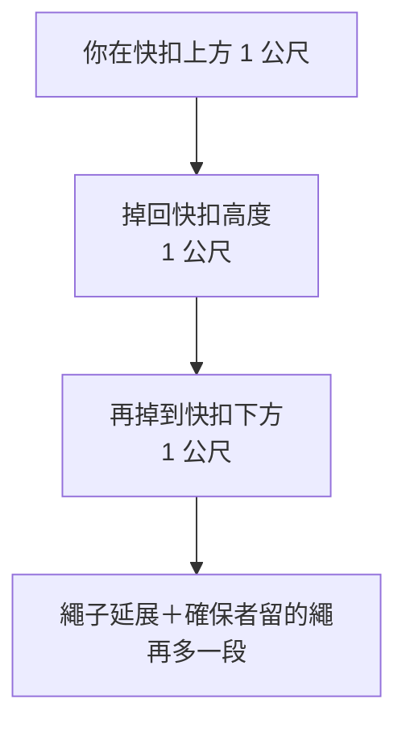

> 🌏 [English version](/posts/climbing/2026-10-17-gym-lead-climbing-en)

上攀爬熟了，你在岩館看到隔壁的人拖著繩子往上爬，邊爬邊把繩子掛進牆上的快扣。那就是先鋒（lead climbing）。想跟著學，櫃檯會再問一次：「你有先鋒確保卡嗎？」

這篇寫給已經會上攀確保的人。上攀確保還不熟的話，先讀[岩館上攀確保怎麼學](/posts/climbing/2026-10-17-gym-top-rope-belay)。這篇會講先鋒多了哪些事：攀爬者怎麼掛快扣、確保者怎麼給繩和站位、墜落為什麼比較長、怎麼練、在台灣怎麼考。學會之後想去戶外，接著讀[第一條戶外運攀先鋒](/posts/climbing/2026-10-17-first-outdoor-sport-lead)。

**這篇一樣不能取代上課。** [REI 的先鋒確保教學](https://www.rei.com/learn/expert-advice/belay-lead-climber.html)開頭就說，岩館會要求你先通過先鋒確保考試，文章只是補充。

## 先鋒和上攀差在哪

上攀的繩子先掛在頂端固定點，再垂下來綁在你身上。你在任何高度放手，都只會往下掉一小段。

先鋒時，繩子從確保者直接連到你，沿路掛進一支支快扣。[REI 的先鋒入門](https://www.rei.com/learn/expert-advice/lead-climbing-basics.html)用一個例子說明差別：你在最後一支快扣上方 3 呎（約 90 公分）放手，至少會掉 6 呎，再加上繩子延展的長度。

所以先鋒多出兩個工作：

- **攀爬者**要在對的時機、用對的方向把繩子掛進快扣。
- **確保者**大部分時間在給繩，要給得夠快，又不能給太多。

## 攀爬者：掛快扣

### 什麼時候掛

[德國阿爾卑斯協會（DAV）的岩館確保證教材](https://alpenverein.de/files/2409-indoor-klettern-basics-english_ol.pdf)把先鋒掛快扣的規則寫得很直接：

- **永遠在穩定的姿勢掛。** 先找到好站的腳點，非掛繩的那隻手抓牢。
- **掛快扣的窗口在髖部到額頭之間。** REI 的說法是快扣在頭和腰之間時掛，系統裡多出來的繩最少。
- **不要伸直手臂勉強去掛。** 身體拉太開，腳點的摩擦力會不夠而滑掉。
- **前五支快扣掛的時候絕對不能掉。** 這一段如果掛繩失敗，手上拉著一大段繩，可能直接掉到地面。
- **每一支都要掛。** DAV 提醒任何時候都可能墜落，例如岩點鬆脫。

掛繩時可以喊「Rope」或「繩」，讓確保者知道要給一大段繩。

### 掛的方向：從岩壁那側穿進

DAV 的要求是快扣要「in line、untwisted」：繩子從岩壁那側穿進鉤環，往你這側出來。[REI 的掛快扣教學](https://www.rei.com/learn/expert-advice/clip-quickdraws.html)和 [Petzl 的快扣技術說明](https://www.petzl.com/us/en/sport/tech-tips/basic-techniques/positioning-the-quickdraw-and-clipping-the-rope/Escalade-falaise-Positionnement-de-la-degaine-et-C_SPO_a77w0000000Kyn8AAC.html)再加一條：掛繩那個鉤環的開口，要背對你接下來要爬的方向。這樣墜落時繩子壓在鉤環的背脊上，不會壓到門。

### 三種常見錯誤

| 錯誤 | 長什麼樣子 | 後果 |
|---|---|---|
| 反掛 | 繩子從外側往岩壁方向穿過鉤環 | 墜落時繩子可能壓開鉤環的門而脫出 |
| Z 字掛 | 抓到上一支快扣下方的繩去掛下一支 | 繩阻大到爬不太動；墜落時剛掛的那支接不到你，掉得更遠 |
| 繩在腿後 | 繩子跑到小腿或大腿後面 | DAV：墜落時可能被翻成頭下腳上、撞到頭，還會被繩子燙傷 |

REI 說 Z 字掛多半會因為繩阻很快發現；沒發現而繼續爬的話，接住你的是下面那一支，墜落會比必要的長。繩子跑到腿後時，[REI 的墜落教學](https://www.rei.com/learn/expert-advice/climbing-how-to-fall.html)要你把腳跨回繩子外側，讓繩子保持在你和岩壁之間。

### 兩種掛繩手法

REI 教兩種手法，依鉤環開口朝哪邊、用哪隻手來選：

- **捏掛（pinch clip）**：繩子跨在食指上，拇指頂住鉤環背脊穩住它，食指把繩子推進門。
- **扣掛（snap clip）**：中指勾住鉤環穩住，拇指和食指捏著繩子推進門。

不用兩種都很快，先練到其中一種左右手都順。

**今晚就能做的動作**：在家門把上掛一支快扣，左右手、開口朝左朝右各掛二十次。掛完每次都低頭看一眼：繩子是不是從「牆」那側穿出來。

### 進岩館前再確認一件事

DAV 規定先鋒時**一定要直接把繩子綁在吊帶上**。它的教材說，上攀在某些條件下可以用自鎖鉤環扣繩，先鋒時禁止。

## 確保者：給繩、站位、接墜

### 和上攀相同的原則

REI 列的四條原則，上攀、先鋒都一樣：

- 制動手永遠握著繩子。
- 只有在繩子已經鎖在制動位置時，才滑動手的位置。
- 制動手維持在最有力的自然位置。
- 注意力一直放在攀爬者身上，同時留意周圍。

### 掛到第一支快扣之前：spot

攀爬者還沒掛第一支快扣時，繩子接不住任何墜落。這時確保者的工作是 spot（保護抱石墜落）：

- [Petzl 的起攀 spot 說明](https://www.petzl.com/us/en/sport/tech-tips/basic-techniques/spotting-and-belaying-at-the-start-of-the-route/Escalade-parer-en-debut-de-voie_SPO_a77w0000000GnbDAAS.html)：spot 不是把人接住，是引導他用腳落地、不要往後翻。雙手瞄準攀爬者的骨盆和上背。
- 確保器先裝好，留夠繩讓攀爬者掛到第一支。
- DAV：先清掉墜落區的東西，兩人先講好往哪一側掛，確保者照著站。

### 掛到第一支之後：站位

DAV 寫的位置是：**靠近岩壁、稍微偏到第一支快扣下方的一側**。理由有三個：

- **離牆近，繩子少。** Petzl 說確保者要夠靠近岩壁，攀爬者和你之間的繩子才少，降低撞地的機會。
- **不在攀爬者正下方。** 避免他掉下來撞到你。
- **跟著動。** [Petzl 的先鋒確保要點](https://www.petzl.com/us/en/sport/tech-tips/basic-techniques/belaying-a-leader-climber--vigilance-anticipation-and-mobility/Escalade---vigilance-et-anticipation_SPO_a77w0000000GnbIAAS.html)建議攀爬者掛快扣時往牆靠近一步，掛完再退回原位；很少有情況需要站離牆超過 2 公尺。

REI 補充：站太遠，墜落時你會被拉著盪向牆，扭到腳踝；每掛一支快扣，都要重新對齊拉力方向。

### 給繩的節奏

REI 教的先鋒給繩動作是：

1. 引導手在確保器正上方握住繩子。
2. 引導手把繩子往上送，制動手同時被帶向確保器。
3. 引導手滑回確保器上方，重新握住。
4. 制動手滑回遠離確保器的位置，重新握住。

攀爬者喊「Clipping」時，快速往上拉出一段繩，可以同時往前跨一步，但小心不要絆倒。

### 繩要留多少

這是先鋒確保最難拿捏的地方。REI 的看法：

- 繩子從確保器出來拉得筆直：**給太少**，會妨礙攀爬，甚至把人從牆上扯下來。
- 繩子在確保器下方垂下一個弧：**給太多**，墜落會又長又痛。

DAV 給了更具體的數字，也列在它的先鋒確保證考試表上：

- **靠近地面時不留多餘的繩，至少到第五支快扣都要這樣。**
- **離地夠高、沒有撞地風險後，大約留 20–50 公分。**
- 攀爬者要掛繩時，快速給出他需要的繩。

**今晚就能做的動作**：下次在岩館看別人先鋒確保，盯著確保器下方那段繩。攀爬者在第三支、第八支快扣時，各估一次垂下來的長度，跟 20–50 公分比一比。

### 接墜：硬確保還是軟確保

[Petzl 的接墜說明](https://www.petzl.com/us/en/sport/tech-tips/basic-techniques/stopping-a-climbing-fall/Escalade-arreter-une-chute_SPO_a77w0000000GnayAAC.html)第一句跟上攀一樣：握緊制動端、往下拉。絕對不要去抓攀爬者那一端，絕對不要放開制動端。

接下來是先鋒才有的選擇。REI 把它分成兩種：

| | 硬確保（hard catch） | 軟確保（soft catch） |
|---|---|---|
| 什麼時候用 | 攀爬者墜落路徑上有岩階、大型岩點，或還可能撞地 | 墜落路徑下方是空的，例如屋簷下或垂直牆上段 |
| 確保者怎麼做 | 往牆靠近一兩步，像上攀一樣用力制動 | 留在原位或退回原位，留出移動空間 |
| 墜落當下 | 會被往牆拉，膝蓋彎曲、用腳頂住牆 | 往牆的方向小跳，讓拉力把你帶起來，用腳接觸牆 |

Petzl 說好的確保者知道什麼時候該軟、什麼時候該硬。墜落發生時沒有時間想，所以要一直預想「他現在掉下來會撞到什麼」。

軟確保也有前提。Petzl 提醒確保者會被拉向牆，所以腳下要清空、不能赤腳、繩上不能有結。

### 體重差

DAV 的先鋒確保建議是兩人體重最好相近。攀爬者比確保者重 10 公斤以上，就要採取對應措施。具體做法要問教練。REI 提到的一種做法是地面固定點：攀爬者重很多時，確保者把自己固定在地面上。

## 為什麼先鋒墜落比較長

[英國登山協會（BMC）的墜落文章](https://services.thebmc.co.uk/climb-skills-falling-down)把它講成一句話。加上繩子延展和系統裡的鬆弛，你掉到最後一個保護點下方的距離，可能是你在它上方高度的兩倍。

拆開來看，一次先鋒墜落的長度來自四段：

1. 你在快扣上方的高度。
2. 掉回快扣之後，再掉同樣一段到快扣下方。
3. 繩子延展。
4. 確保者留的那 20–50 公分，以及軟確保時多出的位移。

前兩段由攀爬者控制：在掛快扣窗口內掛，不爬太高才掛。後兩段由確保者控制。BMC 的提醒是：「你永遠會掉得比你以為的遠。」

## 先鋒墜落怎麼練

先鋒墜落要練，因為攀爬者要學會怎麼掉，確保者要學會怎麼接。[REI 的先鋒入門](https://www.rei.com/learn/expert-advice/lead-climbing-basics.html)說，在低風險的位置做受控的墜落，可以建立信心，也是確保者練習管理繩子和接墜的機會。

### 在哪裡練

- **BMC**：選一個你完全信任的確保者，在不會撞到東西、固定點可靠的地方練；岩館可以，但先問工作人員。
- **REI**：至少離地 30 呎（約 9 公尺），讓繩子的延展吸收衝擊，也確定掉不到地面。
- **Petzl**：在不同情境練習接墜，或接受專業訓練。

### 由小到大

BMC 的練習順序：

1. 在快扣下方坐進繩子。
2. 在快扣正上方放手。
3. 在快扣上方一公尺左右放手。

每一階段都練到不慌再往上加。

### 怎麼掉

DAV、REI、BMC 的建議大致一致：

- **喊出來。** 能喊就喊「Falling」或「掉」，讓確保者反應快一點。
- **不要抓。** 不要抓繩子，也不要抓快扣，手指可能嚴重受傷。
- **不要用力推牆。** DAV 說輕輕推離、身體平平地掉；REI 說除非要避開障礙，否則不要推，推太遠盪回來撞得更重。
- **四肢準備好。** 身體保持直立、軀幹出力，碰到牆前把腳和手往前伸，用腳接觸牆。
- **吐氣。** REI 說吐氣會讓你反射性地放鬆。

**今晚就能做的動作**：下次去岩館，找一位有先鋒確保卡、你也信任的人。先問過教練或館方，只做第一步：爬到夠高的位置，在快扣正下方坐進繩子三次。

## 在台灣怎麼學、怎麼考

台灣的岩館先鋒卡和上攀卡一樣，**各館自己開課、自己考**，跨館承認與否由各館決定。以下兩個例子在 2026-10-17 查過官網：

- **[原岩中和店進階確保課（先鋒確保＆先鋒攀登）](https://tupclimbing.tw/course/zhonghe/360)**：18 歲以上，一期 6 堂、NT$7,500。開課前先考上攀確保；不過關要先上一堂上攀確保複習課。結訓考先鋒確保測驗，通過發原岩的先鋒確保卡。
- **[艾格探險先鋒攀登課](https://www.adventuretaiwan.com/product/lead-climbing/)**：在 Camp 4 攀岩館北投運動中心館上，兩次課、NT$4,500。先修是艾格的頂繩攀登課，能爬 5.8 以上更好。內容包含掛快扣、先鋒墜落、抱石確保（spot）與動態確保。結訓一週後可以考 Camp 4 的先鋒攀登安檢卡。

想拿跨館的證明，最接近全國性的是中華民國山岳協會的 CBT（攀登確保能力檢測）。依[原岩 2023 年的 CBT 公告](https://tupclimbing.tw/news/announcement/232)，CBT 考上攀確保、先鋒確保，還要自己先鋒爬一條 5.7–5.8 的路線。路線會先設好，考前可以來練。CBT 的先鋒部分，正好是這篇的範圍。

**今晚就能做的動作**：問你常去的岩館兩件事。先鋒確保課要先考上攀確保嗎？別館的先鋒卡在這裡能不能用？

對照德國：[DAV 的先鋒確保證考試表](https://alpenverein.de/files/2409-indoor-klettern-basics-english_ol.pdf)逐項打勾，可以直接拿來當自我檢查清單：

- 考慮體重差
- 第一支快扣後注意站位
- 離地近時不留多餘繩，離地夠高後留約 20–50 公分
- 在穩定姿勢掛快扣，每一支都掛
- 沒有繩在腿後

## 練習題：五個情境

答案在每題下方，先自己想再看。想練更多題，可以玩 [nobodyclimb 的繩索系統練習：運動攀登先鋒](https://nobodyclimb.cc/games/rope-system/learn/sport-lead)。

**1. 你爬到第三支快扣，下一支在頭頂上方一個手臂伸直還差一點的位置。腳點很小。**

答案

先不要伸手勉強掛。DAV 要求在穩定姿勢掛、避免伸直手臂去掛，而且前五支快扣掛繩失敗可能直接撞地。先往上找一個好站的腳點，讓快扣落在髖部到額頭之間再掛；找不到就退回原位，請確保者收緊後再想辦法。

**2. 掛完第六支，你發現繩子是從外面往岩壁方向穿過鉤環的。**

答案

這是反掛。墜落時繩子可能壓開鉤環的門而脫出。在穩定的位置把繩子取出，重新從岩壁那側穿進、往你這側出來再掛。

**3. 你確保的朋友在第二支快扣，確保器下方的繩垂了大約半公尺。**

答案

太多。DAV 要求靠近地面時不留多餘繩，至少到第五支快扣都要這樣，因為這段高度掉下來可能撞地。收掉多餘的繩，人往牆靠近；20–50 公分是離地夠高之後的留法。

**4. 朋友在一段大屋簷的上緣，下方全是空的，他喊「Falling」。你該怎麼接？**

答案

這是可以軟確保的情境：墜落路徑下方沒有障礙物。照 REI 與 Petzl 的做法，制動手往下拉、握緊，順著拉力往牆小跳一下，讓制停變柔和，用腳接觸牆。如果他下方是岩階或還在第二、三支快扣，就要改成硬確保。

**5. 你 55 公斤，想確保一位 72 公斤的朋友先鋒。**

答案

差了 17 公斤，超過 DAV 建議要採取措施的 10 公斤。先問館方或教練，例如用地面固定點把你固定住，或請體重相近的人確保。沒有人教過你怎麼做，就不要自己試。

## 下一步

拿到先鋒卡、在岩館先鋒得穩定之後，就可以準備到戶外爬。戶外多了自己掛快扣、第一支快扣前的 stick clip、繩長與頂端操作，這些寫在[第一條戶外運攀先鋒](/posts/climbing/2026-10-17-first-outdoor-sport-lead)。想先看戶外攀岩的全貌，可以讀[運動攀登與傳統攀登總覽](/posts/climbing/2026-10-17-sport-vs-trad-overview)。

## 參考資料

- [Indoor-Climbing Basics：DAV 確保證教材英文版（Deutscher Alpenverein，2024）](https://alpenverein.de/files/2409-indoor-klettern-basics-english_ol.pdf)
- [How to Belay a Lead Climber（REI Expert Advice）](https://www.rei.com/learn/expert-advice/belay-lead-climber.html)
- [Lead Climbing Basics（REI Expert Advice）](https://www.rei.com/learn/expert-advice/lead-climbing-basics.html)
- [Lead Climbing: How to Clip Quickdraws（REI Expert Advice）](https://www.rei.com/learn/expert-advice/clip-quickdraws.html)
- [Lead Climbing: How to Fall（REI Expert Advice）](https://www.rei.com/learn/expert-advice/climbing-how-to-fall.html)
- [Climb skills: Falling down（BMC）](https://services.thebmc.co.uk/climb-skills-falling-down)
- [Stopping a climbing fall（Petzl）](https://www.petzl.com/us/en/sport/tech-tips/basic-techniques/stopping-a-climbing-fall/Escalade-arreter-une-chute_SPO_a77w0000000GnayAAC.html)
- [Belaying a leader climber: vigilance, anticipation and mobility（Petzl）](https://www.petzl.com/us/en/sport/tech-tips/basic-techniques/belaying-a-leader-climber--vigilance-anticipation-and-mobility/Escalade---vigilance-et-anticipation_SPO_a77w0000000GnbIAAS.html)
- [Spotting and belaying at the start of the route（Petzl）](https://www.petzl.com/us/en/sport/tech-tips/basic-techniques/spotting-and-belaying-at-the-start-of-the-route/Escalade-parer-en-debut-de-voie_SPO_a77w0000000GnbDAAS.html)
- [Positioning the quickdraw and clipping the rope（Petzl）](https://www.petzl.com/us/en/sport/tech-tips/basic-techniques/positioning-the-quickdraw-and-clipping-the-rope/Escalade-falaise-Positionnement-de-la-degaine-et-C_SPO_a77w0000000Kyn8AAC.html)
- [原岩中和店：進階確保課（先鋒確保＆先鋒攀登）](https://tupclimbing.tw/course/zhonghe/360)
- [艾格探險：先鋒攀登課](https://www.adventuretaiwan.com/product/lead-climbing/)
- [原岩中和店：中華山協 CBT 攀登確保能力檢測（2023 公告）](https://tupclimbing.tw/news/announcement/232)
- [nobodyclimb 繩索系統練習：運動攀登先鋒](https://nobodyclimb.cc/games/rope-system/learn/sport-lead)
- [岩館上攀確保怎麼學：八字結、夥伴互檢、收繩、口令與下放](/posts/climbing/2026-10-17-gym-top-rope-belay)
