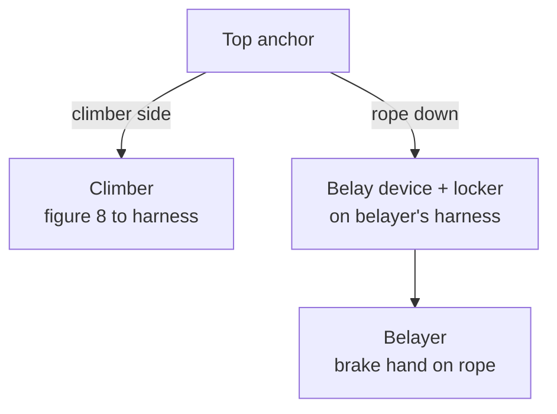

> 🌏 [中文版](/posts/climbing/2026-10-17-gym-top-rope-belay)

You did a top-rope intro session, the instructor belayed you, and you loved it. Next time you want to bring a friend, and the front desk asks first: "Do you have a belay card?"

This post is for that step: what top-rope belaying actually involves, why each step is done the way it is, and how to learn and get tested in Taiwan. If you have never climbed, start with [Rock Climbing for Beginners: Bouldering, Top-Rope, and Lead](/posts/climbing/2026-10-08-climbing-beginner-guide-en).

To be clear up front: **this post does not replace a class.** [REI's belay guide](https://www.rei.com/learn/expert-advice/belay.html) opens by saying belaying is one of the first skills climbing classes teach, and "instruction from a qualified teacher is essential." Reading helps you understand what each move is for; the moves themselves have to be practiced in front of an instructor until they are right.

## The top-rope system: four parts, two people

In top-rope climbing, the rope already runs through an anchor at the top of the wall. One end is tied to the climber; the other runs through a belay device on the belayer's harness. As the climber moves up, the belayer takes in slack. When the climber lets go, the belayer locks the rope and the climber stays put.

If any one link fails, the climber can hit the ground:

- **Knot**: the climber ties the rope to the harness with a figure 8.
- **Harness**: both people wear it correctly and buckle it.
- **Belay device and locking carabiner**: the rope runs through the device the right way and the carabiner is locked.
- **Rope end**: the belayer's end is knotted or fixed to the rope bag, so a rope that is too short cannot slip through the device.

The [German Alpine Club (DAV) belay certificate brochure](https://alpenverein.de/files/2409-indoor-klettern-basics-english_ol.pdf) turns these four points into a fixed pre-climb check, which the next section walks through.

## Before you climb: figure 8 and the four-point check

### The figure 8

The tie-in knot is the figure 8 follow-through: tie a figure 8 in the rope, pass the tail through both tie-in points on the harness, then retrace the original eight. [REI's climbing knots guide](https://www.rei.com/learn/expert-advice/climbing-knots.html) gives two ways to check it yourself:

- Dress the knot so every strand runs parallel without crossing; you should be able to count five pairs of parallel strands.
- Leave at least six inches (about 15 cm) of tail. The DAV minimum is 10 cm.

Which tie-in points to use and how is set by your harness manual. The other common tie-in knot is the double bowline, which is easier to untie, but REI notes it must be backed up with a double overhand. As a beginner, get the figure 8 solid first.

### The four-point check

The DAV rule is that **the climber and the belayer are both responsible for safety, and both check these four points before every climb**, top-rope or lead:

1. **Harness buckles**: the harness sits above the hip bones and is properly fastened.
2. **Tie-in point and knot**: the figure 8 is in the right place, tightened, with at least 10 cm of tail.
3. **Carabiner and belay device**: the rope is threaded correctly, the device is clipped to the harness correctly, and the carabiner is locked.
4. **Knot at the rope end**: the belayer's end is knotted or fixed to the rope bag, and the rope is long enough to lower.

REI's checklist adds a "command check": run through the calls you will use so you both agree on the words.

**Something you can do tonight**: point at each item and say it out loud, for example "buckle done, five pairs in the eight, locker locked, end knotted." A silent glance is how things get missed.

## Taking in slack: the brake hand never leaves the rope

### Stance

REI describes a good belay stance in three ways:

- **Athletic**: non-dominant foot forward, knees bent, relaxed but ready.
- **Position**: not too far from the wall, and one step to the side of the climber's line, so a falling climber or rock does not land on you.
- **Organized**: the rope on the ground is neatly stacked so it does not tangle while you belay.

### What each hand does

- **Brake hand**: your dominant hand, about six inches (15 cm) below the device. Too close, and a hard fall can pinch your hand and make you let go.
- **Guide hand**: the other hand on the climber's strand, roughly at head height.

The first of REI's belay principles is written in capitals: "Always keep your brake hand(s) on the rope. ALWAYS." The DAV says the same: one hand always holds the brake side of the rope.

### PBUS in four steps

On top-rope, most of the belayer's time goes into taking in slack. REI teaches PBUS:

1. **Pull**: pull down with the guide hand while lifting the brake strand up and out, taking in slack.
2. **Brake**: as the guide hand nears the device, flip the brake strand down to lock the rope.
3. **Under**: move the guide hand onto the brake strand below the brake hand and grip it as a temporary brake hand.
4. **Slide**: loosen the original brake hand without opening your fingers, slide it back up to about six inches below the device, and grip again.

Then return the guide hand to the top and repeat. REI's advice is to keep the cycles short and quick, and when the climber pauses, you pause in the brake position.

The whole point of the sequence: **at every moment, one hand is holding the brake strand.**

### Weight difference

The DAV sets a clear limit for top-rope: the climber should weigh no more than 1.5 times the belayer, for example a 90 kg climber with a 60 kg belayer at most. Near the ground, keep the rope tighter, because rope stretch can let the climber touch down.

## Calls: say them loudly, then act

[REI's belay guide](https://www.rei.com/learn/expert-advice/belay.html) lists a common set of calls. Chinese or English both work; what matters is that you agree on them before leaving the ground.

| Who | Call | Meaning | Response |
|---|---|---|---|
| Climber | On belay? | Are you ready to belay me? | Belay on. (Slack is gone, I'm ready.) |
| Climber | Climbing. | I'm starting to climb. | Climb on. |
| Climber | Slack! | Give me a little rope. | Pay out, pause, see if they ask again |
| Climber | Up rope! | Too much slack, take some in. | Take in slack |
| Climber | Take! / Tension! | Pull it tight, I want to hang. | Take in all slack, hold, answer "Got you." |
| Climber | Lower me. | I'm done, let me down. | Both hands to the brake side, answer "Lowering." |
| Climber | Off belay. | I'm standing safely on the ground. | Pay out slack, answer "Belay off." |
| Anyone | Rock! | Something is falling. | Look down, not up, so your helmet protects you |
| Climber | Falling! | I'm coming off. | Brake immediately |

REI is blunt about volume: miscommunication can be as consequential as any other system failure. Gyms are loud, and two people on neighboring routes shouting "Take" at once is common. The DAV's answer is to keep eye contact and call each other's names if needed.

## Lowering: only once they are sitting

At the top, the DAV sequence is:

1. The climber calls "Take."
2. The belayer pulls the rope tight.
3. The climber sits back into the harness with full weight on the rope, then calls "Lower."
4. The belayer starts lowering only once the climber is sitting and the call has been heard.

While lowering, REI has the belayer keep both hands on the brake strand and let the rope feed slowly through the device:

- **Steady pace**: adjust only when the climber asks.
- **Slow at obstacles**: pause at roofs and big holds so the climber can get past.
- **Watch the ground**: the DAV reminds you to check the landing zone for people and the wall for other climbers.
- **Slow near the ground**: let the climber land on both feet, not on their backside.

Only after the climber is standing and calls "Off belay" does the belayer take the rope out of the device.

## Your first fall practice

Once you can belay, one thing is worth doing in front of an instructor: let the climber actually fall. The DAV includes fall practice in the top-rope certificate course, so climbers get used to falling and belayers get used to catching. The setup: rope through the top anchor, a vertical to slightly overhanging wall without big ledges or volumes, and a third person backing up the brake strand.

The DAV progression has three stages:

1. At a set height, the climber sits into a slightly tensioned rope without calling "Take."
2. With a little less tension (but no slack), the climber lets go on their own.
3. The climber lets go mid-move, choosing how far to fall, up to one quickdraw's distance.

Top-rope falls are short to begin with. After one practice, climbers commit more on hard moves, and belayers know what catching a person feels like.

## Belay devices: ATC and GriGri

The two device types you will see most in gyms:

- **Tube-style devices** (such as the Black Diamond ATC): the friction comes entirely from the brake hand pulling the rope down.
- **Assisted-braking devices** (such as the Petzl GRIGRI): they pinch the rope on their own in a fall.

The DAV recommends assisted-braking devices and asks that the carabiner match the device, following the manufacturer's recommendation. But assisted is not automatic: with a GriGri, the brake hand still never leaves the rope.

REI adds a reminder that is easy to skip: if you switch to a different device, you have to learn and practice it again. Basic top-rope belaying is similar across most devices, but the details differ, and lead belaying differs even more.

## Learning and testing in Taiwan

Taiwan has **no national gym belay card**. Each gym runs its own course and test and issues its own belay card (確保證 or 安檢卡); whether another gym accepts it is up to that gym. Two examples (checked on the official sites on 2026-10-17, pages in Chinese):

- **[T-UP Zhonghe beginner belay course](https://tupclimbing.tw/course/zhonghe/358)**: 5 sessions for NT$5,500, covering top-rope belaying with an ATC and a GriGri. Finishing the course gets you a T-UP belay card.
- **[Adventure Taiwan top-rope course](https://www.adventuretaiwan.com/product/top-roping/)**: 6 hours for NT$3,900, covering knots, belaying, calls and gear checks. A week after the course you can take the top-rope belay test for the Camp 4 gym.

The closest thing to a national credential is the CBT (Climbing Belay Test) run by the Chinese Taipei Alpine Association ([Taiwan's member federation listed by World Climbing](https://www.ifsc-climbing.org/national-federations/nf-tpe/tpe-info)). According to [T-UP's 2023 CBT announcement](https://tupclimbing.tw/news/announcement/232), the CBT covers top-rope belaying, lead belaying, rope handling, and leading a 5.7–5.8 route yourself, with a registration fee of NT$1,200. It is also the prerequisite for the federation's C-level coach, judge and routesetter courses. Because it includes leading, it is not a top-rope-stage test; get top-rope belaying solid first.

For comparison, the DAV issues two belay certificates, top-rope (Toprope) and lead (Vorstieg), introduced in 2005 with more than 100,000 issued since. The DAV itself calls it "not a licence"; it certifies belaying technique, and climbing ability is secondary. The top-rope card / lead card split at Taiwanese gyms is almost identical; the difference is that Germany uses one standard test protocol.

**Something you can do tonight**: ask your usual gym three things. Do they run a belay course? Is their belay card accepted at other gyms? Can someone without a card belay under the supervision of a card holder?

## Practice: five scenarios

Answers are under each question; think first, then open. For more questions, try [nobodyclimb's rope system practice: belaying basics](https://nobodyclimb.cc/games/rope-system/learn/sport-belay) (in Chinese).

**1. Your friend ties a figure 8 with about 5 cm of tail. Ready to climb?**

Answer

No. REI asks for at least six inches (about 15 cm), and the DAV minimum is 10 cm. Retie it, leaving more tail, and dress it again.

**2. Halfway up, the climber stops to look at the next move. Where should your hands be?**

Answer

In the brake position: brake hand below the device, rope pulled down. REI's rule is that when the climber pauses, you pause, in the brake position.

**3. You weigh 55 kg and your friend weighs 90 kg. They want you to belay them on top-rope.**

Answer

That exceeds the DAV limit: the climber should not weigh more than 1.5 times the belayer, so about 82 kg for a 55 kg belayer. Find a belayer closer in weight, or ask gym staff for help.

**4. At the top, your friend calls "Lower" but is still holding the holds and has not sat back.**

Answer

Do not lower. The DAV requires the climber to sit fully into the rope before the "Lower" call is acted on. Call back "Take?", pull the rope tight, and wait until they are sitting.

**5. Belaying with a GriGri while the climber rests, you want a free hand for a drink.**

Answer

No. A GriGri assists braking but is not automatic; the brake hand still stays on the rope. Drink once the climber is back on the ground, or ask someone else to take over the belay.

## What's next

Once top-rope belaying is solid and you have your gym's top-rope card, the usual next step is gym lead climbing: clipping quickdraws as you go, longer falls, and a belayer who knows how to pay out and give a soft catch. That will be the next post.

For the bigger picture of climbing outdoors, read the "Before you go outdoors" section of [Rock Climbing for Beginners](/posts/climbing/2026-10-08-climbing-beginner-guide-en). For books to go deeper, see [A Knowledge Map of Climbing Books](/posts/climbing/2026-06-20-climbing-books-knowledge-map-en).

## References

- [Indoor-Climbing Basics: DAV belay certificate brochure, English edition (Deutscher Alpenverein, 2024)](https://alpenverein.de/files/2409-indoor-klettern-basics-english_ol.pdf)
- [How to Belay (REI Expert Advice)](https://www.rei.com/learn/expert-advice/belay.html)
- [Climbing Knots (REI Expert Advice)](https://www.rei.com/learn/expert-advice/climbing-knots.html)
- [T-UP Zhonghe: beginner belay course (top-rope)](https://tupclimbing.tw/course/zhonghe/358) (in Chinese)
- [Adventure Taiwan: top-rope course](https://www.adventuretaiwan.com/product/top-roping/) (in Chinese)
- [T-UP Zhonghe: CTAA Climbing Belay Test announcement (2023)](https://tupclimbing.tw/news/announcement/232) (in Chinese)
- [Chinese Taipei Alpine Association member page (World Climbing)](https://www.ifsc-climbing.org/national-federations/nf-tpe/tpe-info)
- [nobodyclimb rope system practice: belaying basics](https://nobodyclimb.cc/games/rope-system/learn/sport-belay) (in Chinese)
- [Rock Climbing for Beginners: Bouldering, Top-Rope, and Lead, and Where to Start](/posts/climbing/2026-10-08-climbing-beginner-guide-en)
- [A Knowledge Map of Climbing Books](/posts/climbing/2026-06-20-climbing-books-knowledge-map-en)
