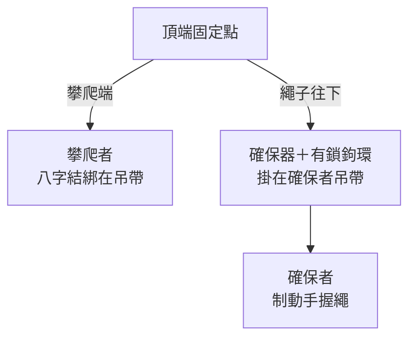

> 🌏 [English version](/posts/climbing/2026-10-17-gym-top-rope-belay-en)

上了一次岩館的上攀體驗，教練幫你確保、你爬得很開心。下一次想自己帶朋友去，櫃檯會先問一句：「你有確保證嗎？」

這篇寫給要跨過這一步的人：上攀確保到底要會哪些事、每一步為什麼這樣做、在台灣怎麼學和怎麼考。還沒爬過的話，先讀[攀岩入門：抱石、上攀、先鋒差在哪](/posts/climbing/2026-10-08-climbing-beginner-guide)。

先講清楚：**這篇不能取代實際上課。** [REI 的確保教學](https://www.rei.com/learn/expert-advice/belay.html)開頭就說，確保是攀岩課最早教的基礎技能，「instruction from a qualified teacher is essential」。文章能讓你上課時知道每個動作在做什麼，手上的動作還是要在教練面前練到正確為止。

## 上攀系統：四樣東西、兩個人

上方確保（台灣岩館俗稱「上攀」）的繩子預先掛在牆頂的固定點，一端綁在攀爬者身上，另一端穿過確保者吊帶上的確保器。攀爬者往上爬，確保者把多出來的繩子收掉；攀爬者一放手，確保者把繩子鎖住，人就停在原地。

這個系統裡任何一環出錯，人就可能落地：

- **繩結**：攀爬者用八字結把繩子綁在吊帶上。
- **吊帶**：兩人都要穿好、扣好。
- **確保器與有鎖鉤環**：繩子要穿對方向，鉤環要鎖上。
- **繩尾**：確保者那一端要打結或固定在繩袋上，繩子不夠長時才不會從確保器滑出去。

[德國阿爾卑斯協會（DAV）的確保證教材](https://alpenverein.de/files/2409-indoor-klettern-basics-english_ol.pdf)把這四點列成開爬前的固定檢查，下一節會照著做一次。

## 開爬前：綁八字結，做四點互檢

### 八字結

綁繩用的是「八字結」（figure 8 follow-through）：先在繩子上打一個八字，把繩尾穿過吊帶上下兩個綁繩點，再沿著原本的八字反穿回去。[REI 的繩結教學](https://www.rei.com/learn/expert-advice/climbing-knots.html)給了兩個自己檢查的方法：

- 穿好之後整理繩結，讓每一股繩平行、不交叉，數得出五組平行的繩線。
- 繩尾至少留 6 吋（約 15 公分）。DAV 的下限是 10 公分。

穿哪兩個點、穿幾圈，以你吊帶的說明書為準。另一種常見的綁繩結是雙套稱人結（double bowline），比較好解開，但 REI 提醒它一定要再打一個雙重單結（double overhand）當備份。初學者先把八字結練熟就好。

### 四點互檢

DAV 的規定是，**攀爬者和確保者都要負責安全，每次開爬前兩人都要檢查這四點**，不管是上攀還是先鋒：

1. **吊帶扣環**：吊帶在髖骨上方，扣環確實扣好。
2. **綁繩點與繩結**：八字結綁在正確的位置、確實拉緊，繩尾至少 10 公分。
3. **鉤環與確保器**：繩子穿對確保器，確保器正確掛在吊帶上，鉤環已上鎖。
4. **繩尾的結**：確保者那端的繩尾打了結，或固定在繩袋上；繩子長度夠不夠下放。

REI 的清單多了一項「口令確認」：兩人開爬前先把要用的口令講一遍，確定用詞一致。

**今晚就能做的動作**：互檢時用手指著每一點、說出聲音，例如「吊帶扣好、八字結數到五組、鉤環鎖了、繩尾有結」。默默看一眼最容易漏。

## 收繩：制動手永遠不離開繩子

### 站位

REI 對確保站位的要求有三個方向：

- **身體**：非慣用腳在前、膝蓋微彎，全身放鬆但隨時能出力。
- **位置**：離牆不要太遠，也不要站在攀爬者正下方，往旁邊站一步，避開墜落的人和落石。
- **繩子**：地上的繩子整理成一堆，確保時才不會打結。

### 兩隻手各做什麼

- **制動手**：慣用手，握在確保器下方約 15 公分。太靠近確保器，墜落時手可能被夾到而放開繩子。
- **引導手**：另一隻手握在攀爬者那一段繩子上，大約頭頂高度。

REI 的確保原則第一條：「Always keep your brake hand(s) on the rope. ALWAYS.」結尾的 ALWAYS 還特別大寫。DAV 的說法一樣：一隻手永遠握著制動端的繩子。

### PBUS 四步收繩

攀爬者往上爬時，確保者大部分時間都在收繩。REI 教的是 PBUS 四步：

1. **Pull 拉**：引導手往下拉，制動手同時把繩子往上、往外提，收掉多的繩。
2. **Brake 制動**：引導手接近確保器時，制動手把繩子往下壓，鎖住繩子。
3. **Under 換到下方**：引導手移到制動手下方，握住制動端，暫時當制動手。
4. **Slide 滑回**：原本的制動手放鬆但不鬆開手指，沿著繩子滑回確保器下方約 15 公分，重新握緊。

然後引導手回到上方，重複。REI 的建議是動作要短而快；攀爬者停下來，你也停在「制動」的姿勢。

這套步驟的重點只有一個：**整個收繩過程中，總有一隻手握著制動端。**

### 體重差

DAV 對上攀的體重差有明確上限：攀爬者的體重不要超過確保者的 1.5 倍，例如確保者 60 公斤、攀爬者最多 90 公斤。攀爬者靠近地面時，繩子要收得比較緊，因為繩子會延展，太鬆可能讓人碰到地面。

## 口令：講大聲，講完再動

[REI 的確保教學](https://www.rei.com/learn/expert-advice/belay.html)列了一組常用口令。用中文或英文都可以，重點是開爬前兩人對過一次。

| 誰說 | 口令 | 意思 | 對方的回應 |
|---|---|---|---|
| 攀爬者 | On belay? | 你準備好確保我了嗎？ | Belay on.（繩子收好了，可以了） |
| 攀爬者 | Climbing. | 我要開始爬了。 | Climb on. |
| 攀爬者 | Slack! | 給我一點繩。 | 給繩，停一下看還要不要 |
| 攀爬者 | Up rope! | 繩子太鬆，收一點。 | 收繩 |
| 攀爬者 | Take!／Tension! | 收緊，我要坐在繩子上休息。 | 收到最緊、握住，回「Gotcha.」 |
| 攀爬者 | Lower me. | 我爬完了，放我下去。 | 雙手換到制動端，回「Lowering.」 |
| 攀爬者 | Off belay. | 我已經站穩在地上。 | 給一段繩，回「Belay off.」 |
| 任何人 | Rock! | 有東西掉下來。 | 往下看，不要往上看，讓頭盔保護你 |
| 攀爬者 | Falling! | 我要掉了。 | 立刻制動 |

REI 特別提醒：講大聲。溝通失誤造成的後果，跟其他系統失誤一樣嚴重。岩館人多的時候，很難分辨是誰在喊，REI 建議每個口令前先叫對方的名字。DAV 的做法也一樣：保持眼神接觸，必要時喊對方的名字。

## 下放：坐穩了才放

爬到頂端之後，DAV 規定的順序是：

1. 攀爬者喊「Take」。
2. 確保者把繩子收到最緊。
3. 攀爬者坐進吊帶、把體重完全交給繩子，再喊「Lower」。
4. 確保者確認攀爬者已經坐穩、也聽到口令，才開始下放。

下放時，REI 的要求是兩隻手都放在制動端的繩子上，讓繩子慢慢從確保器滑出去：

- **等速**：攀爬者要你快一點或慢一點時再調整。
- **遇到障礙放慢**：經過屋簷、凸出的岩點時停一下，讓攀爬者自己避開。
- **看地面**：DAV 提醒注意落地區有沒有人、旁邊牆上有沒有其他攀爬者。
- **接近地面再放慢**：讓攀爬者用雙腳穩穩落地，不要一屁股坐下去。

攀爬者站穩、喊「Off belay」，確保者才把繩子從確保器取出。

## 第一次墜落練習

會確保之後，有一件事最好在教練面前做一次：讓攀爬者真的掉一次。DAV 把墜落練習放在上攀確保證的課程裡，目的是讓攀爬者習慣掉下來、讓確保者習慣接住。練習條件是繩子掛在頂端固定點、牆面垂直到微前傾、沒有大的凸出岩點，並由第三個人在後面握著制動端備援，或在繩上打結當備份。

DAV 的練習分三階段，難度逐步加深：

1. 在牆上某個高度，攀爬者直接坐進微微拉緊的繩子，不喊「Take」。
2. 繩子稍微鬆一點（但沒有多餘的繩），攀爬者自己放手。
3. 攀爬者模擬往上的動作時放手，墜落距離由攀爬者決定，最多一個快扣的距離。

DAV 說這個練習的目的是累積墜落和接墜的初步經驗：攀爬者知道掉下來是什麼感覺，確保者也知道接住一個人是什麼感覺。

## 確保器：ATC 與 GriGri

岩館最常見的兩種確保器：

- **管狀確保器**（例如 Black Diamond ATC）：繩子摩擦力完全靠制動手往下壓產生。
- **輔助制動確保器**（例如 Petzl GRIGRI）：墜落時會自己夾住繩子。

DAV 建議使用輔助制動確保器，也要求鉤環要跟確保器相容，照廠商的建議選。但「輔助」不是「自動」：用 GriGri 時，制動手一樣不能離開繩子。

REI 還有一句容易被忽略的提醒：換一種確保器，就要重新學、重新練。上攀確保在多數確保器上差不多，但細節不同，先鋒確保差得更多。

## 在台灣怎麼學、怎麼考

台灣**沒有全國統一的岩館確保證**。各岩館自己開課、自己考，發「確保證」或「安檢卡」，在其他岩館能不能用，由那間岩館決定（[原岩的課程 Q&A](https://tupclimbing.tw/course/zhonghe/360) 就是這樣回答）。以下是兩個例子（2026-10-17 查詢官網）：

- **[原岩中和店初階確保課](https://tupclimbing.tw/course/zhonghe/358)**：一期 5 堂、NT$5,500，教 ATC 與 GriGri 的上攀確保。原岩的確保複習課只開放給「上過確保課、並取得原岩確保證」的學員。
- **[艾格探險頂繩攀登課](https://www.adventuretaiwan.com/product/top-roping/)**：共 6 小時、NT$3,900，教繩結、確保、口令與裝備檢查。結業一週後可以考 Camp 4 攀岩館的上方確保安檢卡。

想要一張跨館的證明，最接近全國性的是中華民國山岳協會（[World Climbing 登錄的台灣會員](https://www.ifsc-climbing.org/national-federations/nf-tpe/tpe-info)）的 CBT（攀登確保能力檢測）。依[原岩 2023 年的 CBT 公告](https://tupclimbing.tw/news/announcement/232)，CBT 考上攀確保、先鋒確保、收繩，還要自己先鋒爬一條 5.7–5.8 的路線，報名費 NT$1,200。公告也把「之後想報名 C 級教練／裁判／定線員課程」列為適合報考的人。CBT 包含先鋒，所以不是上攀階段的考試，先學好上攀確保再說。

對照一下德國：DAV 的確保證分「上攀」（Toprope）和「先鋒」（Vorstieg）兩張，2005 年推出至今發出超過 10 萬張。DAV 自己說明它「not a licence」，它證明的是確保技術，攀爬能力是次要的。台灣岩館的「上攀卡／先鋒卡」分法跟它幾乎一樣，差別是德國有統一的考試表格。

**今晚就能做的動作**：問你最常去的岩館三件事。有沒有確保課？考到的確保證能不能在其他館用？沒有確保證的人，能不能在持證者監督下確保？

## 練習題：五個情境

答案在每題下方，先自己想再看。想練更多題，可以玩 [nobodyclimb 的繩索系統練習：基礎確保](https://nobodyclimb.cc/games/rope-system/learn/sport-belay)。

**1. 朋友綁好八字結，繩尾大約 5 公分。可以開爬嗎？**

答案

不行。REI 要求至少 6 吋（約 15 公分），DAV 的下限是 10 公分。重綁，或把繩尾留長一點再整理一次。

**2. 收繩到一半，攀爬者停下來看下一步。你的手應該停在哪裡？**

答案

停在「制動」的位置：制動手在確保器下方，把繩子往下壓。REI 的原則是攀爬者停、你也停，而且要停在制動姿勢。

**3. 你 55 公斤，朋友 90 公斤，想請你確保上攀。**

答案

超過 DAV 的上限：攀爬者不要超過確保者體重的 1.5 倍，55 公斤的上限約 82 公斤。請體重接近的人確保，或請岩館教練協助。

**4. 朋友爬到頂端，喊了「Lower」，但人還抓著岩點、沒有坐下。**

答案

不要放。DAV 規定要等攀爬者完全坐進繩子、把體重交給繩子，再聽到「Lower」才開始下放。先回一聲「Take 了嗎？」，把繩子收緊，等對方坐穩。

**5. 用 GriGri 確保時，攀爬者在休息，你想騰出一隻手喝水。**

答案

不行。GriGri 是輔助制動，不是自動確保器；制動手一樣不能離開繩子。想喝水，等攀爬者回到地面，或請旁邊的人接手確保。

## 下一步

上攀確保練熟、也考到岩館的上攀卡之後，下一步通常是岩館先鋒：邊爬邊掛快扣，墜落距離變長，確保者要會給繩與軟確保。接著讀〈[岩館先鋒](/posts/climbing/2026-10-17-gym-lead-climbing)〉；準備去戶外岩壁，從〈[運動攀登與傳統攀登總覽](/posts/climbing/2026-10-17-sport-vs-trad-overview)〉開始。

想先了解戶外攀岩的全貌，可以讀[攀岩入門](/posts/climbing/2026-10-08-climbing-beginner-guide)的「走到戶外之前」一節；想找書深入學，可以看[攀岩書籍知識版圖](/posts/climbing/2026-06-20-climbing-books-knowledge-map)。

## 參考資料

- [Indoor-Climbing Basics：DAV 確保證教材英文版（Deutscher Alpenverein，2024）](https://alpenverein.de/files/2409-indoor-klettern-basics-english_ol.pdf)
- [How to Belay（REI Expert Advice）](https://www.rei.com/learn/expert-advice/belay.html)
- [Climbing Knots（REI Expert Advice）](https://www.rei.com/learn/expert-advice/climbing-knots.html)
- [原岩中和店：初階確保課（Top-Rope 確保）](https://tupclimbing.tw/course/zhonghe/358)
- [原岩中和店：進階確保課（課程 Q&A：確保卡跨館使用）](https://tupclimbing.tw/course/zhonghe/360)
- [艾格探險：頂繩攀登課](https://www.adventuretaiwan.com/product/top-roping/)
- [原岩中和店：中華山協 CBT 攀登確保能力檢測（2023 公告）](https://tupclimbing.tw/news/announcement/232)
- [Chinese Taipei Alpine Association 會員資料（World Climbing）](https://www.ifsc-climbing.org/national-federations/nf-tpe/tpe-info)
- [nobodyclimb 繩索系統練習：基礎確保](https://nobodyclimb.cc/games/rope-system/learn/sport-belay)
- [攀岩入門：抱石、上攀、先鋒差在哪，第一次該從哪裡開始](/posts/climbing/2026-10-08-climbing-beginner-guide)
- [攀岩書籍知識版圖：60+ 本書的完整導覽](/posts/climbing/2026-06-20-climbing-books-knowledge-map)

## 更新紀錄

- 2026-10-18：併入〈運動攀登與傳統攀登〉系列，成為第 0 篇。重新逐條核對來源，更正 REI 口令（Gotcha）、雙套稱人結的備份結、原岩課程與 CBT 的描述，刪去兩處沒有來源的說法。
