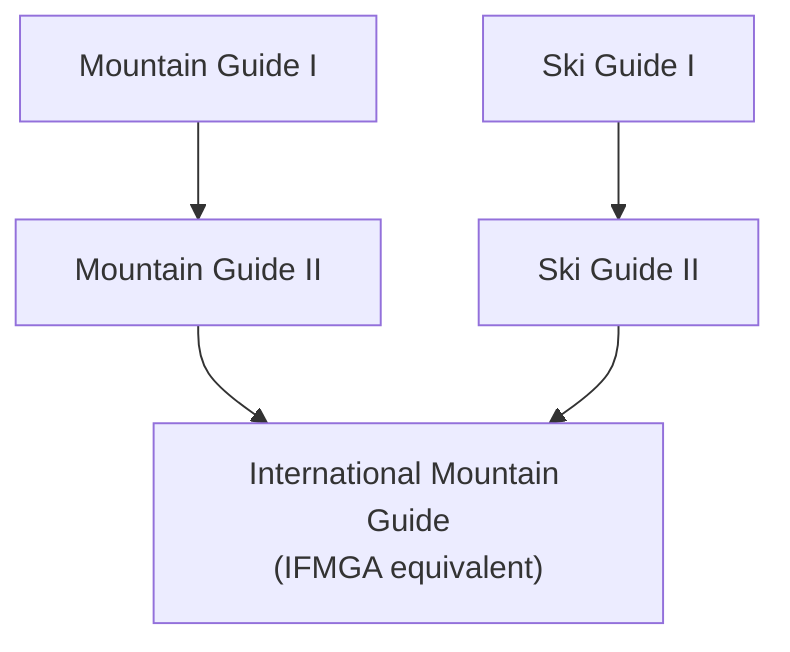

> 🌏 [中文版](/posts/climbing/2026-10-17-ifmga-asia)

[IFMGA](https://ifmga.net/member-associations/member-associations) has only three members in Asia: Japan, Nepal and Kyrgyzstan. Georgia sits on the Europe–Asia border, so it is covered here too. Taiwan, South Korea and China are not members, and none has a candidate association.

These four countries go together because they are closest to Taiwan and yet run very different systems. Japan built its own multi-level domestic qualification. Nepal is a No Ski association that teaches mountaineering but not skiing. Georgia turned guide training into state vocational education. Kyrgyzstan is a small school that started on foreign sponsorship and takes many foreign students.

For the common IFMGA training framework, see [what guides learn and how they are tested](/posts/climbing/2026-10-17-ifmga-training-and-exams-en). This post covers only each country's own rules.

## The four countries at a glance

| Country | Association | Years of training | Approximate cost | Teaching language | Required by law? | Open to foreigners? |
|---|---|---|---|---|---|---|
| Japan | [JMGA](https://jfmga.jp/) | At least about 7 | About ¥1.7 million (2026 official fees, summed by this post) | Japanese (a high level likely needed) | Not a national licence; Nagano Prefecture has its own register | Yes, with a residence card |
| Nepal | [NNMGA](https://www.nnmga.org/) (No Ski) | About 7 (NNMGA estimate for Nepalis) | About NPR 1.7 million (estimate for Nepalis, 2025) | Not stated | No rule found | Allowed to take Asian students since 2020 |
| Georgia | [GMGA](https://gmga.info/association/about) | 2–3 | Paid by state education vouchers; 2026 figure not published | Georgian | Yes, the Tourism Law requires certification from 2026-06-01 | The association says students from any country can join |
| Kyrgyzstan | [KMGA](https://mguide.in.kg/en/association) | About 3 | US$3,300 (2016–2019 intakes) | Russian, English | No, the Tourism Law has no guide-licence clause | Yes, the school page sets no nationality or residence rule |

## Japan: JMGA

### Training path

Japan's association is the [Japan Mountain Guides Association](https://jfmga.jp/aboutus.php) (JMGA, 日本山岳ガイド協会). Its official domain is jfmga.jp. A predecessor body joined IFMGA in 1991, and the IFMGA [history document](https://ifmga.net/images/Documents/240212_History_IFMGA_update.pdf) also lists Japan under 1991.

JMGA has many qualification levels, and only the top one, the International Mountain Guide (国際山岳ガイド), is equivalent to IFMGA. Mountain Guide II and everything below it is valid only inside Japan. The standard path:

According to the official [2026 flowchart](https://jfmga.jp/pdf/shikaku/2026年度フローチャート(山岳・国際・スキー).pdf), the fastest case reaches the international qualification in year 7, counting from the first Mountain Guide I application. That does not include the personal climbing years needed to meet the entry thresholds, so in practice it usually takes longer (an inference).

**JMGA is not accepting new international-guide candidates in fiscal 2026.** The flowchart says that from fiscal 2027 training will grow by about 10–20 days to meet IFMGA rules.

### Entry requirements

Every level has experience thresholds. Take the [Mountain Guide I standards](https://jfmga.jp/pdf/shikaku/2026年度受験資格における登山経験・技術基準表_山岳のみ.pdf) as an example:

- At least 300 days in the mountains (only the last 15 years count, and trips as a client do not)
- At least 15 redpoints each of trad and sport 5.10a
- Able to lead a grade IV ice wall of about 30 m reliably
- A written "mountaineering philosophy" essay of 400 characters or more

The International Mountain Guide exam requires Mountain Guide II plus Ski Guide II, at least 8 months of summer and winter work after that, and the route list in the IFMGA Platform ([international rules](https://jfmga.jp/pdf/shikaku/2026年度職能別資格検定試験詳細規定（国際山岳ガイド）.pdf)).

### Costs

| Stage | Official fees (tax included, 2026) |
|---|---|
| Mountain Guide I | About ¥518,100 (sum of items, excluding the fitness test fee) |
| Mountain Guide II | ¥330,000 (four courses with assessment) |
| Ski Guide I and II assessments | ¥282,700 (excluding the written exam and avalanche test) |
| International Mountain Guide | ¥555,500 (two glacier-area courses abroad, excluding overseas travel and lodging) |

The total is about ¥1.7 million (518,100 + 330,000 + 282,700 + 555,500 = 1,686,300). That is this post's own sum of the items in the [detailed rules](https://jfmga.jp/pdf/shikaku/2026年度職能別資格検定試験詳細規定202605.pdf). All four figures are fiscal-2026 prices, but the sum leaves out the fitness test, the ski written exam and avalanche test, and overseas travel and lodging. The international stage takes no new candidates in fiscal 2026, so prices may have changed by the time you apply.

After qualifying there are annual dues: ¥25,000 a year for an International Mountain Guide ([membership rules](https://jfmga.jp/pdf/aboutus/会員に関する規程_202406.pdf)), plus dues to the regional member body you join. For example, the [Kansai Mountain Guides Association](https://kaga1996.com/entrance/) quotes ¥77,000 for the first year including JMGA.

### Language

The official documents set no Japanese-language requirement. But the rules, forms and set textbooks exist only in Japanese, and the written exam includes an essay in Japanese, so a high level of reading and writing is likely needed (an inference).

### Legal status

JMGA qualifications are not national licences. A working guide states on his [blog](https://bigislandyamaguide.com/2022/08/27/howtoguide/) that "どの認定制度も国家資格ではありません" (none of the certification schemes is a national qualification), so anyone can call themselves a guide. To work as a JMGA guide, though, you must join through a regional member body ([joining procedure](https://jfmga.jp/shikaku_joinus.php)).

Nagano Prefecture is the exception: its [Shinshu mountain guide ordinance](https://www.pref.nagano.lg.jp/kankoki/sangyo/kanko/tozan/youshiki.html) requires guides to pass a prefectural exam and be registered by the governor, and 446 people were registered as of February 2026. So "no qualification is needed anywhere in Japan" is too strong.

### Foreigners

Foreigners can apply. The ID clause in the application rules says "外国人においては在留カードの写し": foreigners must attach a copy of their residence card. Residence cards go only to mid- and long-term residents, so in practice you likely need Japanese residence status (an inference). The exams span several years, and Mountain Guide II requires 1 year 8 months of guiding work after joining, which also points to living and working in Japan (an inference).

### Number of guides

In JMGA's [list of active members](https://jfmga.jp/aboutus_guides.php) for October 2026, 37 people are marked as International Mountain Guides, two of them with foreign names. Neither appears to have qualified through JMGA's exams. One describes himself on his website as an [AMGA/IFMGA](https://www.nisekomtnguides.com/) guide. The other's [personal site](https://www.preining.info/mountain.html) lists German and Austrian credentials, suggesting he qualified in Europe and joined JMGA later (an inference).

## Nepal: NNMGA (No Ski)

### Training path

The Nepal National Mountain Guide Association ([NNMGA](https://www.nnmga.org/become-a-nnmga-guide/)) became an applicant in 2006 and a member in 2012, when it already had 24 IFMGA guides. It is a No Ski association: graduates hold an "IFMGA No Ski" qualification and have no rights as ski guides in other member countries.

The path:

1. Entry exam with 7 parts, including 6a in mountaineering boots and 6b in rock shoes
2. Aspirant course: 3 units over 10 months, 47 training days
3. A 15-day Mountain Guide exam 2 years later
4. Refresher training every 3 years after qualifying

The aspirant course length conflicts between sources: NNMGA's website says 47 days, while [The Himalayan Times](https://www.thehimalayantimes.com/nepal/nnmgas-aspirant-guide-course-forging-excellence-in-mountaineering-education-and-leadership) says 70.

### Entry requirements

Aged 18 or over, and one of the following:

- Basic and advanced courses from the Nepal Mountaineering Association (NMA), plus 4 trekking peaks and 1 peak above 7,000 m
- A Bachelor of Mountaineering Studies (BMS) degree

### Costs

Fees for foreign students are not published. An NNMGA [press release](https://nnmga.org/news/govt-urged-to-invest-in-training-skilled-mountain-guides-as-global-demand-rises) from December 2025 estimates that becoming an international guide takes a Nepali about 7 years and about NPR 1.7 million. Foreign students need to ask NNMGA (info@nnmga.org).

### Language

The teaching language is not stated.

### Legal status

No rule was found on whether Nepali law requires an IFMGA qualification to guide.

### Foreigners

NNMGA's site records that in 2020 "NNMGA was granted authorization by IFMGA to accept international students, particularly from Asian nations" ([2020 history page](https://www.nnmga.org/history/2020/)). The 2023/24 course had 8 Nepali and 2 Indian students.

Visas are the other hurdle. Nepal's [study visa](https://immigration.gov.np/visa-fees-and-documents) covers students on degree and non-degree programmes, costs US$75 a month for non-degree study, and needs a recommendation from the relevant ministry. A tourist visa allows at most 150 days a year. And the aspirant [logbook](https://nnmga.org/programs/logbook) must be completed inside Nepal under the supervision of IFMGA or NNMGA guides. Whether NNMGA can supply the recommendation letter for a foreign student's study visa is not published; you would need to ask.

IFMGA Platform 5.17 forbids No Ski associations from training applicants from "ski countries". Taiwan has no working ski infrastructure, so it is probably not a ski country and NNMGA taking Taiwanese students would not break this rule (an inference). IFMGA makes the final call ([Platform, as republished by EEMGA](https://www.eemga.org/about-eemga/the-ifmga-platform/)).

### Number of guides

24 when Nepal joined. No published current total was found.

## Georgia: GMGA

### Training path

Training for the Georgian Mountain Guides Association (GMGA) is run by the [Adventure Tourism School (ATS)](https://www.guideschool.org/uimla). GMGA set it up in 2016 with the Ministry of Education and Science, at the Gudauri ski resort at 2,700 m. Experts from the Swiss and German guide associations take part in teaching and exams.

GMGA became a candidate in 2018 and a full member at the November 2021 general assembly in Chamonix ([Georgia Today](https://georgiatoday.ge/georgia-welcomed-as-new-member-of-intl-federation-of-mountain-guides-associations/)). When it joined, 30 ATS graduates received international guide status.

The course is listed in the national vocational education catalogue as Mountain Guide (dual system) level IV, 24 months, 15 students per intake ([edu.aris.ge, 2018 version](https://edu.aris.ge/tvet/nnle-adventure-tourism-school-ats.html)). GMGA's website says the course usually takes 2–3 years. No official breakdown of days by stage (entry exam, aspirant, guide) is published.

### Entry requirements

The 2018 [intake notice](https://dmo.ge/news/satavgadasavlo-turizmis-skola-profesiul-swavlebaze-migebas-acxadebs/) asked for a high-school diploma and age 18 or over, with selection by climbing record, interview, and skiing and mountaineering technique. The 2026 application process was not found.

### Costs

The diploma course is paid for with Ministry of Education vouchers ([ATS home page](https://www.guideschool.org/)). In 2018 ATS's deputy director said study in Georgia was free and students paid only travel and lodging during placements. The actual 2026 figure for the mountain guide course is not published, and whether foreign students pay is not stated.

### Language

The national vocational catalogue states that teaching is in Georgian.

### Legal status

Article 34 of Georgia's new [Law on Tourism](https://matsne.gov.ge/en/document/view/6012850?publication=latest) says mountain, ski and high-mountain guides may only work if certified, effective 1 June 2026. The fine for working without a certificate is GEL 3,000, or 6,000 for a repeat offence, though some penalties apply only from 1 January 2027.

A May 2026 [amendment](https://matsne.gov.ge/ka/document/view/6873293) reclassified these guides as "providers of high-risk tourist services", certified by the national tourism administration GNTA. The certification rules are to be set by government decree, but no such decree had been found as of 17 October 2026.

### Foreigners

When GMGA joined, a board member said ATS "will now be able to accept students from any country". But applications go through the national vocational platform and teaching is in Georgian, so how high the real barrier is for foreigners remains an inference.

Whether a foreign IFMGA guide needs separate certification to guide in Georgia is not stated in the law and depends on the pending decree. You can ask [GNTA](https://gnta.ge/).

### Number of guides

The IFMGA guide directory lists [40 entries](https://ifmga.net/browse?search=&association=22&page=1) for GMGA (counted 2026-10-17). GMGA's own register is password-protected.

## Kyrgyzstan: KMGA

### Training path

The Kyrgyz Mountain Guides Association ([KMGA](https://mguide.in.kg/en/association)) registered in 2007 and opened its guide school in 2008, funded by Mammut with technical support from the Swiss and British guide associations. It became a candidate in 2010 and a full member at the December 2017 general assembly in Kathmandu, the first in Central Asia.

The path on the [school page](http://mguide.in.kg/en/school):

1. Send a climbing and skiing CV, then take the entry test (skiing, rock, ice)
2. Two years of courses: two weeks of mountaineering each autumn, two weeks of skiing each spring
3. Pass a mid-course exam to become an aspirant, followed by a year of practice
4. Final exams: about 10 days each, mountaineering in autumn and skiing in spring

A guide who later joined France's SNGM writes on his [website](https://belousov.guide/en/about) that he enrolled in 2018 and graduated three years later. The 2016 intake schedule adds up to about 83 days, plus the aspirant year (this post's sum from the [archived intake notice](https://web.archive.org/web/20160529214619/http://www.risk.ru/blog/208230)).

### Entry requirements

- Independently led at least one TD alpine route
- In mountaineering boots, 5b (trad) to 5c (sport); in rock shoes, 6a (trad) to 6b (sport)
- Steady ice climbing with one or two tools, steady off-piste skiing
- An English speaking test before receiving the diploma

### Costs

Current fees are not published. The official notice for the 2016–2019 intakes listed every price:

| Course | Fee |
|---|---|
| Entry test (mountaineering, skiing) | US$75 each |
| Mountaineering intro / aspirant / guide course | US$650 / 850 / 650, all-inclusive |
| Skiing intro / aspirant / guide course | US$300 / 400 / 300, food and lodging extra |

The total is US$3,300. For current fees, write to kmga.board@gmail.com.

### Language

Russian and English.

### Legal status

Kyrgyzstan's [Law on Tourism](https://tourism.gov.kg/the-law-on-tourism/) has no mountain-guide licence clause, and the tourism licensing article was deleted in 2003. A local [alpine club](https://kac.centralasia.kg/kac_services/expedition-service) puts it bluntly: "everyone in Kyrgyzstan can call himself a guide".

### Foreigners

The school page sets no nationality or residence requirement, and the 2022 application form only has a "Citizenship" field. The association's home page lists 53 members from 12 countries. The guide above has lived in France since 2018 and still completed the course. That said, KMGA does not state outright that residence is not required.

To be employed as a guide in Kyrgyzstan, foreigners need a work permit under the Law on External Migration ([FAOLEX copy](https://faolex.fao.org/docs/pdf/kyr196097.pdf)).

### Number of guides

The IFMGA guide directory lists [42 entries](https://ifmga.net/browse?search=&association=16&page=1) for KMGA (counted 2026-10-17).

## What this means for Taiwanese readers

Of the four, Kyrgyzstan is the most likely to open its door to a Taiwanese candidate: English teaching, no stated residence rule, and a full ski component. Japan is close but needs a residence card and Japanese. Nepal takes Asian students, but you graduate as No Ski. The full cross-country comparison is in [the path for Taiwanese climbers](/posts/climbing/2026-10-17-ifmga-taiwan-path-en).

## References

- [IFMGA Member Associations](https://ifmga.net/member-associations/member-associations)
- [IFMGA history document (2024 update)](https://ifmga.net/images/Documents/240212_History_IFMGA_update.pdf)
- [IFMGA Platform (republished by EEMGA)](https://www.eemga.org/about-eemga/the-ifmga-platform/)
- [JMGA 2026 flowchart](https://jfmga.jp/pdf/shikaku/2026年度フローチャート(山岳・国際・スキー).pdf) (in Japanese)
- [JMGA 2026 detailed qualification rules](https://jfmga.jp/pdf/shikaku/2026年度職能別資格検定試験詳細規定202605.pdf) (in Japanese)
- [JMGA 2026 detailed rules, International Mountain Guide](https://jfmga.jp/pdf/shikaku/2026年度職能別資格検定試験詳細規定（国際山岳ガイド）.pdf) (in Japanese)
- [JMGA Mountain Guide standards table](https://jfmga.jp/pdf/shikaku/2026年度受験資格における登山経験・技術基準表_山岳のみ.pdf) (in Japanese)
- [JMGA membership rules](https://jfmga.jp/pdf/aboutus/会員に関する規程_202406.pdf) (in Japanese)
- [JMGA joining procedure](https://jfmga.jp/shikaku_joinus.php) (in Japanese)
- [JMGA list of active members](https://jfmga.jp/aboutus_guides.php) (in Japanese)
- [Kansai Mountain Guides Association: joining](https://kaga1996.com/entrance/) (in Japanese)
- [Nagano Prefecture: Shinshu mountain guides](https://www.pref.nagano.lg.jp/kankoki/sangyo/kanko/tozan/youshiki.html) (in Japanese)
- [bigislandyamaguide: how to become a guide](https://bigislandyamaguide.com/2022/08/27/howtoguide/) (in Japanese)
- [Niseko Mountain Guides](https://www.nisekomtnguides.com/)
- [Norbert Preining: Mountain](https://www.preining.info/mountain.html)
- [NNMGA: Become a NNMGA Guide](https://www.nnmga.org/become-a-nnmga-guide/)
- [NNMGA 2020 history page](https://www.nnmga.org/history/2020/)
- [NNMGA logbook rules](https://nnmga.org/programs/logbook)
- [NNMGA press release (December 2025)](https://nnmga.org/news/govt-urged-to-invest-in-training-skilled-mountain-guides-as-global-demand-rises)
- [The Himalayan Times: NNMGA Aspirant Guide Course](https://www.thehimalayantimes.com/nepal/nnmgas-aspirant-guide-course-forging-excellence-in-mountaineering-education-and-leadership)
- [Nepal Department of Immigration: visa fees](https://immigration.gov.np/visa-fees-and-documents)
- [GMGA About](https://gmga.info/association/about)
- [Adventure Tourism School](https://www.guideschool.org/uimla)
- [Georgia Today: Georgia welcomed as new IFMGA member](https://georgiatoday.ge/georgia-welcomed-as-new-member-of-intl-federation-of-mountain-guides-associations/)
- [edu.aris.ge: ATS vocational programmes](https://edu.aris.ge/tvet/nnle-adventure-tourism-school-ats.html) (in Georgian)
- [ATS 2018 intake notice](https://dmo.ge/news/satavgadasavlo-turizmis-skola-profesiul-swavlebaze-migebas-acxadebs/) (in Georgian)
- [Georgia Law on Tourism (matsne)](https://matsne.gov.ge/en/document/view/6012850?publication=latest)
- [Georgia Law on Tourism, 2026 amendment (matsne)](https://matsne.gov.ge/ka/document/view/6873293) (in Georgian)
- [IFMGA guide directory: GMGA](https://ifmga.net/browse?search=&association=22&page=1)
- [KMGA Association](https://mguide.in.kg/en/association)
- [KMGA School](http://mguide.in.kg/en/school)
- [KMGA 2016 intake notice (Wayback archive)](https://web.archive.org/web/20160529214619/http://www.risk.ru/blog/208230) (in Russian)
- [Belousov Guide: About](https://belousov.guide/en/about)
- [Kyrgyz Law on Tourism](https://tourism.gov.kg/the-law-on-tourism/)
- [Kyrgyz Alpine Club: Expedition service](https://kac.centralasia.kg/kac_services/expedition-service)
- [Kyrgyz Law on External Migration (FAOLEX)](https://faolex.fao.org/docs/pdf/kyr196097.pdf)
- [IFMGA guide directory: KMGA](https://ifmga.net/browse?search=&association=16&page=1)
