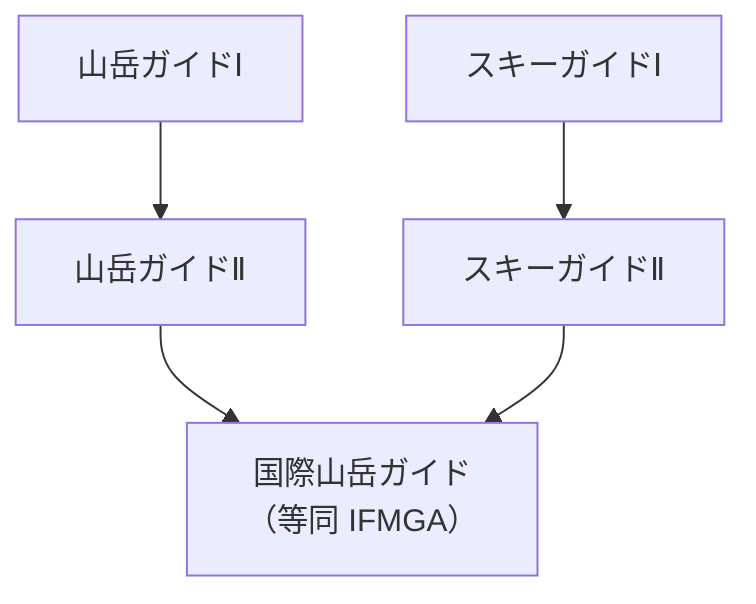

> 🌏 [English version](/posts/climbing/2026-10-17-ifmga-asia-en)

[IFMGA](https://ifmga.net/member-associations/member-associations) 在亞洲的會員只有三個：日本、尼泊爾、吉爾吉斯。喬治亞在歐亞交界，也放進這篇。台灣、韓國、中國都不是會員，也沒有候選協會。

這四國放在一起，是因為它們離台灣最近，制度卻差最多：

- 日本自己發展了一套多層級的國內資格
- 尼泊爾是只教登山、不教滑雪的 No Ski 協會
- 喬治亞把嚮導訓練做成國家職業教育
- 吉爾吉斯是一所靠外國贊助起家、收很多外國學員的小學校

IFMGA 共通的訓練架構見[學什麼、考什麼](/posts/climbing/2026-10-17-ifmga-training-and-exams)，這篇只講四國各自的規定。

## 四國總表

| 國家 | 協會 | 訓練年數 | 大約費用 | 上課語言 | 法律強制？ | 外國人能報名？ |
|---|---|---|---|---|---|---|
| 日本 | [JMGA](https://jfmga.jp/) | 最短約 7 年 | 約 170 萬日圓（2026 官方費用加總，推算） | 日文（推測需高程度讀寫） | 不是國家資格；長野縣另有縣級登錄 | 可，但要附在留卡 |
| 尼泊爾 | [NNMGA](https://www.nnmga.org/)（No Ski） | 約 7 年（NNMGA 對尼泊爾人的估計） | 約 NPR 170 萬（尼泊爾人估計，2025） | 官方沒寫 | 沒找到相關規定 | 2020 年起獲准收亞洲學員 |
| 喬治亞 | [GMGA](https://gmga.info/association/about) | 2–3 年 | 國家教育券支付；2026 實額沒公布 | 喬治亞語 | 是，旅遊法 2026-06-01 起要求認證 | 協會說可收任何國家學生 |
| 吉爾吉斯 | [KMGA](https://mguide.in.kg/en/association) | 約 3 年 | US$3,300（2016–2019 屆） | 俄語、英語 | 否，旅遊法沒有嚮導證照條款 | 可，學校頁沒有國籍或居留門檻 |

## 日本：JMGA

### 訓練流程

日本的協會是公益社團法人[日本山岳ガイド協会](https://jfmga.jp/aboutus.php)（JMGA），官方網域是 jfmga.jp。前身組織 1991 年加入 IFMGA，IFMGA 的[歷史文件](https://ifmga.net/images/Documents/240212_History_IFMGA_update.pdf)也把日本列在 1991 年。

JMGA 的資格分很多層，只有最上層的「国際山岳ガイド」等同 IFMGA。下面的山岳ガイドⅡ以下，只能在日本國內使用。標準路徑是：

依官方[2026 年度流程圖](https://jfmga.jp/pdf/shikaku/2026年度フローチャート(山岳・国際・スキー).pdf)，從開始報考山岳Ⅰ算起，最短第 7 年取得國際資格。這還不含累積報考門檻所需的個人登山年資，實際通常更久（推測）。

**2026 年度不招收國際山岳嚮導新考生。** 流程圖說明，2027 年度起為了符合 IFMGA 規定，訓練天數預計增加約 10–20 天。

### 入學門檻

每一層都有經驗門檻，以[山岳ガイドⅠ基準表](https://jfmga.jp/pdf/shikaku/2026年度受験資格における登山経験・技術基準表_山岳のみ.pdf)為例：

- 山行 300 日以上（只算 15 年內、不含當客人的行程）
- 傳統攀登與運動攀登 5.10a 紅點各 15 條以上
- 能確實領攀 Ⅳ 級、約 30 公尺的冰壁
- 另交 400 字以上的「登山理念」短文

國際山岳ガイド要先持有山岳Ⅱ加スキーⅡ，取得後有 8 個月以上的夏冬實務，並符合 IFMGA Platform 的路線清單要求（[國際規定](https://jfmga.jp/pdf/shikaku/2026年度職能別資格検定試験詳細規定（国際山岳ガイド）.pdf)）。

### 費用

| 階段 | 官方費用（含稅，2026） |
|---|---|
| 山岳ガイドⅠ | 約 518,100 日圓（各項加總，未含體力適性試驗費） |
| 山岳ガイドⅡ | 330,000 日圓（4 個講習檢定） |
| スキーガイドⅠ、Ⅱ 檢定 | 282,700 日圓（不含筆試、雪崩檢定） |
| 国際山岳ガイド | 555,500 日圓（海外冰河區兩科，未含海外交通住宿） |

合計約 170 萬日圓（518,100＋330,000＋282,700＋555,500＝1,686,300），這是本文把[詳細規定](https://jfmga.jp/pdf/shikaku/2026年度職能別資格検定試験詳細規定202605.pdf)各項加總的推算。四項都是 2026 年度價目，但不含體力適性試驗、滑雪筆試與雪崩檢定、海外交通住宿。2026 年度國際階段不招生，實際報考時價目可能已調整。

取得後還有年費：國際山岳嚮導每年 25,000 日圓（[會員規程](https://jfmga.jp/pdf/aboutus/会員に関する規程_202406.pdf)），另外要繳所屬地方團體的會費，例如[關西山岳ガイド協会](https://kaga1996.com/entrance/)連同 JMGA 首年合計 77,000 日圓。

### 語言

官方文件沒有寫日語門檻。不過規定、報名表、指定教本都只有日文，筆試還有日文小論文，所以推測需要高程度的日文讀寫能力。

### 法律地位

JMGA 的資格不是國家資格。一位現役嚮導在[部落格](https://bigislandyamaguide.com/2022/08/27/howtoguide/)寫明「どの認定制度も国家資格ではありません」，沒有資格也能自稱嚮導。但要以 JMGA 嚮導身分執業，必須經由地方的正會員團體入會（[入會手續](https://jfmga.jp/shikaku_joinus.php)）。

例外是長野縣：[信州登山案內人條例](https://www.pref.nagano.lg.jp/kankoki/sangyo/kanko/tozan/youshiki.html)要求嚮導考縣試並經知事登錄，2026 年 2 月有 446 人登錄。所以「全日本都不用任何資格」不能說死。

### 外國人

可以報考。報名的身分證明條款寫「外国人においては在留カードの写し」，也就是外國人要附在留卡影本。在留卡只發給中長期居留者，所以推測實務上要有日本居留身分。考試流程跨好幾年，山岳Ⅱ又要求入會後 1 年 8 個月的嚮導實務，也指向要在日本長住並工作（推測）。

### 嚮導人數

2026 年 10 月的官方[活動中會員名單](https://jfmga.jp/aboutus_guides.php)裡，標示「国際山岳ガイド」的有 37 人，其中 2 人是外國姓名。兩人的 IFMGA 資格看起來都不是走 JMGA 考試：一位本人網站寫自己是 [AMGA/IFMGA](https://www.nisekomtnguides.com/) 嚮導，另一位的[個人網站](https://www.preining.info/mountain.html)列出德國、奧地利的經歷，推測是在歐洲取得後才加入 JMGA。

## 尼泊爾：NNMGA（No Ski）

### 訓練流程

尼泊爾國家山岳嚮導協會（[NNMGA](https://www.nnmga.org/become-a-nnmga-guide/)）2006 年成為申請國，2012 年成為會員，入會時已有 24 名 IFMGA 嚮導。它是 No Ski 協會：結業拿到的是「IFMGA No Ski」資格，在其他會員國沒有滑雪嚮導的權利。

流程：

1. 入學考，共 7 個項目，包括穿登山鞋攀 6a、穿攀岩鞋攀 6b
2. Aspirant 課程：3 個單元、為期 10 個月、共 47 天訓練
3. 2 年後參加 15 天的 Mountain Guide 考試
4. 取得後每 3 年回訓一次

Aspirant 課的天數有衝突：NNMGA 官網寫 47 天，[喜馬拉雅時報](https://www.thehimalayantimes.com/nepal/nnmgas-aspirant-guide-course-forging-excellence-in-mountaineering-education-and-leadership)寫 70 天。

### 入學門檻

年滿 18 歲，並符合以下其中一項：

- 有尼泊爾登山協會（NMA）基礎與進階課程結業，加上 4 座健行峰和 1 座 7000 公尺以上高峰的經歷
- 持登山學士（BMS）學位

### 費用

外籍生學費沒有公開。NNMGA 2025 年 12 月的[新聞稿](https://nnmga.org/news/govt-urged-to-invest-in-training-skilled-mountain-guides-as-global-demand-rises)估計，尼泊爾人成為國際嚮導約需 7 年、約 NPR 170 萬。外籍生的學費要向 NNMGA（info@nnmga.org）洽詢。

### 語言

官方沒有寫授課語言。

### 法律地位

目前沒有找到尼泊爾法律是否要求帶山必須持 IFMGA 證的規定。

### 外國人

NNMGA 官網記載：2020 年「NNMGA was granted authorization by IFMGA to accept international students, particularly from Asian nations」（[2020 歷史頁](https://www.nnmga.org/history/2020/)）。2023/24 期學員是 8 名尼泊爾人、2 名印度人。

簽證是另一關。尼泊爾的[留學簽證](https://immigration.gov.np/visa-fees-and-documents)給學位與非學位課程的學生，非學位每月 US$75，要主管部會推薦；觀光簽證每年最多 150 天。而 aspirant 的[紀錄簿](https://nnmga.org/programs/logbook)規定必須在尼泊爾境內、在 IFMGA 或 NNMGA 嚮導督導下完成。NNMGA 能不能替外籍生拿到留學簽證推薦信，官方沒有公開，要寫信問。

IFMGA Platform 第 5.17 條規定 No Ski 協會不能訓練「滑雪國家」的學員。台灣沒有運作中的滑雪設施，推測不算滑雪國家，所以 NNMGA 收台灣人不違反這條；但最後由 IFMGA 認定（[Platform 轉載](https://www.eemga.org/about-eemga/the-ifmga-platform/)）。

### 嚮導人數

入會時 24 人。現役總數沒有找到公開數字。

## 喬治亞：GMGA

### 訓練流程

喬治亞山岳嚮導協會（GMGA）的訓練由「冒險旅遊學校」（[Adventure Tourism School，ATS](https://www.guideschool.org/uimla)）負責。ATS 是 GMGA 在 2016 年和教育科學部一起成立的，校址在 Gudauri 滑雪場、海拔 2,700 公尺。瑞士與德國嚮導協會的專家參與教學與考試。

GMGA 2018 年成為候選會員，2021 年 11 月在霞慕尼大會通過成為正式會員（[Georgia Today](https://georgiatoday.ge/georgia-welcomed-as-new-member-of-intl-federation-of-mountain-guides-associations/)）。入會時，30 名 ATS 畢業生取得國際嚮導身分。

課程登記在國家職業教育目錄：山岳嚮導（雙軌制）IV 級，24 個月、每屆 15 人（[edu.aris.ge，2018 年版](https://edu.aris.ge/tvet/nnle-adventure-tourism-school-ats.html)）。GMGA 官網說課程通常 2–3 年。官方沒有公開「入學考 → 見習 → 嚮導」的分段天數。

### 入學門檻

2018 年的[招生公告](https://dmo.ge/news/satavgadasavlo-turizmis-skola-profesiul-swavlebaze-migebas-acxadebs/)寫：高中學歷、滿 18 歲，甄試看登山紀錄、面試、滑雪與登山技術。2026 年的報名流程沒有找到。

### 費用

文憑課程由教育部「教育券」支付（[ATS 首頁](https://www.guideschool.org/)）。2018 年 ATS 副校長說在喬治亞學是免費的，學生只付交通與實習住宿。2026 年山岳嚮導課的實際金額沒有公布，外國學生要不要自付也沒寫。

### 語言

國家職業教育目錄寫明授課語言是喬治亞語。

### 法律地位

喬治亞新《[旅遊法](https://matsne.gov.ge/en/document/view/6012850?publication=latest)》第 34 條規定，山岳、滑雪、高山嚮導只能由經認證的人執業，2026 年 6 月 1 日生效。沒有證書罰 GEL 3,000，重犯 6,000，部分罰則延到 2027 年 1 月 1 日才適用。

2026 年 5 月的[修正法](https://matsne.gov.ge/ka/document/view/6873293)把這些嚮導改歸為「高風險旅遊服務提供者」，由國家旅遊局 GNTA 認證。認證規則要由政府命令訂出，但到 2026 年 10 月 17 日還沒找到已公布的命令。

### 外國人

GMGA 理事在入會時表示，ATS「will now be able to accept students from any country」。不過課程走國家職業教育平台報名、用喬治亞語上課，外國人實際門檻多高仍是推測。

外國 IFMGA 嚮導到喬治亞帶山要不要另外認證，法條沒有寫，要等政府命令。要問可以寫信給 [GNTA](https://gnta.ge/)。

### 嚮導人數

IFMGA 嚮導名錄中 GMGA 有 [40 筆](https://ifmga.net/browse?search=&association=22&page=1)（2026-10-17 計數）。GMGA 自己的名冊要密碼才能看。

## 吉爾吉斯：KMGA

### 訓練流程

吉爾吉斯山岳嚮導協會（[KMGA](https://mguide.in.kg/en/association)）2007 年註冊，嚮導學校 2008 年開辦，由 Mammut 出資、瑞士與英國嚮導協會提供技術支援。2010 年成為候選國，2017 年 12 月在加德滿都大會成為正式會員，是中亞第一個。

[學校頁](http://mguide.in.kg/en/school)寫的流程：

1. 寄攀登與滑雪履歷，參加入學測驗（滑雪、岩攀、冰攀）
2. 兩年課程：每年秋天兩週登山、春天兩週滑雪
3. 通過中期考試成為 aspirant，有一年實習
4. 結業考：秋天登山、春天滑雪，各約 10 天

一位後來加入法國 SNGM 的嚮導在[個人網站](https://belousov.guide/en/about)寫，他 2018 年入學，3 年後畢業。2016 年那屆的排程加總約 83 天，另有 aspirant 實習年（本文依[招生公告存檔](https://web.archive.org/web/20160529214619/http://www.risk.ru/blog/208230)加總）。

### 入學門檻

- 自主領攀過至少 TD 等級的高山路線
- 穿登山靴攀 5b（傳統）到 5c（運動）；穿攀岩鞋攀 6a（傳統）到 6b（運動）
- 單、雙冰斧穩定冰攀，穩定的非雪道滑雪
- 拿文憑前要通過英語口說測驗

### 費用

官網沒有公開現行學費。2016–2019 屆的官方招生公告列出全部價目：

| 課程 | 學費 |
|---|---|
| 入學測驗（登山、滑雪） | 各 US$75 |
| 登山入門／aspirant／嚮導課 | US$650／850／650，全包 |
| 滑雪入門／aspirant／嚮導課 | US$300／400／300，食宿另付 |

合計 US$3,300。現行學費要寫信問 kmga.board@gmail.com。

### 語言

俄語與英語。

### 法律地位

吉爾吉斯[旅遊法](https://tourism.gov.kg/the-law-on-tourism/)沒有山岳嚮導證照條款，旅遊業執照條也在 2003 年刪除。當地[登山俱樂部](https://kac.centralasia.kg/kac_services/expedition-service)寫得直接：「everyone in Kyrgyzstan can call himself a guide」。

### 外國人

學校頁沒有國籍或居留門檻，2022 年報名表只有一個「Citizenship」欄。協會首頁寫會員 53 人、來自 12 國。前面那位嚮導 2018 年起住在法國，照樣讀完。不過「不需要居留」官方沒有明寫。

如果要在吉爾吉斯受雇帶隊，依《外部移民法》外國人要先有工作許可（[FAOLEX 轉載](https://faolex.fao.org/docs/pdf/kyr196097.pdf)）。

### 嚮導人數

IFMGA 嚮導名錄中 KMGA 有 [42 筆](https://ifmga.net/browse?search=&association=16&page=1)（2026-10-17 計數）。

## 對台灣讀者的意義

四國裡，吉爾吉斯最可能對台灣人開門：英語授課、沒寫居留門檻、有完整滑雪項目。日本離得近，但要在留卡和日文。尼泊爾收亞洲學員，結業卻是 No Ski。各國門檻的總比較在[台灣人要怎麼走](/posts/climbing/2026-10-17-ifmga-taiwan-path)。

## 參考資料

- [IFMGA Member Associations](https://ifmga.net/member-associations/member-associations)
- [IFMGA 歷史文件（2024 更新版）](https://ifmga.net/images/Documents/240212_History_IFMGA_update.pdf)
- [IFMGA Platform（EEMGA 轉載）](https://www.eemga.org/about-eemga/the-ifmga-platform/)
- [JMGA 2026 年度流程圖](https://jfmga.jp/pdf/shikaku/2026年度フローチャート(山岳・国際・スキー).pdf)
- [JMGA 2026 年度職能別資格檢定試驗詳細規定](https://jfmga.jp/pdf/shikaku/2026年度職能別資格検定試験詳細規定202605.pdf)
- [JMGA 2026 年度詳細規定（國際山岳ガイド）](https://jfmga.jp/pdf/shikaku/2026年度職能別資格検定試験詳細規定（国際山岳ガイド）.pdf)
- [JMGA 山岳ガイド基準表](https://jfmga.jp/pdf/shikaku/2026年度受験資格における登山経験・技術基準表_山岳のみ.pdf)
- [JMGA 會員規程](https://jfmga.jp/pdf/aboutus/会員に関する規程_202406.pdf)
- [JMGA 入會手續](https://jfmga.jp/shikaku_joinus.php)
- [JMGA 活動中會員名單](https://jfmga.jp/aboutus_guides.php)
- [關西山岳ガイド協会 入會說明](https://kaga1996.com/entrance/)
- [長野縣 信州登山案內人](https://www.pref.nagano.lg.jp/kankoki/sangyo/kanko/tozan/youshiki.html)
- [bigislandyamaguide：山岳嚮導怎麼當](https://bigislandyamaguide.com/2022/08/27/howtoguide/)
- [Niseko Mountain Guides](https://www.nisekomtnguides.com/)
- [Norbert Preining：Mountain](https://www.preining.info/mountain.html)
- [NNMGA：Become a NNMGA Guide](https://www.nnmga.org/become-a-nnmga-guide/)
- [NNMGA 2020 歷史頁](https://www.nnmga.org/history/2020/)
- [NNMGA 紀錄簿規定](https://nnmga.org/programs/logbook)
- [NNMGA 新聞稿（2025-12）](https://nnmga.org/news/govt-urged-to-invest-in-training-skilled-mountain-guides-as-global-demand-rises)
- [The Himalayan Times：NNMGA Aspirant Guide Course](https://www.thehimalayantimes.com/nepal/nnmgas-aspirant-guide-course-forging-excellence-in-mountaineering-education-and-leadership)
- [尼泊爾移民局簽證費用](https://immigration.gov.np/visa-fees-and-documents)
- [GMGA About](https://gmga.info/association/about)
- [Adventure Tourism School](https://www.guideschool.org/uimla)
- [Georgia Today：喬治亞成為 IFMGA 會員](https://georgiatoday.ge/georgia-welcomed-as-new-member-of-intl-federation-of-mountain-guides-associations/)
- [edu.aris.ge：ATS 職業教育課程](https://edu.aris.ge/tvet/nnle-adventure-tourism-school-ats.html)
- [ATS 2018 招生公告](https://dmo.ge/news/satavgadasavlo-turizmis-skola-profesiul-swavlebaze-migebas-acxadebs/)
- [喬治亞旅遊法（matsne）](https://matsne.gov.ge/en/document/view/6012850?publication=latest)
- [喬治亞旅遊法 2026 修正（matsne）](https://matsne.gov.ge/ka/document/view/6873293)
- [IFMGA 嚮導名錄：GMGA](https://ifmga.net/browse?search=&association=22&page=1)
- [KMGA Association](https://mguide.in.kg/en/association)
- [KMGA School](http://mguide.in.kg/en/school)
- [KMGA 2016 招生公告（Wayback 存檔）](https://web.archive.org/web/20160529214619/http://www.risk.ru/blog/208230)
- [Belousov Guide：About](https://belousov.guide/en/about)
- [吉爾吉斯旅遊法](https://tourism.gov.kg/the-law-on-tourism/)
- [Kyrgyz Alpine Club：Expedition service](https://kac.centralasia.kg/kac_services/expedition-service)
- [吉爾吉斯外部移民法（FAOLEX）](https://faolex.fao.org/docs/pdf/kyr196097.pdf)
- [IFMGA 嚮導名錄：KMGA](https://ifmga.net/browse?search=&association=16&page=1)
