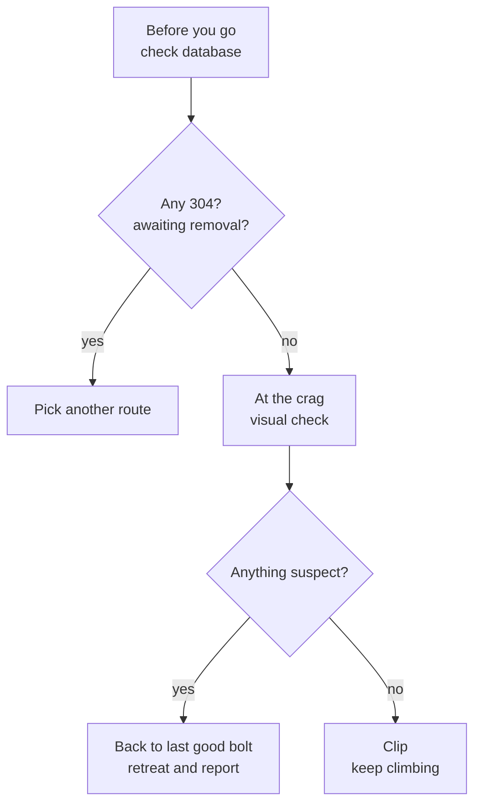

> 🌏 [中文版](/posts/climbing/2026-10-17-judging-bolts)

In the summer of 2015, both bolts of the top anchor on a Long Dong Music Hall route called "Big Drum" broke at the same time, and a climber fell to the ground. He was close to the ground and only lightly injured. Afterwards it emerged that both bolts were 304 stainless steel made before 2010.

Sport climbing hands your protection to bolts someone else placed. So the first judgment to learn outdoors is: **can this bolt be trusted?**

This post covers bolt types, what the standard numbers mean, and why sea cliffs are especially dangerous. It ends with two actions: look up the route database before you go, and inspect the bolts at the crag.

This is part 3 of the [Sport and Trad Climbing](/posts/climbing/2026-10-17-sport-vs-trad-overview-en) series, after [Your First Outdoor Sport Lead](/posts/climbing/2026-10-17-first-outdoor-sport-lead-en). The next post, [Setting Up a Top Rope](/posts/climbing/2026-10-17-top-rope-anchor-setup-en), puts the whole top-rope system on two bolts at the top, so read this one first.

## Two kinds of bolts: expansion and glued-in

The [UIAA 123 rock anchor standard](https://www.theuiaa.org/documents/safety-standards/UIAA_123_Rock_Anchors_V5.1.pdf) divides bolts into two classes:

- **Expansion**: drill, tap it in, tighten the nut; the sleeve at the end expands and friction holds it in the hole. You can see a nut and a hanger.
- **Glued-in**: inject a chemical bonding agent into the hole, insert the anchor, and wait for full cure. Modern ones are mostly a one-piece P-shaped eye with no nut.

The [British Mountaineering Council (BMC)](https://www.thebmc.co.uk/en/spot-a-bad-bolt) notes that expansion bolts are generally only suitable for medium to hard rock. Modern resin anchors are far superior to most mechanical bolts, but some older U-shaped "staples" can be dangerously weak. UIAA's advice to bolters is also to **prefer glue-in anchors in coastal areas**.

**Something you can do tonight**: open photos or video of a crag you want to visit, find a bolt, and decide whether it is an expansion bolt (nut and hanger) or glued-in (one-piece eye).

## The standard numbers: EN 959 and UIAA 123

New bolts have to pass two standards. According to the [UIAA's official pictorial summary](https://www.theuiaa.org/documents/safety-standards/Pictorial_UIAA123%20Rock%20Anchors_2024.pdf):

| Direction | EN 959 | UIAA 123 |
|---|---|---|
| Radial (down along the rock, the main direction in a fall) | 25 kN | 25 kN |
| Axial (straight out of the rock) | 15 kN | 20 kN |

UIAA 123 builds on EN 959:2018 and adds several requirements:

- **Axial strength raised to 20 kN**.
- **Torque for glued-in bolts**: 150 N·m for 60 seconds without rotating.
- **Corrosion classes**: SCC, GC and LC; the class must be marked on the anchor, for example "UIAA SCC".
- **No paint**: not for corrosion protection, not for identification.

Version 5.1 has applied since July 2026.

These numbers have one limit: **they only guarantee a new product in a lab**. How much strength is left in a bolt that has baked on a sea cliff for fifteen years is something the standard cannot answer. What follows is how sea-cliff bolts fail, how to look them up before you go, and how to inspect them on site.

## Why sea-cliff bolts break without warning

Stainless steel on the coast can suffer stress corrosion cracking (SCC): metal under stress meets chlorides and grows cracks from the inside. Annex A of UIAA 123 lists the high-risk conditions:

- **Chlorides**: sea salt, magnesium chloride, calcium chloride.
- **Temperature**: no safe cut-off; SCC can start at 20°C and is worse above 30°C. A bolt in the sun runs much hotter than the air.
- **Humidity**: relative humidity of 20–70%.
- **Distance from the sea**: typically within 30 km of the coast, but there is no clear limit; sea winds carry salt far inland.
- **Not washed by rain**: where rain cannot reach, salt concentrates on the bolt.

Long Dong ticks every box. UIAA's [Watch Your Anchor](https://www.theuiaa.org/documents/safety-standards/UIAA_Anchor_Failures_2024.pdf) notes that these failures occur mostly on stainless steel anchors; in one recent incident in Leonidio, Greece, an anchor failed unexpectedly after only months or years in place.

The worst part: **SCC is not always visible.** BMC puts it more bluntly: in practice it is almost impossible to spot. A visual check catches rust, cracks and movement, but not cracks hidden inside the metal.

UIAA 123 also states that different stainless grades **must not be combined**, for example a hanger and bolt made of different steels. Galvanic coupling between them accelerates corrosion.

## Long Dong: from 304 to 316 to titanium

TOCC (Taiwan Outdoor Climbing Club)'s [Long Dong bolts page](https://www.tocc-climbing.org/post/%E9%BE%8D%E6%B4%9E%E7%9A%84%E9%8C%A8%E6%A0%93) (in Chinese) and the [Long Dong chronicle](https://www.tocc-climbing.org/chronicle-of-events) record the sequence:

1. **2004**: Chang Teng-jung, Wang Hung-hsiang and others start rebolting with 316 stainless steel.
2. **2010**: Dr. Chang Fang-yuan launches the Long Dong Rebolting Project and a full survey of every route's bolts.
3. **July 2014**: the project resolves to use only titanium bolts for future maintenance.
4. **Summer 2015**: both bolts of the Big Drum anchor fail. The team writes to Petzl and learns that early Collinox bolts were made of 304 stainless steel.
5. **September 2015**: the first bolt pull test at Long Dong.
6. **From 2016**: a Taiwan-made titanium bolt is developed; each one gets an X-ray check and a 12 kN pull test before installation.

316 is a subtler case. TOCC's conclusion: 304 has suffered stress corrosion at Long Dong; 316 has no corrosion failures so far, but the possibility **cannot be ruled out**. So 316 was not cut out all at once; it is monitored by regular pull testing instead. The reason is that every round of rebolting means a new hole, old holes cannot be reused, and each new placement is worse than the last.

The [pull test](https://www.tocc-climbing.org/rebolting-project) works like this:

- **Load**: 8 kN axial, held for 1 minute, repeated 5 times within 10 minutes.
- **What a pass means**: yield strength above 8 kN; breaking strength is not tested, and TOCC estimates it above 12 kN.
- **Titanium**: marked as not requiring a test.

According to [What future does Long Dong deserve?](https://www.tocc-climbing.org/post/%E9%BE%8D%E6%B4%9E%E5%80%BC%E5%BE%97%E6%80%8E%E6%A8%A3%E7%9A%84%E6%9C%AA%E4%BE%86-%E5%B2%A9%E5%A0%B4%E7%B6%AD%E8%AD%B7%E8%88%87%E9%96%8B%E7%99%BC) (2021, in Chinese), most problem bolts found by pull tests were early 304s. A few 316s pulled out because the glue was not mixed evenly, a defect no one can see.

For the current picture, use TOCC's route database. Its "統計" (statistics) tab on 2026-10-17:

| Material | Count |
|---|---|
| 304 stainless | 90 (88 in First Cave) |
| 316 stainless | 1,278 |
| Titanium | 781 |
| Total | 2,149 |

The 304 count is still falling: the [TOCC 2025 work report](https://www.tocc-climbing.org/post/2025-tocc-summary-report) (in Chinese) records 20 cut out in First Cave.

## Before you go: look up a route in the TOCC database

TOCC maintains a public Google Sheet, the [Long Dong route database](https://docs.google.com/spreadsheets/d/1QHFNQSPgKgQrTNnYn246wfotOYqOkzHjLltZ26keBgg/edit?usp=sharing) (in Chinese), with every bolt on every route. How to read it:

1. **Pick the area**: the tabs at the bottom are the nine areas (後門 Back Door, 黃金谷 Golden Valley, 第一洞 First Cave…).
2. **Find the route number**: guidebooks and TOCC both use numbers, e.g. #359.
3. **Read the bolt columns**: `B01`–`B18` are the lead bolts counted from the bottom; `A01`–`A03` are the top anchor. Each cell holds a code such as `316-TW` (Taiwan-made 316), `Ti-ETN` (Titan Eterna titanium) or `304-PC` (Petzl Collinox 304). The code key is on the statistics tab.
4. **Read "Anchor 配件"** (anchor hardware): whether the anchor has maillons or ram's-horn lowering hooks, and what they are made of. "共用" means the anchor is shared with a neighbouring route.
5. **Read "路線狀態"** (route status): values such as updated, pull-tested, awaiting pull test, awaiting update, awaiting removal.

The bolt codes are coloured by material: 304 in red, 316 in green, titanium in black. **The colour tells you the material, not whether the route is safe to climb.** A green 316 may not have been pull-tested for years; judge by combining material, route status, and TOCC's latest [work report](https://www.tocc-climbing.org/post/workreport-202607to08) (in Chinese).

**Something you can do tonight**: find a route you want to climb in the database. Copy down the code of every lead bolt and anchor bolt, count the 304s, and read the route status.

## At the crag: a visual checklist

The database only tells you what was installed. At the base of the wall, use your eyes too. Combining advice from [Access Fund](https://www.accessfund.org/latest-news/can-you-trust-that-bolt), BMC, UIAA and TOCC, check these before clipping:

- **Rust and cracks**: rust on the surface, cracks in the hanger or eye. Even modern stainless steel with visible corrosion should be reported.
- **Spinners**: the nut has loosened and the hanger turns by hand. Access Fund notes this lets more leverage act on the bolt and reduces its overall strength.
- **Movement when pulled or twisted**: BMC lists this as a warning sign for glued-in bolts.
- **Mixed metals**: hanger and bolt of different materials, for example when someone replaced only the hanger. This accelerates galvanic corrosion.
- **The surrounding rock**: fractured rock, hollow flakes, or a bolt too close to a crack or edge. BMC's reference distance is a spread hand's width.
- **Wear on lower-offs**: BMC's rule of thumb is not to rely on a part worn more than a third through.
- **Long Dong warning tags**: on some First Cave routes that still have 304 bolts, TOCC has tagged the first bolt. Take it seriously.

Access Fund adds that every climber is responsible for inspecting fixed anchors before trusting them. BMC's expert is blunter: in general nobody is responsible for the bolts at a crag, so never assume a route is safe just because it is a sport route.

**Looking fine only means you saw no obvious problem.** SCC and badly mixed glue are invisible, so checking the database and inspecting on site go together.

## What to do about a suspect bolt

If you find a bad bolt halfway up a lead, [BMC](https://www.thebmc.co.uk/en/spot-a-bad-bolt) suggests:

1. **Go back**: downclimb to the last good bolt.
2. **Bail on a cheap carabiner**: carry a "bail biner" and swap it for your good quickdraw before lowering.

UIAA's advice to climbers adds:

- **Use anchors built from several bolts**, ideally lowering or belaying from more than one ring.
- **Back up where you can**: nuts, cams, trees and threads. This takes trad skills, covered later in the series.
- **Be prepared to abandon projects with suspect bolts**.

Once you are down, report it to TOCC's Rebolting Team if you are at Long Dong. If a bolt actually fails, first make sure everyone is safe and injuries are dealt with. Then UIAA asks you to **keep the broken parts** without trying to fit the fracture surfaces together, inform the local community, and use the [UIAA reporting form](https://theuiaa.typeform.com/to/rlBZyc) so they can analyse them.

Do not fix it yourself. TOCC's 2021 essay notes that 304 bolts, known to be unsuitable for sea cliffs, are still being placed at Long Dong by individual climbers.

## Practice: four scenarios

Answers are below each question; think first, then open. For more rope-system practice, try [nobodyclimb's rope-system practice: top-rope setup](https://nobodyclimb.cc/games/rope-system/learn/sport-toprope).

**1. The database shows a First Cave route with B03–B05 coded `304-FX` and route status "awaiting removal". A friend says, "Someone climbed it last week, it was fine."**

Answer

Pick another route. 304 is known to suffer stress corrosion at Long Dong, and SCC is invisible; not breaking last week says nothing about this week. "Awaiting removal" means TOCC has already scheduled those bolts to be cut.

**2. Every bolt on a route is `316-TW`, shown in green. Can you treat it as safe?**

Answer

No. Green only means the material is 316. Check the route status column (pull-tested? awaiting pull test?) and inspect at the crag. TOCC itself says it cannot rule out stress corrosion in 316.

**3. On lead at the fourth bolt, the hanger spins a full turn by hand and the nut is a bit loose.**

Answer

Do not treat it as reliable protection. Clipping it is better than nothing, but judge your next fall as if it were not there. Following BMC's advice, downclimb to the last good bolt and retreat if needed, then report it to TOCC.

**4. Both anchor bolts look new, but one rappel ring has a deep rope groove worn about halfway through.**

Answer

BMC's rule of thumb is not to rely on a part worn more than a third through. Do not run your rope through that ring; use the other bolt itself or your own carabiners, and report it to the maintainers. The next post, Setting Up a Top Rope, shows how to rig on your own gear so the shared hardware wears less.

## Next steps

Once you can judge a bolt, the next post, [Setting Up a Top Rope](/posts/climbing/2026-10-17-top-rope-anchor-setup-en), rigs a top rope on a two-bolt anchor using your own quickdraws or locking carabiners, so the rope never wears the shared hardware.

If you have not read the series overview, start with [Sport vs Trad Climbing](/posts/climbing/2026-10-17-sport-vs-trad-overview-en); to review belaying, go back to [Learning to Belay Top Rope in the Gym](/posts/climbing/2026-10-17-gym-top-rope-belay-en).

## References

- [UIAA 123 Rock Anchors, Version 5.1 (UIAA, 2026)](https://www.theuiaa.org/documents/safety-standards/UIAA_123_Rock_Anchors_V5.1.pdf)
- [EN 959 / UIAA 123 Rock Anchors pictorial summary (UIAA)](https://www.theuiaa.org/documents/safety-standards/Pictorial_UIAA123%20Rock%20Anchors_2024.pdf)
- [Watch Your Anchor! Corrosion and Stress Corrosion Cracking Failure of Climbing Anchors (UIAA Safety Commission, 2024)](https://www.theuiaa.org/documents/safety-standards/UIAA_Anchor_Failures_2024.pdf)
- [Rock Anchors (UIAA)](https://www.theuiaa.org/safety/rockanchors/)
- [How to spot a bad bolt when sport climbing (BMC)](https://www.thebmc.co.uk/en/spot-a-bad-bolt)
- [Can You Trust That Bolt? (Access Fund)](https://www.accessfund.org/latest-news/can-you-trust-that-bolt)
- [TOCC: Long Dong bolts (in Chinese)](https://www.tocc-climbing.org/post/%E9%BE%8D%E6%B4%9E%E7%9A%84%E9%8C%A8%E6%A0%93)
- [TOCC: Long Dong chronicle of events](https://www.tocc-climbing.org/chronicle-of-events)
- [TOCC: Rebolting Project and pull-test program](https://www.tocc-climbing.org/rebolting-project)
- [TOCC: What future does Long Dong deserve? Crag maintenance and development (2021, in Chinese)](https://www.tocc-climbing.org/post/%E9%BE%8D%E6%B4%9E%E5%80%BC%E5%BE%97%E6%80%8E%E6%A8%A3%E7%9A%84%E6%9C%AA%E4%BE%86-%E5%B2%A9%E5%A0%B4%E7%B6%AD%E8%AD%B7%E8%88%87%E9%96%8B%E7%99%BC)
- [TOCC: 2025 work report (in Chinese)](https://www.tocc-climbing.org/post/2025-tocc-summary-report)
- [TOCC: Work progress report, July–August 2026 (in Chinese)](https://www.tocc-climbing.org/post/workreport-202607to08)
- [Long Dong route database (TOCC, Google Sheet, in Chinese)](https://docs.google.com/spreadsheets/d/1QHFNQSPgKgQrTNnYn246wfotOYqOkzHjLltZ26keBgg/edit?usp=sharing)
- [nobodyclimb rope-system practice: top-rope setup](https://nobodyclimb.cc/games/rope-system/learn/sport-toprope)
