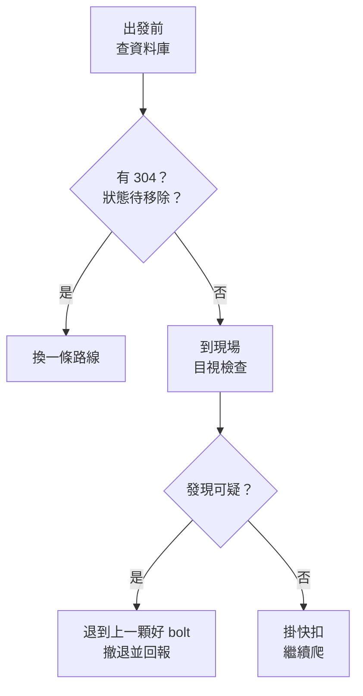

> 🌏 [English version](/posts/climbing/2026-10-17-judging-bolts-en)

2015 年夏天，龍洞音樂廳一條叫「大鼓」的路線，頂端固定點的兩顆 bolt 同時斷裂，一位攀登者摔到地面。他離地面不遠，只受輕傷。事後查出來，那兩顆 bolt 是 2010 年以前出廠的 304 不鏽鋼。

運動攀登把保護交給別人預先打好的 bolt。所以到了戶外，第一個要學的判斷是：**這顆 bolt 能不能信？**

這篇講 bolt 的種類、標準數字的意思、海邊為什麼特別危險，最後給你兩個動作：出發前查資料庫，到現場看一遍。

這篇是〈[運動攀登與傳統攀登](/posts/climbing/2026-10-17-sport-vs-trad-overview)〉系列第 5 篇，接在〈[第一條戶外運攀先鋒](/posts/climbing/2026-10-17-first-outdoor-sport-lead)〉之後。下一篇〈[頂繩架設](/posts/climbing/2026-10-17-top-rope-anchor-setup)〉會把整個頂繩系統交給頂端的兩顆 bolt，所以先把這篇讀完。

## bolt 有兩種：膨脹式與黏膠式

[UIAA 123 岩石錨栓標準](https://www.theuiaa.org/documents/safety-standards/UIAA_123_Rock_Anchors_V5.1.pdf)把 bolt 分成兩大類：

- **膨脹式**（expansion）：鑽孔、敲進去、鎖緊螺帽，尾端的套筒撐開，靠摩擦卡在孔裡。外面看得到螺帽和一片掛片。
- **黏膠式**（glued-in）：孔裡先灌化學黏劑，再把錨栓插進去，等膠完全固化。現代款外觀多半是一體的 P 形環，沒有螺帽。

[英國登山協會（BMC）](https://www.thebmc.co.uk/en/spot-a-bad-bolt)的整理是：膨脹式一般只適合中硬到硬的岩石。現代黏膠式錨栓大多比膨脹式可靠，但早期的 U 形「釘書針」款可能非常弱。UIAA 給打 bolt 者的建議也是**海岸區優先選黏膠式**。

**今晚就能做的動作**：打開你想去的岩場照片或影片，找出一顆 bolt，判斷它是膨脹式（有螺帽和掛片）還是黏膠式（一體的環）。

## 標準數字：EN 959 與 UIAA 123

新品出廠前要過兩套標準。依 [UIAA 官方圖解摘要](https://www.theuiaa.org/documents/safety-standards/Pictorial_UIAA123%20Rock%20Anchors_2024.pdf)：

| 方向 | EN 959 | UIAA 123 |
|---|---|---|
| 徑向（沿岩壁往下拉，墜落的主要方向） | 25 kN | 25 kN |
| 軸向（垂直岩壁往外拔） | 15 kN | 20 kN |

UIAA 123 以 EN 959:2018 為基礎，再加上幾項要求：

- **軸向強度提高到 20 kN**。
- **黏膠式要能承受扭力**：150 N·m 維持 60 秒不轉動。
- **腐蝕等級**：分成 SCC、GC、LC 三級，錨栓上要標出等級，例如「UIAA SCC」。
- **禁止塗漆**：不能為了防鏽或標記而上漆。

第 5.1 版從 2026 年 7 月起生效。

這些數字有一個限制：**它們只保證新品在實驗室裡的強度**。一顆在海邊曬了十五年的 bolt 還剩多少強度，標準回答不了。接下來要看的是：海邊的 bolt 怎麼壞、出發前怎麼查、到現場怎麼看。

## 海邊的 bolt 為什麼會突然斷

不鏽鋼在海邊會發生「應力腐蝕開裂」（SCC）：金屬在受力狀態下碰到氯化物，從內部長出裂紋。UIAA 123 的附錄 A 列了 SCC 的高風險條件：

- **氯化物**：海鹽、氯化鎂、氯化鈣。
- **溫度**：沒有安全下限，20°C 就可能開始，超過 30°C 更糟；被太陽曬的 bolt 比氣溫高很多。
- **濕度**：相對濕度 20–70%。
- **離海距離**：通常在海岸 30 公里內，但沒有明確界線，海風能把鹽帶到很遠的內陸。
- **不被雨水沖刷**：雨淋不到的地方，鹽會在 bolt 上越積越濃。

龍洞全部符合。UIAA 的〈[Watch Your Anchor](https://www.theuiaa.org/documents/safety-standards/UIAA_Anchor_Failures_2024.pdf)〉提醒，這類失效多半發生在不鏽鋼錨栓上；希臘 Leonidio 的一起事故中，錨栓裝上去才幾個月到幾年就意外失效。

最麻煩的一點：**SCC 不一定看得出來。** BMC 的說法更直接，它在實務上「幾乎不可能發現」。目視檢查能抓到鏽蝕、裂縫、鬆動，抓不到藏在金屬裡的裂紋。

另外，UIAA 123 明講不同等級的不鏽鋼**不能混用**，例如掛片和螺栓用了不同的鋼種。兩種金屬接觸會產生電偶腐蝕，加快鏽蝕。

## 龍洞：從 304、316 到鈦

[TOCC（臺灣戶外攀岩協會）〈龍洞的錨栓〉](https://www.tocc-climbing.org/post/%E9%BE%8D%E6%B4%9E%E7%9A%84%E9%8C%A8%E6%A0%93)和[龍洞大事紀](https://www.tocc-climbing.org/chronicle-of-events)記下了這段演變：

1. **2004 年**：張登榮、王宏祥等人開始用 316 不鏽鋼錨栓更新路線。
2. **2010 年**：章芳源醫師發起「龍洞 Rebolt 計畫」，開始全面調查每條路線的錨栓。
3. **2014 年 7 月**：Rebolt 計畫決議，日後更新全面改用鈦合金。
4. **2015 年夏天**：「大鼓」頂端兩顆 bolt 同時斷裂。團隊去信 Petzl，才知道這款 Collinox 早期出廠的是 304 不鏽鋼。
5. **2015 年 9 月**：龍洞第一次 bolt 拉力測試。
6. **2016 年起**：開發臺製鈦合金錨栓，每支都做 X 光檢查和 12 kN 拉力品管。

316 的處境比較微妙。TOCC 的結論是：304 確實在龍洞發生應力腐蝕；316 目前沒有因鏽蝕斷裂的案例，但**無法排除**它將來也會。所以 316 沒有一口氣全部切掉，改成定期拉力測試監控。理由是龍洞每換一輪 bolt 就多一個孔，舊孔無法重用，新的位置只會越來越差。

[拉力測試](https://www.tocc-climbing.org/rebolting-project)的做法是：

- **加載**：8 kN 軸向拉力維持 1 分鐘，10 分鐘內重複 5 次。
- **合格的意思**：降伏強度大於 8 kN；破壞強度沒有測，TOCC 估計大於 12 kN。
- **鈦合金**：標為「免測」。

依[〈龍洞值得怎樣的未來〉](https://www.tocc-climbing.org/post/%E9%BE%8D%E6%B4%9E%E5%80%BC%E5%BE%97%E6%80%8E%E6%A8%A3%E7%9A%84%E6%9C%AA%E4%BE%86-%E5%B2%A9%E5%A0%B4%E7%B6%AD%E8%AD%B7%E8%88%87%E9%96%8B%E7%99%BC)（2021），拉測抓出的問題錨栓大多是早期的 304。少數 316 是化學膠沒混勻而被拉出來，這種施工瑕疵肉眼看不出來。

現況以 TOCC 的路線資料庫為準。2026-10-17 的「統計」分頁：

| 材質 | 數量 |
|---|---|
| 304 不鏽鋼 | 90（88 顆在第一洞） |
| 316 不鏽鋼 | 1,278 |
| 鈦合金 | 781 |
| 合計 | 2,149 |

304 還在減少：[TOCC 2025 工作成果報告](https://www.tocc-climbing.org/post/2025-tocc-summary-report)記錄在第一洞切掉 20 顆。

## 出發前：在 TOCC 路線資料庫查一條路線

TOCC 維護一份公開的 Google 試算表〈[龍洞岩場攀登路線資料庫](https://docs.google.com/spreadsheets/d/1QHFNQSPgKgQrTNnYn246wfotOYqOkzHjLltZ26keBgg/edit?usp=sharing)〉，每條路線的每一顆錨栓都登記在上面。查法：

1. **選分區**：下方分頁是九個區（後門、黃金谷、第一洞……），先點路線所在的區。
2. **找路線編號**：指南書和 TOCC 都用編號，例如 #359。
3. **看錨栓欄**：`B01`–`B18` 是沿途的 bolt，由下往上數；`A01`–`A03` 是頂端固定點。每格寫的是代號，例如 `316-TW`（臺製 316）、`Ti-ETN`（Titan Eterna 鈦合金）、`304-PC`（Petzl Collinox 304）。代號對照在「統計」分頁。
4. **看「Anchor 配件」**：頂端有沒有掛梅隆鎖、羊角，是什麼材質。「共用」表示和隔壁路線共用固定點。
5. **看「路線狀態」**：例如「已更新」「已拉測」「待拉測」「待更新」「待移除」。

錨栓代號的字用顏色區分材質：304 紅字、316 綠字、鈦合金黑字。**顏色代表材質，不代表「能不能爬」。** 一顆綠字的 316 可能已經很久沒拉測；判斷時要把材質、路線狀態、和 TOCC 最近的[工作進度報告](https://www.tocc-climbing.org/post/workreport-202607to08)一起看。

**今晚就能做的動作**：在資料庫裡找一條你想爬的路線。把沿途和頂端每一顆錨栓的代號抄下來，數一數有沒有 304，再看路線狀態欄寫什麼。

## 到現場：目視檢查清單

資料庫只能告訴你裝了什麼。到了岩壁下，還要用眼睛看。綜合 [Access Fund](https://www.accessfund.org/latest-news/can-you-trust-that-bolt)、BMC、UIAA 與 TOCC 的提醒，掛快扣前看這幾件事：

- **鏽蝕與裂縫**：表面有鏽、掛片或環有裂痕。即使是現代不鏽鋼，有明顯鏽蝕也要回報。
- **會轉的掛片**（spinner）：螺帽鬆了，掛片可以用手轉動。Access Fund 指出，這讓 bolt 承受更大的槓桿，整體強度下降。
- **拉或扭會動**：BMC 說，黏膠式錨栓一拉一扭就動，是要提防的訊號。
- **金屬混搭**：掛片和螺栓材質不同，例如有人只換了掛片。這會加速電偶腐蝕。
- **周圍的岩石**：岩石碎裂、空心岩片、離裂縫或岩角太近。BMC 的參考距離是一個張開手掌寬。
- **頂端環的磨損**：BMC 的經驗法則是，磨損超過三分之一厚度就不要依賴那個零件。
- **龍洞的警告布標**：第一洞部分仍有 304 的路線，TOCC 在第一顆 bolt 掛了警告布標。看到就要當真。

Access Fund 也提醒，每個攀登者都有責任在使用前檢查固定點。BMC 的專家說得更白：一座岩場的 bolt 通常沒有人負責，不要因為是運攀路線就假設它安全。

**看起來正常，只代表沒看到明顯問題。** SCC 和化學膠沒混勻都看不出來，所以出發前的資料庫查詢和現場檢查要一起做。

## 遇到可疑的 bolt 怎麼辦

先鋒爬到一半才發現不對，[BMC](https://www.thebmc.co.uk/en/spot-a-bad-bolt) 的建議是：

1. **退回去**：下攀到上一顆好的 bolt。
2. **用便宜的撤退鉤環下來**：身上帶一個「bail biner」，換掉好的快扣再下放。

UIAA 給攀登者的建議還有：

- **頂端用多顆 bolt 組成的固定點**，能從兩個以上的環下放或確保更好。
- **能補保護就補**：岩楔、機械塞、樹、岩洞都可以當備援。這需要傳攀技術，系列後面會講。
- **對可疑 bolt 上的專案路線，準備放棄**。

撤下來之後，在龍洞就回報給 TOCC 的 Rebolting Team。萬一真的有 bolt 斷了，先確保人安全、處理傷患。之後 UIAA 請你**保留斷掉的零件**，不要拼湊斷面；通知在地社群，再透過 [UIAA 的回報表單](https://theuiaa.typeform.com/to/rlBZyc)讓他們拿去分析。

不要自己動手修。TOCC 在〈龍洞值得怎樣的未來〉裡提到，已知不適合濱海岩場的 304 錨栓，至今仍有人自行裝到龍洞的岩壁上。

## 練習題：四個情境

答案在每題下方，先自己想再看。想練更多繩索系統的判斷，可以玩 [nobodyclimb 的繩索系統練習：頂繩架設](https://nobodyclimb.cc/games/rope-system/learn/sport-toprope)。

**1. 你在資料庫查到一條第一洞的路線，B03 到 B05 是 `304-FX`，路線狀態寫「待移除」。朋友說「上週有人爬過，沒事」。**

答案

換一條路線。304 在龍洞已確認會發生應力腐蝕，而且 SCC 看不出來；上週沒斷，不代表這週不會斷。「待移除」表示 TOCC 已經排定要切掉它。

**2. 一條路線的錨栓全是 `316-TW`，字是綠的。可以直接當作安全嗎？**

答案

不行。綠字只代表材質是 316。還要看路線狀態欄（已拉測？待拉測？），到現場也要做目視檢查。TOCC 自己的說法是無法排除 316 發生應力腐蝕的可能。

**3. 先鋒到第四顆 bolt，掛片可以用手轉一圈，螺帽有點鬆。**

答案

不要把它當成可靠的保護點。可以掛上快扣當作「有總比沒有好」，但下一步的墜落要當作它不存在來評估。依 BMC 的建議，必要時下攀到上一顆好的 bolt 撤退，下來後回報 TOCC。

**4. 頂端兩顆錨栓看起來都很新，但其中一個垂降環的內緣被磨出一道深溝，約有原本厚度的一半。**

答案

BMC 的經驗法則是磨損超過三分之一就不要依賴那個零件。不要讓主繩穿過那個環，改用另一顆錨栓本身或自己的鉤環，並回報給維護團隊。下一篇〈頂繩架設〉會講怎麼用自己的裝備架頂繩，讓公共設備少磨一點。

## 下一步

會判斷 bolt 之後，下一篇〈[頂繩架設](/posts/climbing/2026-10-17-top-rope-anchor-setup)〉會在雙 bolt 頂端架一組頂繩：用自己的快扣或有鎖鉤環，不讓主繩直接磨公共固定點。

還沒看過系列總覽，可以從〈[運動攀登與傳統攀登總覽](/posts/climbing/2026-10-17-sport-vs-trad-overview)〉開始；想先複習確保，回到〈[岩館上攀確保](/posts/climbing/2026-10-17-gym-top-rope-belay)〉。

## 參考資料

- [UIAA 123 Rock Anchors, Version 5.1（UIAA，2026）](https://www.theuiaa.org/documents/safety-standards/UIAA_123_Rock_Anchors_V5.1.pdf)
- [EN 959 / UIAA 123 Rock Anchors 圖解摘要（UIAA）](https://www.theuiaa.org/documents/safety-standards/Pictorial_UIAA123%20Rock%20Anchors_2024.pdf)
- [Watch Your Anchor! Corrosion and Stress Corrosion Cracking Failure of Climbing Anchors（UIAA Safety Commission，2024）](https://www.theuiaa.org/documents/safety-standards/UIAA_Anchor_Failures_2024.pdf)
- [Rock Anchors（UIAA）](https://www.theuiaa.org/safety/rockanchors/)
- [How to spot a bad bolt when sport climbing（BMC）](https://www.thebmc.co.uk/en/spot-a-bad-bolt)
- [Can You Trust That Bolt?（Access Fund）](https://www.accessfund.org/latest-news/can-you-trust-that-bolt)
- [TOCC：龍洞的錨栓](https://www.tocc-climbing.org/post/%E9%BE%8D%E6%B4%9E%E7%9A%84%E9%8C%A8%E6%A0%93)
- [TOCC：龍洞大事紀](https://www.tocc-climbing.org/chronicle-of-events)
- [TOCC：Rebolting Project（拉力測試計畫）](https://www.tocc-climbing.org/rebolting-project)
- [TOCC：龍洞值得怎樣的未來：岩場維護與開發（2021）](https://www.tocc-climbing.org/post/%E9%BE%8D%E6%B4%9E%E5%80%BC%E5%BE%97%E6%80%8E%E6%A8%A3%E7%9A%84%E6%9C%AA%E4%BE%86-%E5%B2%A9%E5%A0%B4%E7%B6%AD%E8%AD%B7%E8%88%87%E9%96%8B%E7%99%BC)
- [TOCC：2025 工作成果報告](https://www.tocc-climbing.org/post/2025-tocc-summary-report)
- [TOCC：工作進度報告 2026 年 7、8 月](https://www.tocc-climbing.org/post/workreport-202607to08)
- [龍洞岩場攀登路線資料庫（TOCC，Google 試算表）](https://docs.google.com/spreadsheets/d/1QHFNQSPgKgQrTNnYn246wfotOYqOkzHjLltZ26keBgg/edit?usp=sharing)
- [nobodyclimb 繩索系統練習：頂繩架設](https://nobodyclimb.cc/games/rope-system/learn/sport-toprope)
