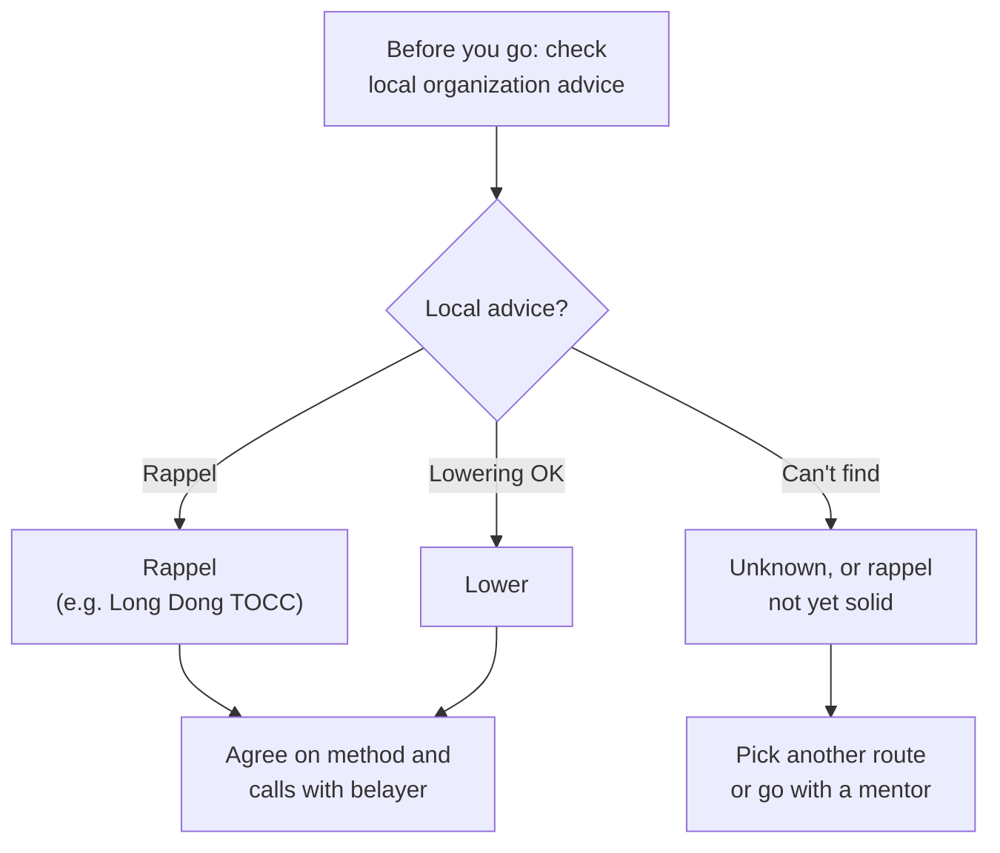

> 🌏 [中文版](/posts/climbing/2026-10-17-lower-or-rappel)

In the gym, you reach the top, call "take," and your belayer lowers you. The rope is already rigged at the top; you don't touch anything.

On an outdoor sport route, you clipped your own quickdraws on the way up. At the top there are two bolts, maybe with chains, rappel rings or lowering hooks. You have to thread the rope yourself and collect your draws, and then you have two choices: your belayer **lowers** you, or you **rappel**. Different organizations give different advice on this.

This is part 5 of the Sport and Trad Climbing series. Read [Belaying Outdoors](/posts/climbing/2026-10-17-outdoor-belay-en) and [Your First Outdoor Sport Lead](/posts/climbing/2026-10-17-first-outdoor-sport-lead-en) first; for rigging a top-rope on your own gear, see [Setting Up a Top Rope](/posts/climbing/2026-10-17-top-rope-anchor-setup-en). This post covers the last climber collecting the gear and getting back to the ground.

To be clear up front: **practice everything you do at the anchor on the ground or in a gym first, until an instructor has seen you do it right.** This post explains what each step protects you from; it is not a manual.

## How lowering and rappelling differ

Both start by threading the rope through the top anchor. The difference is who controls the rope:

| | Lowering | Rappelling |
|---|---|---|
| Who controls speed | Belayer on the ground | The climber |
| Belay | On belay the whole time | Belayer has taken them off belay |
| The rope | Moves through the anchor | Stays still; the device moves along it |
| Anchor wear | Higher | Lower |
| Gear needed | Very little | Rappel device, carabiners, tether, friction hitch |

In the AAC's [Know the Ropes: Lowering](https://americanalpineclub.org/news/2023/6/21/lowering), IFMGA guide Mike Poborsky points out a subtle but important difference. When you rappel, the rope stays still. When you lower, the rope moves, dragging over loose rock and sharp edges on the route. Before lowering, position the rope to avoid edges and loose blocks.

## The AAC: lowering is safer, but respect local rules

Across articles from 2013 to 2021, the American Alpine Club's advice shifts toward lowering:

- **2013**: Poborsky says to top-rope only on your own removable gear, never through the anchor's fixed hardware. At some sandstone areas, sand works into the rope and locals report 50 percent wear of steel quick links in a couple of seasons. Whenever possible, the last climber should rappel rather than lower.
- **2016**: The AAC's [Cleaning an Anchor in Single Pitch Climbing](https://americanalpineclub.org/news/2016/3/15/5ipkouk0id07cgc3dqks4fljnsgnx6) takes another angle. Changing safety systems, from being belayed to rappelling, creates chances for error; "it is inherently more efficient and safer to use one safety system at all times." It calls lowering off the rings the most generalizable cleaning sequence. It admits lowering wears rings faster, but says rings are designed to take that wear and then be replaced.
- **2021**: [Know the Ropes: Cleaning Sport Routes](https://publications.americanalpineclub.org/articles/13201216058), in the AAC's accident report, says lowering has become widely accepted, even recommended, at many areas. It is talking about busy sport crags with active local climbing organizations and modern anchors. It adds that a few climbers and local organizations still recommend rappelling, so **learn the local ethic first**. If rappelling is necessary because of the local ethic, worn hardware, or a remote, rarely maintained route, it suggests cleaning on top-rope and then rappelling.

So the AAC's conclusion: lowering is simpler, and the local organization's rules come first.

## Long Dong's TOCC: please rappel whenever possible

The [Taiwan Outdoor Climbers' Coalition (TOCC)'s page on Long Dong top anchors](https://www.tocc-climbing.org/post/%E9%BE%8D%E6%B4%9E%E7%9A%84%E4%B8%8A%E6%96%B9%E5%9B%BA%E5%AE%9A%E9%BB%9E) (in Chinese) is clear:

- **Retreating**: Clean routes by double-rope rappel whenever possible. Avoid lowering unless there is an emergency such as a sudden weather change, lightning, an earthquake or bee stings.
- **Top-roping**: Always use your own gear. Never run the climbing rope directly through fixed hardware for a top-rope.
- **Bolt-only anchors with no attachments**: Avoid anything that could wear the bolts.

TOCC's reasons come from Long Dong's conditions. It is a sea cliff, and old bolts can't be fully removed; they are cut off and a new hole is drilled nearby. Each round of replacement puts the new bolt in a slightly worse spot. All hardware is bought with community donations, and inspection and replacement rely on a few volunteers. Lowering hooks were installed so climbers could lower without untying, but titanium hooks are hard to buy, so TOCC still recommends rappelling.

TOCC also states that double-rope rappelling is **only a recommendation**; how you retreat should depend on the conditions and your own ability.

## How to choose

The two positions look opposed, but they answer different questions. The AAC argues that one safety system is less error-prone; TOCC argues that every replacement cycle at Long Dong uses up rock. Both agree on one thing: **local rules come first.**

- **At Long Dong**: Follow TOCC and rappel whenever possible; lower only in emergencies like sudden weather, lightning or bee stings.
- **At other crags**: Check the guidebook, the local climbing organization's website or social media, and ask at the local gym or other climbers.
- **If you can't rappel yet**: Don't learn at the top of a route. The 2021 AAC article recommends practicing in a safe setting with feedback from an experienced climber; some gyms have practice anchors.

Whichever you choose, **agree with your belayer before you leave the ground**. Poborsky writes that many accidents happened when the belayer assumed the climber would rappel and took them off belay, while the climber expected to be lowered. The communication section of [Belaying Outdoors](/posts/climbing/2026-10-17-outdoor-belay-en) covers this in detail.

**Something to try tonight**: Open the guidebook or local organization website for the next crag you want to visit and find its advice on lowering versus rappelling. If you can't find it, note that down and ask on site.

## Threading the anchor: always stay attached

Switching the rope from your tie-in to the anchor is the most error-prone part of the whole process. There are many methods. Here are only the principles they share; learn the actual steps from an instructor:

- **The belayer never lets go**: Petzl's [How to clean the anchor](https://www.petzl.com/int/en/sport/tech-tips/basic-techniques/how-to-clean-the-anchor/Escalade-falaise-Comment-installer-une-moulinette_SPO_a77w0000000Kyn3AAC.html) says that regardless of the technique, the belayer keeps belaying throughout, never letting go of the brake side.
- **Something always connects you**: In the AAC's 2016 sequence, you first clip your belay loop to the anchor with a quickdraw. Then you push a bight through the rings, tie a figure 8 on a bight and clip it to your belay loop. You call "take," check the whole system, and only then untie your original knot. Only three calls are used: "slack," "take" and "ready to lower." Nothing like "off belay" that could confuse the belayer.
- **Test before you untether**: Petzl has the climber stay tethered to the anchor while weighting the rope for the lower, and untether only after confirming the belayer is holding them.
- **Never lower through a sling**: Poborsky warns never to lower with the rope running directly through an anchor sling. The heat of nylon on nylon will quickly melt through it.
- **Drill it on the ground**: Poborsky recommends practicing on the ground and using the same system every time you clean an anchor.

**Something to try tonight**: Tie two loops of cord to a door handle or stair rail as a mock anchor and practice threading with a length of rope. The order: clip in, thread, tie, clip to belay loop, and only then untie the original knot. Repeat until you don't have to think about the order.

## The deadliest lowering mistake: a rope that's too short

[Poborsky](https://americanalpineclub.org/news/2023/6/21/lowering) reviewed a decade of lowering accidents in the AAC's reports. The four most common causes were a rope that's too short, miscommunication, an inadequate belay, and anchor failure. **More than half** were the rope end shooting through the belay device.

The fix is **closing the system**: a bulky stopper knot in the rope end (such as a triple overhand), or the belayer tying into the end. Petzl's [Rope too short](https://petzl.com/int/en/sport/tech-tips/basic-techniques/rope-too-short--warning---danger-/CORDES-Corde-trop-courte---attention-danger--_SPO_a77w0000000PCKGAA4.html) puts it plainly: for crag climbing, **always** tie a knot in the end of the rope.

Steep or traversing routes need extra care. The [2021 AAC article](https://publications.americanalpineclub.org/articles/13201216058) warns that lowering from an overhanging or traversing route can take more rope than expected, especially if the climber ends up down a hill.

Anchor failure, another of the four causes, has happened in Taiwan too. The [TOCC chronicle](https://www.tocc-climbing.org/chronicle-of-events) records that in 2015 both bolts of the top anchor on "Big Drum" in Long Dong's Music Hall failed at once and a climber fell to the ground. Luckily they were close to the ground and only slightly hurt. It later turned out that this bolt model was made of 304 stainless steel before 2010. For how to judge whether a bolt can be trusted, see [Bolts Fail: How to Judge a Bolt](/posts/climbing/2026-10-17-judging-bolts-en).

**Something to try tonight**: Pick a route you want to climb, look up its length, double it, and compare with your rope. If the margin is under 5 m, treat the rope as too short.

## The deadliest rappelling mistakes: anchors, backups, rope ends

The AAC's 2012 [Know the Ropes: Rappelling](https://publications.americanalpineclub.org/articles/13201200200/Know-the-Ropes-Rappelling) reviewed rappel incidents since 2000 and found three primary causes:

1. **Anchor failure**.
2. **Inadequate rappel backup**.
3. **Rappelling off the end of the rope**, mostly because the ropes were uneven.

What to do:

- **Find the true middle**: On a single rope, the middle must sit at the anchor. [Petzl notes](https://www.petzl.com/int/en/sport/tech-tips/basic-techniques/change-in-the-length-of-my-rope-after-use/CORDES-evolution-de-la-longeur-de-ma-corde_SPO_a77w0000000PCKLAA4.html) that ropes shrink with use, the two halves may not shrink equally, and the middle mark can drift. If in doubt, hold both ends together and slide both strands through your hands until you reach the middle.
- **Knot each rope end separately**: The AAC suggests knotting each strand on its own rather than tying them together, so twists can dissipate. A triple barrel knot is a good choice.
- **Add a friction-hitch backup**: See the next section.
- **Stay attached at the anchor**: Petzl's [rappelling tip](https://petzl.com/int/en/sport/tech-tips/basic-techniques/rappelling/escalade-grde-voie-rappel_SPO_a77w0000000KypxAAC.html) opens with the rule that every maneuver at the anchor is done while directly connected to it.

The 2012 AAC article also cites the annual accident report: about 30 percent of climbing accidents happen on descent.

**Something to try tonight**: Find your rope's middle mark, then find the true middle by matching the ends. See how far apart the two are.

## Rappel backup: where the friction hitch goes

On rappel, a thin cord tied around the rope as a friction hitch (often an autoblock) acts as a "third hand." If your hand lets go, the hitch grips and you stop. Petzl says it holds you when you need to go hands-free, for example because of rockfall or knots in the rope.

Where the friction hitch is attached has changed:

- **Older method: device on the belay loop, friction hitch on the leg loop.** The 2012 AAC article says this is hard to adjust; if the autoblock sling is too long, it rides up against the rappel device, then slides and stops working.
- **Common method now: extend the rappel device and clip the friction hitch to the belay loop.** The device sits out in front on a sling or tether, and the friction hitch sits below it on the brake strand, clipped back to your belay loop. [Petzl's rappelling steps](https://petzl.com/int/en/sport/tech-tips/basic-techniques/rappelling/escalade-grde-voie-rappel_SPO_a77w0000000KypxAAC.html) teach exactly this: friction hitch on the belay loop, descender on an extended lanyard. [Climbing's rappelling article](https://www.climbing.com/skills/rappelling-best-practices/), by a Yosemite Search and Rescue member and a Yosemite guide, also extends the device and clips a prusik of at least three wraps to the belay loop with a locker.

For the extension sling, the 2012 AAC article adds two points. First, use nylon, not Dyneema; Dyneema has very little elasticity and breaks at low loads when shock-loaded. Second, girth-hitch the sling to the harness tie-in points, not to the belay loop.

**Something to try tonight**: Check whether you own a cord suitable for a friction hitch. Poborsky's rule of thumb is that the cord should be 2–3 mm thinner than the climbing rope to grip well. If you don't have one, put it on your shopping list, then practice tying an autoblock in the gym or at home.

## Practice: four scenarios

Each answer is hidden under its question; think first, then look. For more practice, try [nobodyclimb's rope-system practice: rappelling](https://nobodyclimb.cc/games/rope-system/learn/sport-rappel) (in Chinese).

**1. You finish a sport route at Long Dong and you're the last one to clean it. The weather is fine. Lower or rappel?**

Answer

Following TOCC, rappel with two ropes whenever possible to reduce wear on bolts and hardware. TOCC's exceptions are emergencies such as a sudden weather change, lightning, an earthquake or bee stings. If you can't rappel yet, don't try it for the first time on this route; learn it in a practice setting first.

**2. At the top, the climber shouts "I'm good, you can take me off." You didn't agree beforehand whether they'd lower or rappel.**

Answer

Don't take them off belay. This is the classic accident the AAC describes: the belayer assumes a rappel and pulls the rope out of the device. Keep belaying, ask clearly, and step back to see them if needed. Next time, agree before the climb.

**3. The top anchor has only an old sling between the two bolts, no rings or hooks. You're thinking of running the rope straight through the sling and having your belayer lower you.**

Answer

No. A loaded rope moving through a sling melts it quickly from nylon-on-nylon friction. Lowering needs metal for the rope to run through. A sling-only anchor calls for a different approach, which takes skills learned in a course.

**4. On rappel, the autoblock on your leg loop keeps riding up into your rappel device.**

Answer

Stop; your backup may already have stopped working. The AAC notes that an autoblock touching the device slides. Switch to an extended device with the friction hitch on your belay loop so the two stay apart. Practice this on the ground first.

## What's next

That wraps up sport-route anchor work. Next is [Grades and Protection Ratings](/posts/climbing/2026-10-17-grades-and-protection-ratings-en): what 5.10a, 6a, E1 5b and R/X each mean, before the series moves into trad climbing.

To plan your learning order and the courses to take, see [Learning Path and Common Accidents](/posts/climbing/2026-10-17-sport-to-trad-learning-path-en).

## References

- [Know the Ropes: Lowering (Mike Poborsky, AAC; first published in Accidents in North American Mountaineering 2013)](https://americanalpineclub.org/news/2023/6/21/lowering)
- [Cleaning an Anchor in Single Pitch Climbing (AAC)](https://americanalpineclub.org/news/2016/3/15/5ipkouk0id07cgc3dqks4fljnsgnx6)
- [Know the Ropes: Cleaning Sport Routes (Lindsay Auble, AAC, 2021)](https://publications.americanalpineclub.org/articles/13201216058)
- [Know the Ropes: Rappelling (Rob Hess, AAC, 2012)](https://publications.americanalpineclub.org/articles/13201200200/Know-the-Ropes-Rappelling)
- [How to clean the anchor (Petzl)](https://www.petzl.com/int/en/sport/tech-tips/basic-techniques/how-to-clean-the-anchor/Escalade-falaise-Comment-installer-une-moulinette_SPO_a77w0000000Kyn3AAC.html)
- [Rappelling (Petzl)](https://petzl.com/int/en/sport/tech-tips/basic-techniques/rappelling/escalade-grde-voie-rappel_SPO_a77w0000000KypxAAC.html)
- [Rope too short: warning - danger! (Petzl)](https://petzl.com/int/en/sport/tech-tips/basic-techniques/rope-too-short--warning---danger-/CORDES-Corde-trop-courte---attention-danger--_SPO_a77w0000000PCKGAA4.html)
- [Change in the length of my rope after use (Petzl)](https://www.petzl.com/int/en/sport/tech-tips/basic-techniques/change-in-the-length-of-my-rope-after-use/CORDES-evolution-de-la-longeur-de-ma-corde_SPO_a77w0000000PCKLAA4.html)
- [Rappelling Is Climbing's Most Dangerous Activity (Climbing)](https://www.climbing.com/skills/rappelling-best-practices/)
- [TOCC: Top anchors at Long Dong](https://www.tocc-climbing.org/post/%E9%BE%8D%E6%B4%9E%E7%9A%84%E4%B8%8A%E6%96%B9%E5%9B%BA%E5%AE%9A%E9%BB%9E) (in Chinese)
- [TOCC: Long Dong chronicle of events](https://www.tocc-climbing.org/chronicle-of-events)
- [nobodyclimb rope-system practice: rappelling](https://nobodyclimb.cc/games/rope-system/learn/sport-rappel) (in Chinese)
- [Belaying Outdoors](/posts/climbing/2026-10-17-outdoor-belay-en)
