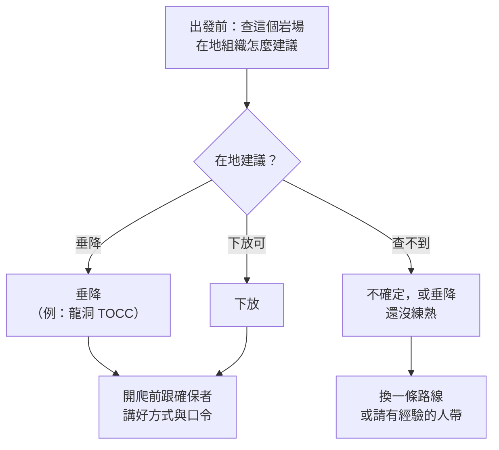

> 🌏 [English version](/posts/climbing/2026-10-17-lower-or-rappel-en)

在岩館，爬到頂端喊一聲「Take」，確保者就放你下來。頂端的繩子本來就掛好了，你不用碰任何東西。

到了戶外運攀路線，你是自己掛快扣爬上去的。頂端只有兩顆錨栓，可能加了鍊條、垂降環或羊角。繩子要你自己穿過去，快扣要回收，然後有兩個選擇：讓確保者**下放**你，或你自己**垂降**。不同的組織，對這題的建議不一樣。

這篇是〈運動攀登與傳統攀登〉系列的第 7 篇。前置是[戶外確保](/posts/climbing/2026-10-17-outdoor-belay)與[第一條戶外運攀先鋒](/posts/climbing/2026-10-17-first-outdoor-sport-lead)；用自己的器材在頂端架頂繩，見[頂繩架設](/posts/climbing/2026-10-17-top-rope-anchor-setup)。這篇講的是最後一個人要把東西收走、下到地面的那一步。

先講清楚：**頂端的操作一定要先在地面或岩館練過，在教練面前做到正確。** 這篇讓你知道每一步在防什麼，不是操作手冊。

## 下放和垂降差在哪

兩者都要把繩子穿過頂端固定點，差別在誰控制繩子：

| | 下放 | 垂降 |
|---|---|---|
| 誰控制速度 | 地面的確保者 | 攀爬者自己 |
| 確保 | 全程都在確保中 | 確保者已經放開確保 |
| 繩子 | 繩子在固定點上移動 | 繩子不動，垂降器沿著繩子移動 |
| 固定點磨損 | 比較大 | 比較小 |
| 需要的器材 | 很少 | 垂降器、鉤環、自我確保繩、摩擦套結 |

AAC 的[〈Know the Ropes: Lowering〉](https://americanalpineclub.org/news/2023/6/21/lowering)（作者是 IFMGA 國際高山嚮導 Mike Poborsky）特別點出一個細微但重要的差別：垂降時繩子不動。下放時繩子在動，它會拖過路線上的鬆石和銳利岩角。下放前要先調整繩子的位置，避開岩角和鬆動的石塊。

## AAC：下放比較安全，但要尊重在地規則

從 2013 到 2021 年的幾篇文章，可以看到美國登山協會（AAC）的建議逐漸轉向下放：

- **2013 年**：Poborsky 那篇主張頂繩一律用自己的器材，不要直接穿過固定點的金屬件。他寫道，在一些砂岩岩場，沙子卡進繩皮，讓鋼製快速扣環在兩三季內就磨掉一半。最後一個人爬完，盡可能用垂降而不是下放。
- **2016 年**：AAC 網站上的[〈Cleaning an Anchor in Single Pitch Climbing〉](https://americanalpineclub.org/news/2016/3/15/5ipkouk0id07cgc3dqks4fljnsgnx6)換了一個角度。它認為切換安全系統（從被確保改成垂降）會增加出錯的機會，「全程只用一套安全系統，本質上更有效率也更安全」。它把「從垂降環下放」列為單繩距最通用的清除方式。它也承認下放比較磨垂降環，但垂降環本來就是設計來承受下放、然後被更換的。
- **2021 年**：AAC 年度事故報告的[〈Know the Ropes: Cleaning Sport Routes〉](https://publications.americanalpineclub.org/articles/13201216058)寫道，下放已被廣泛接受，在很多地方甚至是推薦做法。它指的是有活躍在地攀岩組織、固定點設計較新的熱門運攀岩場。但它同時提醒：少數攀岩者和在地組織仍然建議垂降，**要先查清楚當地的規範**。如果當地倫理要求垂降、固定點的金屬件已經磨損，或是很少維護的偏遠路線，它建議先上攀把路線清乾淨，再垂降。

所以 AAC 的結論是：下放比較單純，在地組織的規範優先。

## 龍洞 TOCC：請盡可能垂降

[臺灣戶外攀岩協會（TOCC）〈龍洞的上方固定點〉](https://www.tocc-climbing.org/post/%E9%BE%8D%E6%B4%9E%E7%9A%84%E4%B8%8A%E6%96%B9%E5%9B%BA%E5%AE%9A%E9%BB%9E)的建議很明確：

- **撤退**：盡可能以「雙繩垂降」的方式清除路線上的裝備。除非遇到天候驟變、雷擊、地震、蜂螫等緊急狀況，否則盡量避免下放。
- **架頂繩**：一律用自備的器材，不要把主繩直接穿過固定設備架頂繩。
- **只有錨栓、沒有配件的固定點**：盡量避免任何可能磨損錨栓的操作。

TOCC 的理由跟龍洞的條件有關。龍洞是海邊岩場，舊錨栓沒辦法完整取出，只能切掉、在旁邊另外鑽孔。每換一輪，新錨栓的位置就更差一點。設備採購全靠社群捐款，巡查和更新也靠少數志工。羊角雖然是為了讓人不解繩結就能下放而裝的，但鈦合金羊角不好買，所以 TOCC 還是建議垂降。

TOCC 也寫明：雙繩垂降**僅為建議**，實際撤退方式要依現場條件與自身能力評估。

## 怎麼選

兩邊的建議看起來衝突，其實回答的是不同的問題。AAC 的論點是單一安全系統比較不容易出錯；TOCC 的論點是龍洞的錨栓換一輪少一輪。兩邊都同意一件事：**當地規範優先。**

- **在龍洞**：照 TOCC，盡可能垂降；遇到天候驟變、雷擊、蜂螫這類緊急狀況才下放。
- **在其他岩場**：查指南書、在地攀岩組織的網站或社群，問當地岩館或其他攀岩者。
- **還不會垂降**：不要在路線頂端第一次學。AAC 2021 那篇建議先在安全的環境、有經驗的人給回饋時練習。有些岩館有練習用的固定點。

不管選哪個，**開爬前就要跟確保者講好**。Poborsky 寫道，很多事故是確保者以為攀爬者要垂降、就放開了確保，其實攀爬者要下放。這部分在[戶外確保](/posts/climbing/2026-10-17-outdoor-belay)的溝通一節有細講。

**今晚就能做的動作**：打開你下一個想去的岩場的指南或在地組織網站，找出它對下放與垂降的建議。找不到就記下來，到現場先問。

## 穿環：全程有東西連著你

頂端的繩子要從你的繩結改成穿過固定點，這是整個過程最容易出錯的一段。方法很多，這裡只講各家都同意的原則，實際步驟要在教練面前學：

- **確保者全程不放手**：Petzl 的[〈How to clean the anchor〉](https://www.petzl.com/int/en/sport/tech-tips/basic-techniques/how-to-clean-the-anchor/Escalade-falaise-Comment-installer-une-moulinette_SPO_a77w0000000Kyn3AAC.html)寫道，不論用哪種技術，確保者都要全程持續確保，制動手不離開繩子。
- **永遠有東西連著你**：AAC 2016 年的流程是先用一條快扣把確保環連到固定點。接著把繩子對折穿過垂降環，打八字結掛回確保環。喊「Take」讓確保者收緊，確認整個系統之後，才解開原本的繩結。整個過程只用三個口令：「Slack」「Take」「Ready to lower」，不會出現「Off belay」這種會讓確保者誤會的話。
- **先測試再解開**：Petzl 建議攀爬者坐上繩子準備下放時，仍然連著固定點，先確認確保者真的接住了體重，再解開連接。
- **不要直接用扁帶下放**：Poborsky 提醒，下放時繩子絕對不能直接穿過固定點上的扁帶。尼龍和尼龍摩擦產生的熱，很快就會把扁帶熔斷。
- **在地面練到熟**：Poborsky 的建議是先在地面練習，而且每次清除固定點都用同一套方法。

**今晚就能做的動作**：在家裡的門把或樓梯扶手上綁兩個繩環當「固定點」，用一段繩子練一次穿環。順序是先連上、再穿、打結、掛回確保環，最後才解開原本的繩結。練到不用想順序為止。

## 下放最致命的錯誤：繩子不夠長

過去十年 AAC 收錄的下放事故，[Poborsky](https://americanalpineclub.org/news/2023/6/21/lowering) 整理出四大主因：繩子太短、溝通錯誤、確保不當、固定點失效。其中**一半以上**是繩尾從確保器穿出、攀爬者失控墜落。

對策是**封閉系統**：繩尾打一個大的止滑結（例如三重單結），或讓確保者綁進繩尾。Petzl 的[〈Rope too short〉](https://petzl.com/int/en/sport/tech-tips/basic-techniques/rope-too-short--warning---danger-/CORDES-Corde-trop-courte---attention-danger--_SPO_a77w0000000PCKGAA4.html)寫得更直接：在岩場攀登，繩尾**一律**打結。

陡峭或橫渡的路線要另外小心。[AAC 2021 那篇](https://publications.americanalpineclub.org/articles/13201216058)提醒，從大仰角或橫渡路線下放，可能比預期用掉更多繩子，尤其攀爬者最後落在坡下時。

四大主因裡的固定點失效，台灣也發生過。[TOCC 大事紀](https://www.tocc-climbing.org/chronicle-of-events)記錄，2015 年龍洞音樂廳「大鼓」頂端固定點的兩顆 bolt 同時斷裂，一位岩友墜落地面。所幸當時離地面不遠，只受輕傷。事後查出那款 bolt 在 2010 年以前出廠的是 304 不鏽鋼。怎麼判斷一顆 bolt 能不能信，見[掛片會壞：怎麼判斷一顆 bolt](/posts/climbing/2026-10-17-judging-bolts)。

**今晚就能做的動作**：挑一條你想爬的路線，查出它的長度，乘以二，跟你的繩長比一比。差不到 5 公尺，就當作繩子不夠。

## 垂降最致命的錯誤：固定點、備份、繩尾

AAC 2012 年的[〈Know the Ropes: Rappelling〉](https://publications.americanalpineclub.org/articles/13201200200/Know-the-Ropes-Rappelling)回顧 2000 年以來的垂降事故，主因有三個：

1. **固定點失效**。
2. **垂降沒有足夠的備份**。
3. **垂降出繩尾**，多半是因為兩邊繩子不等長。

對應的做法：

- **找準繩子中點**：用單繩垂降時，繩子的中點要剛好在固定點上。Petzl 的[說明](https://www.petzl.com/int/en/sport/tech-tips/basic-techniques/change-in-the-length-of-my-rope-after-use/CORDES-evolution-de-la-longeur-de-ma-corde_SPO_a77w0000000PCKLAA4.html)指出，繩子用久會縮短，兩半縮的比例不一定一樣，中點標記就會跑掉。不確定時，把兩端繩尾對齊，兩股一起往回拉，拉到底就是中點。
- **兩邊繩尾各打一個結**：AAC 建議每一股各自打結，不要兩股綁在一起，繩子的扭轉才能散開。三重桶結（triple barrel knot）是好選擇。
- **加摩擦套結當備份**：見下一節。
- **在固定點的所有操作都連著固定點**：Petzl 的[垂降說明](https://petzl.com/int/en/sport/tech-tips/basic-techniques/rappelling/escalade-grde-voie-rappel_SPO_a77w0000000KypxAAC.html)開頭就寫，所有在固定點的操作都要直接連在固定點上。

AAC 2012 那篇還引了年度事故報告的統計：約 30% 的攀登事故發生在下撤途中。

**今晚就能做的動作**：拿出你的繩子，找中點標記。再用兩端對齊的方法找一次真正的中點，看兩個位置差多少。

## 垂降備份：摩擦套結怎麼掛

垂降時用一條細繩在主繩上打摩擦套結（常用的是 autoblock），當作「第三隻手」。手鬆開時，套結會咬住繩子，你就停在原地。Petzl 的說法是，碰到落石、繩子打結這類需要空出雙手的狀況，摩擦套結會撐住你。

摩擦套結掛在哪裡，做法有變：

- **舊做法：垂降器掛確保環，摩擦套結掛在腿環上**。AAC 2012 那篇指出這個做法難調整，摩擦套結太長時會頂到垂降器，一頂上去就會滑動、失去作用。
- **現在常見的做法：把垂降器延伸出去，摩擦套結掛在確保環上**。垂降器用一條扁帶或自我確保繩延伸到身體前方，摩擦套結在它下方的制動端，用鉤環掛回確保環。[Petzl 的垂降步驟](https://petzl.com/int/en/sport/tech-tips/basic-techniques/rappelling/escalade-grde-voie-rappel_SPO_a77w0000000KypxAAC.html)就是這樣教的：摩擦套結掛在確保環，垂降器接在延伸出去的自我確保繩上。[Climbing 雜誌的垂降專文](https://www.climbing.com/skills/rappelling-best-practices/)（作者是優勝美地搜救隊員與嚮導）也用延伸垂降器，摩擦套結至少繞三圈、用有鎖鉤環掛在確保環。

延伸用的扁帶，AAC 2012 提醒兩點。第一，用尼龍扁帶，不要用 Dyneema；Dyneema 幾乎沒有彈性，受到衝擊時在很低的力量下就會斷。第二，扁帶要用 girth hitch 的方式套在吊帶的綁繩點上，不是套在確保環上。

**今晚就能做的動作**：檢查你的裝備裡有沒有一條適合打摩擦套結的細繩。AAC 2013 那篇的經驗法則是，細繩要比主繩細 2–3 公釐，摩擦力才夠。沒有就加進下次的購物清單，然後在岩館或地面上練打 autoblock。

## 練習題：四個情境

答案在每題下方，先自己想再看。想練更多題，可以玩 [nobodyclimb 的繩索系統練習：垂降](https://nobodyclimb.cc/games/rope-system/learn/sport-rappel)。

**1. 在龍洞爬完一條運攀，你一個人最後清路線，天氣很好。下放還是垂降？**

答案

照 TOCC 的建議，盡可能雙繩垂降，減少錨栓與配件磨損。TOCC 列的例外是天候驟變、雷擊、地震、蜂螫等緊急狀況。如果你還不會垂降，就不要在這條路線上第一次試；先在練習環境學好。

**2. 攀爬者在頂端喊「我好了，可以 off 了」。你們開爬前沒講好要下放還是垂降。**

答案

不要放開確保。這正是 AAC 記錄的典型事故：確保者以為攀爬者要垂降，就把繩子拿出確保器。繼續確保，問清楚，必要時往後退一步看到他。下次開爬前就講好。

**3. 頂端固定點的兩顆錨栓之間只有一條舊扁帶，沒有環也沒有羊角。你想直接把繩子穿過扁帶、讓確保者下放你。**

答案

不行。繩子在受力下穿過扁帶移動，尼龍對尼龍的摩擦熱會很快熔斷扁帶。下放要讓繩子穿過金屬件；只有扁帶的固定點，要換方式或另外處理，這需要上過課的技術。

**4. 垂降時你把 autoblock 掛在腿環上，發現它一直被拉上去頂到垂降器。**

答案

停下來，這時備份可能已經失效。AAC 指出，autoblock 頂到垂降器就會滑動。改成延伸垂降器、把摩擦套結掛在確保環上，讓兩者之間保持距離。這要先在地面練熟。

## 下一步

下一篇是[垂降怎麼做](/posts/climbing/2026-10-24-how-to-rappel)：把一次垂降拆成八個步驟，從到站扣上自己、先裝摩擦套結再延伸垂降器、負重測試與夥伴互檢，一路到把繩子拉下來。

想排出自己的學習順序與要上的課，見[學習路徑與常見事故](/posts/climbing/2026-10-17-sport-to-trad-learning-path)。

## 更新紀錄

- 2026-10-24：「下一步」改連到新的第 8 篇〈垂降怎麼做〉

## 參考資料

- [Know the Ropes: Lowering（Mike Poborsky，AAC，原刊 2013 年《Accidents in North American Mountaineering》）](https://americanalpineclub.org/news/2023/6/21/lowering)
- [Cleaning an Anchor in Single Pitch Climbing（AAC）](https://americanalpineclub.org/news/2016/3/15/5ipkouk0id07cgc3dqks4fljnsgnx6)
- [Know the Ropes: Cleaning Sport Routes（Lindsay Auble，AAC，2021）](https://publications.americanalpineclub.org/articles/13201216058)
- [Know the Ropes: Rappelling（Rob Hess，AAC，2012）](https://publications.americanalpineclub.org/articles/13201200200/Know-the-Ropes-Rappelling)
- [How to clean the anchor（Petzl）](https://www.petzl.com/int/en/sport/tech-tips/basic-techniques/how-to-clean-the-anchor/Escalade-falaise-Comment-installer-une-moulinette_SPO_a77w0000000Kyn3AAC.html)
- [Rappelling（Petzl）](https://petzl.com/int/en/sport/tech-tips/basic-techniques/rappelling/escalade-grde-voie-rappel_SPO_a77w0000000KypxAAC.html)
- [Rope too short: warning - danger!（Petzl）](https://petzl.com/int/en/sport/tech-tips/basic-techniques/rope-too-short--warning---danger-/CORDES-Corde-trop-courte---attention-danger--_SPO_a77w0000000PCKGAA4.html)
- [Change in the length of my rope after use（Petzl）](https://www.petzl.com/int/en/sport/tech-tips/basic-techniques/change-in-the-length-of-my-rope-after-use/CORDES-evolution-de-la-longeur-de-ma-corde_SPO_a77w0000000PCKLAA4.html)
- [Rappelling Is Climbing's Most Dangerous Activity（Climbing）](https://www.climbing.com/skills/rappelling-best-practices/)
- [TOCC：龍洞的上方固定點](https://www.tocc-climbing.org/post/%E9%BE%8D%E6%B4%9E%E7%9A%84%E4%B8%8A%E6%96%B9%E5%9B%BA%E5%AE%9A%E9%BB%9E)
- [TOCC：龍洞大事紀](https://www.tocc-climbing.org/chronicle-of-events)
- [nobodyclimb 繩索系統練習：垂降](https://nobodyclimb.cc/games/rope-system/learn/sport-rappel)
- [戶外確保](/posts/climbing/2026-10-17-outdoor-belay)
