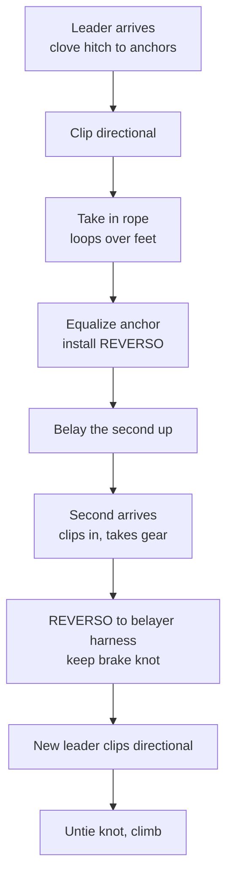

> 🌏 [中文版](/posts/climbing/2026-10-17-multi-pitch-basics)

After a while of single-pitch trad, you start looking at routes that do not end after one rope length: climb to a ledge, build a belay, bring your partner up, carry on. Multi-pitch has no new trick. It takes what you already know from [trad protection](/posts/climbing/2026-10-17-trad-protection-nuts-cams-en), [building anchors](/posts/climbing/2026-10-17-building-anchors-en) and [lowering and rappelling](/posts/climbing/2026-10-17-lower-or-rappel-en) and repeats it several times, tens of meters off the ground. The hard part is getting it right every time, and doing it fast enough.

This post covers five things: how two climbers split the work, how to manage the stance, what to watch for when belaying in guide mode, the full changeover sequence, and how to rappel if you have to retreat. What to do when something goes wrong is the next post, [Self-Rescue Basics](/posts/climbing/2026-10-17-self-rescue-basics-en).

To be clear: **this post helps you understand what each step is for when you take a course; it is not a self-study manual.** Multi-pitch courses in Taiwan (Adventure Taiwan, Learn from the Mountain and others) all require single-pitch trad leading first. They are listed near the end.

## First: are your single-pitch skills solid?

The first three of the [BMC's seven tips for a first multi-pitch adventure](https://services.thebmc.co.uk/top-tips-for-your-first-multipitch-adventure) all say the same thing: do not stack difficulty on top of a new system.

1. **Be confident leading single-pitch trad.** With skills like placing gear wired, you have spare attention for what multi-pitch adds.
2. **Start easy.** Pick two- or three-pitch routes with easy access and simple descents, a few grades below your single-pitch limit, so your head stays on the system.
3. **Choose obvious lines with big ledges.** Routes that follow cracks or corners are easier to follow; leave hanging belays until you are confident.

**Something you can do tonight**: write down the grade you lead single-pitch trad reliably, then drop two or three grades. That is the ceiling for your first multi-pitch route.

## Splitting the work: swapping leads or block leading

A party of two usually takes turns in one of two ways:

- **Swapping leads**: you lead this pitch, I lead the next. The second arrives at the stance and leads on.
- **Block leading**: one person leads several pitches in a row, then the other takes over.

The [BMC article on alpine speed](https://services.thebmc.co.uk/climb-skills-speeding-up) (by Baggy Richards and British Mountain Guide Steve Long) ties each style to how you build the stance: single-point belays when swapping leads, and the rope itself (often quicker) when block leading. Its case for block leading is partners with different strengths. Five crack pitches followed by five slab pitches? Put the right person on each block.

[Petzl's tech tip on multi-pitch belay anchors](https://www.petzl.com/us/en/sport/tech-tips/basic-techniques/building-a-belay-anchor-and-belaying-on-a-bolted-multi-pitch-route/Relais-grande-voie_SPO_a77Tx000000E3MEIA0.html) notes the other side of this: with an anchor built from the climbing rope, the climber is tied to the anchor and cannot free themselves to perform a rescue, and transitions are more complicated if you are not swapping leads.

If your first multi-pitch is with a more experienced partner, you can start as the second and let them lead the harder pitches. That is a split too: you get to watch what happens at each stance.

## Stance management: staying tidy in mid-air

At the stance, two people, one rope and a pile of gear share a small space. The BMC puts it bluntly: good stance management is the difference between a faff-free day and an afternoon of tying yourself in knots. Its points:

- **Build for two directions of pull**: bringing up the second, and holding the leader on the next pitch.
- **Get comfortable**; you may be there for a while.
- **Stack the rope neatly**, on a ledge or flaked over the rope connecting you to the anchor, so it runs out smoothly for the next leader.
- **Do not let loops hang down the crag**; they snag on spikes below.
- **Think ahead** about where the second will stand when they arrive and which way the next leader will head.

[Petzl's changeover tech tip](https://www.petzl.com/us/en/sport/tech-tips/basic-techniques/climbing-with-alternate-leaders/escalade-grde-voie-grimpe-reversible_SPO_a77w0000000KypsAAC.html) gives a concrete method: loop the rope over your feet from the biggest loop to the smallest, and avoid loops that are too large or that hang from the station where they can catch in a crack or vegetation.

### The fall a belay fears most

Your instinct may say it is the second falling. It is not. Petzl's tests show:

- **Belaying the second**: with no slack in the rope, a fall by the second loads the anchor about as much as two people simply hanging on it.
- **The highest load comes from the new leader falling just after leaving the stance**: little rope out, a high fall factor, and no quickdraw friction to absorb energy. Petzl tested a factor 1.74 fall (4 m of fall on 2.3 m of rope).

Petzl names two risks in this fall: overloading the redirect point, and the belayer being pulled into the rock or the anchor. The [BMC](https://services.thebmc.co.uk/top-tips-for-your-first-multipitch-adventure)'s matching advice: **place and clip a piece as soon as possible** after leaving the stance. Fall before that, and the force comes straight onto the belayer, which can injure both of you. Why fall factors differ so much is covered in [Building Anchors](/posts/climbing/2026-10-17-building-anchors-en).

**Something you can do tonight**: practice looping a rope over your feet. Sit on a chair, drape the rope over your feet in loops, each a little shorter than the last, then pull it out from the top loop and see if it tangles.

## Guide mode: belaying the second from the anchor

Once at the stance, the leader brings the second up. A common method is to install a device with an assisted-braking function (such as a Petzl REVERSO or Black Diamond ATC Guide) directly on the anchor, often called guide mode or plaquette. If the second falls, the device pinches the rope.

That pinch comes with conditions. The [REVERSO Instructions for Use](https://www.petzl.com/on/demandware.static/-/Sites-petzl-master-catalog/default/dw3ddbef35/media/product/technical-notice-REVERSO-5_068bK00000nDYPVQA4.pdf) spell them out:

- **Test it after installing**: pull on the climber side of the rope to verify that it blocks.
- **Always hold the brake side**: if you need to let go, tie a knot in each brake strand.
- **Thin ropes can defeat it**: with very small diameter ropes, the rope can cross over itself in the groove and disable assisted braking; this is more likely with a round cross-section carabiner.
- **With two seconds**: if one is weighting their rope, assisted braking is disabled for the other, unless the ropes are truly parallel.

Two more distinctions:

- **A standard belay device cannot do this.** Kolin Powick of Black Diamond's QC lab, in [Autoblock Misuse](https://eu.blackdiamondequipment.com/blogs/stories/qc-lab-autoblock-misuse), describes seeing a standard device rigged off the anchor the same way. Set up like that, it **does not lock** when the second falls, and it is very difficult to hold a weighted climber by hand.
- **Releasing a locked device is not a way to lower someone far.** The REVERSO manual describes using a carabiner in the release hole as a handle to tilt the device and give the second some slack, but says the friction this provides is insufficient to control a long lower. Lowering someone properly is a different system and belongs in a [self-rescue](/posts/climbing/2026-10-17-self-rescue-basics-en) course.

One more note: in normal belay mode on your harness, the REVERSO **does not automatically block the rope**. The first section of the manual says the belayer must actively stop the rope from moving through the device to arrest a fall. Assisted braking only exists in the setup the manual describes.

**Something you can do tonight**: dig out the manual for your own belay device and look for a section on assisted braking or auto-block. If there is no such section, the device is not for guide mode.

## The full changeover sequence

This is the order in Petzl's tech tip, using swapping leads as the example:

What each step protects against:

- **Clove hitch to each anchor**: the leader's first job at the stance is attaching to it. The clove hitch is adjustable in length.
- **Directional**: the next leader clips this quickdraw above the stance before moving up, so the pull of a fall goes through it first. Petzl says it should be of excellent quality, because, as above, this is when the belay takes its highest load.
- **Keep the knot under the REVERSO while moving it to the belayer's harness**: the second, who is about to lead, is still on the rope during the transfer, and the knot keeps them secured throughout. Remove it only after the new leader has clipped the directional.

Petzl opens these tech tips with two reminders: the techniques require specific training, so confirm with a professional that you can do them safely and independently; and they are examples, so other techniques exist. Adventure Taiwan's multi-pitch course also teaches Co-Leading and Full Leading as two separate team modes. What matters is that the two of you agree in advance and follow the same order every time, so nobody improvises at the stance.

**Something you can do tonight**: on a sheet of paper, draw the nine steps without looking, then compare with the diagram. Whatever you missed is what to ask your instructor about.

## Retreating mid-route: multi-pitch rappels

The BMC calls rappelling your get-out-of-jail card on multi-pitch: the weather turns, someone gets hurt, the climbing is harder than expected, and the prudent move is to go down. Its basics for multi-pitch rappels:

- **Check the anchor**: inspect in-situ gear thoroughly before trusting it, and leave as much of your own gear as you need. "How much is your life worth?"
- **Back up the device with a prusik.** The REVERSO manual likewise requires a rappel backup, such as a friction hitch.
- **Knot the rope ends**: the BMC notes that people have died after rappelling off the ends of their ropes.

The American Alpine Club's [Know the Ropes: Lowering](https://americanalpineclub.org/news/2023/6/21/lowering) calls this closing the system. When lowering on multi-pitch terrain, tie the free end to the belayer, the anchor or something else. When rappelling, knot the ends so you cannot rappel off them. On single pitch the ground closes the system for you; on multi-pitch there is no ground, only you.

One common mix-up: "a pitch must be shorter than half the rope" is a limit for **lowering or rappelling back to the ground** on single pitch. On multi-pitch the second is belayed from above, so that limit does not apply to the pitch; but when you retreat on a single rope doubled for rappelling, each rappel can be at most half the rope's length. Know where the retreat anchors are and how far apart before you set off. Details on lowering and rappelling are in [Lower or Rappel](/posts/climbing/2026-10-17-lower-or-rappel-en).

**Something you can do tonight**: check whether your rope has a middle mark and measure its total length. Half of it is your limit for each rappel on a single rope.

## In Taiwan: multi-pitch routes at Long Dong

In the [Long Dong route database maintained by TOCC](https://docs.google.com/spreadsheets/d/1QHFNQSPgKgQrTNnYn246wfotOYqOkzHjLltZ26keBgg/htmlview), most routes labeled P1 and P2 are trad, for example:

- **Via del Drago (龍路)**, Grand Auditorium: P1 5.8, P2 5.10c, 25 m each.
- **Let's Do the Trad (一起爬傳攀)**, Golden Valley: three pitches, 5.6, 5.9, 5.7.
- **Lucid Dreaming**, First Cave: three pitches, 5.9, 5.8, 5.10?.

A few two-pitch sport routes exist too, such as Reincarnation (輪迴) at School Gate and Agar Jelly (石花凍) at First Cave. In other words, multi-pitch at Long Dong mostly means trad first. The same data is on [nobodyclimb's Long Dong page](https://nobodyclimb.cc/crag/longdong).

Taiwan has no official multi-pitch certification; courses are run by private operators (checked on their websites, 2026-10-17):

- **[Adventure Taiwan: Multi-pitch trad climbing](https://www.adventuretaiwan.com/product/multi-pitch-trad-climbing/)**: two days (14 hours) at Long Dong, NT$7,000. Prerequisite: single-pitch trad (including system transitions and using Camalots and nuts), ideally redpointing 5.10a on lead; bring your own trad rack. Covers bolt and gear stations, classic and guide-mode top belaying, Co-Leading and Full Leading, multi-pitch rappels and basic self-rescue.
- **[Learn from the Mountain (山學訓練): Multi-pitch trad course](https://learnfromthemountain.wordpress.com/多繩距傳統攀登課/)**: two days at Long Dong, 1:4 ratio, NT$6,000 per person. Prerequisite: leading single-pitch trad and lead belaying. Covers the multi-pitch process, rope management, transitions between pitches, multi-pitch rappels and self-rescue.

Both set single-pitch trad leading as the entry bar, matching the BMC's first tip.

## Practice: five scenarios

Answers are under each question; think first, then check. For more questions, try [nobodyclimb's rope-system practice: multi-pitch](https://nobodyclimb.cc/games/rope-system/learn/trad-multipitch).

**1. You reliably lead 5.10a single-pitch trad. A friend invites you on a three-pitch route where every pitch is 5.10a and every belay is hanging.**

Answer

Not yet. The BMC advises that your first multi-pitch routes be a few grades below your single-pitch limit, with big ledges, and to leave hanging belays until you are confident. Find a two- or three-pitch route around 5.8 with ledges and get your systems dialed first.

**2. You are belaying two seconds with a REVERSO on the anchor. A is hanging on the rope resting; B keeps climbing.**

Answer

B's assisted braking may now be disabled. The REVERSO manual says that if one of two seconds is weighting their rope, assisted braking is disabled for the other unless the ropes are truly parallel. You brake B by gripping the brake strand.

**3. The second falls and the device locks. They ask you to lower them two meters back to a hold.**

Answer

For giving a little slack, the manual describes using a carabiner as a handle, with a stopper knot tied in the brake strand first; but it states that this friction is insufficient to control a long lower. Practice this in a course; do not figure it out on the spot.

**4. The new leader leaves the stance, and the first good placement is three meters up.**

Answer

This is the highest-load situation for the belay: little rope out, a high fall factor and no quickdraw friction. The BMC advises placing gear as soon as possible after leaving the stance, and clipping the directional during the changeover exists for exactly this moment. Place something earlier if you can.

**5. The party next to you hangs a standard ATC off the anchor guide-mode style to belay their second.**

Answer

A standard device rigged like that **does not lock**, and a weighted second is very hard to hold by hand. Black Diamond's QC lab documented this misuse. Only devices whose manuals describe an assisted-braking mode can be used this way.

## Next steps

Multi-pitch takes you further from the ground, which also means fewer people can help if something goes wrong. The next post, [Self-Rescue Basics](/posts/climbing/2026-10-17-self-rescue-basics-en), covers the options you have when something goes wrong on a multi-pitch route and when to use each. After that, [Learning Path and Common Accidents](/posts/climbing/2026-10-17-sport-to-trad-learning-path-en) puts the whole series into a practice sequence.

## References

- [Top tips for your first multi-pitch adventure (BMC)](https://services.thebmc.co.uk/top-tips-for-your-first-multipitch-adventure)
- [Alpine skills: how to speed up (BMC, Baggy Richards and Steve Long)](https://services.thebmc.co.uk/climb-skills-speeding-up)
- [Climbing with alternate leaders (Petzl Tech Tips)](https://www.petzl.com/us/en/sport/tech-tips/basic-techniques/climbing-with-alternate-leaders/escalade-grde-voie-grimpe-reversible_SPO_a77w0000000KypsAAC.html)
- [Building a belay anchor and belaying on a bolted multi-pitch route (Petzl Tech Tips)](https://www.petzl.com/us/en/sport/tech-tips/basic-techniques/building-a-belay-anchor-and-belaying-on-a-bolted-multi-pitch-route/Relais-grande-voie_SPO_a77Tx000000E3MEIA0.html)
- [REVERSO Instructions for Use (Petzl, PDF; section 7 covers assisted-braking belaying of seconds, often called guide mode)](https://www.petzl.com/on/demandware.static/-/Sites-petzl-master-catalog/default/dw3ddbef35/media/product/technical-notice-REVERSO-5_068bK00000nDYPVQA4.pdf)
- [QC Lab: Autoblock Misuse (Black Diamond, Kolin Powick)](https://eu.blackdiamondequipment.com/blogs/stories/qc-lab-autoblock-misuse)
- [Know the Ropes: Lowering in Single Pitch and Multi-Pitch Climbing (American Alpine Club)](https://americanalpineclub.org/news/2023/6/21/lowering)
- [Long Dong route database (TOCC, Taiwan Outdoor Climbers' Coalition)](https://docs.google.com/spreadsheets/d/1QHFNQSPgKgQrTNnYn246wfotOYqOkzHjLltZ26keBgg/htmlview)
- [Long Dong (nobodyclimb)](https://nobodyclimb.cc/crag/longdong)
- [Adventure Taiwan: Multi-pitch trad climbing](https://www.adventuretaiwan.com/product/multi-pitch-trad-climbing/)
- [Learn from the Mountain: Multi-pitch trad course](https://learnfromthemountain.wordpress.com/多繩距傳統攀登課/)
- [nobodyclimb rope-system practice: multi-pitch](https://nobodyclimb.cc/games/rope-system/learn/trad-multipitch)
- [Trad Protection: Nuts and Cams](/posts/climbing/2026-10-17-trad-protection-nuts-cams-en)
- [Building Anchors](/posts/climbing/2026-10-17-building-anchors-en)
- [Lower or Rappel](/posts/climbing/2026-10-17-lower-or-rappel-en)
- [Self-Rescue Basics](/posts/climbing/2026-10-17-self-rescue-basics-en)
