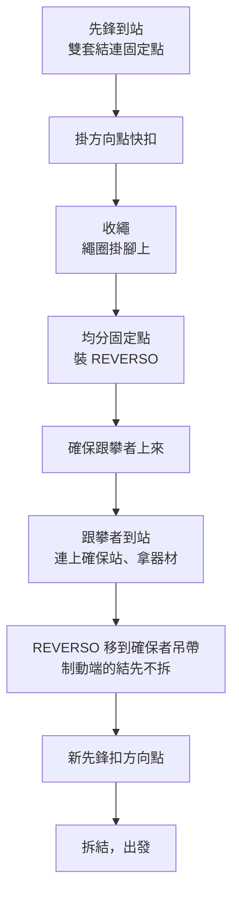

> 🌏 [English version](/posts/climbing/2026-10-17-multi-pitch-basics-en)

單繩距傳攀爬了一陣子，你會開始看那些一段爬不完的路線：爬到一個平台，架站，把夥伴拉上來，再往上。多繩距沒有新的「大招」，它是把[傳攀保護](/posts/climbing/2026-10-17-trad-protection-nuts-cams)、[建立固定點](/posts/climbing/2026-10-17-building-anchors)、[下放與垂降](/posts/climbing/2026-10-17-lower-or-rappel)這些已經會的事，在離地幾十公尺的地方連續做好幾次。難的是每次都要做對，而且做得夠快。

這篇講五件事：兩人怎麼分工、確保站怎麼管理、在確保站上用 guide mode 確保時要防什麼、一次換段的完整順序、爬到一半要撤退時怎麼垂降。出事之後怎麼處理不在這篇，留給下一篇[自我救援基礎](/posts/climbing/2026-10-17-self-rescue-basics)。

先講清楚：**這篇是讓你上課時知道每個動作在做什麼，不是自學手冊。** 台灣的多繩距課程（艾格、山學訓練等）都要求先會單繩距傳攀先鋒，文末會整理。

## 先問自己：單繩距的事都做熟了嗎？

[BMC 給第一次爬多繩距的七個建議](https://services.thebmc.co.uk/top-tips-for-your-first-multipitch-adventure)，前三條都在講「別把難度和新系統疊在一起」：

1. **單繩距傳攀先鋒要很穩。** 放保護點這類基本功練到不用想，才有餘力處理多繩距多出來的事。
2. **從簡單的開始。** 挑兩三段、好接近、好下撤的路線，難度比你單繩距的極限低幾級，讓腦袋專心在系統上。
3. **挑路線明顯、確保平台大的。** 沿著裂隙或內角走的路線比較不會迷路；吊在半空中的懸吊確保站（hanging belay）等熟了再說。

**今晚就能做的動作**：寫下你單繩距傳攀先鋒「穩定能完攀」的難度，往下扣兩三級，這就是你第一條多繩距的上限。

## 兩人怎麼分工：換領攀還是連續領攀

兩人繩隊有兩種常見的輪法：

- **換領攀**（swapping leads）：這段你領、下一段我領。跟攀者到站後，直接接手領下一段。
- **連續領攀**（block leading）：一個人連續領好幾段，再換人。

[BMC 的高山技巧文章](https://services.thebmc.co.uk/climb-skills-speeding-up)（Baggy Richards 與英國高山嚮導 Steve Long 合寫）把兩者跟確保站的做法綁在一起：換領攀時架單點確保站；連續領攀時直接用繩子架站，通常更快。文章推薦連續領攀的情境是兩人專長不同，例如前五段是裂隙、後五段是平板，就讓適合的人領適合的那一組。

[Petzl 的確保站技術說明](https://www.petzl.com/us/en/sport/tech-tips/basic-techniques/building-a-belay-anchor-and-belaying-on-a-bolted-multi-pitch-route/Relais-grande-voie_SPO_a77Tx000000E3MEIA0.html)也提到同一件事的另一面：用主繩直接架的確保站，人被綁在站上，不換領攀時換段會比較麻煩，出事時也比較難脫身去救人。

如果你的第一條多繩距是跟比較有經驗的人一起爬，可以先當跟攀者，讓對方領難的段落。這也是一種分工：先看清楚每個確保站在做什麼。

## 確保站管理：在半空中保持整齊

到了確保站，兩個人、一條繩、一堆器材全擠在一小塊地方。BMC 的說法很直接：確保站管理得好，你會順順爬完；管理不好，整個下午都在把自己打成結。它列的重點：

- **架站時同時想兩個方向的拉力**：一個是把跟攀者拉上來時的向下拉力，一個是下一段先鋒墜落時的拉力。
- **找一個舒服的姿勢**，你可能會在站上待很久。
- **收繩要整齊**：疊在平台上，或在你連著確保站的那段繩上掛成繩圈，下一段先鋒出發時繩子才放得順。
- **不要讓繩圈垂下岩壁**，會勾到下方尖角卡住。
- **先想好跟攀者到站時站哪裡、下一段先鋒往哪個方向出發。**

[Petzl 的換段說明](https://www.petzl.com/us/en/sport/tech-tips/basic-techniques/climbing-with-alternate-leaders/escalade-grde-voie-grimpe-reversible_SPO_a77w0000000KypsAAC.html)給了一個具體做法：收繩時把繩圈掛在腳上，從最大的一圈到最小的一圈，避免繩圈太大或垂下確保站，卡進裂隙或草叢。

### 確保站最怕哪一種墜落

直覺會以為是跟攀者掉下來，其實不是。Petzl 的實測結論是：

- **確保跟攀者時**：繩子收緊的話，跟攀者墜落對確保站的拉力跟兩人單純掛著差不多。
- **最大的受力出現在新先鋒剛離開確保站就墜落**：繩子放出去很短、墜落係數高、途中沒有快扣的摩擦幫忙吸收。Petzl 測過一個係數 1.74 的例子（2.3 公尺的繩子上墜落 4 公尺）。

Petzl 把這種墜落的風險歸成兩個：方向點受力過大，以及確保者被拉向岩壁或確保站。[BMC](https://services.thebmc.co.uk/top-tips-for-your-first-multipitch-adventure) 對應的建議是：離開確保站後**盡快放第一個保護點**，在那之前墜落，衝擊會直接打在確保者身上，兩個人都可能受傷。墜落係數為什麼差這麼多，在[建立固定點](/posts/climbing/2026-10-17-building-anchors)那篇有展開。

**今晚就能做的動作**：在家用一條繩練「繩圈掛腳上」：坐在椅子上，把繩子一圈一圈掛在腳背，每圈比前一圈短一點，再從最上面一圈開始拉出，看會不會打結。

## Guide mode：在確保站上確保跟攀者

先鋒到站後要把跟攀者拉上來。常見做法是把有輔助制動功能的確保器（例如 Petzl REVERSO、Black Diamond ATC Guide）直接裝在確保站上，俗稱 guide mode 或 plaquette。跟攀者墜落時，確保器會把繩子夾住。

但「會夾住」是有前提的。[REVERSO 的技術說明書](https://www.petzl.com/on/demandware.static/-/Sites-petzl-master-catalog/default/dw3ddbef35/media/product/technical-notice-REVERSO-5_068bK00000nDYPVQA4.pdf)寫得很清楚：

- **裝好先測**：裝在確保站上後，拉一下攀爬者那端，確認真的會鎖住。
- **永遠握住制動端**：要騰出手時，在每一股制動端打結。
- **細繩可能失效**：很細的繩子在槽裡可能交叉，輔助制動就不作用了；用圓斷面鉤環時更容易發生。
- **確保兩位跟攀者時**：其中一位掛在繩上，另一位的輔助制動會失效，除非兩條繩真的平行。

還有兩件要分清楚的事：

- **一般確保器不能這樣用。** Black Diamond 品管實驗室的 Kolin Powick 在 [Autoblock Misuse](https://eu.blackdiamondequipment.com/blogs/stories/qc-lab-autoblock-misuse) 裡記錄過有人把一般 ATC 用同樣方式掛在確保站上。這樣跟攀者墜落時**不會自動鎖住**，跟攀者一吃重，用手很難拉住。
- **鎖住之後放繩，不能拿來長距離下放。** REVERSO 說明書提到，用鉤環插進釋放孔把確保器往上扳，可以讓鎖住的繩子鬆開、給跟攀者一點繩；但這樣的摩擦力不夠控制長距離下放。真的需要把人放下去，是另一套系統，屬於[自我救援](/posts/climbing/2026-10-17-self-rescue-basics)課程的範圍。

順帶一提：REVERSO 在一般確保模式（掛在自己吊帶上）**不會自動鎖繩**，說明書第一條就寫「確保者必須主動握住制動端才能制止墜落」。guide mode 的輔助制動，只存在於說明書寫的那種裝法。

**今晚就能做的動作**：翻出你自己確保器的說明書，找找有沒有「輔助制動」或「auto-block」的章節。沒有這一章，它就不能用 guide mode。

## 一次換段的完整順序

以下是 Petzl 換段說明的順序，用換領攀為例：

每一步在防什麼：

- **雙套結連每個固定點**：先鋒到站第一件事是把自己連上確保站。雙套結（clove hitch）的好處是長短可以調。
- **方向點**：下一段先鋒出發前先扣進確保站上方的這條快扣，墜落時拉力會先經過它。Petzl 要求它「必須非常牢靠」，因為前面講過，這種墜落是確保站受力最大的時候。
- **REVERSO 移到確保者吊帶時，制動端的結先不拆**：這段時間跟攀者（也就是下一段的先鋒）還在繩上，結是讓他在轉移過程中一直被固定住的保險。結要等新先鋒扣好方向點才拆。

Petzl 在這類技術說明的開頭都會提醒兩件事：這些技術需要專門訓練，先在專業人員面前確認自己能獨立做對；它提供的只是例子，也有其他做法。艾格的多繩距課程也把 Co-Leading 與 Full Leading 列為兩種繩隊模式分開實作。重點是兩人事先講好、每次照同樣的順序做，在確保站上就不用臨場想。

**今晚就能做的動作**：拿一張紙，不看本文把換段的九個步驟畫出來，再跟上面的圖對照，看漏了哪一步。漏掉的那一步，就是你上課時要特別問教練的。

## 爬到一半要撤退：多段垂降

BMC 把會垂降叫作多繩距的「出獄卡」：天氣變壞、有人受傷、路線比預期難，最謹慎的做法常常是下撤。它對多段垂降的基本要求：

- **固定點要檢查**：用現場留下的器材垂降，先徹底檢查；需要留下自己的器材就留，「你的命值多少錢？」
- **確保器加摩擦套結備份**（prusik）。REVERSO 說明書也要求垂降時搭配備份，例如摩擦套結。
- **繩尾打結**：BMC 提醒，有人就是從繩尾垂降出去而喪命。

美國山岳協會（AAC）的 [Know the Ropes: Lowering](https://americanalpineclub.org/news/2023/6/21/lowering) 把這件事叫作「封閉系統」。多繩距下放時，繩尾要綁在確保者、固定點或別的東西上。垂降時，在兩條繩尾打結，讓人不可能垂降出繩尾。單繩距時地面會幫你封閉系統，多繩距時沒有地面，只能靠自己。

還有一件常被搞混的事：「繩距不能超過半條繩」是單繩距要**下放或垂降回地面**時的限制。多繩距的跟攀者是從上方確保，不受這個限制；但撤退時用單繩對折垂降，每一段最多只能下到繩長的一半。所以出發前要知道路線的撤退點在哪裡、間距多長。下放與垂降的細節在[下放還是垂降](/posts/climbing/2026-10-17-lower-or-rappel)那篇。

**今晚就能做的動作**：看看你的繩子有沒有中點標記，量一下總長。對折後的一半，就是你單繩垂降每一段的上限。

## 在台灣：龍洞的多繩距路線

[TOCC 維護的龍洞岩場攀登路線資料庫](https://docs.google.com/spreadsheets/d/1QHFNQSPgKgQrTNnYn246wfotOYqOkzHjLltZ26keBgg/htmlview)裡，標了 P1、P2 的路線多數是傳攀，例如：

- **龍路**（大禮堂）：P1 5.8、P2 5.10c，各 25 公尺。
- **一起爬傳攀**（黃金谷）：三段，5.6、5.9、5.7。
- **Lucid Dreaming**（第一洞）：三段，5.9、5.8、5.10?。

也有少數兩段的運攀，例如校門口的輪迴、第一洞的石花凍。換句話說，在龍洞想爬多繩距，多半要先會傳攀。這些資料也整理在 [nobodyclimb 的龍洞頁](https://nobodyclimb.cc/crag/longdong)。

台灣沒有官方的多繩距證照，課程都是民間業者開的（以下 2026-10-17 查詢官網）：

- **[艾格探險：多繩距傳統攀登](https://www.adventuretaiwan.com/product/multi-pitch-trad-climbing/)**：兩天 14 小時、龍洞、NT$7,000。先修是單繩距傳攀（含系統轉換、Camelot 與 Nut 的使用），先鋒 RP 5.10a 以上為佳，自備傳攀裝備。課程包含 Bolt 與 Gear 確保站、Classic 與 Guide 兩種上方確保、Co-Leading 與 Full Leading、多段垂降、基礎自我救援。
- **[山學訓練：多繩距傳統攀登課](https://learnfromthemountain.wordpress.com/多繩距傳統攀登課/)**：兩天、龍洞、師生比 1:4、一人 NT$6,000。先修是會單繩距傳統先鋒、會先鋒確保。課程包含多繩距流程、繩索管理、繩距間轉換、多繩距垂降、自我救援。

兩家的先修都卡在「單繩距傳攀先鋒」，跟 BMC 的第一條建議一致。

## 練習題：五個情境

答案在每題下方，先自己想再看。想練更多題，可以玩 [nobodyclimb 的繩索系統練習：多繩距](https://nobodyclimb.cc/games/rope-system/learn/trad-multipitch)。

**1. 你單繩距傳攀先鋒穩定爬 5.10a。朋友找你爬一條每段都是 5.10a 的三段路線，確保站都是吊著的。**

答案

先別去。BMC 的建議是第一條多繩距要比單繩距極限低幾級，並挑有大平台的路線，懸吊確保站等熟了再說。先找兩三段、5.8 左右、有平台的路線把系統練熟。

**2. 你用 REVERSO 在確保站上同時確保兩位跟攀者。A 掛在繩上休息，B 繼續往上爬。**

答案

這時 B 的輔助制動可能失效。REVERSO 說明書寫明：兩位跟攀者中有一位吃重時，另一位的輔助制動會失效，除非兩條繩真的平行。你要靠手握緊 B 的制動端來制動。

**3. 跟攀者在下方墜落、確保器鎖住了，他說要你放他下去兩公尺回到岩點上。**

答案

短距離給繩，說明書有一套用鉤環當把手的做法，操作前要先在制動端打結；但它明說這樣的摩擦力不夠控制長距離下放。這是要在課堂上練過的動作，沒練過不要現場摸索。

**4. 新先鋒離開確保站，第一個保護點的位置還要再爬三公尺。**

答案

這是確保站受力最大的情境：繩短、墜落係數高、沒有快扣摩擦。BMC 的建議是離站後盡快放第一個保護點；換段時先扣方向點，也是為了這一刻。能早一點放就早一點放。

**5. 隔壁繩隊把一般 ATC 用 guide mode 的方式掛在確保站上，準備確保跟攀者。**

答案

一般確保器這樣掛**不會自動鎖住**，跟攀者吃重時很難用手拉住。這是 Black Diamond 品管實驗室記錄的常見誤用。只有說明書寫了輔助制動模式的確保器才能這樣用。

## 下一步

多繩距讓你離地面更遠，也代表出事時能幫你的人更少。下一篇[自我救援基礎](/posts/climbing/2026-10-17-self-rescue-basics)講的是：在多繩距上出狀況時有哪些選項、什麼時候該用哪一個。之後的[學習路徑與常見事故](/posts/climbing/2026-10-17-sport-to-trad-learning-path)會把整個系列串成一條練習順序。

## 參考資料

- [Top tips for your first multi-pitch adventure（BMC）](https://services.thebmc.co.uk/top-tips-for-your-first-multipitch-adventure)
- [Alpine skills: how to speed up（BMC，Baggy Richards、Steve Long）](https://services.thebmc.co.uk/climb-skills-speeding-up)
- [Climbing with alternate leaders（Petzl Tech Tips）](https://www.petzl.com/us/en/sport/tech-tips/basic-techniques/climbing-with-alternate-leaders/escalade-grde-voie-grimpe-reversible_SPO_a77w0000000KypsAAC.html)
- [Building a belay anchor and belaying on a bolted multi-pitch route（Petzl Tech Tips）](https://www.petzl.com/us/en/sport/tech-tips/basic-techniques/building-a-belay-anchor-and-belaying-on-a-bolted-multi-pitch-route/Relais-grande-voie_SPO_a77Tx000000E3MEIA0.html)
- [REVERSO 技術說明書（Petzl，PDF；第 7 節為確保跟攀者的輔助制動模式，俗稱 guide mode）](https://www.petzl.com/on/demandware.static/-/Sites-petzl-master-catalog/default/dw3ddbef35/media/product/technical-notice-REVERSO-5_068bK00000nDYPVQA4.pdf)
- [QC Lab: Autoblock Misuse（Black Diamond，Kolin Powick）](https://eu.blackdiamondequipment.com/blogs/stories/qc-lab-autoblock-misuse)
- [Know the Ropes: Lowering in Single Pitch and Multi-Pitch Climbing（American Alpine Club）](https://americanalpineclub.org/news/2023/6/21/lowering)
- [龍洞岩場攀登路線資料庫（TOCC 臺灣戶外攀岩協會）](https://docs.google.com/spreadsheets/d/1QHFNQSPgKgQrTNnYn246wfotOYqOkzHjLltZ26keBgg/htmlview)
- [龍洞攀岩（nobodyclimb）](https://nobodyclimb.cc/crag/longdong)
- [艾格探險：多繩距傳統攀登](https://www.adventuretaiwan.com/product/multi-pitch-trad-climbing/)
- [山學訓練：多繩距傳統攀登課](https://learnfromthemountain.wordpress.com/多繩距傳統攀登課/)
- [nobodyclimb 繩索系統練習：多繩距](https://nobodyclimb.cc/games/rope-system/learn/trad-multipitch)
- [傳攀保護：岩楔與機械塞](/posts/climbing/2026-10-17-trad-protection-nuts-cams)
- [建立固定點](/posts/climbing/2026-10-17-building-anchors)
- [下放還是垂降](/posts/climbing/2026-10-17-lower-or-rappel)
- [自我救援基礎](/posts/climbing/2026-10-17-self-rescue-basics)
