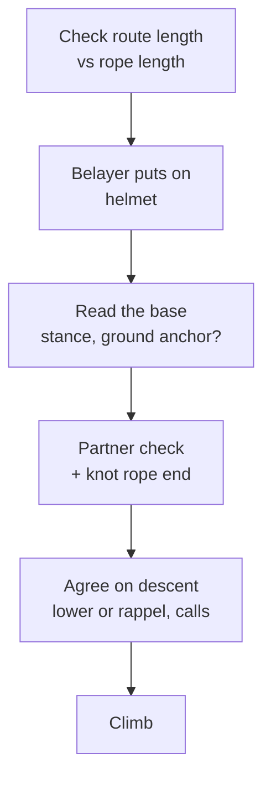

> 🌏 [中文版](/posts/climbing/2026-10-17-outdoor-belay)

You can belay in the gym, you can lower, and you passed the belay test. The first time you go to a crag with a friend, the moves are the same but everything around them changes. The ground isn't padded, rocks can fall, you have to look up how tall the wall is, and you may not hear what your partner yells from 30 meters up.

This is part 3 of the Sport and Trad Climbing series, written for people who already belay top-rope in the gym. The basics (brake hand on the rope, taking in, calls, lowering) are in [Learning to Top-Rope Belay at the Gym](/posts/climbing/2026-10-17-gym-top-rope-belay-en). This post covers only what you need to **add** outside. For the whole series, see [the overview: sport vs trad](/posts/climbing/2026-10-17-sport-vs-trad-overview-en). Lead belaying details (paying out, soft catches, spotting) are in [Your First Outdoor Sport Lead](/posts/climbing/2026-10-17-first-outdoor-sport-lead-en).

To be clear up front: **this post does not replace a class.** For your first outdoor days, go with experienced climbers or a course and watch how they do things.

## Why gym habits don't transfer directly

The [American Alpine Club's Gym to Crag series](https://americanalpineclub.org/news/2023/6/29/gym-to-crag) lists what changes outside: helmets, rockfall, the approach, uneven ground when belaying, and bigger falls to catch. Everything the gym handles for you, you handle yourself outdoors.

[A Climbing magazine article on common gym-to-crag mistakes](https://www.climbing.com/skills/sport-climbing/common-gym-crag-mistakes-need-avoid/) is more blunt: the author kept seeing "incorrect procedures bred from the gym" at classic crags. Gyms are great training grounds, but they also reward some habits that are unsafe outside.

The next five sections are five habits to change.

## Stance: close to the wall, just off the climber's line

Gym belayers often stand several steps back to see the whole route. Outside, that spot has two problems:

- **Getting pulled off balance**: The AAC's [Know the Ropes: Lowering](https://americanalpineclub.org/news/2023/6/21/lowering) was written by IFMGA guide Mike Poborsky. He names belayers standing too far back from the base as a common single-pitch problem: when the climber weights the rope, the belayer gets pulled off balance and can lose control.
- **Getting hit by the climber or by rocks**: The AAC's [Know the Ropes: Belaying](https://publications.americanalpineclub.org/articles/13201214178/Know-the-Ropes-Belaying) suggests standing directly beneath the first piece of protection, then one step out of the fall line (roughly 10 degrees). A falling climber won't land on your head, and you're still in a position to belay well.

Once you're set, stack the rope neatly on your brake-hand side, right next to your stance.

The same applies on top-rope, with one exception: while the climber is at the top rigging to lower or rappel. Poborsky has the belayer step back **temporarily** to see the climber and hear calls clearly, then move back to the base once the climber is ready to lower.

**Watch**: Ben from Hard Is Easy finds a climber heavier than himself at an outdoor crag and has him fall at the first bolt while Ben belays from close in and from farther back (from 12:45). Standing far, he gets yanked toward the wall with almost no control, and the climber drops lower; standing close, he stays put and can choose a harder or softer catch. It's a lead scenario and a handful of by-feel comparisons with no force measurements. Near the end he mentions sometimes skipping the first bolt; that's his own habit, not something this post recommends.

```youtube
url: https://www.youtube.com/watch?v=9bPrcjTtKpk
title: Sketchy Low Falls | Ep.13 (Hard Is Easy)
start: 765
```

**Something to try tonight**: Next time you belay at the gym, stand under the first quickdraw and one step to the side. Notice which way you get pulled when the climber sits on the rope.

## Rockfall: the belayer needs a helmet too

Gyms don't drop rocks; crags do. And many of those rocks are pulled or kicked off by climbers.

The AAC's accident column, The Prescription, ran two similar reports in its [August 2021 issue](https://americanalpineclub.org/news/2022/1/7/the-prescription-august-2021). Both were at sport crags, and in both, rock knocked loose by the climber hit the belayer on the ground:

- A belayer on her second day outdoors was hit by part of a "torso-size" rock that came off when the leader weighted a hold. She was knocked unconscious, broke two bones in her right arm and had bleeding in her brain. She was wearing the leader's helmet, which he had lent her; the report says her head injuries could otherwise have been much worse and possibly fatal. ([full report](https://publications.americanalpineclub.org/articles/13201215924))
- Another belayer was hit by a jug and debris the climber pulled off. The damage was to his right leg; he narrowly avoided being hit in the head or upper body.

The editors point out a paradox. At sport crags, the climbers who wear helmets are usually the ones leading or top-roping, not the belayers and bystanders below. Yet, they argue, the belayer is much more likely to be hit by rockfall.

In both cases the belayer used an assisted-braking device such as a GriGri. In the first, the belayer was knocked out and the GriGri still caught the leader's fall. The AAC's takeaway: think about the value of assisted-braking devices, and helmets, for belaying single-pitch climbs.

**Something to try tonight**: Put the helmet on the first line of your outdoor packing list. At the crag, the belayer puts a helmet on before the partner check.

## Terrain and weight difference: plan your stance before you start

Gym floors are flat. Outside, the base can be a slope, a boulder field, tree roots, or a narrow ledge. The AAC's [Know the Ropes: Cleaning Sport Routes](https://publications.americanalpineclub.org/articles/13201216058) opens with a familiar scene: the lowering climber swings and drags the belayer off a boulder, through a bush, and into a tree.

Three situations to think through in advance:

- **The route starts from a ledge**: Poborsky notes that some routes start after a short scramble to a ledge. The top anchor may leave enough rope to lower the climber to the ledge but not to the ground, or the belayer may need to stand on the ledge.
- **The climber is much heavier**: The belayer can get pulled up hard. Poborsky ties into the rope himself and clove-hitches to a bottom anchor, so the length is adjustable and there's no slack in the system.
- **Top-roping with a GriGri and a big weight difference**: Petzl's [tech tip](https://www.petzl.com/int/en/sport/tech-tips/basic-techniques/top-rope-belaying-with-the-grigri-anchored-to-the-ground./GRIGRI---Assurer-avec-le-GRIGRI-fixe-au-sol_SPO_a77w0000000KyxNAAS.html) keeps the GriGri on the belayer and anchors the belayer to a point 1–2 m away. It **strongly discourages** clipping the GriGri directly to a ground anchor with a sling. At the wrong height, the belayer can accidentally block the cam so it can't brake, and descent is harder to control because the belayer can't feel the climber's weight. Use this only for top-rope, since an anchored belayer can't give a dynamic belay.

On the other hand, more anchoring isn't always better. The [Climbing article](https://www.climbing.com/skills/sport-climbing/common-gym-crag-mistakes-need-avoid/) says that unless the route starts off a narrow ledge or your climber massively outweighs you, it's better to stay mobile on single-pitch routes. Being mobile is how you dodge small falling rocks.

**Watch**: In this HowNOT2 episode, a very big climber takes lead falls in a gym on light and heavy belayers, and for the last test the belayer is bolted to the wall so their body absorbs nothing (from the 0:37 test overview). A belayer who gets lifted is soaking up part of the impact; with the belayer bolted down, the top piece saw about 7 kN, the highest real-world anchor load the channel had recorded. Each condition was fallen on once, and a belayer bolted to the wall is not the adjustable ground-anchor tether Petzl describes above: the video shows the cost of fixing a belayer rigidly in place, not how to rig a ground anchor. The light-belayer tests also had a friction device (Edelrid Ohm) clipped into the system, which this post doesn't cover.

```youtube
url: https://www.youtube.com/watch?v=Tnk4Ky-D9Bg
title: BIG climber lead falls for science. You won't believe the forces! (HowNOT2)
start: 37
```

**Something to try tonight**: Compare weights with your regular partner. If the gap is large, ask an instructor or your gym whether and how to use a ground anchor for top-roping.

## Rope length: always knot the end

This is the most lethal outdoor belay mistake, and one of the easiest to prevent.

In the same [AAC article](https://americanalpineclub.org/news/2023/6/21/lowering), Poborsky writes that **more than half** of the lowering accidents reported over the past decade happened when the rope end shot through the belay device and the climber fell. If the pitch is shorter than half the rope, the climber reaches the ground first, so the ground closes the system for you. The trouble starts when the anchor is near or above the rope's midpoint. He notes that more new routes have anchors above 30 m, and some now require a 70 m rope to lower safely.

In the gym, the wall height is fixed and the gym supplies the rope. Outside, nobody does the math for you. Four things to do:

1. **Check the route length before you go**: Read the guidebook, ask nearby climbers, look it up online. Petzl's [Rope too short](https://petzl.com/int/en/sport/tech-tips/basic-techniques/rope-too-short--warning---danger-/CORDES-Corde-trop-courte---attention-danger--_SPO_a77w0000000PCKGAA4.html) suggests bringing a rope 5 m longer than you expect to need.
2. **Knot the rope end**: Petzl's rule for crag climbing is to **always** tie a knot in the end. Poborsky suggests a bulky triple overhand, or better, the belayer tying into the end.
3. **Watch the middle mark**: Once the middle passes through your device, both of you should be on high alert. But the mark may be wrong. [Another Petzl tip](https://www.petzl.com/int/en/sport/tech-tips/basic-techniques/change-in-the-length-of-my-rope-after-use/CORDES-evolution-de-la-longeur-de-ma-corde_SPO_a77w0000000PCKLAA4.html) explains that ropes shrink with use, up to 10% over their life, and the two halves may not shrink equally, which moves the true middle.
4. **Watch the rope pile while lowering**: Poborsky says that once less than 10–15 feet is left on the ground, make a plan. The climber might stop on a ledge and downclimb, or you might move closer to the start. Even if the climber is almost down, never let the last of the rope slip through the device.

**Something to try tonight**: Add "rope end knotted" to your partner check, and point at it out loud along with harness, knot and locked carabiner. Do it in the gym too, so you won't forget it outside.

## Communication: when you can't hear or see each other

In the gym, you can usually see each other. Outside, the route may be longer or wander around a corner, with wind, water and other parties shouting nearby. [Poborsky](https://americanalpineclub.org/news/2023/6/21/lowering) groups communication problems into three kinds:

- **Environment**: You can't see each other because of the route's shape or distance; wind or rain; noise from rivers, traffic or nearby parties. At Long Dong the wall sits right on the sea, so waves and wind belong in this category.
- **Unclear commands**: "Slack" and "take" sound alike. On top-rope, Poborsky suggests the traditional "up rope" for more tension, which won't be confused with "slack." Avoid vague phrases like "I'm good" or "OK."
- **No shared plan for the top**: This is the most dangerous. Many accidents happened when the belayer thought the climber would rappel and took them off belay, while the climber expected to be lowered.

What to do:

- **Add names to key calls**: At busy crags, Poborsky recommends "Take, Jane!" or "Off belay, Fred!"
- **Agree on the descent before leaving the ground**: Lower or rappel? Which calls? Only take the rope out of your device if you agreed on a rappel, the climber yells "off belay," and you answer "belay off." For how to choose between lowering and rappelling, see [Lower or Rappel?](/posts/climbing/2026-10-17-lower-or-rappel-en)
- **Check before committing weight**: Petzl's [communication tip](https://www.petzl.com/int/en/sport/tech-tips/basic-techniques/communication-when-climbing/Escalade-Communiquer-en-escalade_SPO_a77w0000000Gnb3AAC.html) has the climber stay tethered to the anchor while weighting the rope for the lower. Once it's clear the belayer is holding the weight, the climber untethers.

**Something to try tonight**: Talk through the top-of-route sequence with your partner, from "at the anchor" to "back on the ground." Any step you can't describe clearly is a question to settle before you go.

## An outdoor belay checklist

Putting the five sections together, run through this at the crag:



- The four-point partner check (harness, knot, device and carabiner, rope end) is the same as in the gym; see [Learning to Top-Rope Belay at the Gym](/posts/climbing/2026-10-17-gym-top-rope-belay-en).
- The two outdoor additions are the helmet and the agreed plan for the top.

**Watch**: Hard Is Easy's lead-belay episode walks through the prep at an outdoor crag (from 3:26): clear what you could trip on, read the chalk to stay out of the fall zone, trace the rope from your own harness to the climber's knot, and check the rope end is knotted. It's a lead episode, but the prep is the same for top-rope. He says an unknotted rope end "statistically" causes the most accidents without citing a source; rely on the AAC figure above for the actual share. He also recommends shoes and a helmet for the belayer, though his helmet reason is keeping long hair out of the device, which is a separate point from rockfall.

```youtube
url: https://www.youtube.com/watch?v=aHI8kIXNH5M
title: Lead Belaying - Slack Management, Efficient Taking & More | Ep.11 (Hard Is Easy)
start: 206
```

## What to think about at Long Dong

Taiwan's most popular outdoor crag is Long Dong, on the northeast coast in New Taipei. A few things that bear directly on belaying:

- **Waves**: The [Northeast and Yilan Coast National Scenic Area page for Long Dong](https://www.necoast-nsa.gov.tw/Attraction-Content.aspx?a=186&l=1) (in Chinese) warns that during the northeast monsoon (October to March) long-period waves are common and asks visitors not to go to the shore. A belayer at the base of the wall is standing at the shore.
- **Top anchors**: The [Taiwan Outdoor Climbers' Coalition (TOCC)](https://www.tocc-climbing.org/post/%E9%BE%8D%E6%B4%9E%E7%9A%84%E4%B8%8A%E6%96%B9%E5%9B%BA%E5%AE%9A%E9%BB%9E) (in Chinese) asks climbers at Long Dong to retreat by double-rope rappel whenever possible and avoid lowering, to reduce wear on bolts and hardware. That changes the "how do we get down" conversation you have before leaving the ground.
- **Rescue is slow**: The [TOCC chronicle](https://www.tocc-climbing.org/chronicle-of-events) records two serious accidents in 2019. In both, injured climbers were brought down with help from climbers on scene and paramedics, then taken out by boat. At Long Dong, a small mistake costs far more than in a gym.

**Something to try tonight**: Before your first trip to Long Dong, read TOCC's page on Long Dong top anchors so you can recognize lowering hooks, rappel rings and quick links, then agree with your partner on rappelling or lowering at the top.

## Practice: five scenarios

Each answer is hidden under its question; think first, then look. For more practice, try [nobodyclimb's rope-system practice: belaying basics](https://nobodyclimb.cc/games/rope-system/learn/sport-belay) (in Chinese).

**1. On your first day outside, you habitually stand 4–5 steps back from the wall to see the whole route.**

<details><summary>Answer</summary>

Move in. Stand near the first piece of protection and step one pace out of the fall line. Too far back, you can be pulled off balance when the climber weights the rope; directly underneath, you can be hit by a falling climber or rocks.

</details>

**2. You brought one helmet, and the climber says, "Nothing's going to happen to you down there; I'll wear it."**

<details><summary>Answer</summary>

Wrong. In the AAC reports, the people hit by rock the climber knocked loose were the belayers on the ground. Both of you need helmets; if you only have one, that's a problem to solve before you leave home.

</details>

**3. The guidebook says the route is 35 m. You brought a 60 m rope.**

<details><summary>Answer</summary>

Not enough to lower. Lowering takes twice the route length, so 35 m needs at least 70 m, and ropes shrink with use. Pick another route or bring a longer rope, and knot the end either way.

</details>

**4. At the top, the climber shouts "I'm good!" and you can't tell whether they mean to lower or rappel.**

<details><summary>Answer</summary>

Don't take them off belay and don't pull the rope out of your device. Keep belaying, ask clearly, and step back to see them if needed. Better still, agree on the sequence and the words before the climb, and use only those words at the top.

</details>

**5. The climber outweighs you by 30 kg. The route starts from a narrow ledge above a slope.**

<details><summary>Answer</summary>

Decide whether to anchor yourself so you can't be pulled off the ledge. For top-roping with a GriGri, Petzl keeps the GriGri on you and anchors you to a point 1–2 m away, rather than clipping the GriGri straight to the anchor. If you're unsure, pick a route with a flat base or ask someone closer to the climber's weight to belay.

</details>

## What's next

Once you can belay top-rope outdoors, the next post in the series is [Your First Outdoor Sport Lead](/posts/climbing/2026-10-17-first-outdoor-sport-lead-en), where the belayer starts paying out rope and spotting before the first clip. If you haven't led in the gym yet, start with [Learning to Lead at the Gym](/posts/climbing/2026-10-17-gym-lead-climbing-en).

For getting down from the top, see [Lower or Rappel?](/posts/climbing/2026-10-17-lower-or-rappel-en)

## Further viewing: gear-testing and instruction channels

The videos embedded in this post come from the two channels below. They're a good place to dig further; keep each channel's limits in mind.

- **[HowNOT2](https://www.youtube.com/@HowNOT2)**: run by Ryan Jenks. It started in 2016 as highline safety instruction and grew into breaking climbing, caving and canyoneering gear, plus the Bolt Busters series that pulls bolts out of real rock. Its value is in the cases beyond the rated number: knots, wear, old gear, bad placements. Limits: most tests are slow pulls on a home-built rig with one to three samples, and Ryan himself calls it entertainment, not science; the channel is backed by an online gear shop, and some tested items are sold there.
- **[Hard Is Easy](https://www.youtube.com/@HardIsEasy)**: run solo by a climber who signs as Ben, a former software developer. After watching a hard catch slam a climber into the rock in Tonsai, Thailand, he designed his first experiment; the channel now focuses on experiments and physics explanations about belaying, ropes, carabiners and belay devices, with several recent episodes filmed in Mammut's lab. Limits: most experiments are his own design, not EN/UIAA standard tests.

## Update Log

- 2026-10-23: Added gear-testing videos from HowNOT2, Hard Is Easy and similar channels, plus a channel guide

## References

- [Know the Ropes: Lowering (Mike Poborsky, AAC; first published in Accidents in North American Mountaineering 2013)](https://americanalpineclub.org/news/2023/6/21/lowering)
- [Know the Ropes: Belaying (Ron Funderburke, AAC, 2016)](https://publications.americanalpineclub.org/articles/13201214178/Know-the-Ropes-Belaying)
- [Know the Ropes: Cleaning Sport Routes (Lindsay Auble, AAC, 2021)](https://publications.americanalpineclub.org/articles/13201216058)
- [The Prescription: Belayer Hit by Rockfall (AAC, August 2021)](https://americanalpineclub.org/news/2022/1/7/the-prescription-august-2021)
- [Belayer Hit by Rockfall (AAC, Accidents in North American Climbing 2021)](https://publications.americanalpineclub.org/articles/13201215924)
- [Gym to Crag video series (AAC)](https://americanalpineclub.org/news/2023/6/29/gym-to-crag)
- [Transitioning From Gym to Crag: 5 Tips (Climbing)](https://www.climbing.com/skills/sport-climbing/common-gym-crag-mistakes-need-avoid/)
- [Rope too short: warning - danger! (Petzl)](https://petzl.com/int/en/sport/tech-tips/basic-techniques/rope-too-short--warning---danger-/CORDES-Corde-trop-courte---attention-danger--_SPO_a77w0000000PCKGAA4.html)
- [Change in the length of my rope after use (Petzl)](https://www.petzl.com/int/en/sport/tech-tips/basic-techniques/change-in-the-length-of-my-rope-after-use/CORDES-evolution-de-la-longeur-de-ma-corde_SPO_a77w0000000PCKLAA4.html)
- [Top-rope belaying with the GRIGRI anchored to the ground (Petzl)](https://www.petzl.com/int/en/sport/tech-tips/basic-techniques/top-rope-belaying-with-the-grigri-anchored-to-the-ground./GRIGRI---Assurer-avec-le-GRIGRI-fixe-au-sol_SPO_a77w0000000KyxNAAS.html)
- [Communication when climbing (Petzl)](https://www.petzl.com/int/en/sport/tech-tips/basic-techniques/communication-when-climbing/Escalade-Communiquer-en-escalade_SPO_a77w0000000Gnb3AAC.html)
- [Northeast and Yilan Coast National Scenic Area: Long Dong crag](https://www.necoast-nsa.gov.tw/Attraction-Content.aspx?a=186&l=1) (in Chinese)
- [TOCC: Top anchors at Long Dong](https://www.tocc-climbing.org/post/%E9%BE%8D%E6%B4%9E%E7%9A%84%E4%B8%8A%E6%96%B9%E5%9B%BA%E5%AE%9A%E9%BB%9E) (in Chinese)
- [TOCC: Long Dong chronicle of events](https://www.tocc-climbing.org/chronicle-of-events)
- [nobodyclimb rope-system practice: belaying basics](https://nobodyclimb.cc/games/rope-system/learn/sport-belay) (in Chinese)
- [Learning to Top-Rope Belay at the Gym](/posts/climbing/2026-10-17-gym-top-rope-belay-en)
