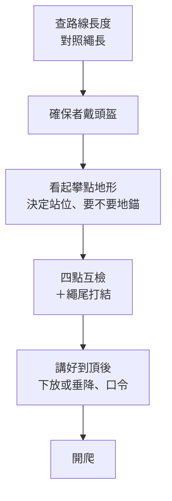

> 🌏 [English version](/posts/climbing/2026-10-17-outdoor-belay-en)

在岩館，你會確保、會下放，也通過了確保考試。第一次跟朋友去戶外岩場，動作一樣，周圍的條件全變了。地面不是軟墊，頭上可能掉石頭。牆有多高要自己查，對方在 30 公尺上方喊什麼，你可能聽不到。

這篇是〈運動攀登與傳統攀登〉系列的第 3 篇，寫給已經會岩館上攀確保的人。確保的基本動作（制動手不離繩、收繩、口令、下放）在[岩館上攀確保](/posts/climbing/2026-10-17-gym-top-rope-belay)講過，這裡只講搬到戶外之後要**多做**的事。系列全貌見[總覽：運攀與傳攀差在哪](/posts/climbing/2026-10-17-sport-vs-trad-overview)。先鋒確保的細節（給繩、軟確保、spot）留到[第一條戶外運攀先鋒](/posts/climbing/2026-10-17-first-outdoor-sport-lead)。

先講清楚：**這篇不能取代實際上課。** 第一次去戶外，最好跟有經驗的人或課程一起去，在旁邊看他們怎麼做。

## 為什麼岩館的習慣不能直接帶出去

[美國登山協會（AAC）的〈Gym to Crag〉系列](https://americanalpineclub.org/news/2023/6/29/gym-to-crag)把戶外多出來的問題列得很直白。要戴頭盔、會落石、要走一段路才到岩壁；確保的地面不平，要接的墜落也更大。岩館替你處理掉的東西，到了戶外都要自己處理。

[Climbing 雜誌一篇談岩館到岩場常見錯誤的文章](https://www.climbing.com/skills/sport-climbing/common-gym-crag-mistakes-need-avoid/)講得更具體：作者在岩場看到很多「從岩館養成的錯誤做法」。岩館是很好的練習場，但它也會獎勵一些到了戶外不安全的習慣。

下面五節，就是五個要改的習慣。

## 站位：靠近岩壁，站在攀爬路線旁邊

岩館的確保者常站離牆好幾步，方便看整條路線。到了戶外，這個位置有兩個問題：

- **被拉離平衡**：AAC 的[〈Know the Ropes: Lowering〉](https://americanalpineclub.org/news/2023/6/21/lowering)作者是 IFMGA 國際高山嚮導 Mike Poborsky。他指出單繩距路線常見的確保問題，是確保者站得離岩壁太遠。攀爬者一坐上繩子，確保者就被拉得失去平衡，甚至失去控制。
- **被墜落者或落石砸到**：AAC 的[〈Know the Ropes: Belaying〉](https://publications.americanalpineclub.org/articles/13201214178/Know-the-Ropes-Belaying)建議站在第一個保護點正下方，再往旁邊跨一步，離開墜落線（大約 10 度）。這樣攀爬者掉下來不會直接落在你頭上，你也還在能有效確保的位置。

站好之後，把繩子整齊地堆在制動手那一側、緊貼著你的腳邊。

上攀時也一樣適用。有一個例外：攀爬者到頂端、正在架設下放或垂降的時候。Poborsky 的做法是確保者**暫時**往後退，好看到頂端的攀爬者、聽清楚口令。攀爬者準備好要下放，確保者再回到起攀點。

**今晚就能做的動作**：下次在岩館確保時，刻意站在第一個快扣正下方、往旁邊一步的位置，感受一下攀爬者坐繩時你被往哪個方向拉。

## 落石：確保者也要戴頭盔

岩館不會掉石頭，戶外會。而且落石常常不是自然掉的，是攀爬者抓掉、踩掉的。

AAC 的意外報告專欄〈The Prescription〉在 [2021 年 8 月號](https://americanalpineclub.org/news/2022/1/7/the-prescription-august-2021)放了兩起相似的案例，都是運動攀岩場、都是攀爬者弄掉石頭砸到地面的確保者：

- 一位第二次去戶外的確保者，被攀爬者抓掉的一塊「軀幹大小」的岩石砸中，當場昏迷，右手兩處骨折、顱內出血。她當時戴著攀爬者借她的頭盔；報告寫道，沒有那頂頭盔，頭部傷勢可能嚴重得多，甚至致命。（[事故報告原文](https://publications.americanalpineclub.org/articles/13201215924)）
- 另一位確保者被攀爬者扯掉的岩點與碎石擊中，傷在右腿，差一點打到頭和上半身。

AAC 編輯在這期指出一個矛盾。運攀岩場裡戴頭盔的，多半是先鋒或上攀的人，不一定是下面的確保者和旁觀者。編輯的看法是，確保者被落石打到的機會恐怕更高。

這兩起事故裡，確保者用的都是輔助制動確保器（例如 GriGri）。第一起的確保者被砸昏，GriGri 仍然接住了先鋒者的墜落。AAC 因此建議單繩距確保時考慮輔助制動確保器，也考慮頭盔。

**今晚就能做的動作**：把頭盔放進戶外裝備清單的第一行。到岩場後，確保者先戴好頭盔，再開始做互檢。

## 地形與體重差：地面不平，就先想好怎麼站

岩館地面平整，戶外的起攀點可能是斜坡、石堆、樹根，或一個窄小的岩階。AAC 的[〈Know the Ropes: Cleaning Sport Routes〉](https://publications.americanalpineclub.org/articles/13201216058)開頭描述了一個典型畫面。攀爬者下放時擺盪，把確保者從大石頭上拖下來，拖過灌木，撞進樹裡。

戶外有三種情況要先想好：

- **起攀點在高處岩階**：Poborsky 提到，有些路線要先爬幾公尺到一個岩階才開始。頂端固定點的位置，可能讓繩長只夠把人放回岩階、放不到地面；或者確保者必須站在岩階上確保。
- **攀爬者明顯比較重**：確保者可能被猛力往上拉。Poborsky 的做法是確保者自己綁進繩子、用雙套結（clove hitch）把自己連到下方的地錨，長度可調，系統裡沒有多餘的鬆繩。
- **用 GriGri 上攀確保、體重差很大**：Petzl 的[技術說明](https://www.petzl.com/int/en/sport/tech-tips/basic-techniques/top-rope-belaying-with-the-grigri-anchored-to-the-ground./GRIGRI---Assurer-avec-le-GRIGRI-fixe-au-sol_SPO_a77w0000000KyxNAAS.html)建議 GriGri 仍然掛在確保者身上，再把確保者連到 1–2 公尺外的地錨。它**強烈不建議**直接把 GriGri 用扁帶掛在地錨上。高度不對時，確保者可能無意間卡住凸輪，讓它無法制動。確保者也感覺不到攀爬者的重量，下放更難控制。這個做法只適用於上攀，因為確保者被固定住，沒辦法做動態確保。

反過來說，地錨也不是越多越好。開頭提到的 [Climbing 文章](https://www.climbing.com/skills/sport-climbing/common-gym-crag-mistakes-need-avoid/)提醒：除非起攀點是窄岩階、或攀爬者重你很多，單繩距確保最好保持能移動。能移動，才閃得開小落石。

**今晚就能做的動作**：跟你的固定攀岩夥伴量一次體重差。差很多的話，先問教練或岩館：上攀時要不要地錨、怎麼掛。

## 繩長：繩尾一律打結

這是戶外確保最致命、也最好預防的錯誤。

Poborsky 在 [AAC 那篇文章](https://americanalpineclub.org/news/2023/6/21/lowering)裡寫：過去十年的下放事故**一半以上**，是繩尾從確保器穿出、攀爬者失控墜落。單繩距路線如果不到繩長的一半，攀爬者會先回到地面，地面本身就「封閉」了系統。問題出在頂端固定點接近或超過繩子中點的路線。他提到，新開的路線固定點高過 30 公尺的越來越多，有些路線已經非得用 70 公尺繩才能安全下放。

岩館的牆高是固定的，繩長也是岩館配好的。戶外沒有人幫你算。要做的事有四件：

1. **出發前查路線長度**：讀指南書、問旁邊的人、上網查。Petzl 的[〈Rope too short〉](https://petzl.com/int/en/sport/tech-tips/basic-techniques/rope-too-short--warning---danger-/CORDES-Corde-trop-courte---attention-danger--_SPO_a77w0000000PCKGAA4.html)建議帶一條比需求長 5 公尺的繩子。
2. **繩尾打結**：Petzl 的原則是在岩場攀登，繩尾**一律**打結。Poborsky 建議打體積大的三重單結，或更好的做法是確保者直接綁進繩尾。
3. **注意繩子中點標記**：中點過了確保器，兩人都要提高警覺。但中點標記不一定準。Petzl 的[另一篇說明](https://www.petzl.com/int/en/sport/tech-tips/basic-techniques/change-in-the-length-of-my-rope-after-use/CORDES-evolution-de-la-longeur-de-ma-corde_SPO_a77w0000000PCKLAA4.html)指出，繩子用了之後會縮短，壽命期間最多可能縮 10%，而且兩半縮的比例不一定一樣，中點就會跑掉。
4. **下放時看地上的繩堆**：Poborsky 建議地上剩不到 3–4.5 公尺時，就先想好備案。例如讓攀爬者停在岩階上自己爬下來，或確保者往起攀點靠近。就算攀爬者只差一點就落地，也不要讓最後一段繩子滑出確保器。

**今晚就能做的動作**：把「繩尾打結」加進你的互檢清單，跟「吊帶扣好、八字結、鉤環上鎖」一起用手指著說出聲。岩館練習時也照做，到戶外就不會忘。

## 溝通：聽不到、看不到時怎麼辦

在岩館，兩人通常看得到彼此。戶外的路線可能更長、有轉角，旁邊還有風聲、水聲、別隊的人在喊。[Poborsky](https://americanalpineclub.org/news/2023/6/21/lowering) 把溝通問題分成三類：

- **環境**：看不到彼此（路線形狀或距離）、風雨，以及河流、車聲、隔壁隊的口令。龍洞的岩壁就在海邊，浪聲和風聲都屬於這一類。
- **口令不一致**：「Slack」和「Take」聽起來很像。Poborsky 建議上攀時改用傳統的「Up rope」要求收繩，比較不會跟「Slack」搞混。也要避免「我好了」「OK」這種模糊的話。
- **對到頂後要做什麼沒有共識**：這是最危險的一類。很多事故是確保者以為攀爬者要垂降、就放開了確保，其實攀爬者要下放。

對應的做法：

- **口令加名字**：熱門岩場同時有很多隊，Poborsky 建議重要口令加對方名字，例如「Take，阿明！」
- **開爬前講好到頂後怎麼下來**：下放還是垂降？要用哪些口令？要先講好是垂降，再聽到攀爬者喊「Off belay」，你回「Belay off」。三件事都成立，才可以把繩子拿出確保器。下放和垂降怎麼選，見本系列的[下放還是垂降](/posts/climbing/2026-10-17-lower-or-rappel)。
- **坐繩前先確認**：Petzl 的[溝通說明](https://www.petzl.com/int/en/sport/tech-tips/basic-techniques/communication-when-climbing/Escalade-Communiquer-en-escalade_SPO_a77w0000000Gnb3AAC.html)建議，攀爬者在頂端坐上繩子準備下放時，仍然連著固定點。先確認確保者真的接住了體重，再解開連接。

**今晚就能做的動作**：跟夥伴把到頂之後的流程用口頭走一遍，從「到頂」說到「回到地面」。講不清楚的那一步，就是要在出發前問清楚的那一步。

## 戶外確保前檢查清單

把上面五節合起來，到岩場後依序做一次：

- 互檢的四點（吊帶、繩結、確保器與鉤環、繩尾）同岩館，見[岩館上攀確保](/posts/climbing/2026-10-17-gym-top-rope-belay)。
- 戶外多出的兩項是頭盔，以及到頂後的共識。

## 在龍洞要多想的事

台灣最多人去的戶外岩場是新北貢寮的龍洞。幾件跟確保直接有關的事：

- **海浪**：[東北角管理處的龍洞岩場頁](https://www.necoast-nsa.gov.tw/Attraction-Content.aspx?a=186&l=1)提醒，東北季風期間（10 月到 3 月）容易有長浪，請勿前往海邊。確保者站在岩壁下方，也站在海邊。
- **頂端固定點**：[臺灣戶外攀岩協會（TOCC）](https://www.tocc-climbing.org/post/%E9%BE%8D%E6%B4%9E%E7%9A%84%E4%B8%8A%E6%96%B9%E5%9B%BA%E5%AE%9A%E9%BB%9E)建議在龍洞盡可能用雙繩垂降撤退、少用下放，以減少錨栓與配件磨損。這會直接影響你出發前要跟夥伴講好的「到頂後怎麼下來」。
- **救援很慢**：[TOCC 大事紀](https://www.tocc-climbing.org/chronicle-of-events)記錄的 2019 年兩起重大意外，傷者都要靠現場岩友和急救人員協助，再用船艇接駁送醫。在龍洞，一個小錯誤的代價比在岩館大很多。

**今晚就能做的動作**：第一次去龍洞前，把 TOCC〈龍洞的上方固定點〉讀一遍，認得羊角、垂降環和梅隆鎖長什麼樣。再跟夥伴講好，到頂後用垂降還是下放。

## 練習題：五個情境

答案在每題下方，先自己想再看。想練更多題，可以玩 [nobodyclimb 的繩索系統練習：基礎確保](https://nobodyclimb.cc/games/rope-system/learn/sport-belay)。

**1. 第一次到戶外，你習慣性地站在離岩壁 4、5 步遠的地方，想看清整條路線。**

答案

往前站。站在第一個保護點附近、往旁邊跨一步離開墜落線。站太遠，攀爬者一坐繩，你可能被拉得失去平衡；站在正下方，則可能被墜落者或落石砸到。

**2. 你們只帶了一頂頭盔，攀爬者說「你在下面又不會怎樣，我戴就好」。**

答案

不對。AAC 的事故案例裡，被攀爬者弄掉的石頭砸到的正是地面的確保者。至少兩人都要有頭盔；只有一頂時，這是出發前就該解決的問題。

**3. 指南書寫這條路線 35 公尺，你們帶的是 60 公尺繩。**

答案

不夠下放。下放需要的繩長是路線長度的兩倍，35 公尺需要 70 公尺以上，繩子用久了還可能縮短。換一條路線，或換長繩；不管哪一種，繩尾都要打結。

**4. 攀爬者到頂之後喊了一聲「好了！」，你不確定他是要下放還是要垂降。**

答案

不要放開確保，也不要把繩子拿出確保器。繼續確保，大聲問清楚，必要時往後退一步看到他。最好的做法是開爬前就講好流程與口令，到頂後只用講好的詞。

**5. 攀爬者比你重 30 公斤，起攀點是一塊窄岩階，下面是斜坡。**

答案

先想好要不要用地錨把自己固定住，免得被拉離岩階。用 GriGri 上攀時，Petzl 的建議是 GriGri 仍掛在你身上，你再連到 1–2 公尺外的地錨，不要把 GriGri 直接掛在地錨上。沒把握的話，換一條起攀點平坦的路線，或請體重相近的人確保。

## 下一步

會在戶外確保上攀之後，系列下一篇是[第一條戶外運攀先鋒](/posts/climbing/2026-10-17-first-outdoor-sport-lead)：確保者要開始給繩、spot 第一個保護點之前的攀爬者。還沒在岩館練過先鋒的話，先讀[岩館先鋒](/posts/climbing/2026-10-17-gym-lead-climbing)。

爬到頂之後怎麼下來，見[下放還是垂降](/posts/climbing/2026-10-17-lower-or-rappel)。

## 參考資料

- [Know the Ropes: Lowering（Mike Poborsky，AAC，原刊 2013 年《Accidents in North American Mountaineering》）](https://americanalpineclub.org/news/2023/6/21/lowering)
- [Know the Ropes: Belaying（Ron Funderburke，AAC，2016）](https://publications.americanalpineclub.org/articles/13201214178/Know-the-Ropes-Belaying)
- [Know the Ropes: Cleaning Sport Routes（Lindsay Auble，AAC，2021）](https://publications.americanalpineclub.org/articles/13201216058)
- [The Prescription：Belayer Hit by Rockfall（AAC，2021 年 8 月）](https://americanalpineclub.org/news/2022/1/7/the-prescription-august-2021)
- [Belayer Hit by Rockfall（AAC《Accidents in North American Climbing》2021）](https://publications.americanalpineclub.org/articles/13201215924)
- [Gym to Crag 影片系列（AAC）](https://americanalpineclub.org/news/2023/6/29/gym-to-crag)
- [Transitioning From Gym to Crag: 5 Tips（Climbing）](https://www.climbing.com/skills/sport-climbing/common-gym-crag-mistakes-need-avoid/)
- [Rope too short: warning - danger!（Petzl）](https://petzl.com/int/en/sport/tech-tips/basic-techniques/rope-too-short--warning---danger-/CORDES-Corde-trop-courte---attention-danger--_SPO_a77w0000000PCKGAA4.html)
- [Change in the length of my rope after use（Petzl）](https://www.petzl.com/int/en/sport/tech-tips/basic-techniques/change-in-the-length-of-my-rope-after-use/CORDES-evolution-de-la-longeur-de-ma-corde_SPO_a77w0000000PCKLAA4.html)
- [Top-rope belaying with the GRIGRI anchored to the ground（Petzl）](https://www.petzl.com/int/en/sport/tech-tips/basic-techniques/top-rope-belaying-with-the-grigri-anchored-to-the-ground./GRIGRI---Assurer-avec-le-GRIGRI-fixe-au-sol_SPO_a77w0000000KyxNAAS.html)
- [Communication when climbing（Petzl）](https://www.petzl.com/int/en/sport/tech-tips/basic-techniques/communication-when-climbing/Escalade-Communiquer-en-escalade_SPO_a77w0000000Gnb3AAC.html)
- [東北角暨宜蘭海岸國家風景區：龍洞岩場](https://www.necoast-nsa.gov.tw/Attraction-Content.aspx?a=186&l=1)
- [TOCC：龍洞的上方固定點](https://www.tocc-climbing.org/post/%E9%BE%8D%E6%B4%9E%E7%9A%84%E4%B8%8A%E6%96%B9%E5%9B%BA%E5%AE%9A%E9%BB%9E)
- [TOCC：龍洞大事紀](https://www.tocc-climbing.org/chronicle-of-events)
- [nobodyclimb 繩索系統練習：基礎確保](https://nobodyclimb.cc/games/rope-system/learn/sport-belay)
- [岩館上攀確保怎麼學](/posts/climbing/2026-10-17-gym-top-rope-belay)
