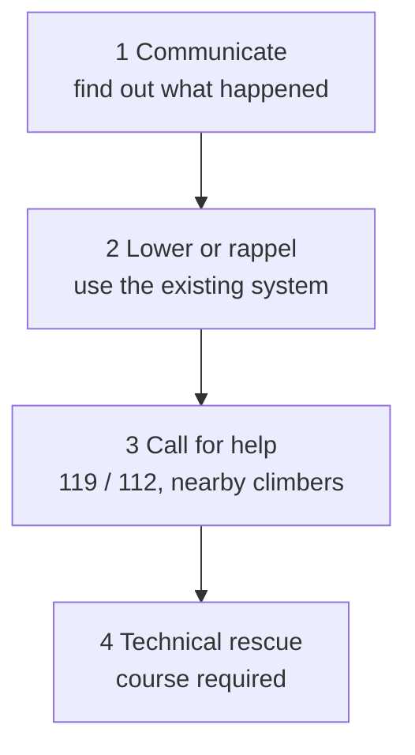

> 🌏 [中文版](/posts/climbing/2026-10-17-self-rescue-basics)

In [Multi-Pitch Basics](/posts/climbing/2026-10-17-multi-pitch-basics-en) you move further from the ground. That also means fewer people can walk over and help when something goes wrong. Your partner is stuck below a crux, hurt after a fall, or you are halfway through a lower and the rope is running out. What options do the two of you actually have?

This post covers **concepts and judgment only**: the common situations, the order in which to think through options, what the main categories of technical rescue are, and when they come into play.

**This post deliberately leaves out step-by-step instructions and cannot be used for self-study.** [Petzl's rescue tech tips](https://petzl.com/us/en/sport/tech-tips/rescue/ascending-the-rope-in-self-rescue---take-care-when-approaching-the-anchor/MICRO-TRAXION---sport-9--Remontee-sur-corde-en-aut_SPO_a77w0000000KyscAAC.html) open with the same warning: these techniques require specific training, and you should work with a professional to confirm you can perform them safely and independently before attempting them unsupervised. One wrong step in a rescue system can turn one person's accident into two. If you want to learn, take a course; Taiwan's options are listed near the end.

## Three common situations

### Stuck

The second cannot get past a crux, swings off a traverse and cannot get back, or the rappel rope jams in a crack and will not pull. Nobody is hurt, but nobody can go up or down. [ZA's self-rescue course](https://www.zaadventure.com/2017/12/rockrescue.html) has a whole unit on stuck rappel ropes.

### Injured

A fall onto a ledge, or a hit from rockfall or dropped gear; [Adventure Taiwan's rescue course page](https://www.adventuretaiwan.com/product/rock-climbing-self-rescue/) also lists insect or animal attacks. [TOCC's Long Dong chronicle](https://www.tocc-climbing.org/chronicle-of-events) records the May 2019 accident on #352 Marmolada in the Music Hall: a climber fell about 3 meters while leading and hit the back of his head on a ledge (wearing a helmet). Because it happened high on the wall, rescue was difficult. More than 20 climbers on site helped bring him down; he was transferred by boat and ambulance to hospital and pronounced dead that night.

### Rope too short

This one is the most preventable. The American Alpine Club's [Know the Ropes: Lowering](https://americanalpineclub.org/news/2023/6/21/lowering), reviewing a decade of accident reports in 2013, named the four most common causes of lowering accidents: a rope that is too short, miscommunication, an inadequate belay, and anchor failure. **More than half** of lowering accidents happened when the rope end shot through the belay device and the climber fell.

The AAC's fix is simple: **close the system**. Tie a bulky stopper knot in the free end (a triple overhand works), or have the belayer tie into it, and the rope cannot slip through. On multi-pitch there is no ground to close the system for you, so you must do it yourself.

**Something you can do tonight**: look up the next route you want to climb and compare its height with your rope length. If the route is longer than half the rope, you cannot lower to the ground and need another way down planned in advance.

## The order of options: start simple

When something goes wrong, your head gets noisy, so have an order ready. This is the framework this post uses, moving from simple, low-risk options to complex ones:

1. **Communicate**: find out what is actually happening. The AAC lists three kinds of communication problems: environmental (no line of sight, wind and surf, other parties shouting), unclear command language, and unclear intentions. Its practice: use each other's names with key commands, and agree on the terms before climbing.
2. **Lower or rappel**: use the system you already have to get the person down. The American Mountain Guides Association's [Single Pitch Instructor Program Handbook](https://cdn.shopify.com/s/files/1/0876/5174/6093/files/AMGA_Single_Pitch_Instructor_Program_Handbook_Edition_4_2026.pdf) says that in single-pitch settings, all problems have a "gravity feed" solution, meaning you lower the person. That assumes enough rope, a reliable anchor and a closed system.
3. **Call for help**: phone, or shout to nearby climbers. No rope skills needed, but you do need to know where you are and how to describe it.
4. **Technical rescue**: only when lowering does not solve it and outside help cannot arrive in time do escaping the belay, ascending the rope and hauling systems come in. These are course skills; the next section explains what each one is.

You do not have to finish one step before starting the next; calling for help can run in parallel with the others. The point of the order: **if a simple method solves it, do not reach for a complex system.**

**Something you can do tonight**: before your next trip, ask your partner, "If you get hurt on pitch two, what do we do?" Whatever step neither of you can answer is where you are not ready yet.

## Three categories of technical rescue

What follows covers only what each category is, what problem it solves, and when it is used.

### Escaping the belay

**What it is**: after a fall, the climber hangs on the rope, their full weight on the belayer (or the belay device), and the belayer is pinned in place. Escaping the belay means transferring that weight to the anchor so the belayer can leave the belay system.

**When it is used**: The Mountaineers, a Pacific Northwest club, describe it clearly in [How To: Belay Escape](https://mountaineers.org/blog/belay-escape): a partner is seriously injured and resources to get help are limited. The belayer may then have to get out of the belay system to investigate, help the partner, or go for help. British Mountain Guide Steve Long, in a [UKClimbing demonstration](https://ukclimbing.com/articles/skills/self_rescue_for_climbers_-_escaping_the_system-3472), adds that once the load is on the anchor, the anchor has to hold that direction of pull.

The Mountaineers also point out the difference in setups: when belaying directly off the anchor, the load is already on the anchor and escaping is simpler; with the device on the belayer's harness, it takes several more steps to move the load. The AAC's advice is to ask before any lower starts: "How easy is it for me to escape the system?"

### Ascending the rope

**What it is**: climbing up a fixed rope with friction hitches or ascenders, without using the rock.

**When it is used**: to get back to a stuck or injured partner, to climb back up after rappelling into a dead end, or after a lead fall that leaves you hanging in space away from the wall. The AMGA Single Pitch Instructor course assesses counter-ascending to a stuck climber; Adventure Taiwan's self-rescue course has a unit on switching from a lead fall to ascending.

The same Petzl tech tip covers an easily overlooked hazard. Near the anchor, people tend to start climbing the wall instead of the rope. If the rope is not kept taut, a single step can significantly increase the fall factor. Petzl notes that this is exactly when the climber feels "out of the woods."

### Hauling systems

**What it is**: a rope system using pulley principles to raise a person. A common ratio is 3:1: in theory you pull three meters of rope and the person rises one meter. Easier, but slow.

**When it is used**: when the person cannot be lowered. The AMGA handbook says single-pitch settings need no in-depth raising training because all problems have a lowering solution. **The exception is a sea cliff or crag where access to the base is problematic**: there, a prudent instructor belays with an assisted-braking device so a simple raise is possible if required. The AAC adds a question to ask before lowering: "What if I need to transfer this lower to a raise?"

Long Dong is on the coast; in both accidents in the next section, the injured were transferred by boat.

**Something you can do tonight**: check whether you carry two cord loops for friction hitches on your harness (ZA's rescue course gear list asks for two prusik loops). The AAC's rule of thumb is that the cord should be 2–3 mm thinner than the climbing rope to grip. Having the loops does not mean you can use them, but without them there is nothing to practice with in a course.

## At Long Dong: why rescue is hard, and what to know before you call

TOCC's chronicle is direct: in the 2019 accident described above, "since the first scene was high on the wall, increased rescue difficulties." Climbers on site brought the injured climber down, and he was transferred by boat. The same month, on #313 Canaleta in the Grand Auditorium, a three-piece trad anchor pulled out as two climbers weighted it; both fell about 20 meters, and both were also transferred by boat.

TOCC (Taiwan Outdoor Climbers' Coalition) maintains a Long Dong EMS plan. In 2020 it formally invited the police, fire department, coast guard, airborne service and the Northeast Coast scenic area administration to a joint meeting on the plan, followed by a joint survey of rescue points. TOCC also runs a [Long Dong EMS basic training course](https://www.tocc-climbing.org/ld-ems-training) on patient assessment, cervical spine protection, moving patients and evacuation planning. It is not rope technique, but it covers the other half of rescue: how to handle the person.

### Before you call 119

The [Keelung City Fire Department's guide to emergency calls](https://www.klfd.klcg.gov.tw/tw/klfd1/2024-316534.html) lists the essentials:

- **Get somewhere safe before calling**, and follow the 119 dispatcher's instructions.
- **State clearly**: the location, the type and scale of the incident, and how many people are injured or trapped.
- **No signal**: dial 112 and press 9 to reach the local 119. 112 works from any mobile phone with battery and any carrier's signal, but the voice menu adds time, so dial 119 directly when reception is good.
- **The 消防防災 e 點通 app**: locates you in real time and shortens call handling; the fire department specifically mentions suburban areas and mountain incidents.

At Long Dong, "location" should include the area name (such as Grand Auditorium or Music Hall) and the route name or number.

**Something you can do tonight**: save a note on your phone with the area names of the crags you visit, the nearest junction or landmark, and how to use 119 and 112. Do not count on having signal to look it up on the day.

## Where to learn in Taiwan

Taiwan has no official self-rescue certification. These are private courses (checked on their websites, 2026-10-17). Most require trad leading and building trad anchors first.

- **[Adventure Taiwan: Rock climbing self-rescue](https://www.adventuretaiwan.com/product/rock-climbing-self-rescue/)**: two days (14 hours) at Long Dong, NT$11,000. Covers escaping the belay, switching from a lead fall to ascending, rappel rescue, hauling and lowering rescue systems. Prerequisite: Adventure Taiwan's trad course or equivalent trad ability, ideally leading 5.8 trad. When checked, the page showed the course as sold out, so ask about the next session. Their [multi-pitch trad course](https://www.adventuretaiwan.com/product/multi-pitch-trad-climbing/) also has a basic self-rescue unit (lowering a person).
- **[ZA Adventure: Rock climbing self-rescue](https://www.zaadventure.com/2017/12/rockrescue.html)**: taught by AMGA-certified guide Mick Pearson, NT$13,000, with an optional one-day lead rescue add-on. The syllabus covers hauling systems, ascending, lowering, escaping the belay, passing knots, stuck rappel ropes and stance management. Prerequisite: sport leading plus building trad anchors. The page still says "2021 schedule in planning", so **it may be discontinued**; ask first.
- **[Wild Lily Rocks: Single-pitch trad full course](https://www.wildlily.rocks/full-course)**: 52 hours (16 indoors plus outdoor days at Long Dong), NT$22,500. Not a dedicated rescue course, but it builds escaping the belay, switching from rappel to ascent, and 3:1/5:1/7:1 assisted-raise systems into its trad foundations.
- **[Learn from the Mountain (山學訓練): Multi-pitch trad course](https://learnfromthemountain.wordpress.com/多繩距傳統攀登課/)**: two days at Long Dong, NT$6,000; the last topic is self-rescue.

## Practice: five scenarios

These questions test judgment, not technique. For more questions, try [nobodyclimb's rope-system practice: self-rescue](https://nobodyclimb.cc/games/rope-system/learn/trad-rescue).

**1. Single-pitch sport. Your friend is at the top ready to lower, and you notice the middle mark has already passed through your device; not much rope is left on the ground.**

Answer

Stop lowering. A rope that is too short is one of the main causes of lowering accidents in the AAC's review. Check that the end is knotted (closed system) and talk to the climber: can they stop on a ledge partway, can you move closer to the wall, do you need a second rope to rappel instead?

**2. The second cannot get past the crux on pitch two. They are uninjured and hanging on the rope.**

Answer

Start with the simplest option: communicate. Where exactly are they stuck, can they rest and try again, is there a way around? Then see whether you can lower them to the stance below and retreat. A hauling system is the last option, and only if you have both trained in it.

**3. Your partner takes a lead fall, hits a ledge and does not respond. You are at the stance with the belay device on your harness.**

Answer

This is the situation The Mountaineers describe for escaping the belay: a seriously injured partner, and you are tied into the system and need to get out to check on them or get help. At the same time, call for help as fast as you can: shout to nearby climbers, call 119, or 112 then 9 with no signal. If you have never trained in it, do not improvise a belay escape; call for help and let trained people take over.

**4. You are at Long Dong. What do you say on the emergency call?**

Answer

Per the fire department's guide: the location, the type and scale of the incident, and how many people are injured or trapped. At Long Dong, give the area name and the route name or number. Then follow the dispatcher's instructions.

**5. A friend says: "I've watched videos. I can rig a hauling system. I don't need a course."**

Answer

Petzl's rescue tech tips start with exactly this: the techniques require specific training, and you should confirm with a professional that you can do them safely and independently before using them on your own. Knowing that a system exists from a video is not the same as getting it right mid-wall when something has gone wrong. Suggest a course, and practice on the ground until it is routine.

## Next steps

That wraps up the rope techniques in this series. The next post, [Learning Path and Common Accidents](/posts/climbing/2026-10-17-sport-to-trad-learning-path-en), arranges everything so far into a practice sequence: what to learn first, where to learn it, and how climbers most often get hurt.

## References

- [AMGA Single Pitch Instructor Program Handbook, 4th Edition (American Mountain Guides Association, 2026, PDF)](https://cdn.shopify.com/s/files/1/0876/5174/6093/files/AMGA_Single_Pitch_Instructor_Program_Handbook_Edition_4_2026.pdf)
- [Know the Ropes: Lowering in Single Pitch and Multi-Pitch Climbing (American Alpine Club)](https://americanalpineclub.org/news/2023/6/21/lowering)
- [How To: Belay Escape (The Mountaineers)](https://mountaineers.org/blog/belay-escape)
- [Self Rescue for Climbers - Escaping the System (UKClimbing, Steve Long)](https://ukclimbing.com/articles/skills/self_rescue_for_climbers_-_escaping_the_system-3472)
- [Ascending the rope in self-rescue: take care when approaching the anchor (Petzl Tech Tips)](https://petzl.com/us/en/sport/tech-tips/rescue/ascending-the-rope-in-self-rescue---take-care-when-approaching-the-anchor/MICRO-TRAXION---sport-9--Remontee-sur-corde-en-aut_SPO_a77w0000000KyscAAC.html)
- [Chronicle of events (TOCC, Taiwan Outdoor Climbers' Coalition)](https://www.tocc-climbing.org/chronicle-of-events)
- [EMS Training (TOCC, Taiwan Outdoor Climbers' Coalition)](https://www.tocc-climbing.org/ld-ems-training)
- [How to call 119 correctly (Keelung City Fire Department, 2026, in Chinese)](https://www.klfd.klcg.gov.tw/tw/klfd1/2024-316534.html)
- [Adventure Taiwan: Rock climbing self-rescue](https://www.adventuretaiwan.com/product/rock-climbing-self-rescue/)
- [Adventure Taiwan: Multi-pitch trad climbing](https://www.adventuretaiwan.com/product/multi-pitch-trad-climbing/)
- [ZA Adventure: Rock climbing self-rescue course](https://www.zaadventure.com/2017/12/rockrescue.html)
- [Wild Lily Rocks: Single-pitch trad full course](https://www.wildlily.rocks/full-course)
- [Learn from the Mountain: Multi-pitch trad course](https://learnfromthemountain.wordpress.com/多繩距傳統攀登課/)
- [nobodyclimb rope-system practice: self-rescue](https://nobodyclimb.cc/games/rope-system/learn/trad-rescue)
- [Multi-Pitch Basics](/posts/climbing/2026-10-17-multi-pitch-basics-en)
- [Learning Path and Common Accidents](/posts/climbing/2026-10-17-sport-to-trad-learning-path-en)
