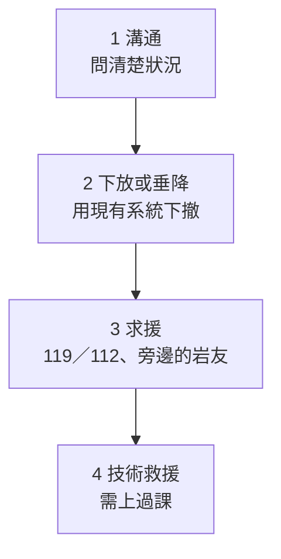

> 🌏 [English version](/posts/climbing/2026-10-17-self-rescue-basics-en)

在[多繩距入門](/posts/climbing/2026-10-17-multi-pitch-basics)裡，你離地面越來越遠。這也代表一件事：出狀況時，能走過來幫你的人越來越少。夥伴卡在一個爬不上去的難關、墜落後撞傷、或者下放到一半發現繩子不夠長，這時你們兩個人手上有什麼選項？

這篇只講**概念與判斷**：常見的狀況有哪些、選項怎麼排順序、技術救援的幾個大類是什麼、什麼時候會用到。

**這篇刻意不寫操作步驟，也不能拿來自學。** [Petzl 的救援技術說明](https://petzl.com/us/en/sport/tech-tips/rescue/ascending-the-rope-in-self-rescue---take-care-when-approaching-the-anchor/MICRO-TRAXION---sport-9--Remontee-sur-corde-en-aut_SPO_a77w0000000KyscAAC.html)開頭就寫：這些技術需要專門訓練，要先在專業人員面前確認自己能安全、獨立地做到，才能在沒有督導的情況下使用。救援系統做錯一步，會把一個人的意外變成兩個人的。想學就上課，文末有台灣的課程整理。

## 三種常見狀況

### 卡住

跟攀者爬不上某個難關、在橫渡段盪出去回不來、垂降時繩子卡在岩縫裡拉不下來。人沒受傷，但上不去也下不來。[ZA 的攀岩自我救援課程](https://www.zaadventure.com/2017/12/rockrescue.html)就把「垂降繩卡住情況」單獨列成一個單元。

### 受傷

墜落撞到岩階、被落石或掉落的裝備砸到，[艾格探險的救援課程介紹](https://www.adventuretaiwan.com/product/rock-climbing-self-rescue/)還列了昆蟲或動物攻擊。[TOCC 的龍洞大事紀](https://www.tocc-climbing.org/chronicle-of-events)記錄了 2019 年 5 月音樂廳「#352 馬爾莫拉達」的事故：攀爬者先鋒時墜落約 3 公尺，後腦撞到岩階（有戴頭盔）。因為事發在岩壁高處，救援困難，靠現場 20 多位岩友協助把傷者送回地面，再用船接駁就醫，當晚宣告不治。

### 繩子不夠長

這一種最可以事先避免。美國山岳協會（AAC）的 [Know the Ropes: Lowering](https://americanalpineclub.org/news/2023/6/21/lowering) 在 2013 年回顧前十年的事故報告，下放事故最常見的四個原因是：繩子太短、溝通錯誤、確保不當、固定點失效。其中**一半以上**是繩尾從確保器滑出去、攀爬者直接摔下。

AAC 給的解法很簡單：**封閉系統**。在繩尾打一個大的止滑結（例如三重單結），或讓確保者綁在繩尾，繩子就不可能滑出去。多繩距時沒有地面幫你封閉系統，一定要自己做。

**今晚就能做的動作**：打開你下一條想爬的路線資料，確認路線高度跟你的繩長。路線超過繩長一半，就代表下放到地面的繩子不夠，要先想好其他下撤方式。

## 選項的順序：從最簡單的想起

出狀況時腦袋會很亂，所以要事先有一個順序。下面是本文的整理，概念上從簡單、風險低的選項往複雜的選項走：

1. **溝通**：先搞清楚發生什麼事。AAC 指出溝通問題有三種：環境（看不到、風浪聲、旁邊繩隊在喊）、口令理解不同、對彼此下一步的認知不同。AAC 的做法是：重要口令加上對方的名字，開爬前講好用哪些詞。
2. **下放或垂降**：用手上現成的系統把人送下去。美國山岳嚮導協會（AMGA）的[單繩距教練手冊](https://cdn.shopify.com/s/files/1/0876/5174/6093/files/AMGA_Single_Pitch_Instructor_Program_Handbook_Edition_4_2026.pdf)說，單繩距情境幾乎所有問題都有「靠重力」的解法，也就是把人放下去。前提是繩長夠、固定點可靠、有封閉系統。
3. **求援**：打電話、找旁邊的岩友。這一步不需要任何繩索技術，但需要你知道自己在哪裡、怎麼描述位置。
4. **技術救援**：下放解決不了、外援一時到不了，才輪到確保脫離、沿繩上升、拖拉系統。這些是課堂上練的東西，下一節會說明它們各是什麼。

這四步不一定要依序做完，求援可以跟其他步驟同時進行。順序的意義在於：**能用簡單的方法解決，就不要動用複雜的系統。**

**今晚就能做的動作**：下次出發前，跟夥伴對一次：「如果你在第二段受傷，我們怎麼辦？」說不出來的那一步，就是你們還沒準備好的地方。

## 技術救援的三個大類

以下只講每一類是什麼、在解決什麼問題、什麼時候會用到。

### 確保脫離（escaping the belay）

**是什麼**：攀爬者墜落後掛在繩上，重量全在確保者身上（或確保器上），確保者被綁在原地動不了。確保脫離就是把這份重量轉到固定點上，讓確保者能離開確保系統。

**什麼時候用**：美國西北部的登山組織 The Mountaineers 的 [Belay Escape 說明](https://mountaineers.org/blog/belay-escape)把情境講得很清楚：夥伴重傷、求援的資源又有限。這時確保者可能必須脫離確保系統，才能去查看、照顧夥伴，或去求援。英國高山嚮導 Steve Long 在 [UKClimbing 的示範](https://ukclimbing.com/articles/skills/self_rescue_for_climbers_-_escaping_the_system-3472)裡提醒：重量轉到固定點之後，固定點要承受得住那個方向的拉力。

Mountaineers 也點出差別：直接從固定點確保時，重量本來就在固定點上，脫離比較單純；確保器掛在確保者吊帶上時，要多做好幾步才能把重量轉過去。AAC 的建議是開始下放前就先想：「如果我需要離開，這個系統好脫身嗎？」

### 沿繩上升（ascending the rope）

**是什麼**：不靠岩點，用摩擦套結或上升器沿著一條固定好的繩子往上爬。

**什麼時候用**：要回到受困或受傷的夥伴身邊、垂降到一半發現下面沒路要爬回去、先鋒墜落後掛在空中碰不到岩壁。AMGA 單繩距教練課程把「沿繩上升到受困攀爬者身邊」列為考核項目；艾格的攀岩自我救援課程有「先鋒墜落轉換上升」一個單元。

同一篇 Petzl 說明講了一個容易被忽略的危險：快到固定點時，人常會改用手腳爬岩壁；繩子沒有隨時收緊的話，只多走一步，墜落係數就會大幅提高。Petzl 特別指出，這正是人覺得「快脫困了」的時候。

### 拖拉系統（hauling / raising system）

**是什麼**：用滑輪原理把人往上拉。常見的比例是 3:1，理論上拉三公尺繩子、人上升一公尺，省力但慢。

**什麼時候用**：人放不下去的時候。AMGA 的手冊說，單繩距情境幾乎都能靠下放解決，所以不需要深入的拖拉訓練。**例外是海崖這類底部難以抵達的岩場**：謹慎的教練會改用輔助制動確保器確保，需要時才能做簡單的上拉。AAC 也提醒，下放前要想：「如果我需要把下放轉成上拉，這個系統轉得過去嗎？」

龍洞就在海邊，下一節的兩起事故，傷者都是用船接駁送醫。

**今晚就能做的動作**：檢查你的吊帶上有沒有兩條摩擦套結用的細繩環（ZA 救援課的裝備清單就要求帶兩條普魯士繩環）。AAC 的經驗法則是，細繩要比主繩細 2 到 3 公釐才有足夠的摩擦力。有了繩環不代表會用，但沒有的話連上課都沒得練。

## 在龍洞：救援為什麼難，打電話前要知道什麼

TOCC 的大事紀寫得很直接：前面提到的 2019 年事故「由於事發地點位於岩壁高處，救援困難」，傷者由現場岩友協助送回地面，再經船艇接駁送醫。同年 5 月，大禮堂「#313 通道」的傳攀固定點在兩人轉移體重時整組脫出，兩人墜落約 20 公尺，傷者同樣由船艇接駁。

TOCC（臺灣戶外攀岩協會）有一套《龍洞岩場救援計畫》，2020 年正式邀請警察、消防、海巡、空勤、東北角管理處開聯合會議，並聯合踏勘救援點。TOCC 也開[龍洞岩場救援訓練基礎課程](https://www.tocc-climbing.org/ld-ems-training)，內容是傷患評估、頸椎保護、搬運與撤退計畫，不是繩索技術，但它補上了救援裡「人怎麼處理」的那一半。

### 打 119 之前

[基隆市消防局的報案說明](https://www.klfd.klcg.gov.tw/tw/klfd1/2024-316534.html)整理了幾個要點：

- **先到安全處再報案**，聽從 119 執勤人員的指示。
- **說清楚**：事故地點、災害類型與規模、受傷或受困人數。
- **收不到訊號**：撥 112，按 9 轉接所在地 119。112 只要手機有電、有任何一家業者的訊號就能撥，但多了語音轉接的時間，訊號好的時候優先直接撥 119。
- **消防防災 e 點通 App**：可以即時定位，縮短受理時間，消防局特別提到郊區與山難。

在龍洞，「地點」最好講得出區域名稱（例如大禮堂、音樂廳）和路線名稱或編號。

**今晚就能做的動作**：在手機裡存一則備忘錄：你常去的岩場區域名稱、最近的路口或地標、119 與 112 的用法。到了現場再查，訊號不一定在。

## 在台灣哪裡學

台灣沒有官方的自我救援證照，以下是民間業者的課程（2026-10-17 查詢官網）。先修多半是會傳攀先鋒、會架傳攀固定點。

- **[艾格探險：攀岩自我救援](https://www.adventuretaiwan.com/product/rock-climbing-self-rescue/)**：兩天 14 小時、龍洞、NT$11,000。內容包含確保脫出、先鋒墜落轉換上升、垂降救援、拖拉救援、下降救援系統。先修是完成艾格傳攀課程或具備傳攀能力，傳攀先鋒 5.8 以上為佳。查詢時頁面顯示「此商品目前已售完」，要問下一期。艾格的[多繩距傳統攀登](https://www.adventuretaiwan.com/product/multi-pitch-trad-climbing/)也有一個「基礎自我救援（下放傷者）」單元。
- **[ZA Adventure：攀岩自我救援](https://www.zaadventure.com/2017/12/rockrescue.html)**：講師是 AMGA 認證嚮導 Mick Pearson，NT$13,000，另有一天的先鋒救援選修。大綱涵蓋拖拉系統、上昇、下放、確保脫離、繩結通過、垂降繩卡住、確保站管理。先修是運動先鋒加上傳攀固定點架設。頁面停在「2021 年課程安排中」，**可能已停開**，要先問。
- **[百合搖滾：單繩距傳統攀登完整課程](https://www.wildlily.rocks/full-course)**：52 小時（室內 16 小時加龍洞戶外），NT$22,500。它不是救援專課，但把「確保脫出」、「垂降轉上昇」、「3:1／5:1／7:1 協助攀登系統」放在傳攀基礎課裡一起練。
- **[山學訓練：多繩距傳統攀登課](https://learnfromthemountain.wordpress.com/多繩距傳統攀登課/)**：兩天、龍洞、NT$6,000，課程最後一項是自我救援。

## 練習題：五個情境

這些題目只問判斷，不問操作。想練更多題，可以玩 [nobodyclimb 的繩索系統練習：自我救援](https://nobodyclimb.cc/games/rope-system/learn/trad-rescue)。

**1. 單繩距運攀，朋友爬到頂端準備下放，你發現繩子已經過了中點標記，地上剩下的繩不多。**

答案

先停，不要繼續放。繩子太短是 AAC 列出的下放事故主因之一。確認繩尾有打結（封閉系統），跟攀爬者溝通：能不能停在中途的平台、你能不能往前站、需不需要另一條繩改成垂降。

**2. 跟攀者在第二段的難關爬不上去，人沒受傷，掛在繩上。**

答案

從最簡單的選項想起：先溝通，問清楚是哪裡卡住、能不能休息後再試、能不能走旁邊。再看能不能下放到下方的確保站撤退。拖拉系統是最後才考慮的選項，而且要你們上過課、練過。

**3. 夥伴先鋒墜落後撞到岩階，叫他沒有回應。你在確保站上，確保器掛在自己吊帶上。**

答案

這是 Mountaineers 描述的確保脫離情境：夥伴重傷、你被綁在確保系統裡，要脫身才能查看或求援。同時要盡快求援：大聲叫附近的人，打 119，收不到訊號打 112 按 9。沒上過課的人不要現場摸索脫離步驟；先求援，讓受過訓練的人接手。

**4. 你們在龍洞，求援電話要講什麼？**

答案

依消防局的說明：事故地點、災害類型與規模、受傷或受困人數。在龍洞要講得出區域名稱和路線名稱或編號。說完照執勤人員的指示做。

**5. 朋友說：「我看過影片，拖拉系統我會架，不用上課。」**

答案

Petzl 的救援技術說明第一條就是：這些技術需要專門訓練，要在專業人員面前確認能安全、獨立做到才能自己用。看影片知道「有這種系統」，跟出事時在半空中做對是兩回事。建議他上一次課，並在地面練到熟。

## 下一步

到這裡，系列裡的繩索技術就講完了。下一篇[學習路徑與常見事故](/posts/climbing/2026-10-17-sport-to-trad-learning-path)會把前面每一篇排成一條練習順序：先學什麼、在哪學、最常怎麼出事。

## 參考資料

- [AMGA Single Pitch Instructor Program Handbook, 4th Edition（American Mountain Guides Association，2026，PDF）](https://cdn.shopify.com/s/files/1/0876/5174/6093/files/AMGA_Single_Pitch_Instructor_Program_Handbook_Edition_4_2026.pdf)
- [Know the Ropes: Lowering in Single Pitch and Multi-Pitch Climbing（American Alpine Club）](https://americanalpineclub.org/news/2023/6/21/lowering)
- [How To: Belay Escape（The Mountaineers）](https://mountaineers.org/blog/belay-escape)
- [Self Rescue for Climbers - Escaping the System（UKClimbing，Steve Long）](https://ukclimbing.com/articles/skills/self_rescue_for_climbers_-_escaping_the_system-3472)
- [Ascending the rope in self-rescue: take care when approaching the anchor（Petzl Tech Tips）](https://petzl.com/us/en/sport/tech-tips/rescue/ascending-the-rope-in-self-rescue---take-care-when-approaching-the-anchor/MICRO-TRAXION---sport-9--Remontee-sur-corde-en-aut_SPO_a77w0000000KyscAAC.html)
- [大事紀（TOCC 臺灣戶外攀岩協會）](https://www.tocc-climbing.org/chronicle-of-events)
- [救援訓練（TOCC 臺灣戶外攀岩協會）](https://www.tocc-climbing.org/ld-ems-training)
- [如何正確打 119（基隆市消防局，2026）](https://www.klfd.klcg.gov.tw/tw/klfd1/2024-316534.html)
- [艾格探險：攀岩自我救援](https://www.adventuretaiwan.com/product/rock-climbing-self-rescue/)
- [艾格探險：多繩距傳統攀登](https://www.adventuretaiwan.com/product/multi-pitch-trad-climbing/)
- [ZA Adventure：攀岩自我救援課程](https://www.zaadventure.com/2017/12/rockrescue.html)
- [百合搖滾：單繩距傳統攀登完整課程](https://www.wildlily.rocks/full-course)
- [山學訓練：多繩距傳統攀登課](https://learnfromthemountain.wordpress.com/多繩距傳統攀登課/)
- [nobodyclimb 繩索系統練習：自我救援](https://nobodyclimb.cc/games/rope-system/learn/trad-rescue)
- [多繩距入門](/posts/climbing/2026-10-17-multi-pitch-basics)
- [學習路徑與常見事故](/posts/climbing/2026-10-17-sport-to-trad-learning-path)
