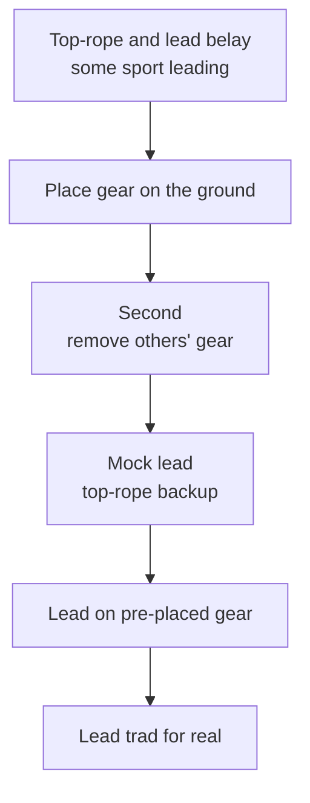

> 🌏 [中文版](/posts/climbing/2026-10-17-sport-to-trad-learning-path)

After the [series overview](/posts/climbing/2026-10-17-sport-vs-trad-overview-en), you should have a rough idea of where you sit between L1 and L5. This post helps you plan the next year: what to practice at each level, where to learn in Taiwan, which certifications exist, and where other climbers most often get hurt.

To be clear up front: **this post does not replace a course.** It lays out the order of skills and courses and what matters at each step; the moves themselves have to be practiced in front of a qualified instructor until they are right.

## The order: sport first, then trad

This series follows the five levels planned for [nobodyclimb's rope-system practice](https://nobodyclimb.cc/games/rope-system). What each level is about:

| Level | Name | What you practice | In this series |
|---|---|---|---|
| L1 | Belayer | Top-rope belaying, from gym to crag | [Post 1](/posts/climbing/2026-10-17-outdoor-belay-en) |
| L2 | Lead belayer | Lead belaying, your first outdoor sport lead | [Post 2](/posts/climbing/2026-10-17-first-outdoor-sport-lead-en) |
| L3 | Outdoor climber | Judging bolts, rigging top-ropes, lowering or rappelling | Posts [3](/posts/climbing/2026-10-17-judging-bolts-en), [4](/posts/climbing/2026-10-17-top-rope-anchor-setup-en), [5](/posts/climbing/2026-10-17-lower-or-rappel-en) |
| L4 | Multi-pitch second | Placing gear, anchors, following multi-pitch | Posts [7](/posts/climbing/2026-10-17-trad-protection-nuts-cams-en), [8](/posts/climbing/2026-10-17-building-anchors-en), [9](/posts/climbing/2026-10-17-multi-pitch-basics-en) |
| L5 | Multi-pitch leader | Leading multi-pitch, knowing what to do when things go wrong | [Post 10](/posts/climbing/2026-10-17-self-rescue-basics-en) |

Between L3 and L4 there is a bridge: [grades and protection ratings](/posts/climbing/2026-10-17-grades-and-protection-ratings-en). Trad grades add a layer about protection quality; understand that before you learn to place gear.

### The five-step trad progression

Up to L3, sport climbing means using bolts someone else placed. From L4 on, you place the protection. [Climbing magazine's "Gym to Crag: Trad Climbing"](https://www.climbing.com/skills/gym-to-crag-trad-climbing-outdoor-research/) lays out a progression; its author, Elaina Arenz, is an AMGA Certified Rock Guide. Before starting, you should be a competent top-rope climber and lead belayer, and ideally have led sport routes.

What each step trains:

- **Placing gear on the ground**: find a single-pitch crag with cracks at the base, place as many pieces as you can close to the ground, and gently weight them.
- **Seconding**: before removing a piece, look at it and picture how the leader placed it, then reverse that. Arenz's advice is to look before you touch.
- **Mock leading**: tie into both a top-rope and a lead rope, and clip the lead rope into the gear you place. If a piece fails, the top-rope catches you, so you can actually weight your placements to test them.
- **Leading on pre-placed gear**: the gear is already in; you climb it as a lead and clip the rope in.
- **Leading for real**: Arenz's rules are to place gear early and often, ideally with a cam as the first piece because it can take forces from several directions.

She also cautions against trusting what friends teach you if they are not much more experienced than you; the quickest way to start is to hire a guide.

**Something you can do tonight**: draw these five boxes in a notebook and tick the ones you have done. The first unticked box is what to practice on your next trip.

## Where to learn in Taiwan

Outdoor courses in Taiwan set prerequisites in roughly this order: sport courses expect top-roping, trad courses expect leading, multi-pitch courses expect single-pitch trad. Below are courses published by several providers; prices and requirements were checked on their websites on 2026-10-17. All pages are in Chinese.

### Outdoor sport (L2–L3)

| Course | Location and length | Price | Prerequisite |
|---|---|---|---|
| [ZA Adventure: outdoor sport climbing course](https://www.zaadventure.com/2020/12/outdoor-rock-climbing-level-2.html) | Long Dong, 2 days | NT$9,800 | Top-rope a 5.9 in the gym |
| [GOFormosa: advanced outdoor climbing course](https://www.go4mosa.net/products/rockclimbing-lead) | Long Dong, Rehai or Defulan, 2 days | NT$6,750 | Indoor 5.9 |

ZA's course covers anchor checks, mock leading and lead belaying, plus converting a lead to a top-rope, retreating from a lead, and double-rope rappels; its page says 2026 public dates are still being planned. GOFormosa's course spends one day on leading and belaying and one on system transitions and retreating from a lead. For gym lead courses and lead cards, see [gym lead climbing](/posts/climbing/2026-10-17-gym-lead-climbing-en).

### Single-pitch trad (entering L4)

| Course | Location and length | Price | Prerequisite |
|---|---|---|---|
| [Adventure Taiwan: single-pitch trad climbing](https://www.adventuretaiwan.com/product/single-pitch-trad-climbing/) | Long Dong, 2 days, 14 hours | NT$6,000 | Able to lead; leading 5.8 or harder preferred |
| [Wild Lily Rocks: full single-pitch trad course](https://www.wildlily.rocks/full-course) | Neihu indoor wall plus Long Dong, 52 hours total | NT$22,500 | Able to lead, and able to climb routes around 10a cleanly |

Adventure Taiwan provides the team's trad gear and covers active and passive protection, the E.A.R.N.E.S.T. anchor principles and retreating from a lead. Wild Lily's course is the longest; beyond protection and anchors, it practices system transitions such as escaping the belay and converting a rappel to an ascent.

### Multi-pitch (L4–L5)

| Course | Location and length | Price | Prerequisite |
|---|---|---|---|
| [Adventure Taiwan: multi-pitch trad climbing](https://www.adventuretaiwan.com/product/multi-pitch-trad-climbing/) | Long Dong, 2 days, 14 hours | NT$7,000 | Their single-pitch trad course; redpoint 5.10a or harder preferred |
| [Learn From The Mountain: multi-pitch trad course](https://learnfromthemountain.wordpress.com/多繩距傳統攀登課/) | Long Dong, 2 days | NT$6,000 per person | Able to lead single-pitch trad and lead belay |
| [GOFormosa: multi-pitch climbing course](https://www.go4mosa.net/products/muti-rockclimbing) | Long Dong, 2 days | NT$9,000 | Mainly sport; no trad experience needed |

Adventure Taiwan's multi-pitch course requires your own trad rack and covers two team modes (co-leading and full leading) and basic self-rescue. Learn From The Mountain also covers multi-pitch rappels and self-rescue.

**Something you can do tonight**: pick the course category for your next level, open two of the course pages in the tables, and copy out their prerequisites. Mark each one "done" or "still need"; the "still need" items are what to train before you sign up.

## Certifications: what exists and what each covers

There are several climbing-related certifications in Taiwan, and they cover different things.

**Gym belay cards**: each gym runs its own course and test, and each gym decides whether to accept other gyms' cards. See [Learning to Top-Rope Belay at the Gym](/posts/climbing/2026-10-17-gym-top-rope-belay-en).

**CTAA CBT**: the Climbing Belay Test of the Chinese Taipei Alpine Association. According to [T-UP's 2023 announcement](https://tupclimbing.tw/news/announcement/232) (in Chinese), it covers top-rope belaying, lead belaying, rope handling, and leading a 5.7–5.8 route. It is the prerequisite for the association's C-level coach, judge and routesetter courses.

**Sport climbing coach (C, B, A levels)**: under the association's [2025 coach certification plan](https://itsrcowebs.com/Files/archives/article/100015/c30784764e984a3288a4ca0fe4d60cad_043-114-%E6%95%99%E7%B7%B4-%E8%B3%87%E6%A0%BC%E6%AA%A2%E5%AE%9A%E5%8F%8A%E7%AE%A1%E7%90%86%E5%AF%A6%E6%96%BD%E8%A8%88%E7%95%AB-0313.pdf) (in Chinese), the C level requires a valid CBT. The C-level course is 24 hours, and the practical climbing standard is 5.10a/b. This is a sports coaching license under the regulations for national sports federations, and it is a separate thing from a license to guide people at outdoor crags.

**Mountain guide (rock climbing)**: the national license for guiding at outdoor crags, under the [Regulations for Mountain Guide Qualification](https://law.moj.gov.tw/LawClass/LawAll.aspx?PCODE=H0120058) (in Chinese), last amended in September 2026. There are three requirements to apply:

- Age 18 or over.
- At least 48 hours of training at an approved training organization within two years.
- At least 8 hours of first-aid training.

The [Sports Administration's list of organizations](https://isports.sa.gov.tw/Apps/Fessay.aspx?SYS=MTG&MENU_PRG_CD=96&ITEM_PRG_CD=&PKNO=3759) (in Chinese) names two training organizations for rock-climbing guides: Adventure Taiwan and an outdoor education association, 社團法人國際戶外教育學會 (IOEF). Only Adventure Taiwan runs the exams and refresher courses.

Adventure Taiwan's [rock guide training](https://www.adventuretaiwan.com/product/rock-guide-training/) (in Chinese) runs 6 days and costs NT$26,000. Before applying you need two kinds of outdoor lead experience, at any grade:

- 10 sport routes led on redpoint.
- 10 trad routes led on redpoint.

Looking abroad, the US [AMGA Single Pitch Instructor (SPI)](https://www.amga.com/programs/climbing-instructor-programs/single-pitch-instructor-program) course requires at least 15 trad leads, and the exam requires 40. For the IFMGA mountain guide path beyond that, see [the Taiwan post in the IFMGA series](/posts/climbing/2026-10-17-ifmga-taiwan-path-en).

**Something you can do tonight**: start a climbing log. For every route, record the date, crag, route, grade, sport or trad, and lead or second. Guide training and AMGA courses both use route counts as prerequisites; logging from today is more reliable than reconstructing later.

## How climbers usually get hurt

The American Alpine Club (AAC) publishes *Accidents in North American Climbing* every year. The patterns below come from two of its analyses, and they touch every level of this series.

### Lowering: the rope is too short

The AAC's 2013 ["Know the Ropes: Lowering"](https://americanalpineclub.org/news/2023/6/21/lowering) reviewed the previous decade of reports. The four most common causes of lowering accidents are a rope that's too short, miscommunication, an inadequate belay, and anchor failure.

More than half of them happened when the rope end shot through the belay device and the climber fell. The author's fixes:

- **Close the system**: tie a bulky stopper knot in the rope end (a triple overhand, for example), or have the belayer tie into it.
- **Check the rope length before you go**: if the anchor is more than half the rope length up, the rope will run out partway down. Some routes need a 70-meter rope.
- **Watch the middle mark while belaying**: once it passes through the device, both of you should be on alert.
- **Agree on the plan at the top before leaving the ground**: lower or rappel. Many accidents happened because the belayer assumed the climber would rappel and took them off belay.

These details come back in [lower or rappel](/posts/climbing/2026-10-17-lower-or-rappel-en).

### Gym-to-crag overconfidence

The 2025 ["Know the Ropes: Human Factors"](https://publications.americanalpineclub.org/articles/13201217363) in the same publication analyzed reports from 2005–2024 and made the gym-to-crag transition its own category. Gyms use the same grades as outdoor climbs, so strong gym climbers tend to overestimate themselves. The author's advice is to find a mentor or take an outdoor-specific course.

### System transitions and rappelling

The same analysis says transitions at anchors, swapping leads, and setting up to rappel or lower cause many severe injuries and fatalities. The most common mistakes are miscommunication, misusing belay or rappel devices, badly tied knots, and failing to close the system. A stopper knot in each end of the rappel rope is the simplest lifesaver, yet it remains one of the most common omissions in the reports.

### Too much trust in cams

The same analysis notes that every reported accident involving pulled protection in 2023 was a failed cam placement. The author argues that cams are so easy to place that people forget it takes experience to judge a good placement, and she recommends learning nuts before relying on cams.

### Experience doesn't protect you

According to the AAC, 43% of the accidents in its reports since 1948 involved experienced climbers. The author calls this the mentor trap: climbing with someone more experienced makes it easy to give up your own judgment. If the rope looks too slack or a knot looks wrong, say so.

### Long Dong

[TOCC's Long Dong safety page](https://www.tocc-climbing.org/ld-safety-information) (in Chinese and English) counts casualties from 1986 to 2020: five deaths and five severe injuries. TOCC warns that Long Dong's terrain is complex, moving between sectors is difficult, and rescue is hard. It provides a rescue plan and a map of rescue points and first-aid caches, and recommends downloading and reading them before you visit.

**Something you can do tonight**: download TOCC's rescue plan to your phone and note the first-aid cache nearest the sector you usually climb in. Then check your own habit: do you always knot the rope end when belaying?

## The limits of injury research

If you want numbers to decide whether sport or trad is more dangerous, you run into the limits of the research. A 2020 [systematic review of climbing accidents](https://www.mdpi.com/1660-4601/17/1/203) summarizes earlier studies:

- Most trad injuries came from falls; most sport injuries came from strenuous moves.
- One study found 69% of injuries happened while leading.
- Another found belay incidents accounted for 12% of victims.

The authors state that studies differ widely in the type of climbing, design and how risk is measured, so precise comparisons are hard. These numbers tell you that leading, falling and belaying deserve extra practice; they cannot rank which style is safer.

## Plan your next year

Pull the sections above together into a one-page plan:

1. **Current level**: use the questions in the [overview](/posts/climbing/2026-10-17-sport-vs-trad-overview-en).
2. **Next post to read**: from the table at the top of this post.
3. **Next course**: pick one from "Where to learn in Taiwan" and list the prerequisites you still need.
4. **Practice partner**: at least one person more experienced than you who is willing to let you second.
5. **Climbing log**: start today and review your route counts and level every quarter.

Getting from L1 to L5 in a year is not the goal. Move on only after you have done each level's skills outdoors several times and had them checked by an instructor.

## Practice: five scenarios

Answers are under each question; think first, then open. For more questions, try [nobodyclimb's rope-system practice](https://nobodyclimb.cc/games/rope-system); all eight sport and trad categories relate to this post.

**1. A sport route's anchor is 32 meters up and you brought a 60-meter rope. The climber wants to be lowered from the top.**

Answer

The rope is too short. The anchor is higher than half the rope length (30 meters), so the rope end would pass through the belay device before the climber reaches the ground. The AAC's fix is to close the system with a stopper knot in the end or the belayer tied in, and to bring a 70-meter rope, or bring a second rope and rappel on both. Check the guidebook or ask locals before you go to find out what rope length the route needs.

**2. You can lead in the gym and want to sign up directly for a multi-pitch trad course.**

Answer

You don't meet the prerequisites. Multi-pitch trad courses in Taiwan, such as Adventure Taiwan's and Learn From The Mountain's, expect you to lead single-pitch trad first. Go in order: outdoor sport leading → single-pitch trad → multi-pitch.

**3. Seconding your first trad route, you reach a stuck nut. A few tugs and it won't come out.**

Answer

Look before you touch: picture how the leader placed it and reverse that. Arenz's method is to give the attached draw or runner a sharp upward tug first; if it still won't come out, jab the body of the nut with the point of your nut tool, pushing it up toward the wider part of the crack.

**4. Your trad leader is very experienced. You notice their knot doesn't look fully finished, but you feel awkward saying so.**

Answer

Say it. According to the AAC, 43% of the accidents in its reports since 1948 involved experienced climbers, and the reports include a fatal fall after a belayer didn't check the climber's knot. Check each other before every climb, no matter how experienced your partner is.

**5. You want to become a licensed rock-climbing guide, but outdoors you have only led a few sport routes and no trad.**

Answer

Build experience first. Adventure Taiwan's rock guide training requires 10 outdoor sport leads and 10 trad leads on redpoint before you apply, or proof of trad training from a registered organization. Take a single-pitch trad course and start your climbing log.

## What's next

To see which crags in Taiwan you can climb and whether each is sport or trad, read [Taiwan's crags: rock type decides the style](/posts/climbing/2026-10-17-taiwan-crags-rock-type-en). To learn why you should not place bolts yourself at Long Dong, read [history and ethics](/posts/climbing/2026-10-17-bolting-history-ethics-en).

## References

- [Gym to Crag: Trad Climbing (Elaina Arenz, Climbing, 2019)](https://www.climbing.com/skills/gym-to-crag-trad-climbing-outdoor-research/)
- [Know the Ropes: Lowering (Mike Poborsky, Accidents in North American Climbing 2013, republished by the AAC)](https://americanalpineclub.org/news/2023/6/21/lowering)
- [Know the Ropes: Human Factors (Valerie Karr, Accidents in North American Climbing 2025)](https://publications.americanalpineclub.org/articles/13201217363)
- [Climbing Accidents: Prospective Data Analysis from the International Alpine Trauma Registry and Systematic Review of the Literature (Rugg et al., IJERPH 2020)](https://www.mdpi.com/1660-4601/17/1/203)
- [Long Dong safety information (TOCC)](https://www.tocc-climbing.org/ld-safety-information)
- [ZA Adventure: outdoor sport climbing course](https://www.zaadventure.com/2020/12/outdoor-rock-climbing-level-2.html) (in Chinese)
- [GOFormosa: advanced outdoor climbing course](https://www.go4mosa.net/products/rockclimbing-lead) (in Chinese)
- [GOFormosa: multi-pitch climbing course](https://www.go4mosa.net/products/muti-rockclimbing) (in Chinese)
- [Adventure Taiwan: single-pitch trad climbing](https://www.adventuretaiwan.com/product/single-pitch-trad-climbing/) (in Chinese)
- [Adventure Taiwan: multi-pitch trad climbing](https://www.adventuretaiwan.com/product/multi-pitch-trad-climbing/) (in Chinese)
- [Adventure Taiwan: rock guide training](https://www.adventuretaiwan.com/product/rock-guide-training/) (in Chinese)
- [Wild Lily Rocks: full single-pitch trad course](https://www.wildlily.rocks/full-course) (in Chinese)
- [Learn From The Mountain: multi-pitch trad course](https://learnfromthemountain.wordpress.com/多繩距傳統攀登課/) (in Chinese)
- [T-UP Zhonghe: CTAA Climbing Belay Test announcement (2023)](https://tupclimbing.tw/news/announcement/232) (in Chinese)
- [Chinese Taipei Alpine Association 2025 sport climbing coach certification plan (PDF)](https://itsrcowebs.com/Files/archives/article/100015/c30784764e984a3288a4ca0fe4d60cad_043-114-%E6%95%99%E7%B7%B4-%E8%B3%87%E6%A0%BC%E6%AA%A2%E5%AE%9A%E5%8F%8A%E7%AE%A1%E7%90%86%E5%AF%A6%E6%96%BD%E8%A8%88%E7%95%AB-0313.pdf) (in Chinese)
- [Regulations for Mountain Guide Qualification (Laws & Regulations Database of the ROC)](https://law.moj.gov.tw/LawClass/LawAll.aspx?PCODE=H0120058) (in Chinese)
- [Approved mountain guide training organizations (Sports Administration, iSports platform)](https://isports.sa.gov.tw/Apps/Fessay.aspx?SYS=MTG&MENU_PRG_CD=96&ITEM_PRG_CD=&PKNO=3759) (in Chinese)
- [Single Pitch Instructor Program (AMGA)](https://www.amga.com/programs/climbing-instructor-programs/single-pitch-instructor-program)
- [nobodyclimb rope-system practice](https://nobodyclimb.cc/games/rope-system)
- [Sport vs Trad Climbing (series overview)](/posts/climbing/2026-10-17-sport-vs-trad-overview-en)
- [How a Taiwanese Climber Can Become an IFMGA Mountain Guide](/posts/climbing/2026-10-17-ifmga-taiwan-path-en)
