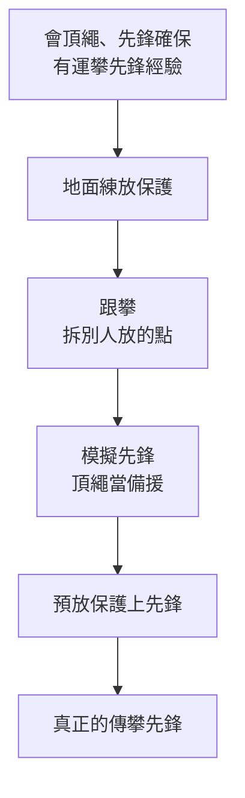

> 🌏 [English version](/posts/climbing/2026-10-17-sport-to-trad-learning-path-en)

讀完[總覽](/posts/climbing/2026-10-17-sport-vs-trad-overview)，你大概知道自己在 L1 到 L5 的哪一級。這篇幫你把接下來一年排出來：每一級要練什麼、在台灣去哪裡學、要不要考證，以及別人最常在哪一步出事。

先講清楚：**這篇不能取代上課。** 它告訴你課程之間的順序和每一步的重點，手上的動作要在合格教練面前練到正確。

## 學習順序：先運攀，再傳攀

這個系列對齊 [nobodyclimb 繩索系統練習](https://nobodyclimb.cc/games/rope-system)規劃中的五級。每一級的重點：

| 等級 | 名稱 | 要練到的事 | 本系列 |
|---|---|---|---|
| L1 | 確保員 | 上攀確保，岩館到戶外 | [第 0](/posts/climbing/2026-10-17-gym-top-rope-belay)、[3 篇](/posts/climbing/2026-10-17-outdoor-belay) |
| L2 | 先鋒確保員 | 先鋒確保，戶外第一條運攀先鋒 | [第 1](/posts/climbing/2026-10-17-gym-lead-climbing)、[4 篇](/posts/climbing/2026-10-17-first-outdoor-sport-lead) |
| L3 | 戶外攀岩者 | 判斷 bolt、架頂繩、下放或垂降 | [第 5](/posts/climbing/2026-10-17-judging-bolts)、[6](/posts/climbing/2026-10-17-top-rope-anchor-setup)、[7 篇](/posts/climbing/2026-10-17-lower-or-rappel) |
| L4 | 多繩距跟攀者 | 放保護、固定點、跟攀多繩距 | [第 9](/posts/climbing/2026-10-17-trad-protection-nuts-cams)、[10](/posts/climbing/2026-10-17-building-anchors)、[11 篇](/posts/climbing/2026-10-17-multi-pitch-basics) |
| L5 | 多繩距先鋒 | 領攀多繩距，知道出事怎麼辦 | [第 12 篇](/posts/climbing/2026-10-17-self-rescue-basics) |

L3 和 L4 中間有一座橋：[難度與保護評等](/posts/climbing/2026-10-17-grades-and-protection-ratings)。傳攀路線的評等多了一層保護好不好，先看懂再去學放保護。

### 傳攀的五步進程

運攀到 L3 為止，都是在用別人打好的 bolt。從 L4 開始，保護點要自己放。[Climbing 雜誌的〈從岩館到傳攀〉](https://www.climbing.com/skills/gym-to-crag-trad-climbing-outdoor-research/)給了一條進程，作者 Elaina Arenz 是 AMGA 認證攀岩嚮導。開始前的條件是：頂繩攀爬與先鋒確保都要熟練，最好也有運攀先鋒的經驗。

每一步在練什麼：

- **地面練放保護**：找底部就有裂隙的單繩距岩場，在離地很近的地方盡量多放，掛上去用體重輕輕測試。
- **跟攀**：拆之前先看，想像先鋒者是怎麼放進去的，再反過來拆。Arenz 的建議是先用眼睛看，再用手碰。
- **模擬先鋒**：同時綁頂繩和先鋒繩，邊爬邊把先鋒繩掛進自己放的點。放的點撐不住時，頂繩會接住你，所以可以真的把體重壓上去測。
- **在預放的保護上先鋒**：保護點事先放好，你用先鋒的方式爬上去、把繩子掛進去。
- **真正先鋒**：Arenz 給的原則是早放、多放；第一個點最好放活動岩楔，因為它能承受多方向的拉力。

她也提醒，跟程度沒比你高多少的朋友學，要小心他給的資訊；最快的起步方式是請嚮導。

**今晚就能做的動作**：在筆記本畫這五格，把你已經做過的打勾。第一個沒打勾的，就是下一次出門要練的。

## 在台灣去哪學

台灣的戶外課程，先修條件大致照上面的順序排：運攀課要求會頂繩，傳攀課要求會先鋒，多繩距課要求會單繩距傳攀。以下是幾家業者公開的課程，價格與條件都是 2026-10-17 查詢官網的結果。

### 戶外運攀（L2–L3）

| 課程 | 地點與時數 | 費用 | 先修 |
|---|---|---|---|
| [ZA 垂直探險工作室：戶外運動攀岩課程](https://www.zaadventure.com/2020/12/outdoor-rock-climbing-level-2.html) | 龍洞，2 天 | NT$9,800 | 岩館頂繩能完成 5.9 |
| [生於戶外 GOFormosa：進階戶外攀岩課程](https://www.go4mosa.net/products/rockclimbing-lead) | 龍洞、熱海、德芙蘭，2 天 | NT$6,750 | 室內 5.9 |

ZA 的課教固定點檢查、模擬先鋒、先鋒確保，也練把先鋒轉換成頂繩、先鋒撤退與雙繩垂降；頁面寫 2026 年的公開班還在規劃。生於戶外的課一天練先鋒攀登與確保，一天練系統轉換與先鋒撤退。岩館的先鋒課與先鋒卡，見[岩館先鋒](/posts/climbing/2026-10-17-gym-lead-climbing)。

### 單繩距傳攀（L4 入口）

| 課程 | 地點與時數 | 費用 | 先修 |
|---|---|---|---|
| [艾格探險：單繩距傳統攀登](https://www.adventuretaiwan.com/product/single-pitch-trad-climbing/) | 龍洞，2 天 14 小時 | NT$6,000 | 有先鋒能力，先鋒 5.8 以上為佳 |
| [百合搖滾：單繩距傳統攀登完整課程](https://www.wildlily.rocks/full-course) | 內湖室內加龍洞，共 52 小時 | NT$22,500 | 有先鋒能力，並能不吃繩完攀 10a 程度的路線 |

艾格的課提供繩隊的傳攀裝備，教活動式與被動式岩械、E.A.R.N.E.S.T. 固定點原則與先鋒撤退。百合搖滾的課時數最長，除了保護點與固定點，也練確保脫出、垂降轉上昇這類系統轉換。

### 多繩距（L4–L5）

| 課程 | 地點與時數 | 費用 | 先修 |
|---|---|---|---|
| [艾格探險：多繩距傳統攀登](https://www.adventuretaiwan.com/product/multi-pitch-trad-climbing/) | 龍洞，2 天 14 小時 | NT$7,000 | 完成艾格單繩距傳攀課，紅點 5.10a 以上為佳 |
| [山學訓練：多繩距傳統攀登課](https://learnfromthemountain.wordpress.com/多繩距傳統攀登課/) | 龍洞，2 天 | 每人 NT$6,000 | 會單繩距傳攀先鋒與先鋒確保 |
| [生於戶外 GOFormosa：多繩距攀登課](https://www.go4mosa.net/products/muti-rockclimbing) | 龍洞，2 天 | NT$9,000 | 以運攀為主，不需傳攀經驗 |

艾格的多繩距課要自備傳攀裝備，內容包括兩種繩隊模式（Co-Leading、Full Leading）與基礎自我救援。山學訓練的課也教多繩距垂降與自我救援。

**今晚就能做的動作**：挑出你下一級對應的那一類課，打開表格裡兩家的課程頁，把先修條件抄下來。逐條標上「已達到」或「還差什麼」，還差的就是報名前要練的。

## 證照：哪些有、各自管什麼

台灣和攀岩有關的證照有幾種，管的事情不一樣。

**岩館確保卡**：各館自己開課、自己考，能不能跨館使用由各館決定。見[岩館上攀確保](/posts/climbing/2026-10-17-gym-top-rope-belay)。

**中華山協 CBT**：中華民國山岳協會的攀登確保能力檢測。依[原岩 2023 年的公告](https://tupclimbing.tw/news/announcement/232)，考上攀確保、先鋒確保、收繩，以及先鋒一條 5.7–5.8 的路線。它是報考山協 C 級教練、裁判、定線員課程的門檻。

**運動攀登教練（C／B／A 級）**：依山協的 [2025 年度教練資格檢定實施計畫](https://itsrcowebs.com/Files/archives/article/100015/c30784764e984a3288a4ca0fe4d60cad_043-114-%E6%95%99%E7%B7%B4-%E8%B3%87%E6%A0%BC%E6%AA%A2%E5%AE%9A%E5%8F%8A%E7%AE%A1%E7%90%86%E5%AF%A6%E6%96%BD%E8%A8%88%E7%95%AB-0313.pdf)，報考 C 級要有效期內的 CBT。C 級講習 24 小時，術科的攀登標準是 5.10a/b。這是依《特定體育團體建立運動教練資格檢定及管理辦法》辦的運動教練證，和帶人去戶外岩場的嚮導證是兩回事。

**山域嚮導（攀岩類）**：帶人去戶外岩場的國家證照，法源是[《山域嚮導資格檢定辦法》](https://law.moj.gov.tw/LawClass/LawAll.aspx?PCODE=H0120058)，最新修正在 2026 年 9 月。申請條件有三項：

- 滿 18 歲。
- 2 年內在訓練機構累計 48 小時以上的訓練。
- 8 小時以上的急救訓練。

[運動部全民運動署的機構名單](https://isports.sa.gov.tw/Apps/Fessay.aspx?SYS=MTG&MENU_PRG_CD=96&ITEM_PRG_CD=&PKNO=3759)列出，攀岩嚮導的訓練機構有艾格探險與社團法人國際戶外教育學會兩家。辦檢定與複訓的只有艾格。

艾格的[攀岩嚮導訓練](https://www.adventuretaiwan.com/product/rock-guide-training/)要上 6 天，費用 NT$26,000。報名前要有兩種戶外先鋒經驗，難度不限：

- 運攀先鋒紅點 10 條。
- 傳攀先鋒紅點 10 條。

想往國際走，美國的 [AMGA 單繩距攀岩教練（SPI）](https://www.amga.com/programs/climbing-instructor-programs/single-pitch-instructor-program)課程要求至少 15 條傳攀先鋒，考試要 40 條。再往上的 IFMGA 高山嚮導，見 [IFMGA 系列的台灣篇](/posts/climbing/2026-10-17-ifmga-taiwan-path)。

**今晚就能做的動作**：開一份攀登紀錄，每爬一條就記日期、岩場、路線、難度、運攀或傳攀、先鋒或跟攀。嚮導訓練、AMGA 課程都用條數當門檻，從今天開始記，比事後回想可靠。

## 最常怎麼出事

美國阿爾卑斯俱樂部（AAC）每年出版《Accidents in North American Climbing》。以下的模式出自它的兩篇分析，和這個系列的每一級都有關。

### 下放：繩子不夠長

美國阿爾卑斯俱樂部 2013 年的[〈Know the Ropes: Lowering〉](https://americanalpineclub.org/news/2023/6/21/lowering)整理了前十年的報告。下放事故的四個主因是：繩子太短、溝通誤會、確保不當、固定點失效。

其中一半以上是繩尾從確保器穿出、攀爬者直接墜落。作者的對策：

- **封閉系統**：在繩尾打一個大的止滑結（例如三重單結），或讓確保者綁在繩尾。
- **出發前查繩長**：固定點超過繩長一半時，下放到一半繩子就不夠了。有些路線需要 70 公尺繩。
- **確保時看繩子中點**：中點標記穿過確保器時，兩人都要提高警覺。
- **開爬前講好到頂後的打算**：要下放還是垂降。不少事故是確保者以為攀爬者要垂降，就把他從確保中放開了。

這些細節在[下放還是垂降](/posts/climbing/2026-10-17-lower-or-rappel)會再講。

### 從岩館到岩場的過度自信

同一份年報 2025 年的[〈Know the Ropes: Human Factors〉](https://publications.americanalpineclub.org/articles/13201217363)分析 2005–2024 年的報告，把「從岩館到岩場」列為獨立的一類。岩館和戶外用同一套難度，岩館爬得好的人容易高估自己。作者的建議是找有經驗的人帶，或上戶外專門的課。

### 系統轉換與垂降

同一篇分析指出，在固定點轉換、換領攀、準備垂降或下放的時刻，最容易出重大意外。最常見的錯誤是溝通誤會、確保器或垂降器用錯、繩結沒打好、系統沒封閉。垂降時在兩端繩尾打止滑結，是最簡單的保命方法，但仍然是報告裡最常被省略的步驟之一。

### 太相信活動岩楔

同一篇分析指出，2023 年回報的保護點脫出事故，全部是活動岩楔放置失敗。作者認為活動岩楔放起來太容易，讓人忘了要經驗才能判斷放得好不好；她建議先學好岩楔，再依賴活動岩楔。

### 有經驗的人也會出事

AAC 的資料顯示，自 1948 年以來的事故有 43% 發生在有經驗的攀岩者身上。作者把這叫做「導師陷阱」：跟著有經驗的人爬，容易放棄自己的判斷。看到繩子太鬆、繩結怪怪的，就開口講。

### 龍洞的狀況

[TOCC 的龍洞安全資訊](https://www.tocc-climbing.org/ld-safety-information)統計 1986 到 2020 年的傷亡，死亡與重傷各 5 人。TOCC 提醒，龍洞地形複雜、區域之間通行困難，出事時救援不易。它提供一份救援計畫書與救援資訊圖，標出各區救援點與急救器材位置，建議造訪前先下載讀過。

**今晚就能做的動作**：下載 TOCC 的救援計畫書存在手機，記下你最常去的分區最近的急救器材點。再檢查你的繩尾：確保時有沒有打結的習慣。

## 受傷研究的限制

想用數字比運攀和傳攀誰比較危險，會碰到研究本身的限制。一篇 2020 年的[攀岩事故系統性回顧](https://www.mdpi.com/1660-4601/17/1/203)整理了既有文獻：

- 傳攀的受傷多數由墜落造成，運攀多半來自用力過度的動作。
- 有一項研究發現，69% 的受傷發生在先鋒上攀時。
- 另一項研究統計，確保事故占攀岩事故傷者的 12%。

作者明講，各研究的攀岩類型、研究設計、計算風險的方式差很多，很難給出精確的比較。所以這些數字只能告訴你「先鋒、墜落、確保」是要特別練的地方，不能拿來排名哪一種比較安全。

## 排出你的下一年

把前面幾節串起來，寫一張自己的學習單：

1. **現在的等級**：用[總覽](/posts/climbing/2026-10-17-sport-vs-trad-overview)的問題判斷。
2. **下一級要讀的文章**：照本篇第一節的表。
3. **下一門課**：從「在台灣去哪學」挑一門，寫下先修還差什麼。
4. **練習夥伴**：至少一位比你有經驗、願意讓你跟攀的人。
5. **攀登紀錄**：從今天開始記，每季回頭看一次條數與等級。

一年內從 L1 走到 L5 不是目標。每一級都在戶外實際做過幾次、在教練面前被檢查過，才往下走。

## 練習題：五個情境

答案在每題下方，先自己想再看。想練更多題，可以玩 [nobodyclimb 的繩索系統練習](https://nobodyclimb.cc/games/rope-system)，運攀與傳攀八個分類全部都和本篇有關。

**1. 一條運攀路線的固定點在 32 公尺高，你們帶的是 60 公尺繩。攀爬者到頂後要下放。**

答案

繩子不夠。固定點超過繩長一半（30 公尺），下放到地面之前繩尾就會穿出確保器。AAC 的對策是封閉系統：確保者在繩尾打止滑結或綁在繩尾，並換 70 公尺繩，或帶第二條繩、改用雙繩垂降。出發前查指南或問當地人，確認這條路線要多長的繩。

**2. 你在岩館能先鋒，想直接報名多繩距傳攀課。**

答案

先修不夠。台灣的多繩距傳攀課，例如艾格與山學訓練，都要求先會單繩距傳攀先鋒。照順序走：戶外運攀先鋒 → 單繩距傳攀 → 多繩距。

**3. 你第一次跟攀傳攀路線，遇到一個卡很緊的岩楔，拉了幾下拉不出來。**

答案

先看再動手，想像先鋒者是怎麼放進去的，反過來拆。Arenz 的方法是先用繩環往上猛拉一下；還是拆不出來，就用岩楔起子的尖端頂住岩楔本體，往裂隙較寬的地方推。

**4. 你的傳攀先鋒夥伴很有經驗。你注意到他的繩結看起來沒穿完整，但不好意思講。**

答案

講出來。AAC 的資料顯示，自 1948 年以來 43% 的事故發生在有經驗的攀岩者身上，報告也有確保者沒檢查繩結、攀爬者墜落身亡的案例。每次開爬前互相檢查，跟對方有多資深無關。

**5. 你想考山域嚮導攀岩類，但戶外只先鋒過幾條運攀，沒先鋒過傳攀。**

答案

先累積經驗。艾格的攀岩嚮導訓練要求報名前有戶外運攀先鋒紅點 10 條、傳攀先鋒紅點 10 條，或提供法人機構的傳攀訓練證明。先上單繩距傳攀課，並開始記攀登紀錄。

## 下一步

想先確認台灣有哪些岩場能爬、各自是運攀還是傳攀，讀[台灣岩場：岩質決定爬法](/posts/climbing/2026-10-17-taiwan-crags-rock-type)。想知道龍洞為什麼不能自己打 bolt，讀[歷史與倫理](/posts/climbing/2026-10-17-bolting-history-ethics)。

## 參考資料

- [Gym to Crag: Trad Climbing（Elaina Arenz，Climbing，2019）](https://www.climbing.com/skills/gym-to-crag-trad-climbing-outdoor-research/)
- [Know the Ropes: Lowering（Mike Poborsky，Accidents in North American Climbing 2013，AAC 重刊）](https://americanalpineclub.org/news/2023/6/21/lowering)
- [Know the Ropes: Human Factors（Valerie Karr，Accidents in North American Climbing 2025）](https://publications.americanalpineclub.org/articles/13201217363)
- [Climbing Accidents: Prospective Data Analysis from the International Alpine Trauma Registry and Systematic Review of the Literature（Rugg et al., IJERPH 2020）](https://www.mdpi.com/1660-4601/17/1/203)
- [岩場安全資訊（TOCC）](https://www.tocc-climbing.org/ld-safety-information)
- [ZA 垂直探險工作室：戶外運動攀岩課程](https://www.zaadventure.com/2020/12/outdoor-rock-climbing-level-2.html)
- [生於戶外 GOFormosa：進階戶外攀岩課程](https://www.go4mosa.net/products/rockclimbing-lead)
- [生於戶外 GOFormosa：多繩距攀登課程](https://www.go4mosa.net/products/muti-rockclimbing)
- [艾格探險：單繩距傳統攀登](https://www.adventuretaiwan.com/product/single-pitch-trad-climbing/)
- [艾格探險：多繩距傳統攀登](https://www.adventuretaiwan.com/product/multi-pitch-trad-climbing/)
- [艾格探險：攀岩嚮導訓練](https://www.adventuretaiwan.com/product/rock-guide-training/)
- [百合搖滾：單繩距傳統攀登完整課程](https://www.wildlily.rocks/full-course)
- [山學訓練：多繩距傳統攀登課](https://learnfromthemountain.wordpress.com/多繩距傳統攀登課/)
- [原岩中和店：中華山協 CBT 攀登確保能力檢測（2023 公告）](https://tupclimbing.tw/news/announcement/232)
- [中華民國山岳協會 114 年度運動攀登教練資格檢定及管理實施計畫（PDF）](https://itsrcowebs.com/Files/archives/article/100015/c30784764e984a3288a4ca0fe4d60cad_043-114-%E6%95%99%E7%B7%B4-%E8%B3%87%E6%A0%BC%E6%AA%A2%E5%AE%9A%E5%8F%8A%E7%AE%A1%E7%90%86%E5%AF%A6%E6%96%BD%E8%A8%88%E7%95%AB-0313.pdf)
- [山域嚮導資格檢定辦法（全國法規資料庫）](https://law.moj.gov.tw/LawClass/LawAll.aspx?PCODE=H0120058)
- [山域嚮導認定及認可訓練機構一覽（運動部全民運動署 i 運動資訊平台）](https://isports.sa.gov.tw/Apps/Fessay.aspx?SYS=MTG&MENU_PRG_CD=96&ITEM_PRG_CD=&PKNO=3759)
- [Single Pitch Instructor Program（AMGA）](https://www.amga.com/programs/climbing-instructor-programs/single-pitch-instructor-program)
- [nobodyclimb 繩索系統練習](https://nobodyclimb.cc/games/rope-system)
- [運動攀登與傳統攀登差在哪（本系列總覽）](/posts/climbing/2026-10-17-sport-vs-trad-overview)
- [台灣人怎麼成為 IFMGA 高山嚮導](/posts/climbing/2026-10-17-ifmga-taiwan-path)
