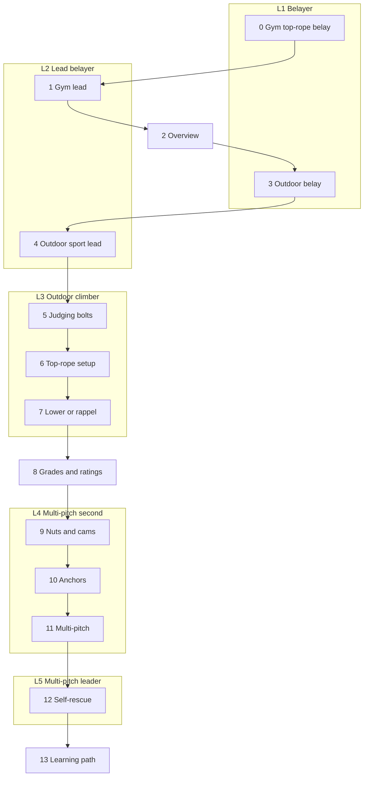

> 🌏 [中文版](/posts/climbing/2026-10-17-sport-vs-trad-overview)

You have your top-rope card at the gym and you've started leading. A friend invites you to Long Dong and says "there are loads of 5.8s, really easy." You bring a rack of quickdraws, walk up to the wall, and find that the 5.8 has no bolts at all.

This post is for that moment. It answers three things: what actually separates sport and trad climbing, which kind Taiwan's crags are, and what order to read this 16-part series in. If you have not belayed in a gym yet, start with [Rock Climbing for Beginners](/posts/climbing/2026-10-08-climbing-beginner-guide-en), [Learning to Top-Rope Belay at the Gym](/posts/climbing/2026-10-17-gym-top-rope-belay-en) and [gym lead climbing](/posts/climbing/2026-10-17-gym-lead-climbing-en).

To be clear up front: **this series does not replace an outdoor course.** Each post helps you understand what the instructor is doing; the moves themselves have to be practiced in front of a qualified instructor until they are right.

## The Long Dong numbers: most easy routes are trad

The Taiwan Outdoor Climbers' Coalition (TOCC) maintains a public [Long Dong route database](https://docs.google.com/spreadsheets/d/1QHFNQSPgKgQrTNnYn246wfotOYqOkzHjLltZ26keBgg/edit?usp=sharing) (in Chinese), one tab per sector, with a "route type" for every route. When checked on 2026-10-17, its statistics tab listed:

| Route type | Routes |
|---|---|
| Trad | 325 |
| Sport | 209 |
| Top-rope only | 42 |
| Boulder | 44 |

Break the sector tabs down by grade and the picture gets sharper: **among routes graded 5.9 and under, 182 are trad and only 12 are sport.** Most sport routes are 5.11 or harder.

So at Long Dong, leading 5.10 in the gym does not mean you can go lead a 5.8. That 5.8 is probably trad, and you would have to place your own protection. If you want easy routes at Long Dong, your options are seconding, climbing a top-rope someone else has rigged, or learning trad.

Each sector has its own character. Counting the route rows at the time of checking:

- **First Cave**: 62 sport and 12 trad, the main concentration of sport routes at Long Dong.
- **Clocktower**: 42 trad and 5 sport, almost entirely trad.
- **Music Hall and Golden Valley**: each over 60 trad routes, with around twenty sport routes.

**Something you can do tonight**: open the database, find a route your friend mentioned, and look at the "route type" and "grade" columns. If it is trad, note "needs trad gear or a leader to second."

## In one sentence: who places the protection, and when

Both are forms of lead climbing: the rope trails up behind you and you clip it into protection as you go. The difference is where the protection comes from.

| | Sport | Trad |
|---|---|---|
| Protection | Pre-drilled bolts | Nuts and cams the leader places in cracks |
| Who places it, and when | The route developer, in advance | The leader, while climbing |
| Who removes it | Nobody; it stays on the wall | The second, while following |
| What decides how good it is | The bolt's material and condition | The rock, the crack's shape, and your placement |

[Wikipedia's traditional climbing article](https://en.wikipedia.org/wiki/Traditional_climbing) uses exactly this definition: the leader places temporary, removable protection, and the second removes it. Its [sport climbing article](https://en.wikipedia.org/wiki/Sport_climbing) says sport climbing began in the early 1980s, when leading French climbers wanted to climb blank faces with no cracks for temporary protection, so they pre-drilled bolts.

That difference has three consequences:

- **Different gear**: sport needs quickdraws; trad needs a full rack of protection.
- **Different sources of risk**: in sport you judge whether a bolt can be trusted; in trad you judge every piece you placed yourself.
- **Different learning paths**: sport extends naturally from gym leading; trad means learning to read, place and remove gear before you lead.

**Something you can do tonight**: next time you lead in the gym, ask yourself at every clip, "if there were no bolt here, where would I place gear?" Any stretch where you can't find an answer would be a long runout on a trad route.

## How the gear differs

The basic sport kit is a rope, quickdraws, a belay device and a helmet. [REI's guide to clipping quickdraws](https://www.rei.com/learn/expert-advice/clip-quickdraws.html) points out that the two ends of a quickdraw are not interchangeable: the straight-gate carabiner goes on the bolt and the bent-gate carabiner takes the rope, because the bolt end can develop sharp edges.

Trad takes much more. Wikipedia notes that trad requires more equipment than sport because the leader has to carry and place protection. A typical rack includes:

- **Nuts**: metal wedges that sit in constrictions in a crack; no moving parts.
- **Cams**: pull the trigger to retract the lobes, place the cam in a parallel crack, and the lobes expand against the walls.
- **Slings and alpine draws**: keep the rope running straight so it does not tug pieces out.
- **Nut tool**: for the second to remove stuck nuts.

[Climbing magazine's "Gym to Crag: Trad Climbing"](https://www.climbing.com/skills/gym-to-crag-trad-climbing-outdoor-research/), written by an AMGA Certified Rock Guide, recommends cams for parallel-sided cracks and nuts for constrictions and V-shaped cracks. How these pieces work and how to judge a placement is the subject of [trad protection: nuts and cams](/posts/climbing/2026-10-17-trad-protection-nuts-cams-en).

## How the risks differ

### Risks both share

A [2025 analysis by the American Alpine Club (AAC)](https://publications.americanalpineclub.org/articles/13201217363) reviewed reports in *Accidents in North American Climbing* from 2005–2024 and identified recurring patterns. Two matter most for this series:

- **Gym-to-crag overconfidence**: gyms use the same grade numbers as outdoor routes, so strong gym climbers tend to overestimate themselves. The report's example is a climber who had been "climbing 5.12 in the gym," tried a 5.12a outdoors, missed a clip, flipped and hit his head.
- **System transitions**: changing over at an anchor, setting up to rappel or lower. The usual mistakes are miscommunication, a misloaded device, a badly tied knot, and failing to close the system.

Both risks apply to sport and trad alike.

### Sport: you trust someone else's bolts

Sport protection is fixed, but bolts fail too. [TOCC's chronicle of events](https://www.tocc-climbing.org/chronicle-of-events) (in Chinese) records that in 2015 both bolts of the top anchor on "Big Drum" in the Music Hall sector broke at once. A climber fell to the ground and, being close to it, was only slightly hurt. Afterward it emerged that early production of that bolt model was 304 stainless steel, which corrodes easily by the sea. How to judge a bolt is covered in [bolts fail: how to judge a bolt](/posts/climbing/2026-10-17-judging-bolts-en).

### Trad: you trust what you placed

In trad, how good the protection is depends on the rock and your skill. The same AAC analysis notes that every reported accident involving pulled protection in 2023 was a failed cam placement. The author's advice is to learn passive protection (nuts) properly before relying on cams.

Long Dong has its own case. TOCC's chronicle records that in 2019, on "#313 Canaleta" in the Grand Auditorium, the leader built an anchor from trad gear and belayed the second up. When both weighted the anchor, all three pieces pulled, and the two fell about 20 meters.

### What injury studies can and can't tell you

A 2020 [systematic review of climbing accidents](https://www.mdpi.com/1660-4601/17/1/203) summarizes earlier studies, citing that 75% of injuries in trad climbing came from falls, while in sport climbing most injuries came from strenuous moves. The authors are explicit about the limitation: studies differ in the type of climbing, design and how risk is measured, so precise comparisons are hard. Don't take one paper's "injuries per 1,000 hours" and use it to decide whether sport or trad is more dangerous. The safer conclusion is that the two go wrong in different ways, so you train for different things.

**Something you can do tonight**: write down the transition points of your next outdoor day, such as whether you will lower or rappel at the top and who calls what. Go through it with your partner before you leave.

## Taiwan's crags: the rock decides how you climb

Taiwan has only a handful of outdoor crags, and the rock largely decides the style:

- **Long Dong** (Gongliao, New Taipei): the [Northeast Coast administration's page](https://www.necoast-nsa.gov.tw/Attraction-Content.aspx?a=186&l=1) (in Chinese) describes the walls as hard Szeleng sandstone with intricate joint patterns. Sport and trad are mixed, with more trad.
- **Southern limestone crags**: nobodyclimb's crag data lists [Kenting](https://nobodyclimb.cc/crag/kenting), [Shoushan](https://nobodyclimb.cc/crag/shoushan) and [Guanziling](https://nobodyclimb.cc/crag/guanziling) as sport crags (Guanziling also lists bouldering). [Mountain Project's Guanziling page](https://www.mountainproject.com/area/107850712/guanziling) lists 19 routes, all sport.

Whether you can climb at each of these varies a lot. [Shoushan National Nature Park's list of prohibited activities](https://www.nnp.gov.tw/ch/titlelist/related-regulations/2610) (in Chinese) bans climbing outside designated areas. Kenting National Park bans climbing at Dajianshan, Frog Rock and Sail Rock, according to a [2024 CNA report](https://www.cna.com.tw/news/aloc/202401050182.aspx) (in Chinese). Details are in [Taiwan's crags: rock type decides the style](/posts/climbing/2026-10-17-taiwan-crags-rock-type-en).

One thing specific to Long Dong: most trad routes still have a bolted anchor at the top (the database's Anchor column). You place your own gear on the way up and descend from the fixed anchor. TOCC's [page on Long Dong's top anchors](https://www.tocc-climbing.org/post/%E9%BE%8D%E6%B4%9E%E7%9A%84%E4%B8%8A%E6%96%B9%E5%9B%BA%E5%AE%9A%E9%BB%9E) (in Chinese) asks climbers to always rig top-ropes with their own gear, and recommends retreating by double-rope rappel rather than lowering whenever possible, to reduce wear on the fixed hardware.

## Series map: five levels, sixteen posts

[nobodyclimb's rope-system practice](https://nobodyclimb.cc/games/rope-system) splits its questions into four sport categories (belaying, leading, top-rope setup, rappelling) and four trad categories (anchors, protection, multi-pitch, self-rescue). Its planned certification has five levels (marked "Coming Soon" on the site):

| Level | Name | What you can do |
|---|---|---|
| L1 | Belayer | Top-rope belay |
| L2 | Lead belayer | Lead belay |
| L3 | Outdoor climber | Outdoor single pitch: rig top-ropes, rappel |
| L4 | Multi-pitch second | Anchors, following multi-pitch |
| L5 | Multi-pitch leader | Multi-pitch independently, including self-rescue |

This series follows those five levels. Sport comes first and trad after: first learn to use bolts someone else placed, then learn to place your own protection.

Beyond L1–L5 there are three background posts: [Taiwan's crags](/posts/climbing/2026-10-17-taiwan-crags-rock-type-en), [history and ethics](/posts/climbing/2026-10-17-bolting-history-ethics-en), and the learning path in post 13. What each post focuses on:

| # | Level | Post | After reading, you can |
|---|---|---|---|
| 0 | L1 | [Gym top-rope belay](/posts/climbing/2026-10-17-gym-top-rope-belay-en) | Top-rope belay, partner-check and lower on your own at the gym |
| 1 | L2 | [Gym lead climbing](/posts/climbing/2026-10-17-gym-lead-climbing-en) | Lead at the gym and lead-belay someone else |
| 2 | — | Overview (this post) | Say which level you are at and which post to read next |
| 3 | L1 | [Outdoor belaying](/posts/climbing/2026-10-17-outdoor-belay-en) | Run a full pre-climb check for a top-rope belay at a crag |
| 4 | L2 | [Your first outdoor sport lead](/posts/climbing/2026-10-17-first-outdoor-sport-lead-en) | Name the extra risks of leading outdoors and how to handle them |
| 5 | L3 | [Bolts fail: how to judge a bolt](/posts/climbing/2026-10-17-judging-bolts-en) | Look up the bolt material on a Long Dong route before you go |
| 6 | L3 | [Top-rope setup](/posts/climbing/2026-10-17-top-rope-anchor-setup-en) | Rig a top-rope on two bolts without wearing the fixed anchor |
| 7 | L3 | [Lower or rappel](/posts/climbing/2026-10-17-lower-or-rappel-en) | Choose lowering or rappelling according to crag rules |
| 8 | Bridge | [Grades and protection ratings](/posts/climbing/2026-10-17-grades-and-protection-ratings-en) | Read 5.10a, 6a, E1 5b, and R and X |
| 9 | L4 | [Trad protection: nuts and cams](/posts/climbing/2026-10-17-trad-protection-nuts-cams-en) | Name three conditions of a good placement |
| 10 | L4 | [Building anchors](/posts/climbing/2026-10-17-building-anchors-en) | Check whether an anchor is redundant and free of extension |
| 11 | L4 | [Multi-pitch basics](/posts/climbing/2026-10-17-multi-pitch-basics-en) | Sketch the steps of a changeover |
| 12 | L5 | [Self-rescue basics](/posts/climbing/2026-10-17-self-rescue-basics-en) | Decide whether to call for help, lower, or use rescue skills |
| 13 | All | [Learning path and common accidents](/posts/climbing/2026-10-17-sport-to-trad-learning-path-en) | Plan your next year of skills and courses |
| 14 | Background | [Taiwan's crags: rock type decides the style](/posts/climbing/2026-10-17-taiwan-crags-rock-type-en) | Pick crags you can go to and the rules to follow |
| 15 | Background | [History and ethics](/posts/climbing/2026-10-17-bolting-history-ethics-en) | Explain why you should not place bolts at Long Dong on your own |

Post 8 sits between sport and trad because trad grades add a layer about protection quality; reading R and X first makes learning to place gear easier. Post 9 covers single placements before post 10 builds anchors, because an anchor is built from several placements.

## Which level are you at?

Work down this list. The first "not yet" is the post to read:

1. Can you top-rope belay, do a partner check and lower in the gym on your own? Not yet → read [Learning to Top-Rope Belay at the Gym](/posts/climbing/2026-10-17-gym-top-rope-belay-en).
2. Can you lead in the gym and lead belay someone else? Not yet → read [gym lead climbing](/posts/climbing/2026-10-17-gym-lead-climbing-en).
3. Have you belayed at an outdoor crag? Not yet → post 3; you are at L1.
4. Have you led an outdoor sport route? Not yet → post 4; you are at L2.
5. Can you rig a top-rope at the top and rappel down yourself? Not yet → posts 5 to 7; you are at L3.
6. Have you seconded a trad route and removed nuts? Not yet → posts 8 to 10, on the way to L4.
7. Have you climbed a multi-pitch route? Not yet → post 11.
8. On a multi-pitch, do you know what to do if your partner gets hurt? Not yet → post 12, then take a rescue course.

**Something you can do tonight**: write your current level and the next post to read in your phone's notes. Move up a level only after you have read the post and practiced in front of an instructor.

## Practice: four scenarios

Answers are under each question; think first, then open. For more questions, try [nobodyclimb's rope-system practice](https://nobodyclimb.cc/games/rope-system), with four sport and four trad categories.

**1. You lead 5.10 in the gym. A friend says there is an easy 5.8 at Long Dong, and you plan to lead it with a rack of quickdraws.**

Answer

Check the "route type" column in TOCC's database first. At Long Dong, trad routes far outnumber sport routes at 5.9 and under; that 5.8 probably has no bolts, so quickdraws alone won't protect it. If it is trad, have a friend who climbs trad lead it while you second, or ask them to rig a top-rope for you.

**2. A trad route at Long Dong has two bolts at the top. Your friend says "it has bolts, so it's a sport route."**

Answer

No. Route type depends on the protection along the way: if you have to place nuts and cams, it is trad. The bolts at the top are an anchor for getting down, and TOCC recommends that climbers at Long Dong retreat by double-rope rappel whenever possible.

**3. You climb 5.12 consistently in the gym. On your first outdoor trip you want to lead a 5.12a.**

Answer

Pick something easier. The AAC analysis includes exactly this case: a climber who had been climbing 5.12 in the gym tried a 5.12a outdoors on his first attempt, missed a clip, flipped and hit his head. Route-finding, rock and footholds outdoors are different from the gym; start on sport routes well below your gym grade.

**4. You can lead sport outdoors, rig top-ropes and rappel, and you want to start learning trad. Which post next?**

Answer

You are at L3. Read post 8 on grades and protection ratings, then post 9 on nuts and cams. In practice, start by seconding and placing gear on the ground; don't jump straight to leading trad.

## What's next

If you are at L1, start with [outdoor belaying](/posts/climbing/2026-10-17-outdoor-belay-en). To see the whole learning path and the courses available in Taiwan first, jump to [learning path and common accidents](/posts/climbing/2026-10-17-sport-to-trad-learning-path-en).

## References

- [Long Dong route database (TOCC, Google Sheets, checked 2026-10-17)](https://docs.google.com/spreadsheets/d/1QHFNQSPgKgQrTNnYn246wfotOYqOkzHjLltZ26keBgg/edit?usp=sharing) (in Chinese)
- [Long Dong's top anchors (TOCC)](https://www.tocc-climbing.org/post/%E9%BE%8D%E6%B4%9E%E7%9A%84%E4%B8%8A%E6%96%B9%E5%9B%BA%E5%AE%9A%E9%BB%9E) (in Chinese)
- [Long Dong chronicle of events (TOCC)](https://www.tocc-climbing.org/chronicle-of-events) (in Chinese)
- [Traditional climbing (Wikipedia)](https://en.wikipedia.org/wiki/Traditional_climbing)
- [Sport climbing (Wikipedia)](https://en.wikipedia.org/wiki/Sport_climbing)
- [How to Clip Quickdraws (REI Expert Advice)](https://www.rei.com/learn/expert-advice/clip-quickdraws.html)
- [Gym to Crag: Trad Climbing (Elaina Arenz, Climbing, 2019)](https://www.climbing.com/skills/gym-to-crag-trad-climbing-outdoor-research/)
- [Know the Ropes: Human Factors (Valerie Karr, Accidents in North American Climbing 2025)](https://publications.americanalpineclub.org/articles/13201217363)
- [Climbing Accidents: Prospective Data Analysis from the International Alpine Trauma Registry and Systematic Review of the Literature (Rugg et al., IJERPH 2020)](https://www.mdpi.com/1660-4601/17/1/203)
- [nobodyclimb rope-system practice](https://nobodyclimb.cc/games/rope-system)
- [nobodyclimb crag data: Kenting](https://nobodyclimb.cc/crag/kenting)
- [nobodyclimb crag data: Shoushan](https://nobodyclimb.cc/crag/shoushan)
- [nobodyclimb crag data: Guanziling](https://nobodyclimb.cc/crag/guanziling)
- [Long Dong (Northeast and Yilan Coast National Scenic Area Administration)](https://www.necoast-nsa.gov.tw/Attraction-Content.aspx?a=186&l=1) (in Chinese)
- [Guanziling (Mountain Project)](https://www.mountainproject.com/area/107850712/guanziling)
- [Shoushan National Nature Park: prohibited activities](https://www.nnp.gov.tw/ch/titlelist/related-regulations/2610) (in Chinese)
- [Climbers drive hooks into reef rock at Kenting's Banana Bay; park administration investigates (CNA, 2024-01-05)](https://www.cna.com.tw/news/aloc/202401050182.aspx) (in Chinese)
- [Rock Climbing for Beginners: Bouldering, Top-Rope, and Lead, and Where to Start](/posts/climbing/2026-10-08-climbing-beginner-guide-en)
- [Learning to Top-Rope Belay at the Gym](/posts/climbing/2026-10-17-gym-top-rope-belay-en)
- [Gym lead climbing](/posts/climbing/2026-10-17-gym-lead-climbing-en)
