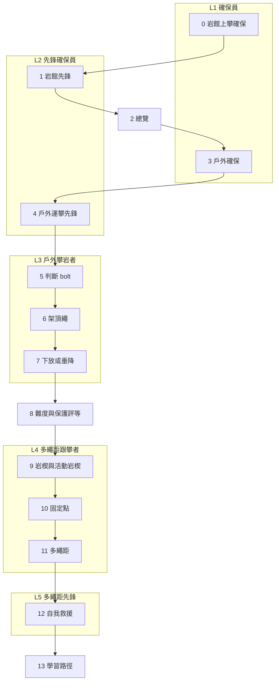

> 🌏 [English version](/posts/climbing/2026-10-17-sport-vs-trad-overview-en)

你在岩館考到上攀卡，也開始先鋒了。朋友約你去龍洞，說「那裡有很多 5.8，很簡單」。你帶了一串快扣過去，站到岩壁下才發現：這條 5.8 上面一顆 bolt 都沒有。

這篇寫給要跨過這一步的人。它回答三件事：運動攀登和傳統攀登到底差在哪、台灣的岩場是哪一種、這個系列 16 篇要按什麼順序讀。還沒在岩館確保過的話，先讀[攀岩入門](/posts/climbing/2026-10-08-climbing-beginner-guide)、[岩館上攀確保](/posts/climbing/2026-10-17-gym-top-rope-belay)與[岩館先鋒](/posts/climbing/2026-10-17-gym-lead-climbing)。

先講清楚：**這個系列不能取代戶外課程。** 每一篇都在幫你上課時聽懂教練在做什麼，手上的動作要在合格教練面前練到正確。

## 龍洞的數字：簡單路線多半是傳攀

臺灣戶外攀岩協會（TOCC）維護一份公開的[龍洞岩場攀登路線資料庫](https://docs.google.com/spreadsheets/d/1QHFNQSPgKgQrTNnYn246wfotOYqOkzHjLltZ26keBgg/edit?usp=sharing)，九個分區各一頁，每條路線都標了「路線種類」。2026-10-17 查詢時，統計分頁列出：

| 路線種類 | 條數 |
|---|---|
| 傳攀 | 325 |
| 運攀 | 209 |
| 上方架繩 | 42 |
| 抱石 | 44 |

把各分區的路線按難度分開看，差別更明顯：**5.9 以下的路線，傳攀有 182 條，運攀只有 12 條。** 運攀多半在 5.11 以上。

所以在龍洞，你在岩館能先鋒 5.10，不代表能去爬一條 5.8。那條 5.8 很可能是傳攀，沿途要自己放保護。想在龍洞爬簡單路線，你的選項是跟攀、爬別人架好的頂繩，或學傳攀。

各分區的性格也不一樣。以統計時的路線列為準：

- **第一洞**：運攀 62 條、傳攀 12 條，是龍洞運攀最集中的地方。
- **鐘塔**：傳攀 42 條、運攀 5 條，幾乎全是傳攀。
- **音樂廳、黃金谷**：傳攀都在 60 條以上，運攀約二十條上下。

**今晚就能做的動作**：打開資料庫，挑朋友提過的一條路線，找到「路線種類」和「難度」兩欄。是傳攀的話，在備註寫下「需要傳攀器材或跟攀」。

## 一句話分清楚：保護點誰放、什麼時候放

兩種爬法都是先鋒攀登：繩子從下面跟著你上去，你一路把繩子掛進保護點。差別在保護點從哪裡來。

| | 運動攀登（運攀） | 傳統攀登（傳攀） |
|---|---|---|
| 保護點 | 預先鑽好的 bolt | 先鋒者自己塞進岩縫的岩楔、活動岩楔 |
| 誰放、何時放 | 開線的人事先打好 | 先鋒者邊爬邊放 |
| 誰拆 | 不拆，留在岩壁上 | 跟攀者爬上來時拆回 |
| 保護好不好，看什麼 | bolt 的材質與狀態 | 岩質、裂隙形狀、你放得好不好 |

[維基百科的傳統攀登條目](https://en.wikipedia.org/wiki/Traditional_climbing)用的就是這個定義：先鋒者放置可移除的臨時保護，跟攀者上來時拆掉。[運動攀登條目](https://en.wikipedia.org/wiki/Sport_climbing)則寫到，運攀始於 1980 年代初：法國的頂尖攀岩者想爬沒有裂隙、放不進臨時保護的平滑岩面，於是預先鑽 bolt。

這個差別帶出三個後果：

- **裝備不同**：運攀帶快扣就好；傳攀要帶一整組保護器材。
- **風險的來源不同**：運攀要判斷 bolt 能不能信；傳攀要判斷自己放的每一個點能不能信。
- **學法不同**：運攀可以從岩館先鋒直接延伸；傳攀要先學會看、放、拆保護器材，才輪到自己先鋒。

**今晚就能做的動作**：下次在岩館先鋒時，每掛一支快扣就想一句「如果這裡沒有 bolt，我能在哪裡放保護？」。找不到地方的段落，在傳攀路線上就是長距離沒有保護。

## 裝備差在哪

運攀的基本配備是繩子、快扣、確保器與頭盔。[REI 的掛快扣教學](https://www.rei.com/learn/expert-advice/clip-quickdraws.html)提醒，快扣兩端不能對調：直門鉤環扣 bolt，彎門鉤環扣繩，因為扣 bolt 的那一端可能被磨出利邊。

傳攀要帶的多很多。維基百科的條目寫，傳攀需要的裝備比運攀多，因為先鋒者要一路攜帶並放置保護器材。常見的組合有：

- **岩楔**（nut）：卡進裂隙內縮處的金屬塊，沒有活動零件。
- **活動岩楔**（cam）：拉動扳機收起凸輪，放進平行裂隙後張開撐住。
- **扁帶與延伸快扣**：讓繩子走直線，減少拉扯保護點。
- **岩楔起子**（nut tool）：跟攀者拆卡住的岩楔用。

[Climbing 雜誌的〈從岩館到傳攀〉](https://www.climbing.com/skills/gym-to-crag-trad-climbing-outdoor-research/)由一位 AMGA 認證攀岩嚮導撰寫，建議平行裂隙放活動岩楔，內縮或 V 形的裂隙放岩楔。這些器材怎麼運作、怎麼判斷放得好不好，留到[傳攀保護：岩楔與活動岩楔](/posts/climbing/2026-10-17-trad-protection-nuts-cams)再講。

## 風險差在哪

### 兩種爬法共同的風險

[美國阿爾卑斯俱樂部（AAC）2025 年的事故分析](https://publications.americanalpineclub.org/articles/13201217363)整理《Accidents in North American Climbing》2005–2024 年的報告，找出幾個反覆出現的模式。和這個系列最有關的兩個：

- **從岩館到岩場的過度自信**：岩館和戶外用同一套難度數字，岩館爬得好的人容易高估自己。報告舉的案例是一位「在岩館爬 5.12」的人，第一次在戶外爬 5.12a 就漏掛快扣、翻身撞到頭。
- **系統轉換**：在固定點換確保、準備垂降或下放的時刻，最常出錯。錯誤多半是溝通誤會、確保器裝錯、繩結沒打好、系統沒封閉。

這兩個風險，運攀和傳攀都會碰到。

### 運攀：你信任的是別人打的 bolt

運攀的保護點是固定的，但 bolt 也會壞。[TOCC 大事紀](https://www.tocc-climbing.org/chronicle-of-events)記錄，2015 年音樂廳「大鼓」路線頂端固定點的兩支 bolt 同時斷裂。一位攀岩者因此墜落地面，所幸離地不遠，只受輕傷。事後查出，那款 bolt 早期出廠的版本是 304 不鏽鋼，在海邊容易腐蝕。怎麼判斷一顆 bolt，留到[掛片會壞：怎麼判斷一顆 bolt](/posts/climbing/2026-10-17-judging-bolts)。

### 傳攀：你信任的是自己放的點

傳攀的保護好壞，取決於岩質和你放的技術。AAC 同一份分析指出，2023 年回報的保護點脫出事故，全部是活動岩楔放置失敗。作者的建議是先學好被動保護（岩楔），再依賴活動岩楔。

龍洞也有案例。TOCC 大事紀記錄，2019 年大禮堂「#313 通道」的先鋒者用傳攀器材架好固定點，確保跟攀者上來。兩人把體重交給固定點時，三個保護點全部脫出，兩人墜落約 20 公尺。

### 受傷研究能說到哪裡

一篇 2020 年的[攀岩事故系統性回顧](https://www.mdpi.com/1660-4601/17/1/203)整理了既有文獻，其中引述：傳攀的受傷有 75% 由墜落造成，運攀的受傷則多半來自用力過度的動作。作者也明講限制：各研究的攀岩類型、研究設計、計算風險的方式都不同，很難給出精確的比較數字。所以不要拿某一篇的「每千小時受傷數」去比運攀和傳攀誰比較危險。比較可靠的結論是：兩者出事的方式不同，要練的東西也不同。

**今晚就能做的動作**：寫下你下一次戶外攀登的「轉換時刻」，例如到頂後要下放還是垂降、誰喊什麼口令。出發前和夥伴對一次。

## 台灣岩場：岩質決定你能爬哪一種

台灣能爬的戶外岩場不多，岩質大致決定了爬法：

- **龍洞**（新北貢寮）：[東北角管理處的景點頁](https://www.necoast-nsa.gov.tw/Attraction-Content.aspx?a=186&l=1)說明岩壁是堅硬的四稜砂岩，節理紋路錯綜。運攀與傳攀混合，傳攀較多。
- **南部石灰岩岩場**：nobodyclimb 的岩場資料把[墾丁](https://nobodyclimb.cc/crag/kenting)、[壽山](https://nobodyclimb.cc/crag/shoushan)、[關子嶺](https://nobodyclimb.cc/crag/guanziling)都標為運攀岩場（關子嶺另標有抱石）。[Mountain Project 的關子嶺頁](https://www.mountainproject.com/area/107850712/guanziling)收錄的 19 條路線也全是運攀。

這幾個岩場能不能爬，規定差很多。[壽山國家自然公園的禁止事項](https://www.nnp.gov.tw/ch/titlelist/related-regulations/2610)寫明，指定地區以外禁止攀岩。墾丁國家公園則禁止在大尖山、青蛙石、船帆石地區攀爬，見[中央社 2024 年的報導](https://www.cna.com.tw/news/aloc/202401050182.aspx)。細節留到[台灣岩場：岩質決定爬法](/posts/climbing/2026-10-17-taiwan-crags-rock-type)。

還有一個龍洞特有的狀況：多數傳攀路線的頂端仍有 bolt 固定點（資料庫的 Anchor 欄）。你上去時自己放保護，下來時用固定點垂降。TOCC 在[〈龍洞的上方固定點〉](https://www.tocc-climbing.org/post/%E9%BE%8D%E6%B4%9E%E7%9A%84%E4%B8%8A%E6%96%B9%E5%9B%BA%E5%AE%9A%E9%BB%9E)請大家架頂繩務必用自備器材，並建議撤退盡量用雙繩垂降、避免下放，以減少固定設備磨損。

## 系列地圖：五個等級、十六篇

[nobodyclimb 的繩索系統練習](https://nobodyclimb.cc/games/rope-system)把題目分成運攀四類（確保、先鋒、頂繩架設、垂降）和傳攀四類（固定點、保護、多繩距、自我救援）。它規劃中的認證把能力分成五級（網站上標示 Coming Soon）：

| 等級 | 名稱 | 會做什麼 |
|---|---|---|
| L1 | 確保員 | 頂繩確保 |
| L2 | 先鋒確保員 | 先鋒確保 |
| L3 | 戶外攀岩者 | 戶外單繩距：架頂繩、垂降 |
| L4 | 多繩距跟攀者 | 固定點、多繩距跟攀 |
| L5 | 多繩距先鋒 | 獨立進行多繩距，含自我救援 |

這個系列照這五級排。運攀在前，傳攀在後；先學會用別人打好的 bolt，再學自己放保護。

L1–L5 之外還有三篇背景：[台灣岩場：岩質決定爬法](/posts/climbing/2026-10-17-taiwan-crags-rock-type)、[歷史與倫理](/posts/climbing/2026-10-17-bolting-history-ethics)，以及第 13 篇的學習路徑。每一篇在聚焦什麼：

| 篇 | 等級 | 文章 | 讀完能做到 |
|---|---|---|---|
| 0 | L1 | [岩館上攀確保](/posts/climbing/2026-10-17-gym-top-rope-belay) | 在岩館獨立做上攀確保、互檢與下放 |
| 1 | L2 | [岩館先鋒](/posts/climbing/2026-10-17-gym-lead-climbing) | 在岩館先鋒，也能幫別人做先鋒確保 |
| 2 | — | 總覽（本篇） | 說出自己在哪一級、下一篇讀哪篇 |
| 3 | L1 | [戶外確保](/posts/climbing/2026-10-17-outdoor-belay) | 在岩場做一次完整的上攀確保前檢查 |
| 4 | L2 | [第一條戶外運攀先鋒](/posts/climbing/2026-10-17-first-outdoor-sport-lead) | 說出戶外先鋒比室內多出的風險與對策 |
| 5 | L3 | [掛片會壞：怎麼判斷一顆 bolt](/posts/climbing/2026-10-17-judging-bolts) | 出發前查一條龍洞路線的 bolt 材質 |
| 6 | L3 | [頂繩架設](/posts/climbing/2026-10-17-top-rope-anchor-setup) | 在雙 bolt 頂端架一組不磨損固定點的頂繩 |
| 7 | L3 | [下放還是垂降](/posts/climbing/2026-10-17-lower-or-rappel) | 依岩場規則選下放或垂降 |
| 8 | 橋 | [難度與保護評等](/posts/climbing/2026-10-17-grades-and-protection-ratings) | 看懂 5.10a、6a、E1 5b 與 R、X |
| 9 | L4 | [傳攀保護：岩楔與活動岩楔](/posts/climbing/2026-10-17-trad-protection-nuts-cams) | 說出好放置的三個條件 |
| 10 | L4 | [建立固定點](/posts/climbing/2026-10-17-building-anchors) | 檢查一個固定點有沒有冗餘、會不會延伸 |
| 11 | L4 | [多繩距入門](/posts/climbing/2026-10-17-multi-pitch-basics) | 畫出一次換段的步驟順序 |
| 12 | L5 | [自我救援基礎](/posts/climbing/2026-10-17-self-rescue-basics) | 判斷該求援、下放還是需要救援技術 |
| 13 | 全部 | [學習路徑與常見事故](/posts/climbing/2026-10-17-sport-to-trad-learning-path) | 排出自己下一年的學習順序與要上的課 |
| 14 | 背景 | [台灣岩場：岩質決定爬法](/posts/climbing/2026-10-17-taiwan-crags-rock-type) | 挑出自己能去的岩場與要守的規定 |
| 15 | 背景 | [歷史與倫理](/posts/climbing/2026-10-17-bolting-history-ethics) | 說明為什麼不該在龍洞自行打 bolt |

第 8 篇放在運攀和傳攀中間，因為傳攀路線的評等多了一層「保護好不好」，先看懂 R、X 再去學放保護比較順。第 9 篇先講單一保護點，第 10 篇才組固定點，因為固定點就是由好幾個保護點組成的。

## 你現在在哪一級

照下面的問題往下走，第一個答「還不會」的地方，就是你該讀的那一篇：

1. 在岩館能獨立做上攀確保、互檢、下放嗎？還不會 → 先讀第 0 篇[岩館上攀確保](/posts/climbing/2026-10-17-gym-top-rope-belay)。
2. 在岩館能先鋒，也能幫別人做先鋒確保嗎？還不會 → 先讀第 1 篇[岩館先鋒](/posts/climbing/2026-10-17-gym-lead-climbing)。
3. 在戶外岩場確保過嗎？還沒 → 第 3 篇，你在 L1。
4. 在戶外先鋒過運攀路線嗎？還沒 → 第 4 篇，你在 L2。
5. 能自己在頂端架頂繩、垂降下來嗎？還不會 → 第 5 到 7 篇，你在 L3。
6. 跟攀過傳攀路線、拆過岩楔嗎？還沒 → 第 8 到 10 篇，你在往 L4 的路上。
7. 爬過多繩距路線嗎？還沒 → 第 11 篇。
8. 爬多繩距時，知道夥伴受傷要怎麼辦嗎？還不知道 → 第 12 篇，然後去上救援課。

**今晚就能做的動作**：在手機記事本寫下你現在的等級，以及下一篇要讀的文章。讀完一篇、在教練面前練過，才往下一級。

## 練習題：四個情境

答案在每題下方，先自己想再看。想練更多題，可以玩 [nobodyclimb 的繩索系統練習](https://nobodyclimb.cc/games/rope-system)，運攀和傳攀各有四個分類。

**1. 你在岩館能先鋒 5.10。朋友說龍洞有一條 5.8 很簡單，你打算帶一串快扣去先鋒。**

答案

先查 TOCC 路線資料庫的「路線種類」欄。龍洞 5.9 以下的路線，傳攀遠多於運攀；那條 5.8 很可能沿途沒有 bolt，快扣派不上用場。是傳攀的話，請會傳攀的朋友先鋒、你跟攀，或請他架好頂繩讓你爬。

**2. 一條龍洞傳攀路線的頂端有兩支 bolt。朋友說「有 bolt，所以算運攀」。**

答案

不算。路線種類看的是沿途的保護點：沿途要自己放岩楔、活動岩楔，就是傳攀。頂端的 bolt 只是讓你下來用的固定點，TOCC 也建議在龍洞盡量用雙繩垂降撤退。

**3. 你在岩館穩定爬 5.12，第一次去戶外，想直接挑一條 5.12a 先鋒。**

答案

先降級。AAC 的事故分析就有這個案例：在岩館爬 5.12 的人，第一次在戶外爬 5.12a，漏掛快扣、翻身撞頭。戶外的找路、岩質、腳點都和岩館不同，先從遠低於你岩館等級的運攀路線開始。

**4. 你已經能在戶外先鋒運攀、架頂繩、垂降，想開始學傳攀。下一步讀哪篇？**

答案

你在 L3。先讀第 8 篇的難度與保護評等，再讀第 9 篇的岩楔與活動岩楔。實際動作從跟攀和在地面練放保護開始，不要直接先鋒傳攀。

## 下一步

確認自己在 L1，就從[戶外確保](/posts/climbing/2026-10-17-outdoor-belay)開始讀。想先看整條學習路徑、台灣有哪些課可以上，跳到[學習路徑與常見事故](/posts/climbing/2026-10-17-sport-to-trad-learning-path)。

## 參考資料

- [龍洞岩場攀登路線資料庫（TOCC，Google 試算表，2026-10-17 查詢）](https://docs.google.com/spreadsheets/d/1QHFNQSPgKgQrTNnYn246wfotOYqOkzHjLltZ26keBgg/edit?usp=sharing)
- [龍洞的上方固定點（TOCC）](https://www.tocc-climbing.org/post/%E9%BE%8D%E6%B4%9E%E7%9A%84%E4%B8%8A%E6%96%B9%E5%9B%BA%E5%AE%9A%E9%BB%9E)
- [龍洞岩場大事紀（TOCC）](https://www.tocc-climbing.org/chronicle-of-events)
- [Traditional climbing（Wikipedia）](https://en.wikipedia.org/wiki/Traditional_climbing)
- [Sport climbing（Wikipedia）](https://en.wikipedia.org/wiki/Sport_climbing)
- [How to Clip Quickdraws（REI Expert Advice）](https://www.rei.com/learn/expert-advice/clip-quickdraws.html)
- [Gym to Crag: Trad Climbing（Elaina Arenz，Climbing，2019）](https://www.climbing.com/skills/gym-to-crag-trad-climbing-outdoor-research/)
- [Know the Ropes: Human Factors（Valerie Karr，Accidents in North American Climbing 2025）](https://publications.americanalpineclub.org/articles/13201217363)
- [Climbing Accidents: Prospective Data Analysis from the International Alpine Trauma Registry and Systematic Review of the Literature（Rugg et al., IJERPH 2020）](https://www.mdpi.com/1660-4601/17/1/203)
- [nobodyclimb 繩索系統練習](https://nobodyclimb.cc/games/rope-system)
- [nobodyclimb 岩場資料：墾丁](https://nobodyclimb.cc/crag/kenting)
- [nobodyclimb 岩場資料：壽山](https://nobodyclimb.cc/crag/shoushan)
- [nobodyclimb 岩場資料：關子嶺](https://nobodyclimb.cc/crag/guanziling)
- [龍洞岩場（交通部觀光署東北角及宜蘭海岸國家風景區管理處）](https://www.necoast-nsa.gov.tw/Attraction-Content.aspx?a=186&l=1)
- [Guanziling（Mountain Project）](https://www.mountainproject.com/area/107850712/guanziling)
- [壽山國家自然公園相關法規：禁止事項（國家公園署壽山國家自然公園管理處）](https://www.nnp.gov.tw/ch/titlelist/related-regulations/2610)
- [墾丁香蕉灣礁岩遭釘掛勾攀岩 墾管處調查開罰（中央社，2024-01-05）](https://www.cna.com.tw/news/aloc/202401050182.aspx)
- [攀岩入門：抱石、上攀、先鋒差在哪，第一次該從哪裡開始](/posts/climbing/2026-10-08-climbing-beginner-guide)
- [岩館上攀確保怎麼學](/posts/climbing/2026-10-17-gym-top-rope-belay)
- [岩館先鋒怎麼學](/posts/climbing/2026-10-17-gym-lead-climbing)
