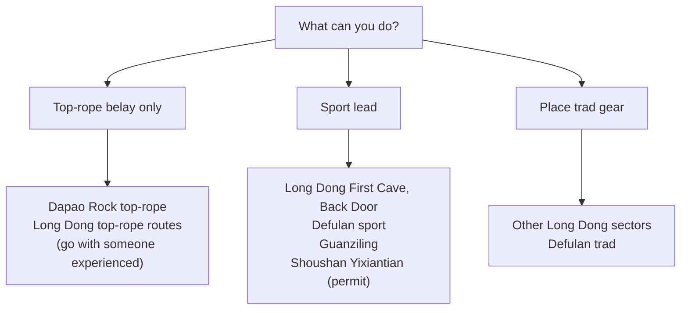

> 🌏 [中文版](/posts/climbing/2026-10-17-taiwan-crags-rock-type)

You can lead in the gym, you've read a few articles about outdoor climbing, and you want to pick a crag in Taiwan. The catch: you know how to sport climb, and you arrive to find no bolts on the route. Or you find a crag only to learn it's in a national park where climbing needs a permit, or isn't allowed at all.

This post answers two questions: where in Taiwan you climb sport and where you climb trad, and which crags come with rules or are currently off-limits. By the end, you should be able to pick crags that match the way you climb and know which notice to check before you go.

If you're still unclear on sport versus trad, start with the series [overview](/posts/climbing/2026-10-17-sport-vs-trad-overview-en).

## Start with the rock: cracks decide whether you can protect it

Trad protection means nuts and cams the leader slots into cracks. [Wikipedia's article on traditional climbing](https://en.wikipedia.org/wiki/Traditional_climbing) notes that one of its risks is a lack of cracks and fissures for adequate protection. Faces without cracks can only be climbed safely with bolts.

Taiwan's data is consistent: trad routes are almost all on sandstone, and the limestone crags are almost entirely sport.

| Crag | Rock | Sport | Trad | Other | Can you go? |
|---|---|---|---|---|---|
| Long Dong (Gongliao, New Taipei) | Szeleng Sandstone | 209 | 325 | Top-rope 42, boulder 44 | Yes; Grand Auditorium closed Feb–Jun |
| Defulan (Guguan, Taichung) | Quartzitic sandstone | 38 | 12 | Mixed 3 | Yes; still being developed |
| Guanziling (Tainan) | Limestone | 46 | 0 | Top-rope 3, boulder 1 | Private land, developed with the owner's consent |
| Shoushan (Gushan, Kaohsiung) | Limestone | 105 | 0 | Top-rope 2 | Only Yixiantian, by application |
| Dapao Rock (Beitou, Taipei) | Quartz sandstone | — | — | Mostly top-rope and bouldering | Yes; park warns the rock is unstable |
| Kenting (Pingtung) | Limestone | 120 | 0 | — | Ban area not defined in the rules |
| Taroko (Hualien) | — | — | — | — | Climbing only in designated areas |

Route counts: Long Dong is from the statistics tab of the [TOCC Long Dong route database](https://docs.google.com/spreadsheets/d/1QHFNQSPgKgQrTNnYn246wfotOYqOkzHjLltZ26keBgg/edit?usp=sharing) (in Chinese; checked 2026-10-17). The others are from nobodyclimb's crag data ([Defulan](https://nobodyclimb.cc/crag/defulan), [Guanziling](https://nobodyclimb.cc/crag/guanziling), [Shoushan](https://nobodyclimb.cc/crag/shoushan), [Kenting](https://nobodyclimb.cc/crag/kenting)). These are routes on record, not routes you can legally climb.

**Something you can do tonight**: circle the crags in this table that match the way you climb now, then read the rules in that crag's section below.

## Long Dong: sandstone sea cliffs, mostly trad

Long Dong's cliffs are Szeleng Sandstone. The [Northeast and Yilan Coast National Scenic Area page](https://www.necoast-nsa.gov.tw/Attraction-Content.aspx?a=186&l=1) (in Chinese) describes the rock as hard and compact with distinct joint lines. Cracked rock like this takes trad gear well, which is why Long Dong has more trad routes than anywhere else in Taiwan.

The [TOCC database](https://docs.google.com/spreadsheets/d/1QHFNQSPgKgQrTNnYn246wfotOYqOkzHjLltZ26keBgg/edit?usp=sharing) lists routes sector by sector. Going by the route-type column on each sector tab, the sport/trad split varies a lot:

- **First Cave**: 62 sport, 12 trad. The most sport-heavy sector.
- **Back Door**: 42 sport, 35 trad. A real mix.
- **Golden Valley, Music Hall, Clock Tower, Second Cave, Grand Auditorium**: far more trad than sport. Clock Tower, for example, has 42 trad and 5 sport.

The easy routes are mostly trad too. Counting route by route in the database, among routes graded 5.9 or easier there are 182 trad and just 12 sport. If you only sport climb, most of what you can lead at Long Dong is 5.10 and up.

**Rules**: the Northeast Coast administration's Long Dong page lists no climbing application. It only warns that during the northeast monsoon (October to March) long-period swells are common and visitors should stay away from the shoreline. Day-to-day management falls to TOCC. According to [TOCC's 2021 position statement](https://www.tocc-climbing.org/post/協會立場聲明) (in Chinese), TOCC is commissioned by the scenic area administration to run "safety patrols and environmental maintenance at Long Dong". Unidentified fixtures on the rock will be removed after assessment, and TOCC states plainly that it opposes private drilling and bolting.

**Falcon closure**: the Grand Auditorium is a peregrine falcon nesting area. According to [TOCC's 2026 closure notice](https://www.tocc-climbing.org/post/2026-grand-auditorium-closed-temporarily):

- **When**: 02/10 to 06/30 each year, or until the fledglings have left the nest.
- **Where**: the whole Grand Auditorium, plus route #284 Commissary Crack in First Cave.
- **Trail**: don't descend to the Grand Auditorium from the observation deck (the bunker).
- **Reporting**: if you see people harassing or poaching the birds, keep evidence and call the police or the New Taipei Animal Protection Office at 02-2959-6353.

**Something you can do tonight**: open the TOCC database, pick a sector, filter the route-type column for the style you climb, and check the route-status column for "closed" or "to be removed".

## Defulan: sport and trad side by side

Defulan sits above the Defulan trail in Guguan, Taichung. According to [Mountain Project's Defulan page](https://www.mountainproject.com/area/122737750/defulan), development began in August 2021, and by June 2022 there were 43 sport and trad routes. Grades run 5.4 to 5.12, mostly slab and technical, with some cracks.

A few things to know before you go, all from the same page:

- **Rock**: anything from concentrated quartzite to blends of sandstone and quartzite; the more sandstone in the blend, the lower the quality. Don't trust shallow placements.
- **Gear**: a single rack from 0.1 to #4 should do for the trad routes, with doubles of 0.4 to #2 if you don't want to finagle placements. Little passive gear is needed. 14 quickdraws cover most routes.
- **Bolts**: 316 stainless steel unless stated otherwise, with quicklinks or rings on the anchors for lowering or rappelling.
- **Loose rock**: the crag is still being developed and loose rock remains. Above the cliffs is a steep, slippery dirt slope. The page strongly advises against scrambling to the top to rig a top rope, since you may knock rocks onto people below. Wear a helmet.

**Something you can do tonight**: build a gear list from the advice above (cams 0.1 to #4, 14 quickdraws, helmet), compare it with what you and your partner own, and borrow or buy what's missing.

## Guanziling: limestone sport on private land

Guanziling's crag is near the "Water and Fire Cave" (水火同源) in Baihe, Tainan. According to a [2018 Liberty Times feature](https://playing.ltn.com.tw/article/15917) (in Chinese), Chiayi climber Hsieh Yuan-lung began developing it in 1996 with the landowner's consent. It is split into sectors including the Ultimate Wall and Flying Rock, with grades from 5.6 to 5.14a. The article also notes the rock is limestone, damp in summer, and the first choice when Long Dong is out of condition in winter.

[Mountain Project's Guanziling page](https://www.mountainproject.com/area/107850712/guanziling) lists 19 routes, all sport, on rock ranging from drippy tufas to sharp, coral-like pockets. Of the 50 routes [nobodyclimb](https://nobodyclimb.cc/crag/guanziling) records, 46 are sport.

The crag is on private land, and there is no public statement from the owner or any agency about access. Ask climbers or guiding outfits who have been recently.

**Something you can do tonight**: if you plan a winter trip to Guanziling, ask in a climbing community group when someone last went and what the approach was like.

## Shoushan: Yixiantian only, by application

Shoushan National Nature Park has the clearest climbing rules. Under item 15 of the [Shoushan National Nature Park prohibitions](https://www.nnp.gov.tw/ch/titlelist/related-regulations/2610) (in Chinese), effective 1 January 2019, climbing outside designated areas is banned, as is installing climbing fixtures anywhere in the park without permission.

The designated climbing site is Yixiantian (一線天). According to the [Shoushan outdoor activity management system](https://snnpact.nnp.gov.tw/landscaper/) (in Chinese):

- **Who can apply**: anyone, but you may not climb alone.
- **When to apply**: year-round, between 90 and 3 days before your climbing day.
- **Code of conduct**: watch for corroded old fixed points; don't drill holes or cracks in the reef rock; don't open new routes or add fixed points to existing ones.

A [2019 Liberty Times report](https://news.ltn.com.tw/news/life/breakingnews/2660064) (in Chinese) on the new system noted fines of up to NT$3,000 for violations.

[nobodyclimb](https://nobodyclimb.cc/crag/shoushan) records 107 routes at Shoushan, 18 of them at Yixiantian and the rest around Qianguang Temple and the Grand Canyon sector. Only Yixiantian is open for climbing applications.

**Something you can do tonight**: open the management system, read the Yixiantian description and what the application form asks for, and gather your team's details in advance.

## Dapao Rock: top-rope and bouldering

Dapao Rock is on the southwest side of Yangmingshan National Park. According to the [Yangmingshan National Park notice](https://www.taiwan.nps.gov.tw/home/zh-tw/news/28116.html) (in Chinese), it is the only place in the park with climbing dating back to the Japanese colonial era. The wall is a little over 10 m tall and made of coarse quartz sandstone from the Wuchihshan Formation.

The wall has been closed once:

- **2015**: the park closed it as a hazardous area, citing soft, fragile rock and the nearby Dahuangzui fumarole.
- **1 November 2019**: after an inspection with geologists and climbing experts, the park lifted the ban. The main rock mass is intact and hard, but the surface has loosened from weathering and sulfuric acid from the vent.
- **Now**: signs on site warn that the rock is unstable, and visitors are responsible for their own safety.

According to [Chinese Wikipedia's Dapao Rock article](https://zh.wikipedia.org/zh-tw/%E5%A4%A7%E7%A0%B2%E5%B2%A9) (in Chinese), routes are about 7–8 m long. Most people walk to the top, rig an anchor above their chosen route, and top-rope; some boulder. The routes are short and hard to protect, so few people lead here. Grades also run stiff: the same number feels harder than at other crags.

**Something you can do tonight**: if you can only belay top-rope, Dapao Rock is a reasonable first outdoor crag, but go with someone who can build an anchor at the top.

## Kenting: a written ban with no map

Item 7 of the Kenting National Park prohibitions bans "climbing at Dajianshan, Frog Rock, and Sail Rock areas". The prohibitions were last [amended by the Ministry of the Interior](https://www.moi.gov.tw/News_Content.aspx?n=145&s=329610) (in Chinese) on 8 July 2025, and the [fine schedule](https://lawplayer.com/rule/6a42871d253171aeb5e2335e) (in Chinese) issued the same day sets NT$3,000 for a first or repeat violation of item 7. The legal basis is Article 13(8) of the [National Park Act](https://law.moj.gov.tw/LawClass/LawAll.aspx?pcode=D0070105) (in Chinese); Article 13(5) separately bans carving text or images into rock.

The problem is that the rules never say where the "Sail Rock area" ends. [Mountain Project's Kenting Main Area page](https://www.mountainproject.com/area/200445042/kenting-main-area) describes a limestone crag not far from the tourist strip, with over 100 sport routes. During the pandemic, Sam Fang and others redeveloped it. Whether it falls inside the ban area, the park administration has not publicly said.

One more case worth knowing: [CNA reported in January 2024](https://www.cna.com.tw/news/aloc/202401050182.aspx) (in Chinese) that two people climbed coral reef rock near Banana Bay and nailed hooks into it. The park's deputy director said the spot was initially judged to be outside item 7's ban area, but leaving hooks fixed in the reef violates the National Park Act, with fines of NT$1,500 for a first offense and up to NT$3,000 for a second. Even outside the three named areas, leaving fixtures in the reef gets you fined.

**Something you can do tonight**: if you want to climb in Kenting, call the Kenting National Park Headquarters first, ask whether the crag you plan to visit counts as the "Sail Rock area", and note the date and who answered.

## Taroko: designated areas only

Item 6 of the [Taroko National Park prohibitions](http://www.rootlaw.com.tw/LawArticle.aspx?LawID=A040040101027900-1140905) (in Chinese) bans climbing outside designated areas. The legislative note is explicit: these activities are banned in principle and allowed only in areas the Taroko National Park Headquarters designates.

So climbing in Taroko requires the headquarters to designate an area first. This series does not list Taroko as a crag you can visit.

**Something you can do tonight**: when you see a Taroko crag write-up online, check whether it cites a designation notice from the park headquarters. If it doesn't, don't go.

## Practice: four scenarios

Answers are folded under each question. Think first, then check.

**1. You only sport lead and want to visit Long Dong in April. A friend recommends a 5.9 in the Grand Auditorium.**

Answer

Two problems. First, the Grand Auditorium is closed from 10 February to 30 June for nesting falcons, so April is out. Second, most of Long Dong's routes at 5.9 and under are trad; check the route-type column in the TOCC database. If you only sport climb, look for sport routes in First Cave or Back Door instead.

**2. You and a friend want to sport climb at Qianguang Temple in Shoushan next Saturday.**

Answer

Shoushan National Nature Park only allows climbing at the designated site, Yixiantian, by online application 90 to 3 days ahead. Qianguang Temple isn't a designated site. Apply for Yixiantian instead, and don't go alone.

**3. On a Kenting route you spot a rusty old bolt and want to bring a new one to replace it yourself.**

Answer

Don't. Kenting is a national park, and in the 2024 Banana Bay case, leaving hooks nailed into the reef led to fines under the National Park Act. If a bolt looks suspect, skip the route and report it to the local climbing community.

**4. At Defulan, you want to scramble around to the clifftop and rig a top rope on a sport route for your friend.**

Answer

Mountain Project's Defulan page strongly advises against it: the clifftop is a steep, slippery dirt slope covered in rocks, scrambling up may knock rocks onto people below, and most anchors can't be reached from the top anyway. Have a leader climb up and rig it instead.

## Next steps

Once you know where you can climb, the next question is who decides whether a route gets bolts, and why Long Dong's trad routes stay bolt-free. That's the subject of the final post, [History and Ethics](/posts/climbing/2026-10-17-bolting-history-ethics-en).

Before your first Long Dong route, read [Judging a Bolt](/posts/climbing/2026-10-17-judging-bolts-en). To compare with crags abroad, see the [Japan Crags Overview](/posts/climbing/2026-10-12-japan-crags-overview-en).

## References

- [Long Dong route database (TOCC, Google Sheets, in Chinese; checked 2026-10-17)](https://docs.google.com/spreadsheets/d/1QHFNQSPgKgQrTNnYn246wfotOYqOkzHjLltZ26keBgg/edit?usp=sharing)
- [2026 Grand Auditorium temporary closure (TOCC)](https://www.tocc-climbing.org/post/2026-grand-auditorium-closed-temporarily)
- [Position statement (TOCC, 2021-10-05, in Chinese)](https://www.tocc-climbing.org/post/協會立場聲明)
- [Long Dong Rock Climbing Area (Northeast and Yilan Coast National Scenic Area, in Chinese)](https://www.necoast-nsa.gov.tw/Attraction-Content.aspx?a=186&l=1)
- [Defulan (Mountain Project)](https://www.mountainproject.com/area/122737750/defulan)
- [Guanziling (Mountain Project)](https://www.mountainproject.com/area/107850712/guanziling)
- [Kenting Main Area (Mountain Project)](https://www.mountainproject.com/area/200445042/kenting-main-area)
- [Guanziling crag feature (Liberty Times, 2018-05-19, in Chinese)](https://playing.ltn.com.tw/article/15917)
- [Shoushan National Nature Park prohibitions (in Chinese)](https://www.nnp.gov.tw/ch/titlelist/related-regulations/2610)
- [Shoushan outdoor activity management system: climbing applications (in Chinese)](https://snnpact.nnp.gov.tw/landscaper/)
- [Shoushan climbing and caving permit report (Liberty Times, 2019, in Chinese)](https://news.ltn.com.tw/news/life/breakingnews/2660064)
- [Dapao Rock reopening notice (Taiwan National Parks, in Chinese)](https://www.taiwan.nps.gov.tw/home/zh-tw/news/28116.html)
- [Dapao Rock (Chinese Wikipedia, in Chinese)](https://zh.wikipedia.org/zh-tw/%E5%A4%A7%E7%A0%B2%E5%B2%A9)
- [Amendment to the Kenting National Park prohibitions (Ministry of the Interior, 2025-07-08, in Chinese)](https://www.moi.gov.tw/News_Content.aspx?n=145&s=329610)
- [Kenting National Park prohibitions fine schedule (LawPlayer transcription, in Chinese)](https://lawplayer.com/rule/6a42871d253171aeb5e2335e)
- [National Park Act (Laws & Regulations Database, in Chinese)](https://law.moj.gov.tw/LawClass/LawAll.aspx?pcode=D0070105)
- [Hooks nailed into Kenting reef for climbing (CNA, 2024-01-05, in Chinese)](https://www.cna.com.tw/news/aloc/202401050182.aspx)
- [Taroko National Park prohibitions (Rootlaw, 2025-09-05 version, in Chinese)](http://www.rootlaw.com.tw/LawArticle.aspx?LawID=A040040101027900-1140905)
- [Traditional climbing (Wikipedia)](https://en.wikipedia.org/wiki/Traditional_climbing)
- nobodyclimb crag data: [Defulan](https://nobodyclimb.cc/crag/defulan), [Guanziling](https://nobodyclimb.cc/crag/guanziling), [Shoushan](https://nobodyclimb.cc/crag/shoushan), [Kenting](https://nobodyclimb.cc/crag/kenting)
- [Sport vs. Trad: What's the Difference (series overview)](/posts/climbing/2026-10-17-sport-vs-trad-overview-en)
