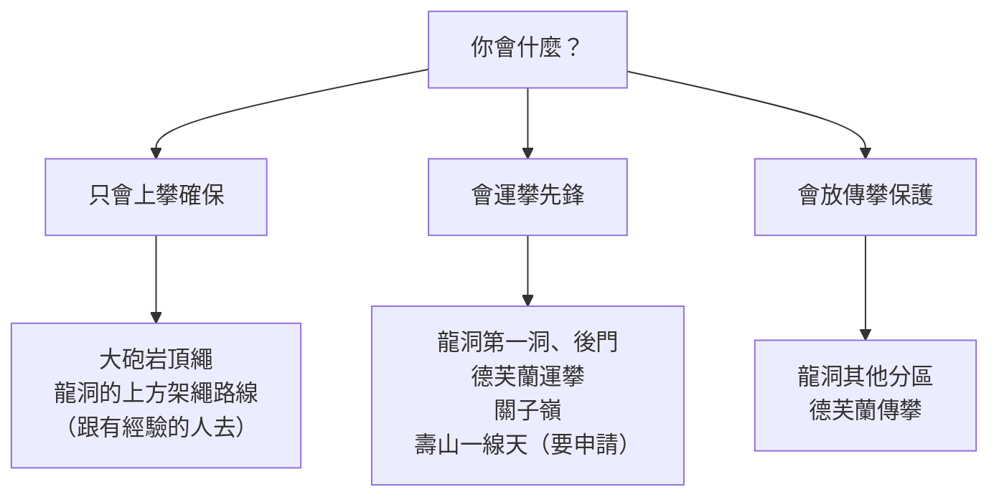

> 🌏 [English version](/posts/climbing/2026-10-17-taiwan-crags-rock-type-en)

你在岩館會先鋒了，也看過幾篇戶外攀岩的文章，想挑一個台灣的岩場去。問題是：你會的是運攀，到了岩場發現路線上沒有 bolt；或者找到一個岩場，才知道那裡是國家公園，攀岩要申請，甚至根本不能爬。

這篇回答兩件事：台灣的戶外岩場，哪裡爬運攀、哪裡爬傳攀；哪裡有規定要遵守，哪裡現在不能去。讀完之後，你可以依自己會的爬法挑出可以去的岩場，並知道出發前要查哪一份公告。

還分不清運攀和傳攀的話，先讀本系列的[總覽](/posts/climbing/2026-10-17-sport-vs-trad-overview)。

## 先看岩質：裂隙決定能不能放保護

傳攀的保護是先鋒者塞進岩縫的岩楔與活動岩楔。[Wikipedia 的傳統攀登條目](https://en.wikipedia.org/wiki/Traditional_climbing)寫到，傳攀的風險之一就是岩壁上可能沒有足夠的裂隙放保護。沒有裂隙的岩面，要爬就得靠打 bolt。

台灣的資料很一致：傳攀幾乎都在砂岩上，石灰岩岩場幾乎全是運攀。

| 岩場 | 岩質 | 運攀 | 傳攀 | 其他 | 能不能去 |
|---|---|---|---|---|---|
| 龍洞（新北貢寮） | 四稜砂岩 | 209 | 325 | 上方架繩 42、抱石 44 | 可以；大禮堂 2–6 月封閉 |
| 德芙蘭（台中谷關） | 石英質砂岩 | 38 | 12 | 混合 3 | 可以；仍在開發 |
| 關子嶺（台南白河） | 石灰岩 | 46 | 0 | 上方架繩 3、抱石 1 | 私有地，經地主同意開發 |
| 壽山（高雄鼓山） | 石灰岩 | 105 | 0 | 上方架繩 2 | 只有一線天能申請 |
| 大砲岩（台北北投） | 石英砂岩 | — | — | 頂繩、抱石為主 | 可以，管理處提醒岩質不穩 |
| 墾丁（屏東） | 石灰岩 | 120 | 0 | — | 法規禁止範圍未劃定 |
| 太魯閣（花蓮） | — | — | — | — | 只能在指定地區攀岩 |

路線數的來源如下。龍洞是 [TOCC 龍洞路線資料庫](https://docs.google.com/spreadsheets/d/1QHFNQSPgKgQrTNnYn246wfotOYqOkzHjLltZ26keBgg/edit?usp=sharing)的統計頁（2026-10-17 查詢）；其他岩場是 nobodyclimb 的岩場資料（[德芙蘭](https://nobodyclimb.cc/crag/defulan)、[關子嶺](https://nobodyclimb.cc/crag/guanziling)、[壽山](https://nobodyclimb.cc/crag/shoushan)、[墾丁](https://nobodyclimb.cc/crag/kenting)）。這些是收錄的路線數，不是可以合法攀登的路線數。

**今晚就能做的動作**：在這張表上圈出你現在的爬法能去的岩場，再讀下面對應岩場那一節的規定。

## 龍洞：傳攀為主的砂岩海岸

龍洞的岩壁是四稜砂岩。[東北角暨宜蘭海岸國家風景區管理處的景點頁](https://www.necoast-nsa.gov.tw/Attraction-Content.aspx?a=186&l=1)形容它堅硬緊實、節理紋路鮮明。這種有裂隙的岩壁適合放傳攀保護，所以龍洞是台灣傳攀路線最多的岩場。

[TOCC 資料庫](https://docs.google.com/spreadsheets/d/1QHFNQSPgKgQrTNnYn246wfotOYqOkzHjLltZ26keBgg/edit?usp=sharing)按分區逐條列路線。依各分區頁的路線種類欄，運攀和傳攀的分布差很多：

- **第一洞**：運攀 62 條、傳攀 12 條，是運攀最集中的分區。
- **後門**：運攀 42 條、傳攀 35 條，兩種都有。
- **黃金谷、音樂廳、鐘塔、第二洞、大禮堂**：傳攀遠多於運攀，例如鐘塔傳攀 42 條、運攀 5 條。

簡單的路線也多是傳攀。以資料庫逐條計算，5.9 以下的路線裡，傳攀 182 條、運攀只有 12 條。只會運攀的人在龍洞能先鋒的，多半是 5.10 以上的路線。

**規定**：東北角管理處的龍洞景點頁沒有列出攀岩申請，只提醒東北季風期間（10 月到 3 月）容易有長浪，請勿前往海邊。岩場的日常管理由 TOCC 承擔。依 [TOCC 2021 年的立場聲明](https://www.tocc-climbing.org/post/協會立場聲明)，TOCC 受東北角管理處委託，辦理「龍洞岩場安全巡守及環境維護管理工作」。岩壁上來路不明的固定設施，TOCC 會在評估後移除。TOCC 也明確表示不同意私自鑽孔、打 bolt。

**遊隼封閉**：龍洞的大禮堂是遊隼育雛區。依 [TOCC 2026 年的封閉公告](https://www.tocc-climbing.org/post/2026-grand-auditorium-closed-temporarily)：

- **時間**：每年 02/10 到 06/30，或確認幼鳥離巢為止。
- **範圍**：大禮堂全區，加上第一洞的 #284 福利社。
- **小徑**：不要從觀景平台（碉堡）下切大禮堂。
- **通報**：看到騷擾或獵捕猛禽，蒐證後報警，或打新北市動保處 02-2959-6353。

**今晚就能做的動作**：打開 TOCC 資料庫，選一個分區，用「路線種類」欄篩出你會的爬法，再看「路線狀態」欄有沒有「路線封閉」或「待移除」。

## 德芙蘭：運攀和傳攀混在一起

德芙蘭在台中谷關的德芙蘭步道上方。依 [Mountain Project 的德芙蘭頁](https://www.mountainproject.com/area/122737750/defulan)，岩場 2021 年 8 月開始開發，到 2022 年 6 月已有 43 條運攀與傳攀路線。難度 5.4 到 5.12，路線多是斜板與技術型，也有裂隙。

幾件出發前要知道的事，都來自同一頁：

- **岩質**：從純石英岩到砂岩、石英岩混合都有，混合比例高的地方岩質會差一點。放保護不要放太淺。
- **器材**：傳攀路線帶一套 0.1 到 #4 的活動岩楔就夠，0.4 到 #2 最好帶兩套，被動保護用得不多。多數路線 14 把快扣夠用。
- **bolt**：除非另外註明，都是 316 不鏽鋼，頂端固定點有快速連結環或鋼環可以下放或垂降。
- **落石**：岩場仍在開發，岩壁上還有危石，崖頂是又陡又滑的土坡。頁面強烈建議不要繞到崖頂架頂繩，以免把石頭弄下去打到下方的人。一定要戴頭盔。

**今晚就能做的動作**：照上面的建議列一張器材清單（0.1 到 #4 活動岩楔、14 把快扣、頭盔），跟你自己和繩伴手上的器材比對，缺什麼先借或先買。

## 關子嶺：私有地上的石灰岩運攀

關子嶺岩場在台南白河的「水火同源」附近。依[自由時報 2018 年的報導](https://playing.ltn.com.tw/article/15917)，1996 年由嘉義岩友謝遠龍徵得地主同意後開發。岩場分成終極岩、飛來石、集合場、神秘谷、蓬萊島、毒刺林等區，難度從 5.6 到 5.14a。報導也提到這裡是石灰岩，夏天潮濕，冬天龍洞不好爬時，是攀岩的首選。

[Mountain Project 的關子嶺頁](https://www.mountainproject.com/area/107850712/guanziling)收錄 19 條路線，全部是運攀，岩面從石灰岩的鐘乳狀岩柱到銳利的凹洞都有。[nobodyclimb](https://nobodyclimb.cc/crag/guanziling) 收錄的 50 條裡，運攀 46 條。

岩場在私有地上，目前沒有地主或官方公開的開放聲明。現況要問最近去過的岩友或帶團的業者。

**今晚就能做的動作**：如果打算冬天去關子嶺，先在攀岩社群問最近一次有人去是什麼時候、路況如何。

## 壽山：只有一線天能申請

壽山國家自然公園的攀岩規定寫得最清楚。依[壽山國家自然公園區域內禁止事項](https://www.nnp.gov.tw/ch/titlelist/related-regulations/2610)第十五點，自 108 年 1 月 1 日起，禁止在指定以外的地區攀岩，也禁止在園區內擅自設置攀岩固定設施。

指定的攀岩場地是「一線天」。依[壽山國家自然公園戶外活動管理系統](https://snnpact.nnp.gov.tw/landscaper/)：

- **誰可以申請**：一般民眾都可以，但不可以獨自進行。
- **什麼時候申請**：全年開放，在活動前 90 天到 3 天之間上網申請。
- **活動守則**：注意受侵蝕的老舊固定點；不要鑽鑿礁岩的孔洞與縫隙；不得新增攀登路線，既有路線也不得擅自增設固定點。

[自由時報 2019 年報導](https://news.ltn.com.tw/news/life/breakingnews/2660064)新制上路時提到，違反禁止事項最高可罰 3,000 元。

[nobodyclimb](https://nobodyclimb.cc/crag/shoushan) 收錄壽山 107 條路線，其中一線天 18 條，其餘分布在千光寺一帶與大峽谷等區。能申請攀岩的只有一線天。

**今晚就能做的動作**：打開管理系統，看一線天的介紹與申請表要填什麼，把隊員資料先準備好。

## 大砲岩：頂繩與抱石

大砲岩在陽明山國家公園西南側。依[陽明山國家公園管理處的公告](https://www.taiwan.nps.gov.tw/home/zh-tw/news/28116.html)，它是園區內唯一日治時期就有攀岩活動的地方，岩壁高十餘公尺，由五指山層的粗粒石英砂岩組成。

這塊岩壁有過一次封閉：

- **2015 年（民國 104 年）**：陽管處考量岩質鬆軟、緊鄰大磺嘴噴氣口，公告為危險地區禁止進入。
- **2019 年 11 月 1 日**：地質學者與攀岩專家現勘後，陽管處取消禁令。理由是岩塊主體仍完整堅硬，表面則因風化與硫氣酸蝕而鬆散易剝落。
- **現在**：現場有告示提醒地質不穩定，進入的人要自己做好安全準備。

依[中文維基百科的大砲岩條目](https://zh.wikipedia.org/zh-tw/%E5%A4%A7%E7%A0%B2%E5%B2%A9)，路線長約七八公尺，多數人從步道走到崖頂，在路線頂端架固定點爬頂繩，也有人爬抱石。路線短、岩壁上不好放保護，所以很少人先鋒。這裡的難度標得偏硬，同一個數字爬起來比其他岩場難。

**今晚就能做的動作**：如果你只會上攀確保，大砲岩是可以考慮的第一個戶外岩場，但要跟會在頂端架固定點的人一起去。

## 墾丁：規定寫了禁止，範圍沒畫出來

墾丁國家公園區域內禁止事項第七點，禁止「於大尖山、青蛙石、船帆石地區從事攀爬之行為」。這份禁止事項最近一次在 114 年 7 月 8 日[由內政部修正](https://www.moi.gov.tw/News_Content.aspx?n=145&s=329610)，同日發布的[罰鍰數額表](https://lawplayer.com/rule/6a42871d253171aeb5e2335e)規定，違反第七點第一次、第二次以上都罰 3,000 元。法源是[國家公園法](https://law.moj.gov.tw/LawClass/LawAll.aspx?pcode=D0070105)第十三條第八款。同一條第五款另外禁止在岩石上加刻文字或圖形。

問題在於法規沒有說「船帆石地區」的範圍到哪裡。[Mountain Project 的墾丁主區頁](https://www.mountainproject.com/area/200445042/kenting-main-area)介紹的是一個離觀光街區不遠的石灰岩岩場，有 100 條以上的運攀路線。疫情期間，Sam Fang 等人重新開發了這裡。這個岩場在不在禁止範圍內，管理處沒有公開界定。

另一個要知道的案例：[中央社 2024 年 1 月報導](https://www.cna.com.tw/news/aloc/202401050182.aspx)，有兩人在香蕉灣附近的珊瑚礁岩攀岩，並把掛勾釘在礁岩上。墾管處副處長說，地點初判不在第七點的禁止範圍內；但掛勾釘在礁岩上沒有清除，涉及違反國家公園法，第一次罰 1,500 元、第二次可罰 3,000 元。也就是說，就算不在三個禁止地區，在礁岩上留下固定物一樣會被罰。

**今晚就能做的動作**：想去墾丁攀岩，先打電話問墾丁國家公園管理處，你要去的岩場算不算「船帆石地區」，並記下回覆的日期與承辦人。

## 太魯閣：只能在指定地區攀岩

[太魯閣國家公園區域內禁止事項](http://www.rootlaw.com.tw/LawArticle.aspx?LawID=A040040101027900-1140905)第六點，禁止擅自在指定以外的地區攀岩。立法理由寫得很清楚：這些行為原則禁止，只有經太魯閣國家公園管理處指定的地區不禁止。

所以在太魯閣攀岩的前提，是太管處先公告指定地區。本系列不把太魯閣列為可以去的岩場。

**今晚就能做的動作**：在網路上看到太魯閣的岩場介紹時，先找它有沒有寫太管處的指定公告。沒有，就不要去。

## 練習題：四個情境

答案在每題下方，先自己想再看。

**1. 你只會運攀先鋒，4 月想去龍洞。朋友推薦大禮堂的一條 5.9。**

答案

兩個問題。第一，2 月 10 日到 6 月 30 日大禮堂因遊隼育雛封閉，4 月不能爬。第二，龍洞 5.9 以下的路線多數是傳攀，先查 TOCC 資料庫的路線種類欄。只會運攀，改去第一洞或後門找運攀路線。

**2. 你和朋友想下週六去壽山千光寺爬運攀。**

答案

壽山國家自然公園只開放指定場地一線天，而且要在活動前 90 到 3 天上網申請。千光寺不是指定場地。改申請一線天，並確認不是一個人去。

**3. 你在墾丁的一條路線上看到生鏽的舊 bolt，想自己帶一顆新的換上。**

答案

不要。墾丁在國家公園內，2024 年的香蕉灣案例中，把掛勾釘在礁岩上沒清除就被依國家公園法裁罰。看到可疑的 bolt 就不要爬那條路線，把狀況回報給在地的攀岩社群。

**4. 你在德芙蘭，想從崖頂繞上去，在一條運攀路線的頂端架頂繩給朋友爬。**

答案

Mountain Project 的德芙蘭頁強烈建議不要這樣做：崖頂是陡滑的土坡，石頭很多，繞上去可能把石頭弄下去打到下方的人，而且多數頂端固定點從崖頂伸手也勾不到。改由會先鋒的人先爬上去架。

## 下一步

知道哪裡能爬之後，下一個問題是：誰決定一條路線要不要打 bolt？為什麼龍洞的傳攀路線不加 bolt？這是系列最後一篇[歷史與倫理](/posts/climbing/2026-10-17-bolting-history-ethics)的主題。

到了龍洞，先讀[掛片會壞：怎麼判斷一顆 bolt](/posts/climbing/2026-10-17-judging-bolts)，再上第一條路線。想比較國外的岩場，可以看[日本岩場總覽](/posts/climbing/2026-10-12-japan-crags-overview)。

## 參考資料

- [龍洞岩場攀登路線資料庫（TOCC，Google 試算表，2026-10-17 查詢）](https://docs.google.com/spreadsheets/d/1QHFNQSPgKgQrTNnYn246wfotOYqOkzHjLltZ26keBgg/edit?usp=sharing)
- [2026 年度大禮堂暫時封閉公告（TOCC）](https://www.tocc-climbing.org/post/2026-grand-auditorium-closed-temporarily)
- [協會立場聲明（TOCC，2021-10-05）](https://www.tocc-climbing.org/post/協會立場聲明)
- [龍洞岩場（東北角暨宜蘭海岸國家風景區管理處）](https://www.necoast-nsa.gov.tw/Attraction-Content.aspx?a=186&l=1)
- [Defulan（Mountain Project）](https://www.mountainproject.com/area/122737750/defulan)
- [Guanziling（Mountain Project）](https://www.mountainproject.com/area/107850712/guanziling)
- [Kenting Main Area（Mountain Project）](https://www.mountainproject.com/area/200445042/kenting-main-area)
- [關子嶺岩場報導（自由時報，2018-05-19）](https://playing.ltn.com.tw/article/15917)
- [壽山國家自然公園區域內禁止事項（國家公園署）](https://www.nnp.gov.tw/ch/titlelist/related-regulations/2610)
- [壽山國家自然公園戶外活動管理系統：攀岩申請](https://snnpact.nnp.gov.tw/landscaper/)
- [壽山攀岩、探洞新制報導（自由時報，2019）](https://news.ltn.com.tw/news/life/breakingnews/2660064)
- [大砲岩取消禁止進入規定（臺灣國家公園主題網）](https://www.taiwan.nps.gov.tw/home/zh-tw/news/28116.html)
- [大砲岩（中文維基百科）](https://zh.wikipedia.org/zh-tw/%E5%A4%A7%E7%A0%B2%E5%B2%A9)
- [修正「墾丁國家公園區域內禁止事項」（內政部，114-07-08）](https://www.moi.gov.tw/News_Content.aspx?n=145&s=329610)
- [違反墾丁國家公園區域內禁止事項裁處罰鍰數額表（法律人 LawPlayer 轉載）](https://lawplayer.com/rule/6a42871d253171aeb5e2335e)
- [國家公園法（全國法規資料庫）](https://law.moj.gov.tw/LawClass/LawAll.aspx?pcode=D0070105)
- [墾丁香蕉灣礁岩遭釘掛勾攀岩 墾管處調查開罰（中央社，2024-01-05）](https://www.cna.com.tw/news/aloc/202401050182.aspx)
- [太魯閣國家公園區域內禁止事項（植根法律網，114-09-05 版）](http://www.rootlaw.com.tw/LawArticle.aspx?LawID=A040040101027900-1140905)
- [Traditional climbing（Wikipedia）](https://en.wikipedia.org/wiki/Traditional_climbing)
- nobodyclimb 岩場資料：[德芙蘭](https://nobodyclimb.cc/crag/defulan)、[關子嶺](https://nobodyclimb.cc/crag/guanziling)、[壽山](https://nobodyclimb.cc/crag/shoushan)、[墾丁](https://nobodyclimb.cc/crag/kenting)
- [運動攀登與傳統攀登差在哪（本系列總覽）](/posts/climbing/2026-10-17-sport-vs-trad-overview)
