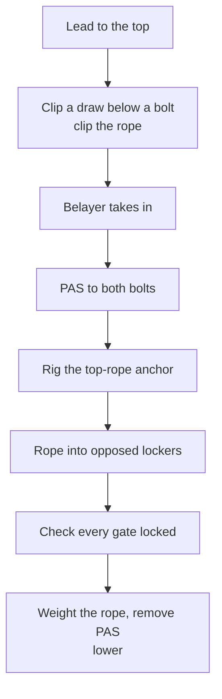

> 🌏 [中文版](/posts/climbing/2026-10-17-top-rope-anchor-setup)

In the gym, the top ropes are already hanging. Outdoors, sooner or later you will climb up yourself and rig a top rope on the two bolts at the top so friends can take laps below.

There is a common bad habit at this step: running the rope straight through the rings at the top. After a full day of laps, a layer of the shared hardware is gone. [TOCC (Taiwan Outdoor Climbing Club)](https://www.tocc-climbing.org/post/%E9%BE%8D%E6%B4%9E%E7%9A%84%E4%B8%8A%E6%96%B9%E5%9B%BA%E5%AE%9A%E9%BB%9E) (in Chinese) calls top-roping the style that wears equipment fastest.

This is part 4 of the [Sport and Trad Climbing](/posts/climbing/2026-10-17-sport-vs-trad-overview-en) series. It builds on [Your First Outdoor Sport Lead](/posts/climbing/2026-10-17-first-outdoor-sport-lead-en) and [Judging a Bolt](/posts/climbing/2026-10-17-judging-bolts-en): you need to be able to lead to the top, and to judge whether the two bolts there can be trusted. Tops with no bolts, where you build an anchor from your own protection, come later in [Building Anchors](/posts/climbing/2026-10-17-building-anchors-en).

[REI's top-rope anchor guide](https://www.rei.com/learn/expert-advice/set-and-clean-anchors.html) assumes from the start that you can lead, belay a leader and rappel, and says the best way to learn these skills is from an experienced climber or a certified instructor. The same goes here: this post explains what each step is for, and the hands-on practice belongs next to someone experienced.

## Why the rope should not run through the fixed rings

Sport anchors usually carry rappel rings, maillons or ram's-horn lowering hooks; some are just two bare bolts. If you top-rope with the rope running directly through them, the rope saws across metal on every climb and every lower.

[Black Diamond's QC Lab](https://blackdiamondequipment.com/blogs/stories/qc-lab-worn-anchors) tested two rope-grooved cold shuts (an open hook-shaped lower-off). The result is a little counterintuitive: the groove keeps the rope on the strongest axis, so the worn samples deformed later than a new one. But the conclusion is that **the sharp edges of a grooved anchor can damage the rope sheath**; replace beat-up hardware when you see it, and use your own quickdraws or carabiners to save wear on fixed anchors.

The [British Mountaineering Council (BMC)](https://www.thebmc.co.uk/en/spot-a-bad-bolt) is more direct:

- **Always top-rope on your own quickdraws or carabiners**, with the last person cleaning the route.
- **If a lower-off is worn more than a third through**, do not rely on that part.

The American Alpine Club (AAC)'s [Cleaning Sport Routes](https://publications.americanalpineclub.org/articles/13201216058), REI and TOCC agree: the rope runs through your own gear, and your gear takes the wear. The shared hardware is saved for the last climber's descent.

**Something you can do tonight**: check whether two of your quickdraws can take locking carabiners, or set aside two locking quickdraws just for top-roping.

## Before rigging: look at the two bolts

A top rope hands the whole system to the two bolts at the top, so repeat the previous post's checks up there: rust, cracks, spinning hangers, the surrounding rock, and wear on the rings.

TOCC gives specific warnings about Long Dong anchor hardware:

- **Maillons**: most on the market are 304 stainless steel, a serious safety concern at Long Dong. Identify the material and check for rust; report anything unusual to the Rebolting Team.
- **Rappel rings**: most on the market are aluminium, which at Long Dong is badly weakened in under a year.
- **Ram's horns**: mostly titanium; a batch of 316 horns installed in 2004–2006 on the 佈告欄 wall in the 長巷 area shows clear wear grooves.

TOCC also asks that before using any anchor or system you rig yourself, you do two things:

1. **Check**: identify the material, look at its condition, and check that the system is correct and complete.
2. **Test**: while secured, transfer your full body weight onto the hardware or system to confirm it holds.

Before you go, look up TOCC's [Long Dong route database](https://docs.google.com/spreadsheets/d/1QHFNQSPgKgQrTNnYn246wfotOYqOkzHjLltZ26keBgg/edit?usp=sharing) (in Chinese): the columns from `A01` show the anchor bolt material, and "Anchor 配件" lists the anchor hardware.

The database also has a route type "上方架繩" (top rope), for routes meant to be climbed on top rope; the statistics tab on 2026-10-17 lists 42.

## Rig one: two locking quickdraws

This is the simplest rig. The points from AAC's Cleaning Sport Routes:

- **At least two**: one quickdraw or sling on each bolt, with the rope through both.
- **Gates opposed**: the two draws face opposite ways and share the load roughly equally.
- **Use locker draws**: locking carabiners on both ends increase the security of a top-rope anchor.
- **Leave the bottom link free**: do not clip the lowest chain link, maillon or ring, so the last climber can clean easily.
- **Keep carabiners off edges**: avoid placements where a carabiner is loaded over an edge.
- **Use steel for frequent top-roping**: a steel carabiner on the rope side lasts much longer and puts less grime on your rope.

One draw on each bolt gives you two **independent** points: if one bolt or one draw fails, the rope is still in the other. That matches REI's minimum for redundancy: at least two solid anchor points.

**Something you can do tonight**: clip two quickdraws to two points at home, such as a door handle and a chair back. Practice setting the gates opposite each other, then run a length of rope through both.

## Rig two: a cordelette quad

[REI](https://www.rei.com/learn/expert-advice/set-and-clean-anchors.html) demonstrates the quad. It takes more material and a few more steps than two quickdraws.

Materials:

- A 25-foot (about 7.6 m) cordelette of 7 mm or thicker, tied into a loop with a double fisherman's bend.
- 4 locking carabiners.
- A PAS girth-hitched to both tie-in points on your harness.

Steps:

1. Double the cordelette so you have four strands.
2. At the end nearest the double fisherman's, clip a locking carabiner through both strands and clip it to one bolt.
3. Hold the other end up to the second bolt, grasp the low point of the cordelette in your fist, and tie an overhand knot on each side of your fist, about 8 inches (20 cm) apart.
4. Clip a second locking carabiner through both strands of the free end and clip it to the other bolt.
5. Between the knots, clip two opposed locking carabiners into three of the four strands, leaving one strand free. These two carabiners are where the rope goes.

Leaving one strand free means that if one side fails, the knot catches the carabiners instead of letting them slide off. REI checks the result with SERENE-A: solid, equalized, redundant, efficient, no extension, plus angles, keeping the angle between the two sides at 60 degrees or less. These principles are covered fully in [Building Anchors](/posts/climbing/2026-10-17-building-anchors-en).

## Order of operations at the top

Whichever rig you use, REI's sequence secures you first and rigs second:

A few details:

- **Keep the PAS tight**: REI warns that a PAS is designed for static loads and might fail in a fall of any distance. Clip the loop that takes all the slack out.
- **Clip-in priority**: REI's order is bolt hanger first, then chain link, and rappel ring last.
- **Weight the rope before removing the PAS**: call for tension, put all your weight on the rope, confirm the rope is holding you, then unclip the PAS.
- **Decide before leaving the ground**: AAC notes that if the route will be cleaned by following on top rope, that decision should be made before the leader leaves the ground, so the anchor is set up for top-roping.

## Keep the rope off edges

The anchor is not always right at the lip. If it sits back from the edge, the rope leaves the carabiners and runs over the edge, sawing on rock with every climb and every lower. AAC also warns that while lowering and swinging to clean draws, the rope above can rub over edges or snag on bushes and loose rocks.

Once rigged, look down from the top:

- **Carabiners**: hang freely, not pressed against rock or an edge.
- **Rope**: drops straight from the carabiners without running over a sharp edge.

If the anchor position forces the rope over an edge, pick another route, or wait until you have learned how to extend an anchor.

## Long Dong: bring your own gear, rappel where possible

TOCC's [Long Dong top anchors page](https://www.tocc-climbing.org/post/%E9%BE%8D%E6%B4%9E%E7%9A%84%E4%B8%8A%E6%96%B9%E5%9B%BA%E5%AE%9A%E9%BB%9E) (in Chinese) sets two rules for top-roping:

1. **Always rig top ropes with your own gear.**
2. **Never run the rope directly through the fixed hardware to top-rope.**

The reasons are spelled out. Long Dong's nearly 600 routes carry more than two thousand bolts, most already on their second round of replacement and a few on their third or fourth. Old bolts cannot be fully extracted, so each round means drilling a new hole in the next-best spot. Hardware is bought with community donations and maintained by a few unpaid volunteers.

For retreat, TOCC recommends **double-rope rappelling** wherever possible, and lowering only in emergencies such as sudden weather, lightning, earthquakes or bee stings. Other areas differ: AAC notes that lowering to clean has become widely accepted, even recommended, at many crags, while some local organizations still ask for rappelling. How to choose and how to do each is in [Lower or Rappel](/posts/climbing/2026-10-17-lower-or-rappel-en); the rule is to follow the local norm.

## Cleaning the top rope: last climber out

When everyone is done, the last climber removes the gear at the top. REI's sequence:

1. **Top-rope one final lap to the top**, with the PAS already on your harness.
2. **Secure yourself to the bolts with a quickdraw and the PAS**, with the belayer taking in as a backup.
3. **Break down the anchor** and rack it toward the back of your harness.
4. **Rappel down**.

REI also says never to lower yourself with the rope running directly through a bolt hanger, chain link or rappel ring, because those parts are not designed for rope friction. If you feel you have to lower, donate a locking carabiner to the crag.

**Something you can do tonight**: agree with your usual partner on the plan for your next outdoor day: who leads up to rig, which rig, who cleans last, and whether you lower or rappel.

## Practice: four scenarios

Answers are below each question; think first, then open. For more, try [nobodyclimb's rope-system practice: top-rope setup](https://nobodyclimb.cc/games/rope-system/learn/sport-toprope).

**1. The top has two bolts, each with a new-looking rappel ring. A friend says, "Just run the rope through both rings, it's faster."**

Answer

Don't. A day of laps grinds the rope against the shared rings. Clip a locking quickdraw to each bolt and run the rope through your own carabiners. At Long Dong, TOCC explicitly asks climbers never to run the rope directly through fixed hardware to top-rope.

**2. You rigged the top rope with two ordinary quickdraws, both gates facing the same way.**

Answer

Flip one so the gates face opposite ways, or switch to locker draws. AAC's points are opposed gates with the load roughly shared; locker draws add more security.

**3. The anchor sits about a metre back from the lip, and the rope runs over the edge of the ledge after leaving the carabiners.**

Answer

The rope will saw on that edge with every load. This spot is not suited to a plain two-quickdraw top rope. Pick another route, or wait until you learn to extend an anchor (later in the series, in Building Anchors).

**4. At the top you are clipped to both bolts with your PAS and about to remove it and lower, but you have not called for tension yet.**

Answer

Not yet. Following REI's order, confirm every carabiner is locked, call for tension, put all your weight on the rope and confirm the rope is holding you. Then remove the PAS and call for the lower.

## Next steps

Once the top rope is up and everyone has climbed, the last person has to get down. The next post, [Lower or Rappel](/posts/climbing/2026-10-17-lower-or-rappel-en), covers the trade-offs and why Long Dong recommends rappelling. For tops with no bolts, see [Building Anchors](/posts/climbing/2026-10-17-building-anchors-en).

To review belaying from the ground, go back to [Learning to Belay Top Rope in the Gym](/posts/climbing/2026-10-17-gym-top-rope-belay-en).

## References

- [How to Set and Clean a Top-Rope Anchor (REI Expert Advice)](https://www.rei.com/learn/expert-advice/set-and-clean-anchors.html)
- [Know the Ropes: Cleaning Sport Routes (Lindsay Auble, Accidents in North American Climbing 2021, AAC)](https://publications.americanalpineclub.org/articles/13201216058)
- [QC Lab: Worn Anchors (Black Diamond)](https://blackdiamondequipment.com/blogs/stories/qc-lab-worn-anchors)
- [How to spot a bad bolt when sport climbing (BMC)](https://www.thebmc.co.uk/en/spot-a-bad-bolt)
- [TOCC: Top anchors at Long Dong (in Chinese)](https://www.tocc-climbing.org/post/%E9%BE%8D%E6%B4%9E%E7%9A%84%E4%B8%8A%E6%96%B9%E5%9B%BA%E5%AE%9A%E9%BB%9E)
- [Long Dong route database (TOCC, Google Sheet, in Chinese)](https://docs.google.com/spreadsheets/d/1QHFNQSPgKgQrTNnYn246wfotOYqOkzHjLltZ26keBgg/edit?usp=sharing)
- [nobodyclimb rope-system practice: top-rope setup](https://nobodyclimb.cc/games/rope-system/learn/sport-toprope)
