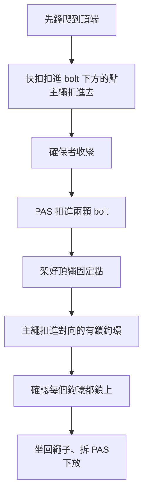

> 🌏 [English version](/posts/climbing/2026-10-17-top-rope-anchor-setup-en)

在岩館，頂繩早就有人架好了。到了戶外，總有一天你要自己爬上去，在頂端兩顆 bolt 上架一組頂繩，讓朋友在下面一輪一輪爬。

這一步有個常見的壞習慣：把主繩直接穿過頂端的環。一整天爬下來，公共設備就被磨掉一層。[TOCC（臺灣戶外攀岩協會）](https://www.tocc-climbing.org/post/%E9%BE%8D%E6%B4%9E%E7%9A%84%E4%B8%8A%E6%96%B9%E5%9B%BA%E5%AE%9A%E9%BB%9E)的說法是，上方架繩是器材磨損率最高的攀登方式。

這篇是〈[運動攀登與傳統攀登](/posts/climbing/2026-10-17-sport-vs-trad-overview)〉系列第 6 篇。前置是〈[第一條戶外運攀先鋒](/posts/climbing/2026-10-17-first-outdoor-sport-lead)〉和〈[判斷一顆 bolt](/posts/climbing/2026-10-17-judging-bolts)〉：你要先會先鋒到頂端，也要會判斷頂端那兩顆 bolt 能不能信。頂端沒有 bolt、要自己放保護做固定點的情況，留到〈[建立固定點](/posts/climbing/2026-10-17-building-anchors)〉。

[REI 的頂繩固定點教學](https://www.rei.com/learn/expert-advice/set-and-clean-anchors.html)開頭就假設你已經會先鋒、會確保先鋒、會垂降，並且說學這些最好的方式是找有經驗的人教，或上合格教練的課。這篇也一樣：它讓你知道每一步在做什麼，手上的動作要在有經驗的人旁邊練。

## 為什麼主繩不能直接穿過頂端的環

運動路線頂端常見的配件是垂降環、梅隆鎖、羊角，有些只有兩顆光禿禿的 bolt。主繩直接穿過它們頂繩，每一次攀爬、每一次下放，繩子都在金屬上來回拉。

[Black Diamond 的 QC Lab](https://blackdiamondequipment.com/blogs/stories/qc-lab-worn-anchors) 測過兩個被繩子磨出溝槽的 cold shut（一種開口鉤狀的頂端環）。結果有點反直覺：溝槽讓繩子固定在受力最強的軸線上，被磨過的樣本反而比新品晚變形。但它的結論是，**磨出來的尖銳邊緣會傷繩皮**，看到要換，平常也要用自己的快扣或鉤環分擔磨損。

[英國登山協會（BMC）](https://www.thebmc.co.uk/en/spot-a-bad-bolt)給的做法更直接：

- **頂繩一律用自己的快扣或鉤環**，最後一個人再清掉。
- **頂端環磨損超過三分之一厚度**，就不要依賴那個零件。

美國阿爾卑斯俱樂部（AAC）的〈[Cleaning Sport Routes](https://publications.americanalpineclub.org/articles/13201216058)〉、REI 和 TOCC 說法一致：主繩穿過你自己的裝備，磨損由你的裝備承擔。公共設備留給最後一個人下撤用。

**看影片**：HowNOT2 把一個從 Yosemite 熱門路線拆下來、被繩子磨薄的鋁製垂降環拿去拉，結果 1.5 kN 就斷了（數字出自影片說明欄）。從 9:06 看起；這是單一樣本的慢拉，用來看磨損怎麼讓公共設備變危險，不是在測新環。

```youtube
url: https://www.youtube.com/watch?v=xrKzvWMyCmE
title: This rappel ring could kill someone（HowNOT2）
start: 546
```

**今晚就能做的動作**：檢查你的快扣裡有沒有兩條能換成有鎖鉤環的，或直接準備兩條有鎖快扣，專門留給頂繩用。

## 架之前：先看頂端的兩顆 bolt

頂繩把整個系統交給頂端兩顆 bolt，所以上一篇的檢查要在頂端再做一次：鏽蝕、裂縫、會轉的掛片、周圍岩石、環的磨損。

**看影片**：BMC 這支三分鐘短片從 2:15 起示範檢查頂端的鏈條和環：先看有沒有接牢、鎖好，再看磨損。片中口述的門檻是磨掉「大約一半」就考慮停用，比前面引的 BMC 網頁寫的三分之一寬鬆；兩種說法不同，以較保守的三分之一為準。影片是英國情境，沒有談材質和鏽蝕，龍洞還要加上 TOCC 下面這幾條。

```youtube
url: https://www.youtube.com/watch?v=SpSOFhqEKgs
title: How to check and preserve a lower off（BMC TV）
start: 135
```

TOCC 對龍洞頂端的配件有幾個具體提醒：

- **梅隆鎖**：市售的大多是 304 不鏽鋼，在龍洞風險極高。看到要辨識材質、看鏽蝕，有異常就通報 Rebolting Team。
- **垂降環**：市售的多是鋁合金，在龍洞往往不到一年強度就大幅削弱。
- **羊角**：大多是鈦合金；長巷佈告欄有一批 2004–2006 年裝的 316 羊角，已經磨出明顯凹痕。

TOCC 也呼籲，任何固定點或自己架的系統，在真正使用前都要做兩件事：

1. **檢查**：辨識設備材質、看外觀、檢查系統是否正確完整。
2. **測試**：在自我確保的狀態下，把體重完全轉移到設備或系統上，確認它撐得住。

出發前可以先查 TOCC 的〈[龍洞岩場攀登路線資料庫](https://docs.google.com/spreadsheets/d/1QHFNQSPgKgQrTNnYn246wfotOYqOkzHjLltZ26keBgg/edit?usp=sharing)〉：`A01` 起的欄位是頂端錨栓的材質，「Anchor 配件」欄寫頂端掛了什麼。

資料庫也把一類路線標成「上方架繩」，就是預期用頂繩爬的路線；2026-10-17 的統計分頁共 42 條。

## 架法一：兩條有鎖快扣

最簡單的架法。AAC〈Cleaning Sport Routes〉列的要點：

- **至少兩條**：兩顆 bolt 各掛一條快扣或繩環，繩子同時穿過兩條。
- **開口對向**：兩條快扣的鉤環開口方向相反，並大致平均受力。
- **用有鎖快扣**：兩端都是有鎖鉤環，能提高頂繩固定點的安全性。
- **不要掛在最下面那一環**：把最下面的鏈環、梅隆鎖或垂降環空出來，最後一個人收繩時比較好操作。
- **鉤環不要壓在岩角上**：避免鉤環在受力時被岩角頂住。
- **常頂繩就用鋼製鉤環**：繩子那一端用鋼製鉤環耐磨得多，也能減少繩子沾上的髒污。

每顆 bolt 各掛一條快扣，就是兩個**獨立**的點：其中一顆或一條快扣出問題，繩子還掛在另一條上。這也是 REI 對冗餘的最低要求：至少兩個牢靠的固定點。

**看影片**：Hard Is Easy 在 Mammut 實驗室拍的這段從 24:02 開始，講頂端兩個開口對向的鉤環：繩子只走其中一個時，鉤環側面會磨出不對稱的溝槽，結論是「有兩個，就扣兩個」。這只是約一分鐘的觀察，不是破斷測試，片中的鉤環也是頂端常見的無鎖款；架自己的頂繩，仍照上面 AAC 的要點用有鎖快扣。

```youtube
url: https://www.youtube.com/watch?v=7qEvvobz5YQ
title: How Deep is too Deep? For a Rope（Hard Is Easy）
start: 1442
```

**今晚就能做的動作**：在家把兩條快扣扣在門把或椅背的兩個點上，練習讓兩個開口朝相反方向，再把一段繩子同時穿過兩條。

## 架法二：用 cordelette 做 quad

[REI](https://www.rei.com/learn/expert-advice/set-and-clean-anchors.html) 示範的是 quad。它比兩條快扣多帶一些材料、多幾個步驟。

材料：

- 一條 25 呎（約 7.6 公尺）、7 mm 以上的 cordelette，用雙漁人結接成一圈。
- 4 個有鎖鉤環。
- 一條 PAS（個人固定繩），用繫帶結（girth hitch）接在吊帶的兩個綁繩點上。

做法：

1. 把 cordelette 對折成四股。
2. 靠近雙漁人結的一端，用一個有鎖鉤環扣住兩股，掛到其中一顆 bolt。
3. 另一端拿到另一顆 bolt 旁，用拳頭握住 cordelette 的最低點，在拳頭兩側各打一個單結，兩結相距約 8 吋（約 20 公分）。
4. 另一端用第二個有鎖鉤環扣住兩股，掛到另一顆 bolt。
5. 在兩個結之間的四股中，用兩個開口對向的有鎖鉤環扣住其中三股，留一股不扣。這兩個鉤環就是主繩要穿過的點。

留一股不扣，是為了讓其中一側失效時，鉤環會被結擋住，不會整個滑掉。REI 用 SERENE-A 口訣檢查成品：牢靠、平均、冗餘、有效率、不延伸，再加上角度，兩側夾角保持在 60 度以內。這些原則在〈[建立固定點](/posts/climbing/2026-10-17-building-anchors)〉會完整講。

**看影片**：HowNOT2 的 Bobby 從 14:17 起示範他最常用的 quad 頂繩固定點，兩個單結先不拉緊、方便調整，並說強度是頂繩需求的 10 到 20 倍。但他用的是 240 公分 dyneema 扁帶，不是 REI 的 7 mm 以上 cordelette，扣主繩的方式也不是上面 REI「兩個對向有鎖鉤環扣三股、留一股不扣」的做法。影片適合拿來看 quad 的結構，自己照做時以 REI 的步驟為準。

```youtube
url: https://www.youtube.com/watch?v=Xzw9ZT-J71E
title: 3 Ways to Build a Top Rope Climbing Anchor（HowNOT2）
start: 857
```

## 在頂端的操作順序

不論哪一種架法，REI 的順序都是先把自己固定好，再動手架：



幾個細節：

- **PAS 要拉緊**：REI 提醒 PAS 只能靜態承重，承受任何距離的墜落都可能斷。選能把它拉直、沒有鬆弛的那一環來扣。
- **扣點的優先順序**：REI 的建議是先扣掛片，其次是鏈環，最後才是垂降環。
- **拆 PAS 之前先坐回繩子**：喊確保者收緊，把全部體重交給主繩，確認是繩子在承重，再拆 PAS。
- **出發前就講好**：AAC 提醒，要不要讓最後一人用頂繩跟攀清線，應該在先鋒者離地前決定，這樣頂端才會照頂繩的需要來架。

## 繩子不要壓在岩角上

頂端固定點不一定剛好在岩壁邊緣。如果固定點退在平台後方，主繩從固定點出來、越過邊緣往下，每一次攀爬和下放都在岩角上拉扯。AAC 也提醒，下放清快扣、身體擺盪時，上方的繩子可能在岩角上摩擦，或卡進灌木與鬆動的岩塊。

架好之後，從頂端往下看一遍：

- **鉤環**：自然下垂，沒有頂在岩面或岩角上。
- **主繩**：從鉤環出來直直往下，沒有壓在銳利的邊緣。

如果固定點的位置讓繩子一定會壓在岩角上，換一條路線，或等學過延伸固定點的做法再架。

## 龍洞：自備器材、盡量垂降

TOCC 在〈[龍洞的上方固定點](https://www.tocc-climbing.org/post/%E9%BE%8D%E6%B4%9E%E7%9A%84%E4%B8%8A%E6%96%B9%E5%9B%BA%E5%AE%9A%E9%BB%9E)〉寫了兩條關於頂繩的規定：

1. **請務必自備器材架設上方架繩系統。**
2. **請勿將主繩直接穿過固定設備架設上方架繩系統。**

理由寫得很清楚。龍洞近 600 條路線上有兩千多顆錨栓，多數已經是第二輪更新，少數到第三、四輪。舊錨栓無法完整取出，每換一輪就要在次好的位置鑽新孔。設備靠社群捐款購買，維護靠少數志工無償投入。

撤退時，TOCC 建議盡可能用**雙繩垂降**，除非遇到天候驟變、雷擊、地震、蜂螫等緊急狀況，才用下放。其他地方的規範不一定相同：AAC 指出許多岩場已經接受甚至推薦下放清線，但也有在地組織仍要求垂降。兩種做法怎麼選、怎麼做，在〈[下放還是垂降](/posts/climbing/2026-10-17-lower-or-rappel)〉講；原則是照當地規範。

## 收頂繩：最後一個人清

大家爬完之後，最後一個人要把頂端的裝備收掉。REI 的流程是：

1. **最後一趟頂繩爬到頂**，身上先接好 PAS。
2. **用快扣和 PAS 把自己固定在兩顆 bolt 上**，讓確保者收緊當備份。
3. **拆掉頂繩固定點**，整理好掛在吊帶後方。
4. **垂降下來**。

REI 也寫，不要直接讓主繩穿過掛片、鏈環或垂降環下放自己，那些零件不是設計來承受繩子摩擦的。真的必須下放，就留一個有鎖鉤環在岩場上。

**看影片**：HowNOT2 找 Hard Is Easy 合拍的運攀入門片，從 58:06 起示範最後一個人收固定點：先用 personal anchor 固定自己、下方留一條快扣當備份，用繩耳穿過頂端環、打八字結加有鎖鉤環掛上吊帶，全程都有兩個保護，確認是繩子在承重才拆 personal anchor。要注意影片最後是讓主繩穿過頂端環**下放**，也就是上面 REI 不建議的做法；在龍洞請依 TOCC 盡量垂降，兩種方式的差別見〈[下放還是垂降](/posts/climbing/2026-10-17-lower-or-rappel)〉。

```youtube
url: https://www.youtube.com/watch?v=yxNYyCONYGo
title: Intro to Sport Climbing ft. Hard is Easy（HowNOT2）
start: 3486
```

**今晚就能做的動作**：跟常一起爬的夥伴約好下次戶外的分工：誰先鋒上去架、架哪一種、最後誰清、用下放還是垂降。

## 練習題：四個情境

答案在每題下方，先自己想再看。想練更多題，可以玩 [nobodyclimb 的繩索系統練習：頂繩架設](https://nobodyclimb.cc/games/rope-system/learn/sport-toprope)。

**1. 頂端有兩顆 bolt，各掛了一個看起來很新的垂降環。朋友說：「直接把繩子穿過兩個環就好，比較快。」**

<details><summary>答案</summary>

不要。頂繩一整天下來，繩子都在公共的垂降環上磨。用兩條有鎖快扣各扣一顆 bolt，讓主繩穿過你自己的鉤環。在龍洞，TOCC 明文要求不要把主繩直接穿過固定設備架頂繩。

</details>

**2. 你用兩條普通快扣架好頂繩，兩條的開口朝同一邊。**

<details><summary>答案</summary>

把其中一條翻過來，讓兩個開口方向相反，或直接換成有鎖快扣。AAC 的要點是開口對向、大致平均受力；用有鎖快扣能進一步提高安全性。

</details>

**3. 頂端固定點在平台後方約一公尺，主繩從鉤環出來後壓在平台邊緣才往下。**

<details><summary>答案</summary>

繩子每次受力都會在岩角上磨。這個位置不適合用兩條快扣直接架頂繩。換一條路線，或等學會延伸固定點的做法（系列後面的〈建立固定點〉）再架。

</details>

**4. 你在頂端已經用 PAS 扣進兩顆 bolt，正準備拆 PAS 下放，但還沒喊確保者收緊。**

<details><summary>答案</summary>

先別拆。依 REI 的順序，先確認每個鉤環都鎖上，喊確保者收緊，把全部體重交給主繩，確認是繩子在承重，再拆 PAS、喊下放。

</details>

## 下一步

架好頂繩、大家爬完之後，最後一個人要從頂端下來。下一篇〈[下放還是垂降](/posts/climbing/2026-10-17-lower-or-rappel)〉會講兩種方式的取捨，以及龍洞為什麼建議垂降。頂端沒有 bolt 時怎麼自己做固定點，在〈[建立固定點](/posts/climbing/2026-10-17-building-anchors)〉。

想先複習地面的確保，可以回到〈[岩館上攀確保](/posts/climbing/2026-10-17-gym-top-rope-belay)〉。

## 延伸觀看：器材實測與教學頻道

本文嵌入的影片來自下面幾個頻道。想自己往下挖，可以從這裡開始；看的時候記得每個頻道的限制。

- **[HowNOT2](https://www.youtube.com/@HowNOT2)**：Ryan Jenks 經營，2016 年從走繩（highline）安全教學起家，後來把攀岩、洞穴、溪降器材拿去拉斷，還有在真岩上拉 bolt 的 Bolt Busters 系列。看點是「標示強度以外」的情況：打結、磨損、舊裝備、放錯位置。限制：多數是自製機器慢拉、每組 1–3 個樣本，他自己也說這是娛樂不是科學；頻道背後有網路器材店，部分受測品是店內商品。
- **[Hard Is Easy](https://www.youtube.com/@HardIsEasy)**：署名 Ben 的攀岩者獨自經營，以前是軟體工程師。一次在泰國 Tonsai 看到確保者接太硬、攀者撞上岩石，他回家設計實驗，從此專拍確保、繩子、鉤環與確保器的實驗與物理解說，近年多支在 Mammut 實驗室合拍。限制：實驗多是自己設計，不是 EN／UIAA 標準測試。
- **[BMC TV](https://www.youtube.com/@teamBMCTV)**：英國登山協會（BMC）的頻道。2017 年拍的一系列 1–3 分鐘短片逐步示範怎麼檢查繩子、吊帶、頭盔、鉤環、bolt。限制：只示範、不測數字，是英國情境。

## 更新紀錄

- 2026-10-23：補充 HowNOT2、Hard Is Easy 等頻道的器材實測影片與頻道介紹

## 參考資料

- [How to Set and Clean a Top-Rope Anchor（REI Expert Advice）](https://www.rei.com/learn/expert-advice/set-and-clean-anchors.html)
- [Know the Ropes: Cleaning Sport Routes（Lindsay Auble，Accidents in North American Climbing 2021，AAC）](https://publications.americanalpineclub.org/articles/13201216058)
- [QC Lab: Worn Anchors（Black Diamond）](https://blackdiamondequipment.com/blogs/stories/qc-lab-worn-anchors)
- [How to spot a bad bolt when sport climbing（BMC）](https://www.thebmc.co.uk/en/spot-a-bad-bolt)
- [TOCC：龍洞的上方固定點](https://www.tocc-climbing.org/post/%E9%BE%8D%E6%B4%9E%E7%9A%84%E4%B8%8A%E6%96%B9%E5%9B%BA%E5%AE%9A%E9%BB%9E)
- [龍洞岩場攀登路線資料庫（TOCC，Google 試算表）](https://docs.google.com/spreadsheets/d/1QHFNQSPgKgQrTNnYn246wfotOYqOkzHjLltZ26keBgg/edit?usp=sharing)
- [nobodyclimb 繩索系統練習：頂繩架設](https://nobodyclimb.cc/games/rope-system/learn/sport-toprope)
