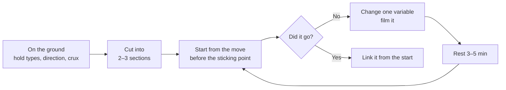

> 🌏 [中文版](/posts/climbing/2026-10-18-bouldering-problem-solving)

You're on a boulder problem and you've just fallen on the same move for the fifth time. Back to the start, chalk up, go again. Same move, same fall.

This post is for people who have bouldered in a gym for a few months and have started meeting "the move I can't do." It doesn't teach new moves. It covers **what to do between attempts**: check the rules, break the problem down, watch others, change your beta, keep a record, rest, and get down safely. The earlier posts in this series are your toolbox here; if you haven't read them, start with the [series overview](/posts/climbing/2026-10-18-climbing-movement-overview). If you've never climbed, read the [beginner's guide to climbing](/posts/climbing/2026-10-08-climbing-beginner-guide) first.

A few words come up again and again. Taiwanese gyms mostly use the English terms; a [Taiwanese climbing glossary on Vocus](https://vocus.cc/article/623ac982fd897800012c7c40) (in Chinese) says most terms came from abroad and people just use the originals.

- **Problem**: a boulder route.
- **Beta**: how to climb it.
- **Crux**: the hardest section.
- **Send**: finishing it within the rules.

## First: what counts as starting, and what counts as a send

Plenty of people spend a session stuck on something that's really a rules problem: they used a hold of another color, or slapped the finishing hold and jumped off, thinking they'd finished.

**The start.** The [German Alpine Club (DAV) indoor bouldering handbook](https://www.alpenverein.de/files/3610003_dav_boulderschein_brosch_148x210_online.pdf) (in German) says: find the start holds and hold them with both hands before you set off; use only holds of one color, and the wall itself and large wooden volumes are usually allowed. Competitions are stricter. [World Climbing's 2026 Competition Rules](https://images.ifsc-climbing.org/ifsc/image/private/t_q_good/prd/jaq7awz9jmqwpddwnbpr.pdf) require both hands and both feet on the marked start position, in a stable position, before the start counts.

**The send.** Sources differ here:

- **Competition**: World Climbing requires both hands on the finishing hold at the same time, in a stable position with clear control of it, or standing on top of the boulder.
- **DAV handbook**: the top hold is the goal, and you don't climb any higher; top out only where that is allowed. It does not say both hands.
- **Taiwanese gyms**: the Vocus glossary notes that outside competitions, gyms usually mark the finishing hold with two strips of tape, the same way as the start.

So "both hands on the top hold" is a competition rule, not every gym's rule. Check the posted rules at your gym or ask the front desk. The DAV handbook also points out that rules can differ from gym to gym.

**Something you can do tonight**: when you walk into the gym, find the house rules and check three things: must the start be both hands (or hands and feet), must you match the finishing hold, and can you use the wall and volumes? If they aren't posted, ask the desk.

## Break the problem into sections

Look before you climb. The DAV handbook makes "look first, then climb" a rule: which way the problem goes, where it ends, and whether someone is already on the wall. The [British Mountaineering Council (BMC) route-reading article](https://www.thebmc.co.uk/en/get-to-grips-with-route-reading) gives a checklist you can work through:

1. **Hold types**: jugs, crimps, slopers, or a mix? Where are the feet?
2. **Hold direction**: if a hold faces right, it's usually for your right hand; if it faces left, your left.
3. **Body position**: a sidepull taken square-on feels much harder than with one hip turned to the wall (see [turning and twisting](/posts/climbing/2026-10-18-climbing-turning-twisting-en)).
4. **The crux**: is it a long move, a balance move, or a move where your feet come off?

Then cut the problem into two or three sections. Usually only one of them stops you, so practise that one. One of the projecting strategies listed by [Lattice's Tom Randall](https://latticetraining.com/blog/bouldering-top-10-projecting-strategies-for-beginners-and-intermediate-climbers) is "not starting at the start." Get on the wall in the position just before the move that stops you and try it three to five times. That beats climbing up to it tired every time for a single try.

The start is worth practising on its own too. In a [Climbing.com piece](https://www.climbing.com/skills/bouldering/tom-randall-four-exercises-to-train-bouldering-technique-on-the-first-move/), Tom Randall calls the start the best lab on the wall: it's lowest to the ground, the holds are the best, and the fall is the safest. He suggests starting problems in ways the setter didn't intend: use only the highest foothold, match hand and foot on the same hold, pull on with a single low foot and a flag, or smear on the blank wall. If you can't even hold the start, drop at least two grades below your usual hard problem.

**Something you can do tonight**: pick a problem you're stuck on and mime each move from the ground, then say which move is hardest. Get on the wall in the position just before it and try it three times before resting.

## Watch others: one of the few things research shows raises send rates

Many people treat watching someone else as cheating, or assume that reading the problem longer on their own is enough. The research says otherwise.

A [2021 bouldering study](https://pmc.ncbi.nlm.nih.gov/articles/PMC8657215/) had advanced climbers try problems under three conditions: no demonstration, a video demonstration, and a live demonstration. They topped most often after watching a live climber, and failed most often when they had no information at all (onsight). In other words, **seeing how someone else climbs it makes a send more likely than going in with no information**.

Another study backs up the "watch, then recall" drill. In [Medernach and colleagues' 2023 study](https://pubmed.ncbi.nlm.nih.gov/38166602/), boulderers watched an expert climb a problem and then had two minutes to rehearse it. The better the boulderer, the more holds and moves they remembered; the authors link this to movement knowledge and the ability to visualize moves.

The BMC puts it plainly: watching others is "a perfectly acceptable way of learning." Keep two things in mind:

- **Height and span change beta.** The BMC notes that someone else's sequence may not suit your body, so adapt it.
- **Don't offer beta unasked.** The Vocus glossary and [Gripped's bouldering etiquette list](https://gripped.com/indoor-climbing/10-rules-for-indoor-bouldering-etiquette) both say: unless someone asks, don't tell them how to climb it. If you want beta, ask.

**Something you can do tonight**: find a problem you haven't sent that someone else is working, and watch them try it twice. Then close your eyes and recall every hand and foot, and try it their way once.

## Change your beta one thing at a time

When you keep falling on the same move, the usual reaction is to pull harder. In [Climbing.com's piece on common projecting mistakes](https://www.climbing.com/skills/training/common-climbing-projecting-mistakes/), Cameron Hörst notes that failing the hardest move can come down to beta-recognition or movement skills, not only power.

I change things in this order, one at a time, so I know which change made the move go:

| Change this first | Try | Related post |
|---|---|---|
| Feet | A higher or wider foothold; swap feet | [Footwork](/posts/climbing/2026-10-18-climbing-footwork-en) |
| Center of gravity | Get your weight over the supporting foot before you reach | [Balance](/posts/climbing/2026-10-18-climbing-balance-en) |
| Body orientation | Square to sideways, add a flag or drop knee | [Turning and twisting](/posts/climbing/2026-10-18-climbing-turning-twisting-en) |
| Grip | Hold it differently, or change the hand order | [Holds and grips](/posts/climbing/2026-10-18-climbing-holds-grips-en) |
| Static or dynamic | If static won't go, try a deadpoint | [Dynamic moves](/posts/climbing/2026-10-18-climbing-dynamic-moves-en) |

**Something you can do tonight**: write down how you just tried the move in your phone's notes, change one row of the table, and try again. If it goes, note which change did it. If not, change it back and try the next row.

## Record every attempt

The move you remember and the move you actually did are often different. The BMC suggests looking back at the problem once you're down and comparing it with your plan: what you guessed right and what turned out differently. [Gripped's spray wall article](https://gripped.com/indoor-climbing/how-to-use-a-spray-wall) adds that thinking about how you fell is how you learn not to fall there again, and video helps you lay your mental picture over what you actually did.

The simplest log has three columns: what you tried, which move you fell on, and why (foot slipped, missed the hold, body swung off).

**Something you can do tonight**: ask a friend to film the section you're stuck on. Watch for one thing only: at the moment you reach, are your feet still on?

## How long to rest, and when to move on

A boulder attempt is short, but a full effort is draining. In [Climbing.com's bouldering training guide](https://www.climbing.com/skills/training/how-train-bouldering/), Cameron Hörst writes that during limit bouldering you should rest 3–5 minutes between goes so that each one is a high-quality, full-power effort. He also advises ending before you're completely exhausted.

As for when to stop, the BMC has a practical warning: most injuries happen when you're tired, on that "one last go."

| Situation | What to do |
|---|---|
| Falling on the same move, but getting closer | Keep going, with full rests |
| Falling earlier and earlier | Drop a grade, or call it a day |
| Fingers hurting, skin about to split | Stop |
| Out of ideas to change | Go watch someone else, or come back another day |

**Something you can do tonight**: set a timer and wait at least 3 minutes between full-effort attempts. Use the time to watch others or mime the moves.

## Mats and falling: learn to get down first

There's no rope in bouldering, so every attempt can end on the ground. The DAV handbook has a line worth remembering: "the mat is harder than you think." That's why it calls downclimbing the safest way down.

Research points the same way:

- [Auer and colleagues' 2021 study](https://pubmed.ncbi.nlm.nih.gov/33966976/), which followed gym boulderers for a year, found that lower-limb injuries were more often caused by jumping off the wall than upper-limb injuries were.
- A [2025 study of falls in French gyms](https://pmc.ncbi.nlm.nih.gov/articles/PMC12312403/) found that most injury-causing falls were involuntary, and most happened from the middle and upper parts of the wall.

So decide how you'll come off before you climb:

- **Downclimb whenever you can.** Some gyms have dedicated downclimb holds; DAV says they're usually grey.
- **If the hard part is high up, climb back down.** DAV recommends that beginners only top out easy problems.
- **If you must jump**: check that the landing area is clear of people and things; feet shoulder-width apart, land on both feet; bend your knees as if sitting down and roll backwards; arms bent close to your body, fists closed. DAV calls this the "Babyboxer."
- **Keep the fall zone clear.** Don't stand or sit where someone could fall on you, and keep water bottles and shoes out of it too (DAV, Gripped).

If someone spots you, [REI](https://www.rei.com/learn/expert-advice/bouldering.html) and the [BMC](https://www.thebmc.co.uk/en/the-basics-climbing-indoors) both say the spotter's job isn't to catch you but to protect your head and shoulders and prevent a head-first landing. Gripped adds that you should ask before spotting someone. Outdoor bouldering, with pads to carry and arrange, is left for a later outdoor post.

**Something you can do tonight**: on an easy problem, deliberately downclimb from halfway three times. Then jump from about a meter up and practise the Babyboxer landing three times.

## Practice: four scenarios

Answers are under each question. Think first, then look.

**1. You grab the finishing hold with one hand and jump off before the other hand touches it. Your friend says it doesn't count.**

Answer

It depends on the gym's rules. Competition rules require both hands on the finishing hold at once, in a stable position; the DAV handbook only says to climb to the top hold. If the posted rules aren't clear, ask the desk. When you practise, match the hold and get stable before coming down; that satisfies both the competition rules and DAV.

**2. You've tried a problem from the start six times. You fall on move five each time, and earlier each time.**

Answer

Falling earlier means fatigue is piling up faster than you're improving. Rest 3–5 minutes, then start from the position at move four and practise only move five. If you still fall earlier each time, drop a grade or stop for the day. The BMC warns that most injuries happen on the tired "one last go."

**3. The person next to you keeps failing, and you know a great foothold.**

Answer

If they haven't asked, don't tell them. Both the Vocus glossary and Gripped list "no unsolicited beta" as gym etiquette. Chat about the problem, but don't tell them how to climb it. If they ask, go ahead.

**4. You're at the top of a problem, the last move is long and you're not sure you'll reach it. There's a line of grey holds next to you.**

Answer

When in doubt, downclimb. DAV says the mat is harder than you think, downclimbing is always safer than jumping, and beginners should climb down when the hard part is high. The grey holds are probably downclimb holds. If you do fall, land on both feet, bend your knees and roll backwards.

## Next steps

A boulder problem is short enough to climb top to bottom in one go. On a long roped route, the questions become "where can I rest?" and "how do I read the whole line before I start?". Read [Resting, Route Reading, and Setting Your Own Problems](/posts/climbing/2026-10-18-resting-route-reading-en) next. To see which techniques matter most on which wall angle, read [Wall Angles](/posts/climbing/2026-10-18-climbing-wall-angles-en).

## References

- [Indoor-Bouldern Basics: DAV indoor bouldering handbook (Deutscher Alpenverein, in German)](https://www.alpenverein.de/files/3610003_dav_boulderschein_brosch_148x210_online.pdf)
- [World Climbing Competition Rules (January 2026)](https://images.ifsc-climbing.org/ifsc/image/private/t_q_good/prd/jaq7awz9jmqwpddwnbpr.pdf)
- [Get to grips with route reading (BMC)](https://www.thebmc.co.uk/en/get-to-grips-with-route-reading)
- [The basics: climbing indoors (BMC)](https://www.thebmc.co.uk/en/the-basics-climbing-indoors)
- [How to Get Started Bouldering (REI Expert Advice)](https://www.rei.com/learn/expert-advice/bouldering.html)
- [4 Bouldering Technique Drills to Perform on the Very First Move (Tom Randall, Climbing.com)](https://www.climbing.com/skills/bouldering/tom-randall-four-exercises-to-train-bouldering-technique-on-the-first-move/)
- [Bouldering: Top 10 Projecting Strategies (Lattice Training)](https://latticetraining.com/blog/bouldering-top-10-projecting-strategies-for-beginners-and-intermediate-climbers)
- [3 Common Projecting Mistakes and What To Do About Them (Cameron Hörst, Climbing.com)](https://www.climbing.com/skills/training/common-climbing-projecting-mistakes/)
- [A Simple Guide to Bouldering Harder (Cameron Hörst, Climbing.com)](https://www.climbing.com/skills/training/how-train-bouldering/)
- [Influence of On-Sight and Flash Climbing Styles on Advanced Climbers' Route Completion for Bouldering (IJERPH, 2021)](https://pmc.ncbi.nlm.nih.gov/articles/PMC8657215/)
- [Medernach, Henz & Memmert (2023). Mechanisms underlying superior memory of skilled climbers in indoor bouldering. J Sports Sci](https://pubmed.ncbi.nlm.nih.gov/38166602/)
- [Auer et al. (2021). Indoor Bouldering — A Prospective Injury Evaluation. Wilderness Environ Med](https://pubmed.ncbi.nlm.nih.gov/33966976/)
- [The art of falling: fall scenarios associated with bouldering injuries (Frontiers in Sports and Active Living, 2025)](https://pmc.ncbi.nlm.nih.gov/articles/PMC12312403/)
- [10 rules for indoor bouldering etiquette (Gripped)](https://gripped.com/indoor-climbing/10-rules-for-indoor-bouldering-etiquette)
- [How to Use a Spray Wall (Gripped)](https://gripped.com/indoor-climbing/how-to-use-a-spray-wall)
- [Climbing terms glossary (Vocus, HHH; in Chinese)](https://vocus.cc/article/623ac982fd897800012c7c40)

Appendix: study details

- Demonstration study (PMC8657215): 21 climbers who climb French 7b–7c+, on problems graded 6c, comparing no preview, video demonstration and live demonstration.
- Medernach 2023: 60 boulderers (20 each intermediate, advanced and elite), two minutes of recall after a demonstration.
- Auer 2021: 507 gym boulderers followed for 12 months; 44% were injured; odds ratio for lower-limb injury from jumping off the wall: 4.39.
- French fall study (2025): 245 injured adults; 85% of falls were involuntary; 67% were lower-limb injuries (mainly ankle sprains).

