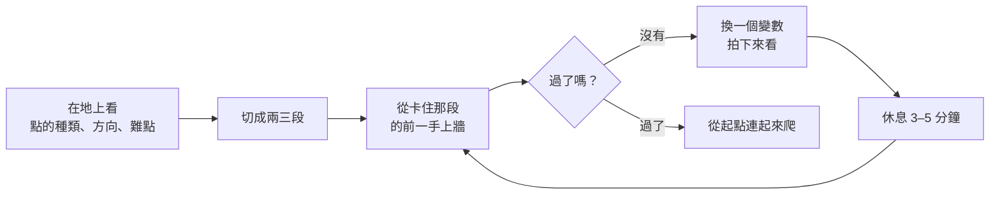

> 🌏 [English version](/posts/climbing/2026-10-18-bouldering-problem-solving-en)

你在一條抱石題目上，第五次掉在同一手。爬回起點、拍粉、再衝一次，還是掉在那裡。

這篇寫給在岩館抱石幾個月、開始遇到「爬不過去的那一手」的人。它不教新動作，教的是**兩次嘗試之間該做什麼**：先確認規則，再拆題目、看別人、換 beta、記錄、休息，最後是怎麼安全地下來。前面幾篇的技巧都是這裡的工具箱，還沒讀過可以從[系列總覽](/posts/climbing/2026-10-18-climbing-movement-overview)開始；完全沒爬過，先讀[攀岩入門](/posts/climbing/2026-10-08-climbing-beginner-guide)。

先講幾個會一直出現的詞。台灣岩館多半直接講英文：[方格子的攀岩術語整理](https://vocus.cc/article/623ac982fd897800012c7c40)說，大部分術語是從國外傳回來的，大家都講原文。

- **題目（problem）**：一條抱石路線。
- **beta**：這條題目的爬法。
- **crux**：最難的那一段。
- **完攀（send）**：照規則爬完。

## 先弄清楚：怎樣才算開始、怎樣才算完攀

很多人卡了半天，其實是規則沒看懂：用了別的顏色的點，或在完攀點拍一下就跳下來，以為自己爬完了。

**起攀**。[德國阿爾卑斯協會（DAV）的岩館抱石手冊](https://www.alpenverein.de/files/3610003_dav_boulderschein_brosch_148x210_online.pdf)寫的是：找到起攀點，雙手握住再出發。只用同一個顏色的點；牆面和大型木作（volume）通常都可以用。比賽更嚴格，[World Climbing 2026 年的競賽規則](https://images.ifsc-climbing.org/ifsc/image/private/t_q_good/prd/jaq7awz9jmqwpddwnbpr.pdf)要求雙手雙腳都在標示的起攀位置、穩住之後才算開始。

**完攀**。這裡各館說法不一樣：

- **比賽**：World Climbing 規則要求雙手同時碰到完攀點，而且要穩住、明顯控制住它；或者爬到岩塊頂上站好。
- **DAV 手冊**：爬到最上面那顆點（Top）就是終點，不要再往上爬；只有允許的地方才能翻上牆頂（top out）。手冊沒有規定要雙手。
- **台灣岩館**：方格子的整理提到，非比賽時岩館多半用兩條膠帶標示完攀點，和起攀點的標法一樣。

所以「雙手握住完攀點才算」是比賽規則，不是每間岩館的規定。你常去的岩館怎麼算，看牆上的館規或問櫃檯。DAV 手冊也提醒，規則每間館都可能不同。

**今晚就能做的動作**：進館先找館規，看三件事：起攀要不要雙手（或雙手雙腳）、完攀點要不要雙手同點、牆面和木作能不能用。看不到就問櫃檯。

## 把題目拆成段落

爬之前先看。DAV 手冊把「先看再爬」列成規則：確認題目往哪個方向走、終點在哪、有沒有人正在爬。[英國登山協會（BMC）的讀線文章](https://www.thebmc.co.uk/en/get-to-grips-with-route-reading)給了一份可以照著看的清單：

1. **點的種類**：大把、小點、圓點，還是混著來？腳點在哪？
2. **點的方向**：點朝右，大多用右手；朝左，大多用左手。
3. **身體位置**：側拉點正身去抓會很累，把一側的髖轉向牆會輕鬆很多（見[側身與擰身](/posts/climbing/2026-10-18-climbing-turning-twisting)）。
4. **難點在哪**：是很遠的動作、要平衡，還是要腳離牆？

看完之後，把題目切成兩三段。卡住的通常只有一段，就去練那一段。[Lattice 的 Tom Randall](https://latticetraining.com/blog/bouldering-top-10-projecting-strategies-for-beginners-and-intermediate-climbers) 列的專案策略裡，有一條就是「不要每次都從起點開始」。直接從卡住那一手的前一個姿勢上牆，一次試三、五遍，比每次從頭爬到那裡、帶著疲勞試一次有效。

起攀那一段也值得單獨練。[Tom Randall 在 Climbing.com 的文章](https://www.climbing.com/skills/bouldering/tom-randall-four-exercises-to-train-bouldering-technique-on-the-first-move/)說，起攀離地最近、點最好、掉下來最安全，是牆上最好的實驗室。他建議故意用定線員沒想到的方式起攀：只踩最高的那個腳點、手腳踩同一個點、只用一個低腳點加 flag、腳只踩空白牆面。連起攀都抓不住，就換一條比你平常極限低至少兩級的題目。

**今晚就能做的動作**：挑一條卡關的題目，在地上用手指比出每一手，說出「第幾手最難」。上牆時直接從那一手的前一個姿勢開始，連試三次再休息。

## 看別人爬：研究裡少數真的提高完攀的做法

很多人覺得看別人的爬法是作弊，或是「自己在地上讀久一點就好」。研究的結果不太一樣。

一份 [2021 年的抱石研究](https://pmc.ncbi.nlm.nih.gov/articles/PMC8657215/)讓高階攀岩者在三種條件下爬題目：不看任何示範、看影片示範、看真人現場示範。看真人示範時，爬到頂的次數最多；完全沒有事前資訊（onsight）時，失敗最多。換句話說，**看過別人怎麼爬，比沒有任何事前資訊更容易完攀**。

另一份研究也支持「看完再回想」這個練法。[Medernach 等人 2023 年的研究](https://pubmed.ncbi.nlm.nih.gov/38166602/)讓抱石者看一位高手示範一條題目，再給兩分鐘回想。程度越好的人，記得的點和動作越多；作者認為這和動作知識、在腦中想像動作的能力有關。

BMC 的說法很直接：看別人怎麼爬，是「完全可以接受的學習方式」。不過要記得兩件事：

- **身高和臂展會改變 beta。** BMC 提醒，別人的爬法不一定適合你的身體，要自己調整。
- **不要主動報 beta。** 方格子的整理和 [Gripped 的抱石禮儀](https://gripped.com/indoor-climbing/10-rules-for-indoor-bouldering-etiquette)都提到：別人沒問，不要告訴他怎麼爬。想知道，就自己開口問。

**今晚就能做的動作**：找一條有人在爬、你也還沒完攀的題目，看他爬兩次。下來後閉眼回想他每一手抓哪裡、腳踩哪裡，再上牆照著試一次。

## 換 beta：一次只改一件事

連續掉在同一手，最常見的反應是「再用力一點」。Cameron Hörst 在 [Climbing.com 的專案常見錯誤](https://www.climbing.com/skills/training/common-climbing-projecting-mistakes/)裡提到，過不了最難的那一手，有時是找 beta 的能力或動作技巧不夠，不全是力量問題。

我會照下面的順序換，每次只換一項，才知道是哪一項讓動作過了：

| 先換這個 | 試試看 | 相關篇 |
|---|---|---|
| 腳點 | 換一個更高或更側邊的腳點；換左右腳 | [腳法](/posts/climbing/2026-10-18-climbing-footwork) |
| 重心 | 出手前先把重心移到支撐腳上方 | [重心與平衡](/posts/climbing/2026-10-18-climbing-balance) |
| 身體朝向 | 正身改側身、加 flag 或 drop knee | [側身與擰身](/posts/climbing/2026-10-18-climbing-turning-twisting) |
| 握法 | 換一種抓法，或換手的順序 | [手點與握法](/posts/climbing/2026-10-18-climbing-holds-grips) |
| 靜態或動態 | 靜態做不到時，改用 deadpoint | [動態](/posts/climbing/2026-10-18-climbing-dynamic-moves) |

**今晚就能做的動作**：在手機記事本寫下你剛才那次的爬法，只改表格裡的一項再試。過了，就把這一項記下來；沒過，換回原樣，改下一項。

## 記錄每一次嘗試

腦中記得的動作和實際做出來的，常常不一樣。BMC 建議下來之後回頭看題目，對照你原本的計畫：哪裡猜對了，哪裡和想的不一樣。[Gripped 的 spray wall 文章](https://gripped.com/indoor-climbing/how-to-use-a-spray-wall)也說，想想自己是怎麼掉的，才知道下次怎麼不掉在那裡；影片可以幫你把腦中的畫面和實際動作疊在一起比。

最簡單的紀錄只要三欄：試了什麼、掉在哪一手、掉的原因（腳滑、手沒抓到、身體盪出去）。

**今晚就能做的動作**：請朋友用手機拍你卡住的那一段。看影片時只看一件事：出手的那一刻，你的腳還在不在點上。

## 休息多久、什麼時候換題

抱石一次嘗試很短，但全力的嘗試很耗力。Cameron Hörst 在 [Climbing.com 的抱石訓練文章](https://www.climbing.com/skills/training/how-train-bouldering/)寫，做極限抱石時，每次全力嘗試之間要休息 3–5 分鐘，才能維持每次都是高品質的出力。他也建議在完全累垮之前就結束。

什麼時候該停，BMC 有一句很實際的提醒：多數受傷發生在累的時候，「再試最後一次」的那一次。

| 情況 | 建議 |
|---|---|
| 每次都掉在同一手，但越來越接近 | 繼續，休息夠再試 |
| 連續幾次離那一手越來越遠 | 換一條低一級的題目，或今天先停 |
| 手指開始痛、皮快磨破 | 停 |
| 想不出新的變數可以換 | 去看別人爬，或改天再來 |

**今晚就能做的動作**：在手機開計時器，兩次全力嘗試之間至少等 3 分鐘。等的時候看別人爬，或在地上比動作。

## 抱石墊與摔落：先學會下來

抱石沒有繩子，每一次嘗試都可能落地。DAV 手冊有一句話值得記住：「墊子比你以為的硬。」所以它把下攀列為最安全的下法。

研究也支持這件事：

- [Auer 等人 2021 年追蹤岩館抱石者一年的研究](https://pubmed.ncbi.nlm.nih.gov/33966976/)發現，下肢受傷比上肢受傷更常是從牆上跳下來造成的。
- [2025 年一份法國岩館的落地研究](https://pmc.ncbi.nlm.nih.gov/articles/PMC12312403/)發現，受傷的墜落大多不是自己選擇跳的，而且多發生在牆的中段和上段。

所以怎麼掉，要在爬之前就想好：

- **能下攀就下攀。** 有些岩館有專門給人下攀的點，DAV 說多半是灰色的。
- **高處有難點，就先爬下來。** DAV 建議新手只在簡單的題目爬到頂。
- **必須跳時**：先看落地區有沒有人和東西；雙腳與肩同寬、雙腳一起落地；膝蓋彎曲像要坐下，順勢往後滾；手臂彎曲貼近身體、握拳。DAV 把這個姿勢叫「Babyboxer」。
- **墜落區保持淨空。** 不要站在、坐在別人可能掉下來的地方，水壺和鞋子也一樣（DAV、Gripped）。

有人幫你 spot 時，[REI](https://www.rei.com/learn/expert-advice/bouldering.html) 和 [BMC](https://www.thebmc.co.uk/en/the-basics-climbing-indoors) 都說，spot 要護住的是頭和肩膀，避免頭先著地；不用把人整個接住。Gripped 提醒，要 spot 別人之前先問過他。戶外抱石還要搬墊子、排墊子，留到之後的戶外篇再寫。

**今晚就能做的動作**：挑一條簡單的題目，爬到一半刻意下攀回地面三次。再從離地一公尺左右的高度跳下，練三次 Babyboxer 落地。

## 練習題：四個情境

答案在每題下方，先自己想再看。

**1. 你抓到完攀點的瞬間另一手還沒碰到，就跳下來了。朋友說「這不算」。**

答案

要看這間岩館的規則。比賽規則要求雙手同時碰到完攀點並穩住；DAV 手冊只說爬到最上面那顆點。館規沒寫清楚就問櫃檯。自己練習時，雙手同點並穩住再下來，比賽規則和 DAV 的說法都會算。

**2. 一條題目你從起點爬了六次，每次都掉在第五手，而且越來越早掉。**

答案

越來越早掉，代表累積的疲勞比進步多。停下來休息 3–5 分鐘，之後直接從第四手的姿勢上牆，只練第五手。如果還是越來越遠，就換一條低一級的題目，或今天先停。BMC 提醒，多數受傷發生在累了還要「再試最後一次」的時候。

**3. 隔壁的人一直試不過，你知道一個很好用的腳點。**

答案

他沒問就不要說。方格子和 Gripped 都把「不主動報 beta」列為岩館禮儀。可以聊這條題目，但不要告訴他該怎麼爬。他問了，再說。

**4. 你爬到題目最上面，最後一手很遠，你不確定抓不抓得到。旁邊有一排灰色的點。**

答案

不確定就先下攀。DAV 說墊子比你以為的硬，下攀永遠比跳下來安全，高處有難點時新手應該先爬下來。灰色的點多半是給人下攀用的。真的要掉，雙腳落地、膝蓋彎曲、往後滾。

## 下一步

抱石題目短，一次就能從頭爬到尾。換成繩攀的長路線，問題變成「中途怎麼休息、起攀前怎麼讀整條線」，接著讀[休息、讀線與自己定線](/posts/climbing/2026-10-18-resting-route-reading)。想知道不同角度的牆該先用哪些技巧，讀[牆角度](/posts/climbing/2026-10-18-climbing-wall-angles)。

## 參考資料

- [Indoor-Bouldern Basics：DAV 岩館抱石手冊（Deutscher Alpenverein，德文）](https://www.alpenverein.de/files/3610003_dav_boulderschein_brosch_148x210_online.pdf)
- [World Climbing Competition Rules（2026 年 1 月版）：抱石起攀與完攀的比賽規則](https://images.ifsc-climbing.org/ifsc/image/private/t_q_good/prd/jaq7awz9jmqwpddwnbpr.pdf)
- [Get to grips with route reading（BMC）](https://www.thebmc.co.uk/en/get-to-grips-with-route-reading)
- [The basics: climbing indoors（BMC）](https://www.thebmc.co.uk/en/the-basics-climbing-indoors)
- [How to Get Started Bouldering（REI Expert Advice）](https://www.rei.com/learn/expert-advice/bouldering.html)
- [4 Bouldering Technique Drills to Perform on the Very First Move（Tom Randall，Climbing.com）](https://www.climbing.com/skills/bouldering/tom-randall-four-exercises-to-train-bouldering-technique-on-the-first-move/)
- [Bouldering: Top 10 Projecting Strategies（Lattice Training）](https://latticetraining.com/blog/bouldering-top-10-projecting-strategies-for-beginners-and-intermediate-climbers)
- [3 Common Projecting Mistakes and What To Do About Them（Cameron Hörst，Climbing.com）](https://www.climbing.com/skills/training/common-climbing-projecting-mistakes/)
- [A Simple Guide to Bouldering Harder（Cameron Hörst，Climbing.com）](https://www.climbing.com/skills/training/how-train-bouldering/)
- [Influence of On-Sight and Flash Climbing Styles on Advanced Climbers' Route Completion for Bouldering（IJERPH，2021）](https://pmc.ncbi.nlm.nih.gov/articles/PMC8657215/)
- [Medernach, Henz & Memmert（2023）. Mechanisms underlying superior memory of skilled climbers in indoor bouldering. J Sports Sci](https://pubmed.ncbi.nlm.nih.gov/38166602/)
- [Auer et al.（2021）. Indoor Bouldering — A Prospective Injury Evaluation. Wilderness Environ Med](https://pubmed.ncbi.nlm.nih.gov/33966976/)
- [The art of falling: fall scenarios associated with bouldering injuries（Frontiers in Sports and Active Living，2025）](https://pmc.ncbi.nlm.nih.gov/articles/PMC12312403/)
- [10 rules for indoor bouldering etiquette（Gripped）：不主動報 beta、墜落區淨空](https://gripped.com/indoor-climbing/10-rules-for-indoor-bouldering-etiquette)
- [How to Use a Spray Wall（Gripped）](https://gripped.com/indoor-climbing/how-to-use-a-spray-wall)
- [攀岩術語整理（方格子 HHH）](https://vocus.cc/article/623ac982fd897800012c7c40)

附錄：研究的細節數字

- 看示範的研究（PMC8657215）：21 位能爬法國 7b–7c+ 的攀岩者，題目難度為 6c，比較不看、看影片、看真人三種條件。
- Medernach 2023：60 位抱石者（中階、高階、菁英各 20 位），看示範後回想兩分鐘。
- Auer 2021：507 位岩館抱石者追蹤 12 個月，44% 受過傷；下肢受傷與從牆上跳下的勝算比為 4.39。
- 法國落地研究（2025）：245 位受傷的成人，85% 的墜落是非自願的，67% 是下肢受傷（以腳踝扭傷為主）。

