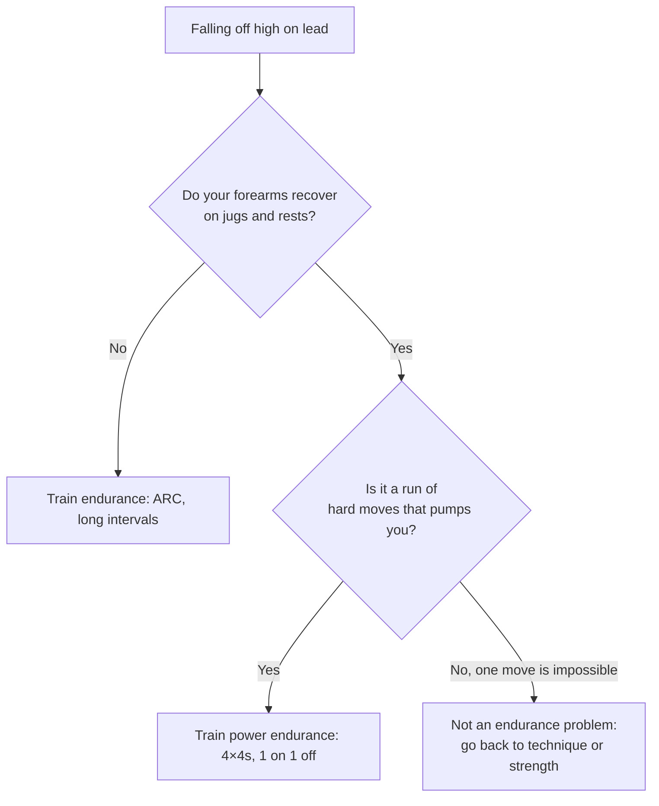

> 🌏 [中文版](/posts/climbing/2026-10-18-climbing-endurance-training)

You're leading a 5.10c at the gym. The first half goes fine. Around the fifth or sixth clip your forearms start to harden, your fingers won't close, and you're off. You lower, shake your hands out, and think: "My endurance is bad. From now on I'll climb until I'm completely pumped every session."

This post asks whether that instinct is right. The [energy systems](/posts/climbing/2026-10-18-climbing-energy-systems-en) post covered the theory; this one covers practice: what each of three endurance methods trains, how to set intensity, how to choose based on how you fall off, and how to build one session.

Scope first: this post assumes you already know how to find rests on the wall and shake out. If not, read [Resting, Route Reading and Setting Your Own Problems](/posts/climbing/2026-10-18-resting-route-reading-en) first; a lot of "bad endurance" is really not resting. If you haven't led yet, start with [Gym Lead Climbing](/posts/climbing/2026-10-17-gym-lead-climbing-en).

## First: which kind of endurance are you missing?

### "Endurance means climbing until you're pumped" is a common mistake

The most common gym endurance workout is lap after lap until your forearms are pumped. [Lattice's article on endurance training](https://latticetraining.com/blog/what-is-endurance-training-in-climbing) argues against it directly:

- The aerobic system is trained with **volume**; the anaerobic system with **intensity**.
- Getting really pumped lands in the middle ground between volume and intensity, so it trains neither system well.
- Exhaustive pump sessions are fatiguing and take longer to recover from, which costs you the quality of your next session.

Lattice uses a water tank analogy (see its [energy systems guide](https://latticetraining.com/blog/training-energy-systems-the-climbers-guide)): the water level is your anaerobic capacity, and the water flowing in is your aerobic capacity. The more flows in, the higher the intensity you can sustain without draining the tank.

### Two ways of falling off, two weaknesses

Think back to your last few falls. Most land in one of these rows:

| How you fall off | More likely missing | Matching training |
|---|---|---|
| Even well below your limit your forearms harden, and you can't recover on a jug | Endurance (aerobic capacity, recovery) | ARC, long intervals |
| Every move goes on its own, but linked together you pump out; the crux is a dozen-odd moves | Power endurance | 4×4s, 1 on 1 off, circuits |

The left row is what [Liu Chun-yen's 2017 post on endurance training](http://liuchunyen.blogspot.com/2017/04/local-edurance.html) (in Chinese) describes: still pumped after a route below your limit, and no recovery even on good holds or easy sections. The right row is the problem that opens [part four of Climbing.com's Learn to Train](https://www.climbing.com/skills/learn-to-train-increase-your-power-endurance/): you can do every move but can't link them.

Why does recovering at rests matter so much? [MacLeod et al. (2007)](https://pubmed.ncbi.nlm.nih.gov/17786696/) tested forearm endurance with intermittent contractions and found that how fast the forearm **re-oxygenated** during the rest phases predicted endurance performance. That is the physiology most often cited in support of ARC-style training.

That last branch matters: if one move is impossible on its own, endurance training won't fix it. That's technique or strength; see [Training Diagnosis](/posts/climbing/2026-10-18-climbing-training-diagnosis-en) and [Strength, Shoulders and the Campus Board](/posts/climbing/2026-10-18-climbing-strength-power-en).

**Something you can do tonight**: Pick a route two or three grades below your redpoint grade. When you finish, don't lower straight away. Hang on the last jug for 30 seconds and feel whether your forearms slowly loosen. If they don't, your weakness is probably the left-hand row.

## ARC: low intensity, long duration, no stopping

### How it works

ARC means climbing continuously on easy terrain for a long time without coming off. In a gym you can traverse the bouldering wall, or climb up and down on top rope or an auto-belay without touching the ground.

The acronym is expanded differently. [The Anderson brothers' Rock Prodigy clinic slides](https://rockclimberstrainingmanual.com/wp-content/uploads/2013/12/rp-intro-clinic-slides_19-aug-15.pdf) say Aerobic Restoration and Capillarity; Lattice writes Aerobic Recruitment Capilarisation; Liu Chun-yen's Chinese post writes Aerobic, Respiration, Capillarity. Don't memorise the name. Remember the target: forearm aerobic capacity and capillaries.

### How low is low? The coaches disagree

Intensity is where ARC most often goes wrong, and the sources don't agree:

| Source | Intensity | Duration |
|---|---|---|
| [Lattice](https://latticetraining.com/blog/what-is-endurance-training-in-climbing) | No pump at all; the last minute should feel like the first; about 2/10 RPE | 10–30 minutes continuous |
| [Eva López](http://en-eva-lopez.blogspot.com/2014/12/aerobic-endurance-training-in-sport_29.html) | Forearm pain at level 1–2, a "very mild pump"; above 2, move to a less steep wall or bigger holds | 5–45 minutes continuous |
| Anderson brothers (Rock Prodigy) | At or just below the maximum steady state (MSS) | 2–3 sets of 20–45 minutes |
| Liu Chun-yen 2017 | Keep the forearms in a "slight pump" | 15–45 minutes |

Why go by feel and not heart rate? [Baláš et al. (2022)](https://pubmed.ncbi.nlm.nih.gov/35069253/) point out that climbing loads are concentrated in the forearms and vary a lot, so the measures other sports use to control intensity, such as heart rate or blood lactate, haven't worked well. López also says plainly that she doesn't use heart rate and goes by how pumped the forearms are.

What all of them share: **you must be able to keep going**. Once you need to stop on a jug and shake out to survive, you're above ARC intensity. López says the occasional 1–2 second shake is fine, but this method doesn't involve shaking for more than 3 seconds or stopping at a rest.

On terrain, Liu suggests vertical or slightly overhanging walls where your arms carry only part of your weight. Lattice, answering a reader, said that doing it on a steep spray wall probably trains the anaerobic system instead, and recommended a less steep wall.

### Starting out, and how long it takes

Many people can't climb 10 minutes non-stop at first. Liu's suggestion is to climb 5 minutes, rest 5 minutes, up to 30–45 minutes in total, and lengthen each bout over time.

López adds total time slowly each week, with a lighter fourth week:

- Week 1: 8 minutes of easy climbing
- Week 2: 10 minutes
- Week 3: 12 minutes
- Week 4: recovery, 6 minutes

She also notes that ARC works mainly through structural changes, which take time: some effects may show after 3–4 weeks, but expect at least 6–8 weeks for them to be significant.

**Evidence level: coaching consensus plus physiology.** ARC rests on physiology studies like MacLeod 2007 and on coaching experience, not on controlled trials comparing ARC with no ARC.

**Something you can do tonight**: Find a vertical section of the bouldering wall, set an 8-minute timer, and traverse on big holds without touching down. If you need to stop and shake halfway, use bigger holds or a gentler wall next time.

## Intervals: between ARC and 4×4s

If 10 continuous minutes is too hard, or your gym has nowhere to traverse, intervals are easier to set up. Lattice's endurance article gives two:

**Long intervals: 5 on 3 off**

- Climb 5 minutes, rest 3 minutes off the wall, 3 times.
- Only a light pump that always feels manageable; you should be able to shake on any hold.
- In a reply to a reader, Lattice adds: about 2/10 RPE throughout.

**Short intervals: 1 on 1 off**

- Climb 1 minute, rest 1 minute off the wall, 10 times.
- You build a pump during the minute on, and fully recover during the minute off.
- You shouldn't be near failure; about 4/10 RPE.
- Progress by stretching the climbing time from 60 seconds to 80, then 100.

Short intervals are more intense but still train the aerobic system. Lattice recommends at least 15 minutes of climbing beforehand.

**Evidence level: coaching consensus.**

**Something you can do tonight**: Pick an auto-belay route you can onsight and try one round of 1 on 1 off × 10. Each time you come down, check your watch and rest the full minute. If you can't finish reps 6 or 7, choose an easier route next time.

## 4×4s and power endurance: holding on through hard sequences

### How a 4×4 works

The Climbing.com version:

1. Pick four boulder problems about three grades below your limit.
2. Climb the first one four times in a row, dropping off or downclimbing to the start and going again immediately.
3. Rest 2 minutes, then do the next problem four times.
4. After all four, rest 5 minutes. That's one set; aim for three.

Frequency advice from the same article:

- Power-endurance work leaves your forearms sore, so allow 48–72 hours between sessions.
- Start at two sessions a week and move to three if soreness allows.
- Gains show in as little as two to three weeks, and you lose them about as fast.

One precondition: Climbing.com recommends building a solid base of strength first, since power-endurance work converts some of that maximum strength into endurance.

### Lattice splits power endurance in two

[UKClimbing's power-endurance feature with Lattice](https://ukclimbing.com/articles/features/lattice_training_series_with_tom_randall_-_part_2_power_endurance-11352) breaks it into two parts:

| | Aerobic power | Anaerobic capacity |
|---|---|---|
| Feels like | Very pumped, like a hard redpoint | "Powered out", but less pumped |
| Example session | 5 sets × 2 reps, each rep a double lap of a route; 1 min between reps, 10 min between sets; 1–2 grades below onsight | 6 sets × 3 reps, one problem three times; 1 min between reps, 3 min between sets; around your flash level |
| Best for | Route climbers | Boulderers |

In the same piece Lattice says that boulderers and route climbers alike should do only about two such sessions a week, talk to a coach before doing more, and that "this training is easy to overdo".

**Evidence level: coaching consensus.** Neither 4×4s nor these sessions have been tested in controlled trials.

**Something you can do tonight**: Pick four problems you could climb with your eyes shut and do a single 4×4 set. The goal the first time isn't to get pumped out; it's to note which problem starts to feel hard on the third or fourth lap.

## Choosing, and building a session

### Choose by goal

[Stien et al. (2021)](https://pubmed.ncbi.nlm.nih.gov/33969299/) had intermediate climbers prioritise either lead or bouldering for five weeks:

- The lead-focused group improved forearm endurance.
- The boulder-focused group improved isolated finger strength.
- Neither group's climbing performance changed noticeably in five weeks.
- Prioritising one for five weeks didn't make the other decline.

The practical takeaway: **you get better at what you train, and focusing on one thing short-term doesn't make the other slip.** If you pump out high on lead, climb more routes and do route-style endurance work.

### Order within a session

[Eva López's post on periodizing ARC](http://en-eva-lopez.blogspot.com/2015/03/aerobic-endurance-training-in-sport.html) gives a general rule: when a session has several components, **start with the most intense and technically complex, and finish with the easier, low-intensity ones**. In order: maximum strength, bouldering, high-intensity endurance, and only then low-intensity endurance like ARC.

On frequency, López suggests that people new to ARC or at a medium level train it every other day: two days a week if you climb outdoors at weekends, up to three if you don't.

### A sample endurance session

This sample combines the sources above for someone who climbs three times a week and wants to stop pumping out high on lead. It is not anyone's original program:

| Time | Content | Intensity |
|---|---|---|
| 0–15 min | Warm-up: easy boulders, building gradually | Low |
| 15–35 min | 1 on 1 off × 10 on an auto-belay or top-rope route | About 4/10 RPE |
| 35–45 min | Rest, drink water | — |
| 45–55 min | ARC traverse for 8–10 minutes, working on footwork or shaking out | About 2/10 RPE |

This session has only one tiring component. If you also want to hangboard or limit boulder that day, those go first, and the endurance volume comes down. How to fit endurance and everything else into one week and one month is the subject of [the next post, on periodization](/posts/climbing/2026-10-18-climbing-periodization-en).

**Something you can do tonight**: Write down where you fell on your last three leads: which clip, whether it was an easy or hard section, and whether you'd just passed a rest. If two of the three were on easy ground or right after a rest, start with ARC.

## Practice: four scenarios

Answers are under each question; think first, then check.

**1. A friend says: "I spend the last half hour of every gym session climbing until my arms are wrecked. That's my endurance training." What do you tell them?**

Answer

Lattice's view: getting really pumped sits between volume and intensity, trains neither the aerobic nor the anaerobic system well, and is fatiguing and slow to recover from. For aerobic work, lower the intensity and extend the time (ARC, 5 on 3 off). For power endurance, raise the intensity and control sets and rests (4×4s, 1 on 1 off).

**2. Six minutes into ARC your forearms start to harden and you need to stop on a jug to shake out before carrying on. What do you change?**

Answer

The intensity is too high. López's standard is to move to a gentler wall or bigger holds once forearm pain goes above level 2; Lattice is stricter and wants no pump at all. Both agree that if you need to stop and rest to survive, you're no longer doing ARC.

**3. You boulder V4, but on a 5.10b lead you always pump out in a mid-route run of ten small holds. The easy sections and rests are fine. Which do you train first?**

Answer

Power endurance. You recover at rests; the problem is a run of hard moves, close to Climbing.com's "you can do the moves but can't link them". Start with 4×4s or Lattice's aerobic-power style sessions, about twice a week with 48–72 hours between them.

**4. After three weeks of 4×4s you feel much better, but you're off on a month-long climbing trip with no training. What happens when you come back?**

Answer

Climbing.com says power endurance comes quickly and goes quickly, in about two to three weeks. Plenty of route climbing on the trip helps maintain it. When you're back, restart at a lower volume rather than jumping straight into your last week's program.

## Next

You now have three tools: hangboard, strength and endurance. The next question is how to fit them into three sessions a week. Read [Periodization](/posts/climbing/2026-10-18-climbing-periodization-en) next.

An injury-prevention series (in progress) will cover finger, shoulder and elbow injuries. For now: if anything in these sessions hurts, stop rather than pushing through.

## References

- [What is endurance training in climbing? (Lattice Training, 2023)](https://latticetraining.com/blog/what-is-endurance-training-in-climbing)
- [Training Energy Systems: The Climber's Guide (Lattice Training)](https://latticetraining.com/blog/training-energy-systems-the-climbers-guide)
- [Lattice Training Series with Tom Randall – Part 2: Power Endurance (UKClimbing, 2018)](https://ukclimbing.com/articles/features/lattice_training_series_with_tom_randall_-_part_2_power_endurance-11352)
- [Learn to Train for Rock Climbing: Increase Your Power-Endurance (Climbing.com, 2017)](https://www.climbing.com/skills/learn-to-train-increase-your-power-endurance/)
- [Aerobic Endurance Training in Sport Climbing. Capacity (III): Training Methods (Eva López)](http://en-eva-lopez.blogspot.com/2014/12/aerobic-endurance-training-in-sport_29.html)
- [Periodization and Load Progression for ARC Training (Eva López)](http://en-eva-lopez.blogspot.com/2015/03/aerobic-endurance-training-in-sport.html)
- [Periodization and Load Progression for ARC Training (TrainingBeta, pointing to Eva López, 2016)](https://trainingbeta.com/periodization-and-load-progression-for-arc-training)
- [Introduction to the Rock Prodigy Training Program (Mark Anderson, clinic slides PDF, 2015)](https://rockclimberstrainingmanual.com/wp-content/uploads/2013/12/rp-intro-clinic-slides_19-aug-15.pdf)
- [Local endurance training for climbers (Liu Chun-yen, 2017) (in Chinese)](http://liuchunyen.blogspot.com/2017/04/local-edurance.html)
- [Baláš J et al. The Estimation of Critical Angle in Climbing as a Measure of Maximal Metabolic Steady State. Front Physiol 2022](https://pubmed.ncbi.nlm.nih.gov/35069253/)
- [MacLeod D et al. Physiological determinants of climbing-specific finger endurance and sport rock climbing performance. J Sports Sci 2007](https://pubmed.ncbi.nlm.nih.gov/17786696/)
- [Stien N et al. The Effects of Prioritizing Lead or Boulder Climbing Among Intermediate Climbers. Front Sports Act Living 2021](https://pubmed.ncbi.nlm.nih.gov/33969299/)
