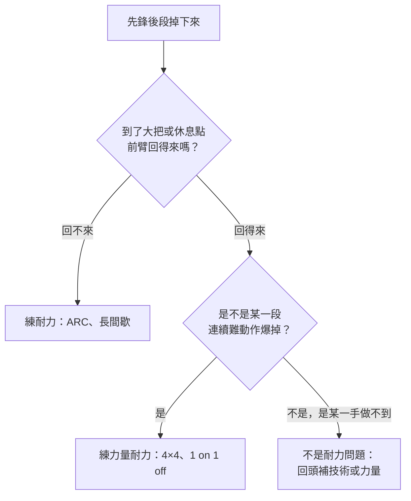

> 🌏 [English version](/posts/climbing/2026-10-18-climbing-endurance-training-en)

你在岩館先鋒一條 5.10c。前半段很順，掛到第五、六把快扣時，前臂開始發硬，手指扣不住，接著就掉了。下來甩甩手，你心想：「耐力不夠，以後每次都爬到爆為止好了。」

這篇要回答的就是這個直覺對不對。[能量系統](/posts/climbing/2026-10-18-climbing-energy-systems)那篇講過原理，這篇講做法：三種耐力訓練各練到哪裡、強度怎麼抓、怎麼依你掉下來的方式挑一種，最後排出一堂課。

先講清楚範圍：這篇假設你已經會在牆上找休息點、會甩手（shake out）。還不太會的話，先讀[休息、讀線與自己定線](/posts/climbing/2026-10-18-resting-route-reading)；很多「耐力不夠」其實是沒休息。還沒爬過先鋒的，先讀[岩館先鋒](/posts/climbing/2026-10-17-gym-lead-climbing)。

## 先分清楚：你缺的是哪一種耐力

### 「耐力就是爬到爆」是常見的誤會

岩館最常見的耐力練法，就是一條接一條爬到前臂僵硬（pump）。[Lattice 的耐力文章](https://latticetraining.com/blog/what-is-endurance-training-in-climbing)直接反駁這個做法：

- 有氧系統靠**量**來練，無氧系統靠**強度**來練。
- 爬到很 pump，剛好落在量和強度的中間，兩個系統都練不好。
- 爬到力竭的疲勞很重，恢復要更久，等於拿下一堂課的品質去換。

Lattice 用水箱比喻這件事（見[能量系統的指南](https://latticetraining.com/blog/training-energy-systems-the-climbers-guide)）：水箱裡的水位是無氧容量，流進來的水是有氧能力。流進來的水越多，你在不消耗水位的情況下能撐住的強度就越高。

### 兩種掉法，兩種弱點

回想你最近幾次掉下來的樣子，大致會落在其中一種：

| 你的掉法 | 比較可能缺的 | 對應訓練 |
|---|---|---|
| 爬比極限低很多的路線，前臂還是會僵；到了大把也回不來 | 耐力（有氧能力、恢復力） | ARC、長間歇 |
| 每個動作單獨都做得到，連起來就爆；難段只有十幾手 | 力量耐力（power endurance） | 4×4、1 on 1 off、circuits |

左邊那一列是[劉純延 2017 年的耐力訓練文](http://liuchunyen.blogspot.com/2017/04/local-edurance.html)描述的狀況：爬完極限以下的路線還是前臂僵硬，到了好點或簡單區域也恢復不了。右邊那一列是 [Climbing.com〈Learn to Train〉第四篇](https://www.climbing.com/skills/learn-to-train-increase-your-power-endurance/)開頭寫的問題：每個動作都會，就是連不起來。

為什麼「到休息點回得來」那麼重要？[MacLeod 等人 2007 年的研究](https://pubmed.ncbi.nlm.nih.gov/17786696/)用間歇用力測前臂耐力。結果發現，休息空檔裡前臂**再氧合**的速度，可以預測耐力表現。這是 ARC 類訓練最常被引用的生理依據。

最後那個分支很重要：某一手單獨就做不到，練耐力救不了它。那是技術或力量的問題，見[卡關診斷](/posts/climbing/2026-10-18-climbing-training-diagnosis)和[力量、肩與 campus board](/posts/climbing/2026-10-18-climbing-strength-power)。

**今晚就能做的動作**：在岩館挑一條比你紅點等級低兩三級的路線。爬完不要馬上下來，在最後一個大把停 30 秒，感覺前臂有沒有慢慢鬆開。鬆不開，你的弱點多半在左邊那一列。

## ARC：低強度、長時間、不停下來

### 做法

ARC 是在簡單的地形上連續爬很久，中間不落地。在岩館可以沿著抱石牆橫移（traverse），或在頂繩、自動確保上下攀不落地。

全名各家寫法不同。[Anderson 兄弟的 Rock Prodigy 講義](https://rockclimberstrainingmanual.com/wp-content/uploads/2013/12/rp-intro-clinic-slides_19-aug-15.pdf)寫 Aerobic Restoration and Capillarity。Lattice 寫 Aerobic Recruitment Capilarisation，劉純延的中文文章寫 Aerobic, Respiration, Capillarity。名字不用背，記住它要練的是前臂的有氧能力和微血管就好。

### 強度要多低：各家說法不同

ARC 最容易做錯的地方是強度。這一點各家並不一致：

| 來源 | 強度標準 | 時間 |
|---|---|---|
| [Lattice](https://latticetraining.com/blog/what-is-endurance-training-in-climbing) | 完全不 pump，最後一分鐘跟第一分鐘感覺一樣；RPE 約 2/10 | 連續 10–30 分鐘 |
| [Eva López](http://en-eva-lopez.blogspot.com/2014/12/aerobic-endurance-training-in-sport_29.html) | 前臂痠痛維持在 1–2 級，「非常輕微的 pump」；超過 2 級就換緩一點的牆或大一點的點 | 連續 5–45 分鐘 |
| Anderson 兄弟（Rock Prodigy） | 在最大穩定狀態（MSS）或略低 | 2–3 組，每組 20–45 分鐘 |
| 劉純延 2017 | 維持前臂「輕微 pump」的狀態 | 15–45 分鐘 |

為什麼大家都用感覺、不用心跳？[Baláš 等人 2022 年的研究](https://pubmed.ncbi.nlm.nih.gov/35069253/)指出，攀岩的負荷集中在前臂、變化又大。其他運動常用心率、血乳酸控制強度，放到攀岩效果並不好。López 也明講不用心跳控制，改看前臂的 pump 程度。

各家的共通點是：**要能一直爬下去**。一旦需要停在大把上甩手才撐得住，就已經超過 ARC 的強度了。López 也說，這個方法偶爾停 1–2 秒甩一下手可以，但不會停在休息點超過 3 秒。

地形的選擇，劉純延建議垂直或微前傾的牆，手臂只承受一部分體重。Lattice 回答讀者提問時也說，在很陡的 spray wall 上做，很可能已經在練無氧系統，應該換到比較不陡的牆。

### 新手怎麼開始、多久見效

連續爬 10 分鐘不落地，對很多人來說一開始做不到。劉純延的建議是先爬 5 分鐘、休息 5 分鐘，總共累積 30–45 分鐘，之後再逐步拉長每一段。

López 建議每週把總時間慢慢往上加，第四週減量：

- 第 1 週：簡單攀爬 8 分鐘
- 第 2 週：10 分鐘
- 第 3 週：12 分鐘
- 第 4 週：減量，6 分鐘

她也提醒，ARC 帶來的主要是結構上的改變，需要時間：有些效果 3–4 週就感覺得到，要明顯則至少 6–8 週。

**證據等級：教練共識＋生理機制。** 支持 ARC 的是 MacLeod 2007 這類生理研究和教練經驗，不是直接比較「練 ARC vs 不練」的對照試驗。

**今晚就能做的動作**：在抱石牆找一段垂直的區域，設定 8 分鐘計時，用大點橫移不落地。爬到一半如果需要停下來甩手，下次換更大的點或更緩的牆。

## 間歇：介於 ARC 和 4×4 中間

連續爬 10 分鐘太難、或你的岩館沒地方橫移時，間歇是比較好安排的選擇。Lattice 的耐力文章給了兩種：

**長間歇：5 on 3 off**

- 爬 5 分鐘、下來休息 3 分鐘，做 3 次。
- 爬的時候只能有輕微、一直在掌控中的 pump，在每個點上都還能甩手。
- Lattice 在留言回覆裡補充：全程 RPE 約 2/10。

**短間歇：1 on 1 off**

- 爬 1 分鐘、下來休息 1 分鐘，做 10 次。
- 爬的那 1 分鐘會累積 pump，休息的 1 分鐘要完全恢復。
- 不應該接近力竭，RPE 約 4/10。
- 進步的方式是把「爬」的時間從 60 秒拉長到 80 秒、100 秒。

短間歇比較激烈，練的仍然是有氧系統。Lattice 建議做之前至少先爬 15 分鐘熱身。

**證據等級：教練共識。**

**今晚就能做的動作**：挑一條自動確保上你能 onsight 的路線，試一輪 1 on 1 off × 10。每次下來看錶，休息滿 1 分鐘才上去；第 6、7 次就爬不完，下次換更簡單的路線。

## 4×4 與力量耐力：連續難動作撐得住

### 4×4 的做法

Climbing.com 的版本：

1. 選 4 條比你極限低約 3 級的抱石題。
2. 第一題連爬 4 次，落地或下攀回起點就立刻再上。
3. 休息 2 分鐘，換下一題，一樣 4 次。
4. 4 題做完休息 5 分鐘，算一組；目標做 3 組。

同一篇文章的頻率建議：

- 力量耐力訓練會讓前臂痠痛，兩次之間隔 48–72 小時。
- 從每週 2 次開始，痠痛允許再加到 3 次。
- 約 2–3 週就看得到進步，停練後也差不多這麼快退回去。

還有一個前提：Climbing.com 建議先有扎實的力量基礎再練力量耐力，因為它會把一部分最大力量「轉換」成耐力。

### Lattice 把力量耐力再分兩種

[UKClimbing 與 Lattice 合作的力量耐力專文](https://ukclimbing.com/articles/features/lattice_training_series_with_tom_randall_-_part_2_power_endurance-11352)把它拆成兩塊：

| | aerobic power | anaerobic capacity |
|---|---|---|
| 感覺 | 很 pump，像在拚紅點 | 「沒力了」，但不那麼 pump |
| 範例課 | 5 組 × 2 趟，每趟是同一條路線連爬兩次；趟間休 1 分鐘、組間休 10 分鐘；難度比 onsight 低 1–2 級 | 6 組 × 3 次，同一題連爬三次；次間休 1 分鐘、組間休 3 分鐘；難度約在你的 flash 等級 |
| 適合 | 爬路線的人 | 抱石的人 |

Lattice 在同一篇說，不論抱石或路線，這類訓練每週大約只做 2 次，想做更多先找教練討論，「很容易練過頭」。

**證據等級：教練共識。** 4×4 和這兩種課表都沒有對照試驗直接驗證效果。

**今晚就能做的動作**：挑 4 條你閉著眼都能完攀的抱石題，照 4×4 做一組就好。第一次的目標不是爆掉，是記下哪一題的第三、四次開始變難。

## 怎麼選、怎麼排一堂課

### 依你的目標選

[Stien 等人 2021 年的研究](https://pubmed.ncbi.nlm.nih.gov/33969299/)讓中級攀岩者 5 週內偏重先鋒或偏重抱石：

- 偏重先鋒的組，前臂耐力進步。
- 偏重抱石的組，單獨測的指力進步。
- 兩組的攀爬表現在 5 週內都沒有明顯改變。
- 專練其中一項 5 週，另一項沒有退步。

這給一般人一個實用的結論：**練什麼就長什麼，而且短期偏重一項不會讓另一項掉下去。** 你是先鋒後段爆，就多爬路線、多做路線型的耐力課。

### 一堂課的順序

[Eva López 談 ARC 週期化的文章](http://en-eva-lopez.blogspot.com/2015/03/aerobic-endurance-training-in-sport.html)給了一個通則：一堂課裡有好幾種內容時，**先做強度高、技術複雜的，再做簡單、低強度的**。依序是最大力量、抱石、高強度耐力，最後才是 ARC 這類低強度耐力。

頻率方面，López 建議剛開始練 ARC 或中等程度的人隔天練，週末有去戶外的話每週 2 天、沒有的話最多 3 天。

### 一堂耐力課的範例

下面是依上述來源組合的範例，給每週爬 3 次、想改善先鋒後段的人參考，不是任何一家的原始課表：

| 時段 | 內容 | 強度 |
|---|---|---|
| 0–15 分 | 熱身：簡單抱石、慢慢加難 | 低 |
| 15–35 分 | 1 on 1 off × 10，選自動確保或頂繩路線 | RPE 約 4/10 |
| 35–45 分 | 休息、喝水 | — |
| 45–55 分 | ARC 橫移 8–10 分鐘，練腳法或甩手 | RPE 約 2/10 |

這一堂只放一種「會累」的內容。同一天又想練指力板或極限抱石，那兩樣要放在最前面，而且耐力的量要減。怎麼把耐力和其他訓練排進同一週、同一個月，是[下一篇週期化](/posts/climbing/2026-10-18-climbing-periodization)的主題。

**今晚就能做的動作**：寫下你最近三次掉下來的位置：第幾把快扣、當時是簡單段還是難段、掉之前有沒有經過休息點。三次裡有兩次是在簡單段或休息點後掉，就從 ARC 開始。

## 練習題：四個情境

答案在每題下方，先自己想再看。

**1. 朋友說：「我每次去岩館最後半小時都爬到手爆，這就是耐力訓練。」你怎麼回？**

答案

Lattice 的看法是：爬到很 pump，落在量和強度中間，有氧和無氧兩個系統都練不好，而且疲勞重、恢復久。想練有氧就降強度、拉長時間（ARC、5 on 3 off）；想練力量耐力就提高強度、控制組數和休息（4×4、1 on 1 off）。

**2. 你在做 ARC，爬到第 6 分鐘前臂開始發硬，需要停在大把上甩手才能繼續。該怎麼調整？**

答案

強度太高了。López 的標準是前臂痠痛超過 2 級就換緩一點的牆或大一點的點；Lattice 更嚴格，要求完全不 pump。兩家都同意：需要停下來休息才撐得住，就已經不是在練 ARC。

**3. 你抱石能爬 V4，但先鋒 5.10b 每次都在中段的十手連續小點爆掉，前面的簡單段和休息點都沒問題。先練哪一種？**

答案

力量耐力。你到休息點回得來，問題出在連續難動作，比較接近 Climbing.com 說的「動作都會，連不起來」。可以從 4×4 或 Lattice 的 aerobic power 型課表開始，每週約 2 次，兩次之間隔 48–72 小時。

**4. 你照 4×4 練了三週，覺得進步很多，接下來要出國攀岩旅行一個月，期間不練。回來會怎樣？**

答案

Climbing.com 的說法是力量耐力進步快、退得也快，大約 2–3 週。旅行期間多爬路線本身就有維持效果；回來後從低一點的量重新開始，不要直接接回最後一週的課表。

## 下一步

你現在有指力板、力量、耐力三種工具，下一個問題是：每週只有 3 次，要怎麼全部排進去？接著讀[週期化](/posts/climbing/2026-10-18-climbing-periodization)。

手指、肩、肘的受傷與預防，見[攀岩傷害預防與急救](/posts/climbing/2026-10-18-climbing-injury-overview)系列；這篇的課表練到痛就停，不要硬撐。

## 參考資料

- [What is endurance training in climbing?（Lattice Training，2023）](https://latticetraining.com/blog/what-is-endurance-training-in-climbing)
- [Training Energy Systems: The Climber's Guide（Lattice Training）](https://latticetraining.com/blog/training-energy-systems-the-climbers-guide)
- [Lattice Training Series with Tom Randall – Part 2: Power Endurance（UKClimbing，2018）](https://ukclimbing.com/articles/features/lattice_training_series_with_tom_randall_-_part_2_power_endurance-11352)
- [Learn to Train for Rock Climbing: Increase Your Power-Endurance（Climbing.com，2017）](https://www.climbing.com/skills/learn-to-train-increase-your-power-endurance/)
- [Aerobic Endurance Training in Sport Climbing. Capacity (III): Training Methods（Eva López）](http://en-eva-lopez.blogspot.com/2014/12/aerobic-endurance-training-in-sport_29.html)
- [Periodization and Load Progression for ARC Training（Eva López）](http://en-eva-lopez.blogspot.com/2015/03/aerobic-endurance-training-in-sport.html)
- [Periodization and Load Progression for ARC Training（TrainingBeta 轉介 Eva López，2016）](https://trainingbeta.com/periodization-and-load-progression-for-arc-training)
- [Introduction to the Rock Prodigy Training Program（Mark Anderson，講義 PDF，2015）](https://rockclimberstrainingmanual.com/wp-content/uploads/2013/12/rp-intro-clinic-slides_19-aug-15.pdf)
- [攀岩者的耐力（Local Endurance）訓練（劉純延，2017）](http://liuchunyen.blogspot.com/2017/04/local-edurance.html)
- [Baláš J et al. The Estimation of Critical Angle in Climbing as a Measure of Maximal Metabolic Steady State. Front Physiol 2022](https://pubmed.ncbi.nlm.nih.gov/35069253/)
- [MacLeod D et al. Physiological determinants of climbing-specific finger endurance and sport rock climbing performance. J Sports Sci 2007](https://pubmed.ncbi.nlm.nih.gov/17786696/)
- [Stien N et al. The Effects of Prioritizing Lead or Boulder Climbing Among Intermediate Climbers. Front Sports Act Living 2021](https://pubmed.ncbi.nlm.nih.gov/33969299/)

## 更新紀錄

- 2026-10-18：〈攀岩傷害預防與急救〉系列上線，原本「撰寫中」的地方改成實際連結。
