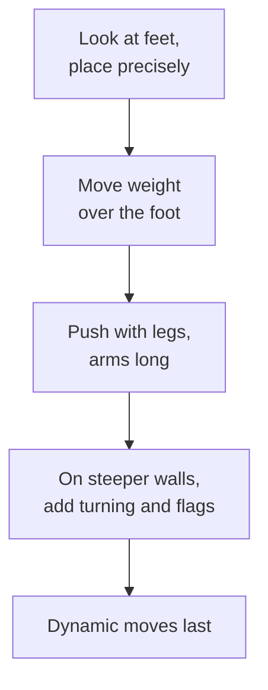

> 🌏 [中文版](/posts/climbing/2026-10-18-climbing-movement-overview)

Three months into gym climbing, you may find yourself stuck at the same grade. The person next to you floats up the same holds while your forearms are already blown. The first instinct is usually "I need to get stronger", so you start hanging on a fingerboard and doing pull-ups.

This post opens the Climbing Movement series. It is written for people who have climbed in a Taiwanese gym for 1–12 months, can top-rope belay, and have started to plateau. If you have not climbed yet, read the [beginner's guide to climbing](/posts/climbing/2026-10-08-climbing-beginner-guide-en) and [how to learn top-rope belaying in the gym](/posts/climbing/2026-10-17-gym-top-rope-belay-en) first. This post does not teach any single technique. It answers three questions: is your plateau about strength or movement, in what order should movement be learned, and which post should you read first.

## Plateaued? First work out whether it is strength or movement

### What the research saw

[Baláš and colleagues (2014)](https://pmc.ncbi.nlm.nih.gov/articles/PMC4327382/) had novice and intermediate climbers climb the same route with pressure insoles in their shoes while measuring oxygen uptake and heart rate. The novices pushed less force through the footholds, yet their oxygen uptake and heart rate were higher. The more weight your feet carry, the lower the physiological cost, and this held at all three wall angles.

The study had only 11 female climbers, so it is small, but it matches what coaches see. The [British Mountaineering Council (BMC) FUNdamentals coaching notes](https://services.thebmc.co.uk/media/files/Skills/FUNdamentals%20Docs/FUNdamentals%201,%202%20and%203%20-%20Guidance%20Notes.pdf) say novices commonly rely on their arms far too much, because the hands are in view and holding on feels secure. Pushing up with the bigger leg muscles is what takes the load off the arms.

### A test you can run in one evening

Lacking strength and lacking movement skill both stop you, but they look different:

- **Movement problem**: routes two grades below your limit still feel hard and your forearms pump quickly. Your feet slip, hunt for holds and make noise. The same move looks easy when someone else does it.
- **Strength problem**: easy routes feel smooth and quiet. Only one specific spot (a tiny hold, a long reach) defeats you, and you are already doing the move the way an experienced climber showed you.

**Something you can do tonight**: pick a route two grades below what you can send and climb it using the [Philly Rock Gym quiet-feet drill](https://philarockgym.com/climbing-footwork-drills). Your feet must not make a sound, and you keep your eyes on each foot until it takes weight. If you cannot do it, or your forearms still pump, movement is what you should work on first.

## How federations order movement teaching

### Germany: every reach has three phases

The German Alpine Club (DAV) article [Grundlagen der Klettertechnik](https://www.alpenverein.de/artikel/grundlagen-der-klettertechnik_fe950319-4c9c-4a04-add0-df2aacffca3c) (in German) splits every reach into three phases:

1. **Preparation**: eyes on your feet; hit the foothold precisely the first time, stepping only with a foot that carries no weight.
2. **Main phase**: the drive comes from legs and hips, not fingers and arms. Push your hip over the foot on the side of the reaching hand, straighten that leg, and reach at the end, all in one fluid movement.
3. **Stabilisation**: after the catch, reposition so your arm can relax and lengthen, rather than holding yourself in with arm strength.

A second DAV article, [Die Basics der Klettertechnik](https://www.alpenverein.de/artikel/die-basics-der-klettertechnik_c02900a6-2083-4149-90f0-c1cf281cd406) (in German), compresses it into a cue: place the foot, move your centre of gravity over it, push up, then reach. It adds that the leg muscles are far stronger and more enduring than the arms and fingers, and that this holds "up to the highest grades".

### Britain: from slab to vertical, then steep ground and dynamics

BMC FUNdamentals has three stages:

- **Stage 1**: on slabs, learn centre of gravity, weight transfer between feet, footwork and handholds. The notes call weight transfer between the feet "one of climbing's most fundamental skills".
- **Stage 2**: on vertical walls, learn a stable base, opposing forces, steep-rock techniques and straight arms.
- **Stage 3**: poorer holds, steeper ground, dynamic movement, and heel and toe hooks.

### How Taiwanese sources put it

The Taiwanese teaching material we could find follows the same order. In 2007, Huang Kuo-wei wrote a column on climbing basics for *Shanye Diaoyou* magazine ([reposted by iclimb](http://www.iclimb.com.tw/share/prose2_4.htm), in Chinese). He lists five principles: find holds with your eyes, legs are stronger than arms, balance first and then move, both close to the wall and away from it, and follow what your body feels.

Stack these sources and the order is consistent:

**Something you can do tonight**: on an easy route, pause before every new hold and say the DAV cue to yourself: "foot, weight over, push, reach". Check you have not reversed the order. DAV lists the three most tiring errors at this stage: not shifting the hip, bending the arms too early, and searching for the target hold like a windscreen wiper.

## The series map: what each of the ten posts solves

The series follows that order. Stand solidly first, then turn; learn the holds, then dynamic moves; then problem solving, resting and route reading, then a regrouping by wall angle. Crack climbing is a whole new movement vocabulary, so it comes last.

| Post | Topic | The question it answers |
|---|---|---|
| 0 | Overview (this post) | Plateaued: is it strength or movement? |
| 1 | [Footwork](/posts/climbing/2026-10-18-climbing-footwork-en) | How do your feet carry weight so your hands don't have to grip so hard? |
| 2 | [Balance and the three-points rule](/posts/climbing/2026-10-18-climbing-balance-en) | When should you keep the rule and when should you drop it? |
| 3 | [Turning and twisting](/posts/climbing/2026-10-18-climbing-turning-twisting-en) | Why does turning sideways make the same hold easier? |
| 4 | [Hold types and grips](/posts/climbing/2026-10-18-climbing-holds-grips-en) | How do you grip each hold, and which grip is hard on your fingers? |
| 5 | [Dynamic moves](/posts/climbing/2026-10-18-climbing-dynamic-moves-en) | When should you move dynamically, and how do you practise without getting hurt? |
| 6 | [Bouldering problem solving](/posts/climbing/2026-10-18-bouldering-problem-solving-en) | Stuck on one move: what should you change on the next attempt? |
| 7 | [Resting, route reading and setting your own problems](/posts/climbing/2026-10-18-resting-route-reading-en) | Which kinds of route reading and resting actually help? |
| 8 | [Wall angles](/posts/climbing/2026-10-18-climbing-wall-angles-en) | How does body position differ on slab, vertical, overhang and roof? |
| 9 | [Crack climbing technique](/posts/climbing/2026-10-18-crack-climbing-technique-en) | From the gym to Long Dong: how do hands and feet go into a crack? |

Each post deals with one or two pieces of common advice. "Climb with your feet, not your arms", for example, roughly holds on vertical walls and needs rewriting on overhangs; posts 1 and 8 cover it. "Three points of contact" is a beginner practice rule, not a law of movement; post 2 explains where it came from and when to let it go.

This series does not cover fingerboards, conditioning or injury care. Those will be separate series later.

## Self-check: which post to read first

Find the situation you hit most often. If several match, start with the lowest number.

| What happens on the wall | Read first |
|---|---|
| Feet slip, land with a thud, or need several adjustments before they feel solid | [Post 1, Footwork](/posts/climbing/2026-10-18-climbing-footwork-en) |
| Even easy routes pump your forearms and you grip everything hard | [Post 1, Footwork](/posts/climbing/2026-10-18-climbing-footwork-en), then [post 2](/posts/climbing/2026-10-18-climbing-balance-en) |
| Reaching for the next hold makes you wobble or tip backwards | [Post 2, Balance](/posts/climbing/2026-10-18-climbing-balance-en) |
| With all holds on one side, letting go swings you open like a door | [Post 3, Turning and twisting](/posts/climbing/2026-10-18-climbing-turning-twisting-en) |
| On steep sections, facing the wall square, you are always just short | [Post 3](/posts/climbing/2026-10-18-climbing-turning-twisting-en), then [post 8](/posts/climbing/2026-10-18-climbing-wall-angles-en) |
| You don't know how to hold a certain hold, or your finger joints hurt after climbing | [Post 4, Holds and grips](/posts/climbing/2026-10-18-climbing-holds-grips-en) |
| The next hold is too far to reach statically | [Post 5, Dynamic moves](/posts/climbing/2026-10-18-climbing-dynamic-moves-en) |
| A boulder problem stops you on the same move after ten tries | [Post 6, Bouldering problem solving](/posts/climbing/2026-10-18-bouldering-problem-solving-en) |
| You run out of energy halfway up long routes, or don't know where to go next | [Post 7, Resting and route reading](/posts/climbing/2026-10-18-resting-route-reading-en) |
| Slabs scare you, roofs wreck you, and a new wall angle means you can't climb | [Post 8, Wall angles](/posts/climbing/2026-10-18-climbing-wall-angles-en) |
| You are heading to Long Dong and the route description says "crack" | [Post 9, Crack technique](/posts/climbing/2026-10-18-crack-climbing-technique-en) |

**Something you can do tonight**: next time you're at the gym, ask a friend to film 30 seconds of you climbing. At home, go through the table above: count how often your feet slip, which move makes you wobble, how long you hang on bent arms. Pick the row that shows up most.

## How to use this series

### Practise one thing at a time

DAV recommends learning technique under stress-free conditions: on top rope or in the bouldering area, while you are fresh, on suitable routes, focusing on one element at a time so you are not overloaded. It also recommends video feedback.

In practice: each gym session, spend the 20-minute warm-up on one drill from one post, then climb as usual.

### Understand the concept, don't just memorise techniques

[Lattice Training's video page](http://latticetraining.com/blog/learn-100-climbing-techniques-with-just-4-movement-concepts) gives an example: foot swaps alone have at least five common methods and endless variations, too many to memorise. It argues for understanding movement concepts, such as the "direction of pull", so that many techniques fall into place. Every post in this series explains the principle before the technique.

### Terminology

A [climbing glossary on Vocus](https://vocus.cc/article/623ac982fd897800012c7c40) (in Chinese) notes that almost all climbing terms came from abroad, many have no settled Chinese name, and people just say the English word. The Chinese edition of this series therefore gives "Chinese (English)" on first mention. In this English edition we use the English terms, and where a Taiwanese term is common in gyms, we mention it so you know what you will hear at the wall.

## Practice: four scenarios

Answers are under each question. Think first, then open.

**1. You can send V3 but keep failing on V4. You cruise V1s, yet your forearms still pump and your feet make noise when you place them.**

Answer

This looks like a movement problem, not strength. If V1s pump you and your feet are noisy, you are holding yourself on with your arms even on easy ground. That matches what Baláš 2014 saw: novices put less force through the footholds and used more oxygen. Read post 1 on footwork and practise quiet feet in your warm-up.

**2. A friend tells you to buy a fingerboard and hang on it every day. You have been climbing for four months.**

Answer

Run this post's quiet-feet test before deciding. If routes two grades below your limit still pump your forearms, you are using your arms to make up for movement, so start with the post the self-check table points you to. Finger training is outside this series and will be covered separately.

**3. On a vertical route the next hold is up and to the right. You reach with your right hand while your feet stay where they are, and you swing to the left.**

Answer

The order is reversed. Follow the DAV cue: place your foot, move your weight over the right foot, straighten the right leg to push up, and only then reach with the right hand. Placing the foot is post 1 and shifting your weight is post 2.

**4. You are starting the series with three problems: your feet slip, you swing open when the holds are all on one side, and you run out of energy halfway up long routes.**

Answer

When several rows match, start with the lowest number: post 1 on footwork, then post 3 on turning, then post 7 on resting and route reading. If your feet aren't solid, turning and resting are hard to pull off.

## Next

Start with [post 1: Footwork](/posts/climbing/2026-10-18-climbing-footwork-en). It covers how to watch your feet onto holds, how to make them quiet, which part of the shoe to use on which kind of hold, and when your feet should pull rather than push.

For the bigger picture of outdoor climbing, read the [overview of sport and trad climbing](/posts/climbing/2026-10-17-sport-vs-trad-overview-en).

## References

- [Baláš J, et al. The Effect of Climbing Ability and Slope Inclination on Vertical Foot Loading Using a Novel Force Sensor Instrumentation System (Journal of Human Kinetics, 2014)](https://pmc.ncbi.nlm.nih.gov/articles/PMC4327382/)
- [FUNdamentals of Climbing 1, 2 and 3 Guidance Notes (British Mountaineering Council, 2014)](https://services.thebmc.co.uk/media/files/Skills/FUNdamentals%20Docs/FUNdamentals%201,%202%20and%203%20-%20Guidance%20Notes.pdf)
- [Grundlagen der Klettertechnik (Deutscher Alpenverein, in German)](https://www.alpenverein.de/artikel/grundlagen-der-klettertechnik_fe950319-4c9c-4a04-add0-df2aacffca3c)
- [Die Basics der Klettertechnik (Deutscher Alpenverein, in German)](https://www.alpenverein.de/artikel/die-basics-der-klettertechnik_c02900a6-2083-4149-90f0-c1cf281cd406)
- [Four Awesome Climbing Footwork Drills (Philly Rock Gym)](https://philarockgym.com/climbing-footwork-drills)
- [Learn 100+ Climbing Techniques With Just 4 Movement Concepts (Lattice Training, 2024)](http://latticetraining.com/blog/learn-100-climbing-techniques-with-just-4-movement-concepts)
- [Huang Kuo-wei: Climbing basics (1), principles and holds (Shanye Diaoyou magazine, 2007, no. 17; reposted by iclimb, in Chinese)](http://www.iclimb.com.tw/share/prose2_4.htm)
- [Climbing terms and glossary (Vocus, 2022, in Chinese)](https://vocus.cc/article/623ac982fd897800012c7c40)
- [Beginner's guide to climbing](/posts/climbing/2026-10-08-climbing-beginner-guide-en)
- [How to learn top-rope belaying in the gym](/posts/climbing/2026-10-17-gym-top-rope-belay-en)
