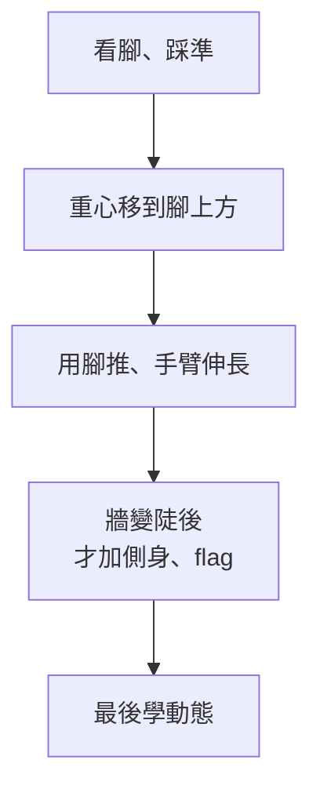

> 🌏 [English version](/posts/climbing/2026-10-18-climbing-movement-overview-en)

在岩館爬了三個月，你可能卡在同一個級數。看著隔壁的人用同一組點輕鬆上去，你的前臂卻已經爆了。第一個念頭通常是「我要練力氣」，去吊指力板、做引體向上。

這篇是「攀岩動作技術」系列的入口，寫給在台灣岩館爬了 1–12 個月、會上攀確保、開始卡關的人。還沒爬過的話，先讀[攀岩入門](/posts/climbing/2026-10-08-climbing-beginner-guide)和[岩館上攀確保怎麼學](/posts/climbing/2026-10-17-gym-top-rope-belay)。這篇不教任何單一技巧，只回答三件事：卡關缺的是力量還是動作、動作要照什麼順序學、你現在該先讀哪一篇。

## 卡關了，先分辨是力量還是動作

### 研究看到的差別

[Baláš 等人 2014 年的研究](https://pmc.ncbi.nlm.nih.gov/articles/PMC4327382/)讓新手和中級攀岩者爬同一條線，在攀岩鞋裡放壓力鞋墊，同時量耗氧和心率。結果是：新手踩在腳點上的力比較小，耗氧和心率卻比較高。腳踩得越實，身體付出的代價越低，三種牆角度都一樣。

研究對象只有 11 位女性攀岩者，樣本很小，但它和教練的觀察一致。[英國登山協會（BMC）的 FUNdamentals 教練講義](https://services.thebmc.co.uk/media/files/Skills/FUNdamentals%20Docs/FUNdamentals%201,%202%20and%203%20-%20Guidance%20Notes.pdf)寫：新手通常太依賴手臂，因為手就在視線裡，抓著有安全感。改用腿部的大肌群往上推，手臂的負擔才會降下來。

### 一個晚上就能做的分辨

力量和動作都會讓你爬不上去，但症狀不一樣：

- **動作問題**：比你極限低兩級的線也爬得很累，前臂一下就脹；腳常在牆上滑、找點、發出聲音；同一個動作換個人做就很輕鬆。
- **力量問題**：簡單的線爬得很順、很安靜。只有某個特定的點（很小的點、很遠的距離）怎麼樣都撐不住，而且你已經照有經驗的人示範的動作做了。

**今晚就能做的動作**：挑一條比你能完攀的級數低兩級的線，用[費城攀岩館（Philly Rock Gym）的安靜腳練習](https://philarockgym.com/climbing-footwork-drills)爬一次。規則是腳踩上去不能發出聲音，眼睛盯著腳，直到那隻腳開始承重才移開視線。做不到，或爬完前臂一樣很脹，你該先補的是動作。

## 協會怎麼排動作的教學順序

### 德國：每一次伸手分三段

[德國阿爾卑斯協會（DAV）的〈攀岩技術基礎〉](https://www.alpenverein.de/artikel/grundlagen-der-klettertechnik_fe950319-4c9c-4a04-add0-df2aacffca3c)把每一次往上抓點拆成三段：

1. **準備**：眼睛看腳，腳一次踩準，而且只用沒承重的那隻腳去踩。
2. **主動作**：力量從腿和髖部來，不是從手指和手臂。先把髖部推到抓點那一側的腳上方，伸直那條腿，最後才伸手，整個過程要連成一個動作。
3. **穩定**：抓到點之後調整身體位置，讓手臂放鬆伸長，不靠手臂硬撐。

DAV 的另一篇[〈攀岩技術入門〉](https://www.alpenverein.de/artikel/die-basics-der-klettertechnik_c02900a6-2083-4149-90f0-c1cf281cd406)把它濃縮成一句口訣：放腳、重心移過去、往上推、再抓下一個點。它也說，腿的肌群比手臂和手指強壯、耐久得多，這一點「到最高的難度都成立」。

### 英國：從 slab 到垂直，再到前傾和動態

BMC 的 FUNdamentals 課程分三階：

- **第一階**：在 slab 上練重心、腳與腳之間的重心轉移、腳法和手點。講義說腳之間的重心轉移是「攀岩最基本的技能之一」。
- **第二階**：到垂直牆，練穩定的支撐、反向施力、前傾的技巧和直臂。
- **第三階**：更差的點、更陡的牆、動態動作，以及勾腳。

### 台灣的寫法

台灣找得到的書面教學和協會的順序一樣。黃國維 2007 年在《山野釣遊》雜誌寫過一篇攀岩基礎專欄（[iclimb 轉載](http://www.iclimb.com.tw/share/prose2_4.htm)）。他列了五條原則：用眼睛找岩點、用腳比手有力、先平衡後移動、貼壁離壁都要、順從身體感受。

把這幾份來源疊起來，順序是一致的：

**今晚就能做的動作**：在一條簡單的線上，每抓一個新的點之前停一下，默念 DAV 的口訣「放腳、移重心、推、抓」，確認順序沒有顛倒。DAV 列出這個階段最耗力的三個錯誤：髖部沒移過去、太早彎手臂、手像雨刷一樣在牆上摸找目標點。

## 系列地圖：十篇各解決什麼問題

系列照上面的順序排。先站穩，再轉身；先學手點，再學動態；接著解題、休息與讀線，再依牆角度重組；裂隙是全新的動作語彙，放在最後。

| 篇 | 主題 | 這篇回答的問題 |
|---|---|---|
| 0 | 總覽（本篇） | 卡關了，是力量不夠還是動作不對？ |
| 1 | [腳法](/posts/climbing/2026-10-18-climbing-footwork) | 怎麼讓腳穩穩承重，手不用一直抓死？ |
| 2 | [重心、平衡與「三點不動」](/posts/climbing/2026-10-18-climbing-balance) | 什麼時候該守這條規則，什麼時候該放掉？ |
| 3 | [側身與擰身](/posts/climbing/2026-10-18-climbing-turning-twisting) | 為什麼側過身，同一個點就變好抓？ |
| 4 | [手點種類與握法](/posts/climbing/2026-10-18-climbing-holds-grips) | 每種點怎麼握，哪種握法傷手指？ |
| 5 | [動態](/posts/climbing/2026-10-18-climbing-dynamic-moves) | 什麼時候該用彈的，怎麼練才不受傷？ |
| 6 | [抱石解題](/posts/climbing/2026-10-18-bouldering-problem-solving) | 卡在一個動作，下一次嘗試該改什麼？ |
| 7 | [休息、讀線與自己定線](/posts/climbing/2026-10-18-resting-route-reading) | 看線和在牆上休息，哪些真的有用？ |
| 8 | [牆角度](/posts/climbing/2026-10-18-climbing-wall-angles) | slab、垂直、前傾、屋簷，身體擺位各差在哪？ |
| 9 | [裂隙技術](/posts/climbing/2026-10-18-crack-climbing-technique) | 從岩館到龍洞，手和腳要怎麼塞進裂隙？ |

每篇都會處理一兩個常聽到的口訣。例如「用腳爬，不要用手」在垂直牆大致成立，到前傾壁就要改寫，這在第 1 篇和第 8 篇講。「三點不動一點動」是入門的練習規則，不是動作定律，第 2 篇講它從哪來、什麼時候該放掉。

這個系列不談指力板、體能訓練和傷害處置，那些會是之後另外的系列。

## 自我診斷：你該先讀哪一篇

照你最常遇到的狀況找。符合好幾條，從編號小的開始讀。

| 你在牆上的狀況 | 先讀 |
|---|---|
| 腳常滑掉、踩點時會「咚」一聲、腳要調好幾次才站穩 | [第 1 篇 腳法](/posts/climbing/2026-10-18-climbing-footwork) |
| 簡單的線也爬得前臂很脹，手一直抓很緊 | [第 1 篇 腳法](/posts/climbing/2026-10-18-climbing-footwork)，接著[第 2 篇](/posts/climbing/2026-10-18-climbing-balance) |
| 伸手去抓下一個點時，整個人會晃、會往後倒 | [第 2 篇 重心與平衡](/posts/climbing/2026-10-18-climbing-balance) |
| 點都在同一側，一放手身體就像門一樣甩開 | [第 3 篇 側身與擰身](/posts/climbing/2026-10-18-climbing-turning-twisting) |
| 前傾段正面爬總是差一點搆不到 | [第 3 篇](/posts/climbing/2026-10-18-climbing-turning-twisting)，再讀[第 8 篇](/posts/climbing/2026-10-18-climbing-wall-angles) |
| 不知道某種點怎麼抓，或爬完手指關節會痛 | [第 4 篇 手點與握法](/posts/climbing/2026-10-18-climbing-holds-grips) |
| 下一個點太遠，靜態怎麼樣都搆不到 | [第 5 篇 動態](/posts/climbing/2026-10-18-climbing-dynamic-moves) |
| 抱石題目卡在同一步，試了十次還是一樣 | [第 6 篇 抱石解題](/posts/climbing/2026-10-18-bouldering-problem-solving) |
| 繩攀長線爬到一半就沒力，或在牆上不知道下一步去哪 | [第 7 篇 休息與讀線](/posts/climbing/2026-10-18-resting-route-reading) |
| slab 很怕、屋簷很累，換個牆角度就不會爬 | [第 8 篇 牆角度](/posts/climbing/2026-10-18-climbing-wall-angles) |
| 準備去龍洞，路線描述寫著「裂隙」 | [第 9 篇 裂隙技術](/posts/climbing/2026-10-18-crack-climbing-technique) |

**今晚就能做的動作**：下次去岩館請朋友幫你錄一段 30 秒的攀爬影片。回家對著上面的表，數一數腳滑了幾次、哪一步在晃、手臂彎著撐了多久，挑出最常出現的那一條。

## 怎麼用這個系列

### 一次只練一件事

DAV 建議技術要在沒有壓力的條件下學：在上攀或抱石區、還沒累的時候、在合適的路線上練，一次只專注一個元素，不然會顧此失彼。它也建議錄影回看。

實際做法是：每次去岩館，熱身的那 20 分鐘只練一篇文章裡的一個練習，之後再照平常爬。

### 理解原理，不要只背招式

[Lattice Training 的影片介紹](http://latticetraining.com/blog/learn-100-climbing-techniques-with-just-4-movement-concepts)舉了一個例子：光是換腳，常見的做法就至少有五種，還有無數變化，背不完。它主張先理解動作的概念，例如「點的受力方向」，很多技巧就會自然出現。這個系列每篇都會先講原理，再講技巧。

### 術語

[方格子上的攀岩術語介紹](https://vocus.cc/article/623ac982fd897800012c7c40)說，攀岩術語幾乎都是從國外傳回來的，很多沒有固定的中文名稱，大家都直接講原文。所以這個系列第一次提到一個術語時寫「中文（English）」，之後兩種都會用。找不到台灣用例的中文說法，會標明是「本文譯名」，你在岩館不一定會聽到。

## 練習題：四個情境

答案在每題下方，先自己想再看。

**1. 你能完攀 V3，但最近 V4 都過不了。你的 V1 爬起來很快，但前臂還是會脹，腳踩上去常常有聲音。**

答案

這比較像動作問題，不是力量。V1 都會讓前臂脹、腳有聲音，表示你在簡單的線上也靠手臂撐。Baláš 2014 看到新手踩在腳點上的力比較小、耗氧比較高，就是這種狀況。先讀第 1 篇腳法，熱身時練安靜腳。

**2. 朋友建議你買指力板，每天吊。你爬了四個月。**

答案

先做本篇的安靜腳測試再決定。低兩級的線也爬得前臂很脹，表示你在用手臂補動作的不足，先從自我診斷表找到該讀的那一篇。指力訓練不在這個系列的範圍，之後會另外寫。

**3. 你在一條垂直的線上，下一個點在右上方。你先伸出右手，腳還踩在原地，結果整個人往左晃。**

答案

順序顛倒了。照 DAV 的口訣：先放腳、把重心移到右腳上方、伸直右腿往上推，最後才伸右手。這是第 1 篇（放腳）和第 2 篇（移重心）的內容。

**4. 你要開始讀這個系列，但同時有三個問題：腳常滑、點都在同一側時身體會甩開、長線爬到一半沒力。**

答案

符合好幾條就從編號小的讀：先讀第 1 篇腳法，再讀第 3 篇側身，最後讀第 7 篇休息與讀線。腳站不穩，後面的側身和休息都很難做出來。

## 下一步

從[第 1 篇：腳法](/posts/climbing/2026-10-18-climbing-footwork)開始。它教你怎麼看著腳踩、怎麼讓腳安靜、鞋子的哪個部位踩哪種點，以及什麼時候該讓腳去「拉」而不是「推」。

想先看戶外攀岩的全貌，可以讀[運動攀登與傳統攀登總覽](/posts/climbing/2026-10-17-sport-vs-trad-overview)。

## 參考資料

- [Baláš J, et al. The Effect of Climbing Ability and Slope Inclination on Vertical Foot Loading Using a Novel Force Sensor Instrumentation System（Journal of Human Kinetics，2014）](https://pmc.ncbi.nlm.nih.gov/articles/PMC4327382/)
- [FUNdamentals of Climbing 1, 2 and 3 Guidance Notes（British Mountaineering Council，2014）](https://services.thebmc.co.uk/media/files/Skills/FUNdamentals%20Docs/FUNdamentals%201,%202%20and%203%20-%20Guidance%20Notes.pdf)
- [Grundlagen der Klettertechnik（Deutscher Alpenverein）](https://www.alpenverein.de/artikel/grundlagen-der-klettertechnik_fe950319-4c9c-4a04-add0-df2aacffca3c)
- [Die Basics der Klettertechnik（Deutscher Alpenverein）](https://www.alpenverein.de/artikel/die-basics-der-klettertechnik_c02900a6-2083-4149-90f0-c1cf281cd406)
- [Four Awesome Climbing Footwork Drills（Philly Rock Gym）](https://philarockgym.com/climbing-footwork-drills)
- [Learn 100+ Climbing Techniques With Just 4 Movement Concepts（Lattice Training，2024）](http://latticetraining.com/blog/learn-100-climbing-techniques-with-just-4-movement-concepts)
- [黃國維：攀岩基礎技巧（一）原則、岩點（山野釣遊雜誌 2007 第 17 期，iclimb 轉載）](http://www.iclimb.com.tw/share/prose2_4.htm)
- [攀岩術語介紹（方格子，2022）](https://vocus.cc/article/623ac982fd897800012c7c40)
- [攀岩入門](/posts/climbing/2026-10-08-climbing-beginner-guide)
- [岩館上攀確保怎麼學](/posts/climbing/2026-10-17-gym-top-rope-belay)
