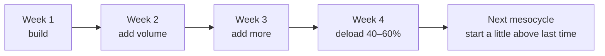

> 🌏 [中文版](/posts/climbing/2026-10-18-climbing-periodization)

After the last few posts you have a pile of tools: [the hangboard](/posts/climbing/2026-10-18-hangboard-training-en), [pull-ups and the campus board](/posts/climbing/2026-10-18-climbing-strength-power-en), [ARC and 4×4s](/posts/climbing/2026-10-18-climbing-endurance-training-en). The problem is you only go to the gym three times a week, two hours each time. Train everything and nothing gets done properly; train one thing and you worry the rest will slip.

Periodization is the answer to that. [Steve Bechtel, in a TrainingBeta interview](https://trainingbeta.com/steve-bechtel-on-periodization), puts it plainly: periodization is simply the organisation of your training. This post starts with how to lay out a week of three sessions, then how to group 3–4 weeks into a mesocycle, and only then the yearly structure and where the coaches argue.

If you're still deciding whether to train at all, read [Training Diagnosis](/posts/climbing/2026-10-18-climbing-training-diagnosis-en) first; this post assumes you've decided to.

## Start with one week: three sessions

### "Just climb more" stops working at some point

Taiwanese gym course pages often describe exactly this. [Camp4's periodized training course](https://www.adventuretaiwan.com/product/rock-climbing-fitness-training/) (in Chinese) opens with: you climb three times a week and you've been stuck at 5.10+ for ages. [The Anderson brothers' Rock Prodigy clinic slides](https://rockclimberstrainingmanual.com/wp-content/uploads/2013/12/rp-intro-clinic-slides_19-aug-15.pdf) likewise say training solves the plateau that comes from "just climbing".

But just climbing is very useful early on. [Lattice's beginner training guide](https://latticetraining.com/blog/the-beginners-guide) says that if you can only get to the gym twice a week, most of that time should be spent climbing. So what follows is for people who have been climbing a while and are confident fitness is the bottleneck.

### Three rules

**Rule 1: within a session, do the strongest, hardest work first and the low-intensity work last.**

[Eva López's post on periodizing ARC](http://en-eva-lopez.blogspot.com/2015/03/aerobic-endurance-training-in-sport.html) gives the order: maximum strength → bouldering → high-intensity endurance → low-intensity endurance (ARC). [Part III of her fingerboard guide](https://en-eva-lopez.blogspot.com/2018/07/fingerboard-training-guide-iii-periodization-samples-of-maxhangs-training-programs-.html) also says MaxHangs should always be the first thing in a session.

**Rule 2: leave 48–72 hours between finger-heavy sessions.**

López says 48–72 hours between hangboard sessions is "compulsory". [Climbing.com on 4×4s](https://www.climbing.com/skills/learn-to-train-increase-your-power-endurance/) gives the same 48–72 hours for power-endurance work.

**Rule 3: when you add something new, take something else out.**

One of the four questions [Hooper's Beta](https://hoopersbeta.com/library/throw-your-hangboard-in-the-trash-if-you-dont-know-this-save-a-friend) asks before you start hangboarding is "Do you know how to integrate more training load into your routine?" It calls the most common mistake starting a hangboard protocol and carrying on with your normal climbing and training as if nothing had changed. Its reasoning: workload beyond what you can recover from builds into chronic fatigue and, in the end, some tissue fails, often in the fingers or shoulders.

**Evidence level: coaching consensus.** The 48–72 hours and the hard-first order are coaches' recommendations, not results from studies comparing different spacings.

### A sample week

[HANCHOR's article on climbing training frequency](https://tw.hanchor.com/pages/climb14) (in Chinese) suggests at least one day between sessions, for example Monday, Wednesday, Friday, and a different focus each day: one strength day (hangboard or campus board), one technique day, one endurance day. It's a commercial coaching article with no research cited, but it agrees with the three rules above.

Put together, three sessions a week can look like this:

| Day | Focus | Order within the session |
|---|---|---|
| Monday | Intensity | Warm-up → hangboard (only if you meet the starting criteria in [the hangboard post](/posts/climbing/2026-10-18-hangboard-training-en)) or limit bouldering → pull-ups |
| Wednesday | Technique | Warm-up → new problems, wall angles or styles you avoid → 10 minutes of ARC |
| Friday | Endurance | Warm-up → 4×4s or 1 on 1 off → antagonists and core |

This sample combines the sources above; it is not anyone's original program. Three things matter: at least a day between the intensity day and the endurance day; each session runs from high to low intensity; antagonist work goes last. Lattice likewise suggests squeezing strength work like press-ups and pull-ups onto the end of your climbing sessions, once the skill work is done. For antagonist training, see [Antagonists, Core and General Strength](/posts/climbing/2026-10-18-climbing-antagonist-core-en).

**Something you can do tonight**: Open your calendar, put in next week's three gym days, and give each day one focus. If a day won't take a focus, call it a climb-for-fun day. That's fine too.

## Then one month: mesocycles and deload weeks

### Blocks of 3–4 weeks, with a lighter final week

Once a week is planned, the next level up is a block of weeks. [Lattice's article on deload weeks](https://latticetraining.com/blog/do_climbers_need_deload_weeks) says its training blocks are mostly 3–4 week mesocycles, each ending in a deload week, commonly at a 2:1 or 3:1 train-to-rest ratio.

Lattice gives two reasons for deloading: you go into the next block fresh and motivated, and it's during recovery that the body actually adapts to the training.

### A deload is not a week off

Many people think deloading means not climbing for a week. Lattice says no: aim to cut overall training load by 40–60%. Ways to do it:

- **Climbing volume**: one fewer session, or less climbing per session.
- **Climbing intensity**: instead of max-effort projecting, climb at your flash grade and work on one movement detail.
- **Strength-training volume and load**: fewer sets, or lighter weights.

It adds two warnings: don't raise the volume just because the intensity is lower, and don't add new exercises during a deload or stay up late and eat badly, since those also slow recovery.

### When you don't need a deload

Lattice lists a few cases. One matters most to readers of this series: **you're completely new to structured training**. You'll be layering in structure gradually with low overall load, so you may not need a deload. The others are rehab phases, maintenance phases during exams or busy work periods, and long climbing trips or competition seasons.

### Adding volume week by week

López keeps intensity fixed and progresses sets or time. Her ARC example:

- Week 1: 3 sets × 5 minutes, 2 minutes' rest between sets
- Week 2: 4 sets
- Week 3: 5 sets
- Week 4: recovery, 2–3 sets

The hangboard follows the same logic: López suggests picking one method, adding sets week by week over 4–8 weeks, then taking 1–2 weeks off the hangboard before the next round.

**Evidence level: coaching consensus.** Lattice's and López's deload advice comes from coaching experience and general training principles.

**Something you can do tonight**: Draw a four-column table. In weeks 1–3, write how many minutes or sets your endurance session will be; in week 4, write half. Be conservative the first time; a plan you can write down beats a big one.

## Then a year: linear, nonlinear, pendulum

At this level the coaches start to disagree. What they share: **everyone agrees training should be planned and recovery built in**. The split is whether to focus on one quality at a time or train them all together.

| Model | Associated with | In one line |
|---|---|---|
| Linear (sequential, block) | Anderson brothers (Rock Prodigy) | Focus on one quality at a time, in sequence: base → strength → power → power endurance → performance → rest |
| Nonlinear (pendulum) | Steve Bechtel (Climb Strong) | Keep every quality going all year, taking turns as the main focus |
| 3–4 week mesocycles | Lattice | Plan in mesocycles, each ending in a deload |

[Lian Jian Kang's introduction to periodization](https://l-kk.tw/periodization/) (in Chinese) summarises three common models from general strength and conditioning:

- **Parallel**: all training goals in each session or week.
- **Sequential**: also called block; emphasise specific goals in a given period.
- **Emphasis**: also called pendulum; train several at once and rotate the emphasis periodically.

It also points out that periodization is not the same as programming: the first is the overall strategy, the second is what you do each day.

Linear vs nonlinear: each side's reasoning

**The Andersons' linear periodization.** The Rock Prodigy slides split a season into relatively distinct phases:

- Base fitness: mainly ARC, also an ideal time for skill work.
- Strength: hangboard and whole-body strength.
- Power: limit bouldering and the campus board.
- Power endurance: linked bouldering circuits, route intervals.
- Performance: go climb your goal routes.
- Rest: rest weeks between seasons.

Their [conference presentation](https://rockclimberstrainingmanual.com/wp-content/uploads/2015/10/apcst-presentation.pdf) describes a 12-week training cycle plus about a 6-week performance period. An online survey in the presentation reports users' self-reported redpoint grade rising by about 1.4 YDS grades on average after one cycle. It was voluntary and had no control group, so treat it as a pointer only.

**Bechtel's critique and nonlinear approach.** In the TrainingBeta interview, Bechtel says the problem with linear models is detraining: train strength for a month, switch to bouldering, then to routes, and by two months later the strength you built first is starting to drop. He argues climbing isn't like the marathon, one movement repeated until tired; a single route can need sustained endurance, a power-endurance section and a final powerful move, so for most of the year every quality needs attention.

His image is a four-burner stove: one burner on full boil, the other three simmering and stirred now and then. In any given period, one quality is the main focus and the others are maintained.

**How to choose.** No controlled trial in climbing has compared linear and nonlinear periodization. The Lian Jian Kang summary notes that parallel models are often used with youth and developing athletes, and pendulum models suit intermediate-to-advanced athletes with packed competition schedules. For someone training three times a week with no competition season, pick the one you can actually lay out and stick to.

**Evidence level: coaching consensus, and the coaches disagree.** People train and improve with all three; no study has ranked them.

**Something you can do tonight**: Circle this year's main goal on a calendar, such as a climbing trip abroad or a target route. Count back 8–12 weeks. That's where your first full training block starts.

## How to tell it's working: record and adjust

### Write it down, or you won't see the trend

Bechtel says in the same interview that you should assess your weaknesses before building a plan, because "we tend to drift toward our preference rather than toward our greatest need". In the Rock Prodigy survey, most users also rated "a defined training schedule" and "a framework for documenting results" as significant contributors to their improvement.

Three things per session are enough: what you did, how much, and how tired you felt (0–10).

### When you see these signs, add rest first

In her fingerboard guide López lists cases where you should stretch the gap to 72 hours:

- You're under a lot of stress, or your job is physically demanding.
- For no obvious reason you can't reach last session's load.
- Your second session of the week is regularly worse.

She adds that besides adjusting the plan, you should look at how you climb on other days and at your sleep and diet. [Hooper's Beta](https://hoopersbeta.com/library/throw-your-hangboard-in-the-trash-if-you-dont-know-this-save-a-friend) has a simpler test: if every rep felt easy, increase intensity next time; if you struggled through the last few, don't increase yet.

Fatigue that keeps building, poor sleep and a run of worse performances are signs of doing too much; the [Nutrition, RED-S and Recovery](/posts/climbing/2026-10-18-climbing-nutrition-recovery-en) post covers this in detail. If fingers or shoulders start to hurt, stop and see a doctor or physiotherapist; an injury-prevention series (in progress) will cover this separately.

**Something you can do tonight**: Start a phone note called "Training log" and add one line for today: date, focus, what you did, how tired (0–10).

## Practice: four scenarios

Answers are under each question; think first, then check.

**1. You plan hangboarding on Monday, 4×4s on Tuesday and hangboarding again on Wednesday. What's wrong?**

Answer

Three finger-heavy days in a row. López requires 48–72 hours between hangboard sessions, and Climbing.com gives the same gap for 4×4s. Switch to Monday, Wednesday, Friday with one focus each and rest days in between.

**2. In one session you want to do ARC, limit bouldering and the hangboard. In what order?**

Answer

After warming up, hangboard or limit boulder first (the most intense work, which needs the freshest fingers), and ARC last. López's general rule is intense and technically complex first, easy and low-intensity last.

**3. After three weeks of training, a friend says "deload week means not climbing at all." Right?**

Answer

Lattice calls that a common misconception. Deloading means cutting total load by 40–60%: one fewer session, climbing at flash grade, fewer sets. And if this is your first structured training and your overall load is low anyway, Lattice says you may not need a formal deload.

**4. You've read Anderson's linear periodization and Bechtel saying linear models cause detraining. Who do you believe?**

Answer

Both are experienced coaches, and no controlled trial in climbing has shown one is better. If you train three times a week with no competition season, try Lattice-style 3–4 week blocks, each with one main focus while the other qualities are maintained, log it for a few months, then decide whether to change.

## Next

Your plan is set, but there will always be days you can't get to the gym. Read [Home Training](/posts/climbing/2026-10-18-climbing-home-training-en) next: what you can do with a pull-up bar and a hangboard.

## References

- [Transcript Highlight: Steve Bechtel on Periodization (TrainingBeta, 2017)](https://trainingbeta.com/steve-bechtel-on-periodization)
- [Do Climbers Need Deload Weeks? (Lattice Training, 2026)](https://latticetraining.com/blog/do_climbers_need_deload_weeks)
- [The Beginner Climber's Training Guide (Lattice Training)](https://latticetraining.com/blog/the-beginners-guide)
- [Fingerboard training guide (III): Periodization (Eva López, 2018)](https://en-eva-lopez.blogspot.com/2018/07/fingerboard-training-guide-iii-periodization-samples-of-maxhangs-training-programs-.html)
- [Periodization and Load Progression for ARC Training (Eva López)](http://en-eva-lopez.blogspot.com/2015/03/aerobic-endurance-training-in-sport.html)
- [Introduction to the Rock Prodigy Training Program (Mark Anderson, clinic slides PDF, 2015)](https://rockclimberstrainingmanual.com/wp-content/uploads/2013/12/rp-intro-clinic-slides_19-aug-15.pdf)
- [A Novel Tool and Training Methodology for Improving Finger Strength in Rock Climbers (Anderson & Anderson, APCST 2015 presentation)](https://rockclimberstrainingmanual.com/wp-content/uploads/2015/10/apcst-presentation.pdf)
- [Throw Your Hangboard in the Trash If You Don't Know This (Hooper's Beta)](https://hoopersbeta.com/library/throw-your-hangboard-in-the-trash-if-you-dont-know-this-save-a-friend)
- [Learn to Train for Rock Climbing: Increase Your Power-Endurance (Climbing.com, 2017)](https://www.climbing.com/skills/learn-to-train-increase-your-power-endurance/)
- [What is periodized training? (Lian Jian Kang, 2024) (in Chinese)](https://l-kk.tw/periodization/)
- [Climbing training frequency guide (HANCHOR) (in Chinese)](https://tw.hanchor.com/pages/climb14)
- [Periodized climbing training course (Camp4 / Adventure Taiwan) (in Chinese)](https://www.adventuretaiwan.com/product/rock-climbing-fitness-training/)
