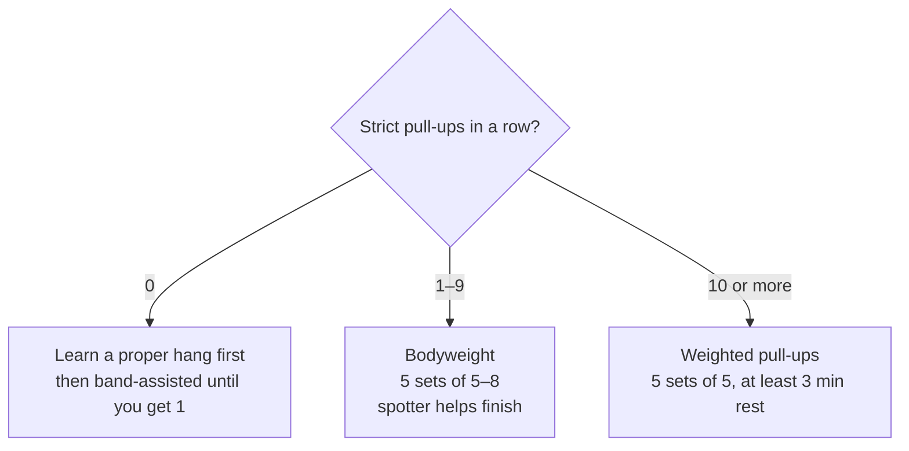

> 🌏 [中文版](/posts/climbing/2026-10-18-climbing-strength-power)

You have seen it at the gym: someone with their feet off the wall, hands slapping up a board of wooden rungs one at a time. It looks great and you want to try. Or your problem is the other kind: on steep walls you can still hold the holds, but your arms and back give out first.

This post covers upper-body strength beyond your fingers: shoulders and back, pull-ups, power, and when the campus board is your turn. Finger training itself is in [the previous post on hangboarding](/posts/climbing/2026-10-18-hangboard-training-en).

Evidence labels work as before: **Research** means controlled trials, regression studies or systematic reviews; **Coaching consensus** means advice from coaches or physical therapists with no controlled study behind it.

## Shoulders and back: the underrated half

"Climbing is all about fingers" is a common saying, and the research supports only half of it. The two camps side by side:

| Claim | Data | Who was tested |
|---|---|---|
| Fingers matter most | [Berta 2025](https://pubmed.ncbi.nlm.nih.gov/39754511/): maximal finger strength explains most of the variation in grade | 307 male and female climbers |
| Fingers matter most | [Lattice](https://latticetraining.com/blog/lattice_data_finger_strength_grades): finger strength is the single best predictor of grade | More than 6,000 climbers tested |
| Shoulders matter most | [MacKenzie 2020](https://pubmed.ncbi.nlm.nih.gov/31094249/): shoulder power and endurance are the main determinants; finger and grip strength come second | 77 male and female climbers, lower grade to elite |
| Pulling matters most | [National Taiwan University master's thesis, 2025](https://tdr.lib.ntu.edu.tw/bitstream/123456789/98245/1/ntu-113-2.pdf) (in Chinese): of four variables, only weighted pull-up relative to body weight significantly predicted grade | 25 advanced men, average 6.6 years climbing |

Apart from Lattice's in-house data, these are all **research**, but all cross-sectional correlations: they tell you what strong climbers have, not what will make you strong. Part of the disagreement comes from what was measured. MacKenzie's shoulder tests were max pull-ups, arm-crank power and a bent-arm hang; the Taiwan thesis compared only finger grip strength and two kinds of pull-up.

For a one-year climber, the practical reading is that both fingers and shoulders can limit you, and which one gives out first varies by person. [Lattice's data](https://latticetraining.com/blog/lattice_data_finger_strength_grades) also shows pull-up scores roughly doubling from the lower grades to the top.

**Something you can do tonight**: write down two things. First, how many strict pull-ups you can do in a row (start from straight arms, chin over the bar). Second, on the problem you are stuck on, do your fingers slip first, or do your arms stop pulling first?

## Pull-ups: from zero to weighted

[Lattice's beginner guide](https://latticetraining.com/blog/the-beginners-guide) says pull-ups and press-ups cover most of the upper body. Done with good form they are safe and build the capacity of muscles and tendons to handle all the climbing. It suggests doing them at the end of a climbing session, after the skill work. **Coaching consensus**

Pick your stage by how many you can do now:

- **Zero**: [kateberry](http://kateberrysblog.blogspot.com/2026/03/climbingtraining1.html) (in Chinese) suggests getting comfortable with a correct hang first, then using a resistance band until you can do one. **Coaching consensus**
- **Under 10**: [Eric Hörst](https://trainingforclimbing.com/hypergravity-pull-up-training-for-increased-strength-power-and-endurance) says weighted training is not appropriate until you can do at least 10 strict pull-ups in a row. Do bodyweight sets instead: 5 sets of 5–8, with a spotter helping you through the last reps. **Coaching consensus**
- **10 or more**: Hörst's "5 × 5" weighted pull-ups, 5 sets of 5 with at least 3 minutes' rest. Choose a weight that brings you close to failure on the last rep of the final two sets.

Both of Hörst's versions run three times a week for ten weeks. **Coaching consensus**

[Tom Randall in Climbing.com](https://www.climbing.com/skills/training/why-climbers-are-doing-pull-ups-wrong/) names the usual reason people stall: a year of the same pull-up, sets of 8–12, intensity never changing. He suggests rotating in wide-grip pull-ups, offset pull-ups with one hand lower than the other, and pulls with your feet on a box and your body leaning back to mimic steep terrain. For maximal strength, load it so you can manage only 3–5 reps. **Coaching consensus**

On the research side, [Langer 2023, a systematic review](https://pubmed.ncbi.nlm.nih.gov/36820707/), found positive effects of strength training on every climbing-related measure. The trend favoured mixing maximal-strength work with hypertrophy or endurance work, and choosing semi-specific exercises. **Research**

### How much is enough

[Using its own weighted pull-up test data](https://latticetraining.com/blog/pull-ups-dimishing-returns), Lattice proposes a "gold standard": 165% of body weight for men, 135% for women. Below it, pulling strength may be one of your limits; above it, returns diminish. **Coaching consensus**

How heavy is 165%?

For a 60 kg man, 165% is 99 kg, meaning one rep with 39 kg added. Lattice's figures come from 733 two-rep-max tests.

The standard is a ceiling, not a target to chase forever. If you are below it, pull-ups are worth training.

**Something you can do tonight**: using the number you just tested, pick one of the three stages and put it in the last 15 minutes of your next two climbing sessions this week.

## Power: how fast you bear down

Strength is how much force you can produce; power is how fast you can produce it. Climbing research often measures the latter as RFD (rate of force development): once your hand touches a hold, how fast you can ramp up force.

[Fanchini 2013](https://pubmed.ncbi.nlm.nih.gov/22505133/) compared national- and international-level boulderers with lead climbers; RFD showed the biggest gap between them, clearly higher in boulderers. In the [IRCRA sport-specific test battery](https://pubmed.ncbi.nlm.nih.gov/33652414/) (Draper 2021), the two tests most strongly correlated with grade were the finger hang and the powerslap, the latter a power test. **Research**

That is why the campus board exists.

**Something you can do tonight**: on a problem with a deadpoint (grabbing the hold at the instant your body peaks), notice whether your hand latches or slides off. If it slides, read [dynamic moves: deadpoints and dynos](/posts/climbing/2026-10-18-climbing-dynamic-moves-en) and check your timing first.

## What is a campus board?

[A 2008 blog post by tmingcheng](https://tmingcheng.wordpress.com/2008/05/21/%E4%BD%95%E8%AC%82campus-board%EF%BC%9F/) (in Chinese) was already describing it, and Taiwanese climbers have always used the English name. It is an overhanging wooden board with rows of evenly spaced rungs. "Campusing" means moving your body with your hands only, no footholds.

[A BMC article](https://services.thebmc.co.uk/should-u18s-use-campus-boards-finger-injuries) says the board was invented by the German climbers Wolfgang Güllich and Kurt Albert in the late 1980s at a gym called "Campus" in Nuremberg. Güllich used it to train double dynos on specific finger combinations for one route: Action Directe, the world's first 9a. He climbed it at 31, as a world-class climber at his peak.

It trains power and contact strength (latching a hold the instant you touch it), at the cost of large impact loads on the fingers, arms and shoulders.

**Something you can do tonight**: next time you are at the gym, find the campus board and look at the rung depth and spacing. Just look; do not get on it.

## What to reach before you campus

This is the most important section of the post. The thresholds vary widely; here they are side by side, **all coaching consensus**:

| Who | What to reach first |
|---|---|
| [Neil Gresham (Climbing.com, 2022)](https://www.climbing.com/skills/how-to-campus-board/) | Before going feet-off: at least two years of bouldering and hangboarding, and around V6/7. Otherwise campus feet-on; bouldering and hangboarding are more effective for you |
| [BMC, approved by the UIAA Medical Commission](https://thebmc.co.uk/en/campus-boards-guidance-on-use) | Feet-off or dynamic campusing only for experienced climbers who fully understand what they are doing |
| [UIAA Medical Commission advice sheet](https://theuiaa.org/documents/safety/UIAA_Medical_SportClimbing.pdf) | Only "veteran climbers": around 8–10 years of climbing |
| [Saeterbakken 2024 review](https://pubmed.ncbi.nlm.nih.gov/38240903/) | Because of the high finger loads, fingerboard and campus training should be limited in lower-graded climbers |

The thresholds are years apart and no study tells you which is right. Campus intervention studies are few. [Stien 2021](https://pubmed.ncbi.nlm.nih.gov/34267583/) is one: advanced-to-elite lead climbers improved bouldering performance and climbing-specific tests after a few weeks of campus training. **Research**. It cannot tell you what happens when a one-year climber does it.

Stacking the sources together, a one-year climber around V3–V4 can check:

1. You have been hangboarding regularly for a while with no finger trouble (Gresham wants hangboard experience first).
2. Your bouldering grade is near Gresham's V6/7, or your years of climbing are near the UIAA's range.
3. You are 18 or older.

If you cannot tick all three, campusing is not your turn yet. If you really want to try, Gresham and the BMC agree: **keep your feet on the wall**, do it at the start of the session while fresh. Gresham adds: use only a half crimp or chisel grip, never a full crimp, and first-timers go once a week.

**Something you can do tonight**: copy the three items into your phone and tick what applies. The unticked items are what you should be training now.

## No campusing for teenagers: a rare consensus

This series is full of points where the schools disagree. Teenagers and campus boards are a rare exception:

- [The BMC's campus guidance](https://thebmc.co.uk/en/campus-boards-guidance-on-use) (approved by the UIAA Medical Commission): climbers under 18 should not campus feet-off or dynamically.
- [The BMC article "Should U18s use campus boards?"](https://services.thebmc.co.uk/should-u18s-use-campus-boards-finger-injuries), by Audry Morrison and Volker Schöffl, answers simply "no". Schöffl says there is no place for the campus board, double dynos or added weight for anyone under roughly 18–20.
- UIAA Medical Commission: not for those up to around 16 or 17, whose fingers are still growing.
- Gresham: no feet-off campusing under 17; feet-on is fine with supervision.

The reason is the growth plates in the fingers. The BMC article reports Schöffl's clinical observation that most young climbers' finger injuries happen while training, not climbing, with the campus board and crimping as the main culprits. [Schöffl 2024](https://pubmed.ncbi.nlm.nih.gov/39311912/) reviews more than 200 growth-plate stress fractures of the fingers, mostly at age 13–15. **Research**

Consensus is not the same as practice. In [McMullen 2021](https://pubmed.ncbi.nlm.nih.gov/33972161/), a survey of US gym coaches with youth teams, more than 60% reported using full-weight, feet-off campus training with some of their climbers. 
**Something you can do tonight**: if your child is on a gym youth team, ask the coach directly: does anyone on the team campus, and how do you decide who can?

## Fitting it into your week

For finger training, [Saeterbakken 2024](https://pubmed.ncbi.nlm.nih.gov/38240903/) recommends low volume and high resistance: twice a week, hanging from small edges or a fingerboard. In [a TrainingBeta article](https://trainingbeta.com/steve-bechtels-new-book-on-strength-training), Steve Bechtel argues that "hard free climbing … is not an endurance activity", and his whole strength plan takes up just 25% of a climber's training time. On ordering:

- If you do pull-ups and hangboarding on the same day, kateberry does pull-ups first, then hangs. **Coaching consensus**
- Campus goes first, while you are freshest. **Coaching consensus**
- Where pull-ups go differs. Lattice puts them after climbing so they do not eat into skill work; Hörst puts his 5 × 5 in the middle of the workout, when you are warm but still fresh. **Coaching consensus**

How to lay out the whole year is in [periodization](/posts/climbing/2026-10-18-climbing-periodization-en). Training only pulling leaves the pushing muscles behind; press-ups and other antagonist work are in [antagonist, core and general strength](/posts/climbing/2026-10-18-climbing-antagonist-core-en).

**Something you can do tonight**: in next week's calendar, put pull-ups at the end of two climbing sessions with at least a day between them.

## Practice: four scenarios

Answers are under each question; think first, then open.

**1. You can do six strict pull-ups. A friend lends you a dip belt and tells you to start with 10 kg.**

Answer

Not yet. Hörst's threshold for weighted work is at least 10 in a row. Your stage is bodyweight: 5 sets of 5–8, with a spotter for the last reps.

**2. You are 22, have climbed for 14 months, boulder V4, and have not started hangboarding. Your gym has a campus board and you want to try it.**

Answer

Feet-off campusing is not your turn. Gresham wants two years of bouldering and hangboarding and around V6/7 before feet-off, and you have not hangboarded at all. If you must try, keep your feet on, do it at the start of the session, use a half crimp, and go at most once a week.

**3. Your 15-year-old brother is on a gym youth team, and the coach has the team campusing feet-off. What should you make of it?**

Answer

The BMC and UIAA both advise against feet-off or dynamic campusing under 18 (the UIAA says up to around 16 or 17), and 13–15 is exactly when growth-plate fractures peak. Ask the coach how they decide who campuses; McMullen's survey shows coaches genuinely do not agree on this. If his fingers hurt, see a doctor.

**4. Your weighted pull-up is now 170% of body weight, but you still cannot pull through on steep walls. Keep adding weight?**

Answer

Not necessarily. You are past Lattice's 165%, where returns diminish. Lattice suggests moving your time to the next limit: finger strength, flexibility, endurance or movement skill. For steep-wall movement, see [wall angles](/posts/climbing/2026-10-18-climbing-wall-angles-en).

## Next

Strength and power let you do the hard move. Getting pumped halfway up a lead route is a different problem: read [endurance and power endurance](/posts/climbing/2026-10-18-climbing-endurance-training-en) next. For shoulder and elbow injuries, see [shoulders](/posts/climbing/2026-10-18-climbing-shoulder-en) and [elbows and wrists](/posts/climbing/2026-10-18-climbing-elbow-wrist-en).

## References

- [MacKenzie R et al. Physical and Physiological Determinants of Rock Climbing. Int J Sports Physiol Perform 2020](https://pubmed.ncbi.nlm.nih.gov/31094249/)
- [Hsiao Yu-Xuan. A Multiple Regression Analysis of Upper Limb Strength Characteristics and Climbing Grades in Climbers (master's thesis, National Taiwan University, 2025) (in Chinese)](https://tdr.lib.ntu.edu.tw/bitstream/123456789/98245/1/ntu-113-2.pdf)
- [Berta P et al. Validity and normative scores of finger flexor strength and endurance tests estimated from a large sample of female and male climbers. J Sports Sci 2025](https://pubmed.ncbi.nlm.nih.gov/39754511/)
- [Finger Strength For Climbers Increases, In Relation To Grade (Lattice Training)](https://latticetraining.com/blog/lattice_data_finger_strength_grades)
- [Is pull-up training a waste of time for climbers? (Lattice Training)](https://latticetraining.com/blog/pull-ups-dimishing-returns)
- [The Beginner Climber's Training Guide (Lattice Training)](https://latticetraining.com/blog/the-beginners-guide)
- ["5 x 5" Weighted Pull-up Training for Increased Strength, Power, and Endurance (Eric Hörst)](https://trainingforclimbing.com/hypergravity-pull-up-training-for-increased-strength-power-and-endurance)
- [The One Mistake Most Climbers Make With Pull-Ups (Tom Randall, Climbing.com)](https://www.climbing.com/skills/training/why-climbers-are-doing-pull-ups-wrong/)
- [Climbing training (1): ARC and max strength (kateberry, 2026) (in Chinese)](http://kateberrysblog.blogspot.com/2026/03/climbingtraining1.html)
- [Langer K et al. Strength Training in Climbing: A Systematic Review. J Strength Cond Res 2023](https://pubmed.ncbi.nlm.nih.gov/36820707/)
- [Saeterbakken AH et al. The Connection Between Resistance Training, Climbing Performance, and Injury Prevention. Sports Med Open 2024](https://pubmed.ncbi.nlm.nih.gov/38240903/)
- [Fanchini M et al. Differences in climbing-specific strength between boulder and lead rock climbers. J Strength Cond Res 2013](https://pubmed.ncbi.nlm.nih.gov/22505133/)
- [Draper N et al. Performance Assessment for Rock Climbers: The IRCRA Sport-Specific Test Battery. Int J Sports Physiol Perform 2021](https://pubmed.ncbi.nlm.nih.gov/33652414/)
- [What is a campus board? (tmingcheng, 2008) (in Chinese)](https://tmingcheng.wordpress.com/2008/05/21/%E4%BD%95%E8%AC%82campus-board%EF%BC%9F/)
- [Everything You Need to Know About Campus Boarding (Neil Gresham, Climbing.com, 2022)](https://www.climbing.com/skills/how-to-campus-board/)
- [Campus boards: guidance on use (BMC, approved by the UIAA Medical Commission)](https://thebmc.co.uk/en/campus-boards-guidance-on-use)
- [Should U18s use campus boards? (Audry Morrison, Volker Schöffl, BMC)](https://services.thebmc.co.uk/should-u18s-use-campus-boards-finger-injuries)
- [UIAA Medical Commission: Sport Climbing (UIAA, PDF)](https://theuiaa.org/documents/safety/UIAA_Medical_SportClimbing.pdf)
- [Stien N et al. Effects of Two vs. Four Weekly Campus Board Training Sessions on Bouldering Performance and Climbing-Specific Tests in Advanced and Elite Climbers. J Sports Sci Med 2021](https://pubmed.ncbi.nlm.nih.gov/34267583/)
- [Schöffl V et al. Stress fractures of the growth plates in the fingers of adolescent rock climbers. Unfallchirurgie 2024](https://pubmed.ncbi.nlm.nih.gov/39311912/)
- [McMullen CW et al. Coaches' Attitudes Toward Campus Board Training in Adolescent Climbers in the United States. Wilderness Environ Med 2021](https://pubmed.ncbi.nlm.nih.gov/33972161/)
- [Steve Bechtel's Book on Strength Training (Steve Bechtel, TrainingBeta)](https://trainingbeta.com/steve-bechtels-new-book-on-strength-training)

## Update Log

- 2026-10-18: The Climbing Injuries and First Aid series is now published; replaced "in progress" mentions with links.
