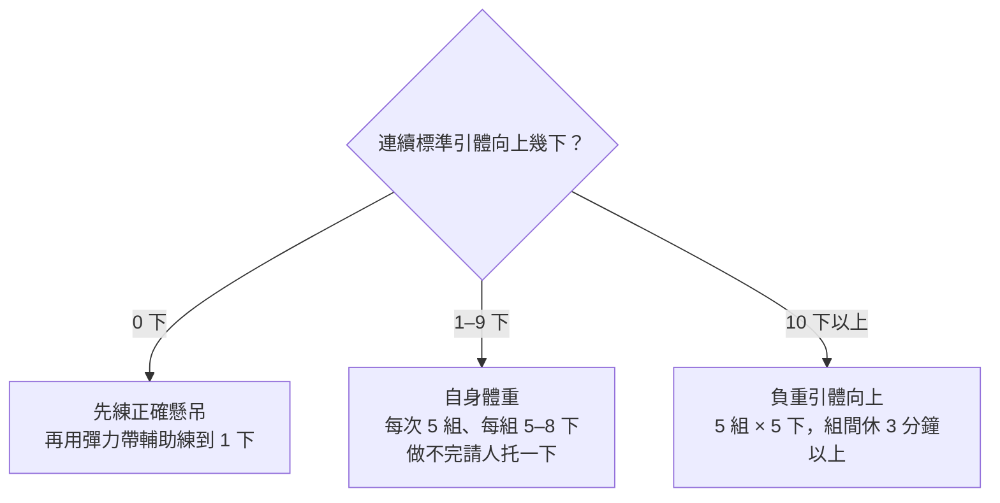

> 🌏 [English version](/posts/climbing/2026-10-18-climbing-strength-power-en)

你在岩館看過這個畫面：有人腳離開牆，只用手在一片木條板上一格一格往上跳。看起來很帥，你也想試。或者你的問題是另一種：前傾牆一拉就沒力，手指明明還抓得住，手臂和背先投降了。

這篇講手指以外的上肢力量：肩和背、引體向上、爆發力，以及那片木條板 campus board 什麼時候才輪得到你。手指本身的訓練在[上一篇〈指力板〉](/posts/climbing/2026-10-18-hangboard-training)。

證據標法和上一篇一樣：**研究**是有對照試驗、迴歸分析或系統性回顧；**教練共識**是教練或物理治療師的建議，沒有對照研究。

## 肩和背：被低估的另一半

「攀岩靠手指」是一個常見說法，研究只支持一半。兩派數據並列如下：

| 說法 | 數據 | 對象 |
|---|---|---|
| 指力最重要 | [Berta 2025](https://pubmed.ncbi.nlm.nih.gov/39754511/)：最大指力解釋大部分的等級差異 | 307 位男女攀岩者 |
| 指力最重要 | [Lattice](https://latticetraining.com/blog/lattice_data_finger_strength_grades)：指力是最能預測等級的單一指標 | 6,000 多位受測者 |
| 肩最重要 | [MacKenzie 2020](https://pubmed.ncbi.nlm.nih.gov/31094249/)：肩的爆發力與耐力是主要決定因素，指力、握力排第二 | 77 位男女攀岩者，從低階到菁英 |
| 拉力最重要 | [臺大 2025 碩士論文](https://tdr.lib.ntu.edu.tw/bitstream/123456789/98245/1/ntu-113-2.pdf)：四個變項中，只有負重引體向上與體重的比值能顯著預測等級 | 25 位進階男性，平均攀岩 6.6 年 |

除了 Lattice 的自家數據，這幾篇都是**研究**，但都是橫斷面的相關分析：它們告訴你強的人有什麼，不告訴你練了什麼就會變強。結果不同，部分原因是測的項目不同。MacKenzie 用的肩部測驗是最多引體向上次數、手搖功率和屈臂懸吊；臺大碩論只比了指握力和兩種引體向上。

對爬一年的人，實際的意思是：手指和肩背都會限制你，哪一個先卡住因人而異。[Lattice 的數據](https://latticetraining.com/blog/lattice_data_finger_strength_grades)也看到，從低等級到高等級，引體向上的成績大約翻倍。

**今晚就能做的動作**：測兩個數字並記下來。一是連續標準引體向上能做幾下（手臂完全伸直開始，下巴過槓才算）；二是你目前卡住的題目，是手指先滑掉，還是手臂先拉不動。

## 引體向上：從 0 下到負重

[Lattice 的初學者指南](https://latticetraining.com/blog/the-beginners-guide)說，引體向上（pull-up）和伏地挺身（press-up）涵蓋上半身大部分肌肉。動作做對是安全的，還能讓肌肉和肌腱更撐得住攀爬量。它建議放在攀岩結束、練完技術之後。**教練共識**

依你現在能做幾下，分三段：

- **0 下**：[kateberry](http://kateberrysblog.blogspot.com/2026/03/climbingtraining1.html) 的建議是先熟悉正確的懸吊姿勢，再用彈力帶輔助，練到能拉 1 下。**教練共識**
- **10 下以內**：[Eric Hörst](https://trainingforclimbing.com/hypergravity-pull-up-training-for-increased-strength-power-and-endurance) 說，連續做不到 10 下標準引體向上，負重訓練就不適合你。先用自身體重做 5 組、每組 5–8 下，做不完的那幾下請人從下面托一把。**教練共識**
- **10 下以上**：Hörst 的「5 × 5」負重引體向上，5 組、每組 5 下，組間至少休 3 分鐘。重量抓到最後兩組的最後一下快拉不上去。

Hörst 的兩個版本都是每週 3 次、連續做 10 週。**教練共識**

[Tom Randall 在 Climbing.com](https://www.climbing.com/skills/training/why-climbers-are-doing-pull-ups-wrong/) 點出常見的卡關原因：一年來都做同一種引體向上、每組 8–12 下，強度從來沒變。他建議輪流加入寬握、一手高一手低的不對稱引體向上，或把腳放在箱子上、身體往後傾，模擬前傾牆的拉法。要練最大力量，就把重量調到只能做 3–5 下。**教練共識**

研究上，[Langer 2023 的系統性回顧](https://pubmed.ncbi.nlm.nih.gov/36820707/)發現力量訓練對攀岩相關的各項指標都有正面效果。趨勢是把最大肌力和肌肥大或耐力訓練混著練，並選擇半專項的動作。**研究**

### 練到哪裡就夠

[Lattice 用自家的負重引體向上測驗數據](https://latticetraining.com/blog/pull-ups-dimishing-returns)提出一個「黃金標準」：男性能拉起體重的 165%，女性 135%。低於這個值，拉力可能是你的限制之一；超過之後，再加的效益就遞減。**教練共識**

165% 是多重？

以 60 公斤的男性來說，165% 是 99 公斤，也就是身上再掛 39 公斤做 1 下。Lattice 的數據來自 733 筆兩下最大重量測驗。

這個標準是一個上限，不是要一路追下去的目標。還沒到的人，引體向上值得練。

**今晚就能做的動作**：依你剛剛測到的次數，挑上面三段中的一段，排進這週下兩次攀岩的最後 15 分鐘。

## 爆發力：手碰到點，多快能抓緊

力量是你能出多大的力；爆發力（power）是你能多快出力。攀岩研究常用 RFD（rate of force development，發力率）來量後者：手一碰到點，多快能把力量拉上去。

[Fanchini 2013](https://pubmed.ncbi.nlm.nih.gov/22505133/) 比較國家到國際級的抱石者和先鋒攀登者，兩組的 RFD 差距最大，抱石者明顯較高。[IRCRA 的專項測驗組合](https://pubmed.ncbi.nlm.nih.gov/33652414/)（Draper 2021）裡，和等級相關最強的兩項是指力懸吊和 powerslap，後者是爆發力類的測驗。**研究**

這也是 campus board 存在的理由。

**今晚就能做的動作**：在一題有 deadpoint（身體到最高點那一瞬間出手抓點）的題目上，注意手碰到點的那一刻是抓住還是滑開。滑開的，先讀[動態：deadpoint 與 dyno](/posts/climbing/2026-10-18-climbing-dynamic-moves)，先檢查出手的時機。

## campus board 是什麼

[tmingcheng 2008 年的部落格文章](https://tmingcheng.wordpress.com/2008/05/21/%E4%BD%95%E8%AC%82campus-board%EF%BC%9F/)就介紹過它，台灣攀岩圈一直直接用英文稱呼。它是一片前傾的木板，上面釘著一排排等距的橫木條。「campus」指的是沒有腳點可踩、只用雙手移動身體的動作。

[BMC 的文章](https://services.thebmc.co.uk/should-u18s-use-campus-boards-finger-injuries)說，campus board 由德國攀岩者 Wolfgang Güllich 和 Kurt Albert 在 1980 年代後期，於紐倫堡一間叫「Campus」的岩館發明。Güllich 用它練特定手指組合的雙手跳躍，為的是一條路線：Action Directe，世界第一條 9a。他完攀時 31 歲，是世界頂尖、狀態巔峰的攀岩者。

它練的是爆發力和 contact strength（接點瞬間抓住的能力），代價是手指、手臂和肩承受很大的衝擊。

**今晚就能做的動作**：下次去岩館，找出 campus board 在哪裡，看一眼橫木條的深度和間距。今天只看，不上去。

## 做 campus 之前要先達到什麼

這是本篇最重要的一節。各家的門檻差很多，下面並列，**全部是教練共識**：

| 誰 | 先達到什麼 |
|---|---|
| [Neil Gresham（Climbing.com，2022）](https://www.climbing.com/skills/how-to-campus-board/) | 離腳做之前：抱石加指力板至少 2 年，抱石約 V6/7；做不到就腳踩著做，抱石和指力板對你更有效 |
| [BMC，經 UIAA 醫學委員會核可](https://thebmc.co.uk/en/campus-boards-guidance-on-use) | 離腳或動態的 campus，只限有經驗、完全了解自己在做什麼的攀岩者 |
| [UIAA 醫學委員會說明書](https://theuiaa.org/documents/safety/UIAA_Medical_SportClimbing.pdf) | 只給「老手」：攀岩約 8–10 年 |
| [Saeterbakken 2024 回顧](https://pubmed.ncbi.nlm.nih.gov/38240903/) | 手指負荷大，等級較低的攀岩者應限制指力板和 campus 訓練 |

各家門檻差了好幾年，沒有研究告訴你哪一個對。campus 的介入研究很少，[Stien 2021](https://pubmed.ncbi.nlm.nih.gov/34267583/) 是其中一篇：受試者是進階到菁英的先鋒攀登者，幾週的 campus 訓練讓抱石表現和專項測驗都進步了。**研究**。但它不能告訴你爬一年的人做會怎樣。

把各家說法疊起來，爬一年、V3–V4 的人可以先檢查這幾件事：

1. 你已經規律吊指力板一段時間，手指沒有出狀況（Gresham 要求先有指力板經驗）。
2. 你的抱石等級接近 Gresham 說的 V6/7，或攀岩年資接近 UIAA 說的範圍。
3. 你滿 18 歲。

三項沒有全部做到，現在還輪不到 campus。真的想碰，Gresham 和 BMC 的共同做法是：**腳踩在牆上做**，排在訓練一開始、精神好的時候。Gresham 另外提醒：只用 half crimp 或 chisel 握法，不要 full crimp；第一次接觸的人每週只做一次。

**今晚就能做的動作**：把上面三項抄進手機，逐項打勾。沒打勾的項目，就是你現在該練的東西。

## 青少年不做 campus：少數有共識的地方

這個系列裡，各家意見分歧的地方很多，青少年和 campus board 是少數例外：

- [BMC 的 campus 指引](https://thebmc.co.uk/en/campus-boards-guidance-on-use)（經 UIAA 醫學委員會核可）：未滿 18 歲不要做離腳或動態的 campus。
- [BMC 的專文〈Should U18s use campus boards?〉](https://services.thebmc.co.uk/should-u18s-use-campus-boards-finger-injuries)，作者是 Audry Morrison 和 Volker Schöffl，答案直接寫「不」。Schöffl 說，18 到 20 歲以下的人，campus board、雙手跳和負重都沒有位置。
- UIAA 醫學委員會：約 16、17 歲以下，手指還在生長，不做。
- Gresham：未滿 17 歲不做離腳 campus，腳踩著做要有人指導。

理由是手指的生長板。BMC 專文轉述 Schöffl 的臨床觀察：青少年的手指傷害多半發生在訓練，不是攀爬時，campus board 和 crimp 是主因。[Schöffl 2024 的回顧](https://pubmed.ncbi.nlm.nih.gov/39311912/)整理了 200 多例手指生長板疲勞性骨折，多數 13–15 歲。**研究**

共識不等於實際做法。[McMullen 2021](https://pubmed.ncbi.nlm.nih.gov/33972161/) 問卷調查美國有青少年隊的岩館教練，超過六成會讓部分隊員做離腳的 campus。
**今晚就能做的動作**：家裡有小孩參加岩館的青少年隊，直接問教練：隊上有沒有人做 campus，怎麼決定誰可以做。

## 放進一週

[Saeterbakken 2024](https://pubmed.ncbi.nlm.nih.gov/38240903/) 對手指訓練的建議是低量、高阻力：每週 2 次，在小點或指力板上吊。Steve Bechtel 在 [TrainingBeta 的文章](https://trainingbeta.com/steve-bechtels-new-book-on-strength-training)裡主張「難的自由攀登不是耐力活動」，他的整套力量計畫只占攀岩者訓練時間的 25%。順序上：

- 同一天練引體向上和指力板，kateberry 的做法是先引體向上，再吊指力板。**教練共識**
- campus 排在最前面，精神最好的時候。**教練共識**
- 引體向上放在哪裡，各家不同。Lattice 建議放在攀岩之後，不要吃掉練技術的精神；Hörst 的 5 × 5 則放在訓練中段，肌肉熱開了、還不累的時候。**教練共識**

整年怎麼排，見[週期化](/posts/climbing/2026-10-18-climbing-periodization)。只練拉會讓推的肌群落後，伏地挺身這類拮抗肌訓練見[拮抗肌、核心與一般肌力](/posts/climbing/2026-10-18-climbing-antagonist-core)。

**今晚就能做的動作**：在下週的行事曆上，把引體向上排在兩次攀岩的結尾，兩次之間至少隔一天。

## 練習題：四個情境

答案在每題下方，先自己想再看。

**1. 你能做 6 下標準引體向上，朋友借你一條負重腰帶，叫你直接掛 10 公斤練。**

答案

先不要。Hörst 的門檻是連續 10 下以上才做負重。你現在的段落是自身體重 5 組、每組 5–8 下，做不完請人托一下。

**2. 你 22 歲，爬了 14 個月，抱石 V4，指力板還沒開始吊。岩館有 campus board，你想試。**

答案

離腳的 campus 還輪不到你。Gresham 要求抱石加指力板 2 年、約 V6/7 才離腳；你連指力板都還沒吊。真的想碰，只能腳踩在牆上、排在訓練一開始、用 half crimp，每週最多一次。

**3. 15 歲的弟弟參加岩館的青少年隊，教練讓隊員做離腳 campus。你該怎麼想？**

答案

BMC 和 UIAA 都建議 18 歲以下（UIAA 寫約 16、17 歲以下）不做離腳或動態 campus，13–15 歲正是生長板骨折最多的年紀。可以直接問教練怎麼決定誰能做；McMullen 的調查顯示，教練之間對這件事確實沒有共識。手指痛就去看醫師。

**4. 你的負重引體向上已經能拉起體重的 170%，但前傾牆還是拉不上去。要繼續加重嗎？**

答案

不一定。你已經超過 Lattice 說的 165%，再加的效益遞減。Lattice 建議把時間轉到下一個限制：指力、柔軟度、耐力或動作技術。前傾牆的動作見[牆面角度](/posts/climbing/2026-10-18-climbing-wall-angles)。

## 下一步

力量和爆發力讓你做得出難的那一手；先鋒爬到一半手就爆，是另一個問題。接著讀[耐力與力量耐力](/posts/climbing/2026-10-18-climbing-endurance-training)。肩和手肘受傷怎麼辦，見[肩](/posts/climbing/2026-10-18-climbing-shoulder)與[肘與腕](/posts/climbing/2026-10-18-climbing-elbow-wrist)。

## 參考資料

- [MacKenzie R et al. Physical and Physiological Determinants of Rock Climbing. Int J Sports Physiol Perform 2020](https://pubmed.ncbi.nlm.nih.gov/31094249/)
- [蕭妤瑄。攀岩者上肢力量特徵與攀登等級之多元迴歸分析（臺大運動設施與健康管理碩士學位學程碩士論文，2025）](https://tdr.lib.ntu.edu.tw/bitstream/123456789/98245/1/ntu-113-2.pdf)
- [Berta P et al. Validity and normative scores of finger flexor strength and endurance tests estimated from a large sample of female and male climbers. J Sports Sci 2025](https://pubmed.ncbi.nlm.nih.gov/39754511/)
- [Finger Strength For Climbers Increases, In Relation To Grade（Lattice Training）](https://latticetraining.com/blog/lattice_data_finger_strength_grades)
- [Is pull-up training a waste of time for climbers?（Lattice Training）](https://latticetraining.com/blog/pull-ups-dimishing-returns)
- [The Beginner Climber's Training Guide（Lattice Training）](https://latticetraining.com/blog/the-beginners-guide)
- [「5 x 5」Weighted Pull-up Training for Increased Strength, Power, and Endurance（Eric Hörst）](https://trainingforclimbing.com/hypergravity-pull-up-training-for-increased-strength-power-and-endurance)
- [The One Mistake Most Climbers Make With Pull-Ups（Tom Randall，Climbing.com）](https://www.climbing.com/skills/training/why-climbers-are-doing-pull-ups-wrong/)
- [攀岩訓練 (1) arc、max strength 訓練內容與心得（kateberry，2026）](http://kateberrysblog.blogspot.com/2026/03/climbingtraining1.html)
- [Langer K et al. Strength Training in Climbing: A Systematic Review. J Strength Cond Res 2023](https://pubmed.ncbi.nlm.nih.gov/36820707/)
- [Saeterbakken AH et al. The Connection Between Resistance Training, Climbing Performance, and Injury Prevention. Sports Med Open 2024](https://pubmed.ncbi.nlm.nih.gov/38240903/)
- [Fanchini M et al. Differences in climbing-specific strength between boulder and lead rock climbers. J Strength Cond Res 2013](https://pubmed.ncbi.nlm.nih.gov/22505133/)
- [Draper N et al. Performance Assessment for Rock Climbers: The IRCRA Sport-Specific Test Battery. Int J Sports Physiol Perform 2021](https://pubmed.ncbi.nlm.nih.gov/33652414/)
- [何謂Campus Board？（tmingcheng，2008）](https://tmingcheng.wordpress.com/2008/05/21/%E4%BD%95%E8%AC%82campus-board%EF%BC%9F/)
- [Everything You Need to Know About Campus Boarding（Neil Gresham，Climbing.com，2022）](https://www.climbing.com/skills/how-to-campus-board/)
- [Campus boards: guidance on use（BMC，經 UIAA 醫學委員會核可）](https://thebmc.co.uk/en/campus-boards-guidance-on-use)
- [Should U18s use campus boards?（Audry Morrison、Volker Schöffl，BMC）](https://services.thebmc.co.uk/should-u18s-use-campus-boards-finger-injuries)
- [UIAA Medical Commission: Sport Climbing（UIAA，PDF）](https://theuiaa.org/documents/safety/UIAA_Medical_SportClimbing.pdf)
- [Stien N et al. Effects of Two vs. Four Weekly Campus Board Training Sessions on Bouldering Performance and Climbing-Specific Tests in Advanced and Elite Climbers. J Sports Sci Med 2021](https://pubmed.ncbi.nlm.nih.gov/34267583/)
- [Schöffl V et al. Stress fractures of the growth plates in the fingers of adolescent rock climbers. Unfallchirurgie 2024](https://pubmed.ncbi.nlm.nih.gov/39311912/)
- [McMullen CW et al. Coaches' Attitudes Toward Campus Board Training in Adolescent Climbers in the United States. Wilderness Environ Med 2021](https://pubmed.ncbi.nlm.nih.gov/33972161/)
- [Steve Bechtel's Book on Strength Training（Steve Bechtel，TrainingBeta）](https://trainingbeta.com/steve-bechtels-new-book-on-strength-training)

## 更新紀錄

- 2026-10-18：〈攀岩傷害預防與急救〉系列上線，原本「撰寫中」的地方改成實際連結。
