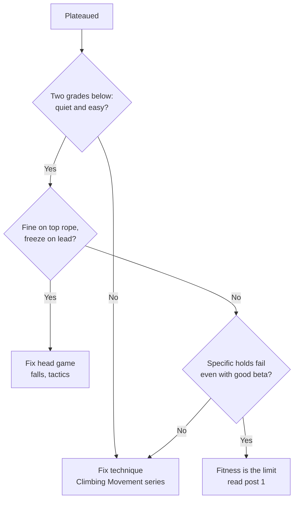

> 🌏 [中文版](/posts/climbing/2026-10-18-climbing-training-diagnosis)

You have been climbing for about a year, two or three gym sessions a week, and you have been stuck at 5.10 or V3–V4 for months. The people next to you have started hanging on hangboards and doing weighted pull-ups, and you are wondering whether it is time to start "training."

This is the entry post of the Climbing Training series. It gives no program. It answers three things: what different coaches say about technique first versus fitness first, how to tell whether you are limited by technique, head game, or fitness, and which post to read next. If you have not climbed in a gym yet, start with [the beginner's guide](/posts/climbing/2026-10-08-climbing-beginner-guide-en), [learning top-rope belaying](/posts/climbing/2026-10-17-gym-top-rope-belay-en), and [learning to lead in the gym](/posts/climbing/2026-10-17-gym-lead-climbing-en).

Every training recommendation in this series carries an evidence label: **research** means experiments or measurements support it; **coaching consensus** means it is what coaches do from experience, without controlled studies. Where schools disagree, they are listed side by side. The series does not pick one for you.

## "The best training for climbing is climbing": what each school says

British climber Ron Fawcett famously said, "The best training for climbing is climbing." Coach Neil Gresham quotes it in [his Climbing column](https://climbing.com/skills/training-value-effectiveness) and then argues that training gives but also takes away: train without climbing and you lose the adaptability and nerve you need on rock. His advice: if you struggle more with technique or your head game, spend your time on those, not on training.

The others below differ on when to add specific training:

| Who | What they tell someone about a year in | Evidence label |
|---|---|---|
| [Dave MacLeod](https://www.davemacleod.com/shop/9outof10climbers) | Most climbers are stuck on motivation, managing time, and not being able to spot their own technical and tactical errors | Coaching consensus |
| [Eva López](http://en-eva-lopez.blogspot.com/2018/05/fingerboard-training-guide-i-preliminary-evaluation.html) | More than 2 years of systematic climbing or training before hangboard dead-hangs; technical gains matter more in the early years | Coaching consensus, citing literature that tendons and ligaments adapt more slowly than muscle |
| [Eric Hörst](https://trainingforclimbing.com/training-programs/) | His beginner program (under 1 year, below 5.11 top-rope) focuses on skills and managing fear, but also includes sport-specific strength and antagonist work | Coaching consensus |
| [Lattice Training](https://latticetraining.com/blog/lattice_data_finger_strength_grades) | Finger strength is the single metric that best predicts grade; be both steely-fingered and a great technician | Test data from more than 6,000 climbers |
| [Hooper's Beta](https://hoopersbeta.com/library/throw-your-hangboard-in-the-trash-if-you-dont-know-this-save-a-friend) | Hangboarding is worth it once your technique is decent, progress has stalled, and you have established that your fingers are the main limiter | A physical therapist's clinical experience |

Research has not settled it either. [A 2023 meta-analysis by Stien and colleagues](https://pubmed.ncbi.nlm.nih.gov/36636194/) pooled randomized controlled trials and found that climbing plus specific resistance training improved climbing-specific test results more than climbing alone, but only a handful of studies qualified. [A 2024 randomized trial by Langer and colleagues](https://pubmed.ncbi.nlm.nih.gov/38976692/) had female climbers train for five weeks: off-the-wall training trended toward better climbing-specific strength, on-the-wall training toward better technique, and the authors concluded climbers can go with personal preference.

Taken together, most sources lean toward "technique first" for someone about a year in, but Hörst and Lattice do not think fitness has to wait until much later. This series does not settle that for you. What follows is how to figure out which case you are.

**Something you can do tonight**: write down the last three routes you did not finish. For each, note which move you fell on and whether it felt like "my hands couldn't hold on," "I didn't know how to do it," or "I didn't dare." If two of the three are the same, start looking there.

## What research finds about what predicts climbing grade

### Trainable factors matter more than build

[Laffaye and colleagues (2016)](https://pubmed.ncbi.nlm.nih.gov/26453999/) measured the build and strength of novice, skilled, and elite climbers. Trainable factors explained nearly half the variance in climbing ability; build (height, arm span, body fat) and muscle characteristics together explained less than 4%. For most people, "my arms are too short" is not the main reason they are stuck.

### Fingers or shoulders: the studies disagree

- **Finger strength**: [Berta and colleagues (2025)](https://pubmed.ncbi.nlm.nih.gov/39754511/) tested 307 climbers and found maximal finger strength was the strongest predictor of grade.
- **Shoulders and upper body**: [MacKenzie and colleagues (2020)](https://pubmed.ncbi.nlm.nih.gov/31094249/) found the main determinants were shoulder power and endurance, measured with maximum pull-ups, bent-arm hangs and similar tests; finger strength came in as a secondary factor.
- **Data from Taiwan**: [a 2025 National Taiwan University master's thesis](https://tdr.lib.ntu.edu.tw/bitstream/123456789/98245/1/ntu-113-2.pdf) (in Chinese) tested 25 advanced male climbers. Of four variables, only maximum weighted pull-up relative to body weight significantly predicted grade.
- **Threshold abilities**: [the International Rock Climbing Research Association (IRCRA) test battery](https://pubmed.ncbi.nlm.nih.gov/33652414/) found that flexibility and general strength need to reach a certain level, but improving them beyond that does not do much more for grade.

These are all cross-sectional studies: measure a group once and see what the strong climbers have. They cannot tell you which ability to train first to get stronger, and the Taiwanese thesis says so in its conclusion, calling for training intervention studies to sort out cause and effect. Strong climbers may have strong fingers partly because they climb a lot.

**Something you can do tonight**: write down your current best send grade in two columns, bouldering and roped. [Draper and colleagues (2011)](https://pubmed.ncbi.nlm.nih.gov/21491325/) found no significant difference between climbers' self-reported onsight grades and their tested grades, so this number works as a baseline for tracking progress.

## A three-step check: technique, head, fitness

Go in order. If a step shows a problem, deal with it first; the later tests will be more accurate afterward.

### Step 1: technique

[The Climbing Movement overview](/posts/climbing/2026-10-18-climbing-movement-overview-en) already has the full method: pick a route two grades below your limit and climb it with quiet feet. If easy routes still pump your forearms, your feet keep slipping, or you need several adjustments to stand up, the problem is usually movement. Hangboarding at that point just lets you keep climbing inefficiently with stronger fingers.

**Something you can do tonight**: have a friend film you on a route two grades below your limit, then check it against [the self-diagnosis table in the Climbing Movement overview](/posts/climbing/2026-10-18-climbing-movement-overview-en) and find the item that shows up most.

### Step 2: head game

MacLeod lists not seeing your own tactical errors as a main reason climbers get stuck, and Hörst's beginner program puts managing fear up front. The signs are usually easy to spot: you send a route on top rope, then freeze below a quickdraw on lead and over-grip; or you can do the last move of a boulder but keep not committing to it.

Gresham's advice for this case is to take practice falls and spend more time on the wall, not to train your body.

**Something you can do tonight**: pick a route you can send on top rope and lead it once. Note which quickdraw you start over-gripping at. Next session, follow [the fall practice in the lead climbing post](/posts/climbing/2026-10-17-gym-lead-climbing-en), starting small at that draw and building up.

### Step 3: fitness

If the first two steps check out, and you still cannot hold a specific hold (a tiny edge, a long reach, a steep wall) even when you copy an experienced climber's beta, then fitness is the limiter. The first question Hooper's Beta asks before hangboarding is exactly this: do you know your fingers are the main limiting factor?

Record three numbers as a baseline, not as an exam:

- **López's hangboard entry test**: hang a 25 mm edge (about one and a half finger pads deep). If you can hang 15 seconds, López says you could start hangboarding; if not, she suggests keep training your fingers by climbing.
- **Maximum pull-ups**: one of the shoulder tests in MacKenzie's study, no special equipment needed.
- **Your send grades**: the two columns from the previous section.

One caveat from Lattice's data: female and male finger strength benchmarks differ a lot, so comparing yourself with an overall average misleads you. [Post 2 of this series](/posts/climbing/2026-10-18-hangboard-training-en) covers them separately. Stop testing at any finger discomfort; do not grind to your limit.

**Something you can do tonight**: find an edge about 25 mm deep in your gym. Hang it with both hands in a half crimp with your feet on the floor or a box to take some weight. Once your fingers feel fine, lift your feet and see how many seconds you hold.

## Under 15 seconds but want to get stronger: a conservative start

López gives people who cannot hang 15 seconds two options, both using climbing to train the fingers: climb on steeper walls than usual from time to time, and deliberately include some small hand and foot holds (she suggests 10–20%) in the routes and boulders you climb.

Hooper's Beta warns that if you do add training, you need to take some climbing out. Their example: if you currently climb hard three times a week, drop to two when you start hangboarding. Gresham suggests setting aside periods each year when you follow no program and just climb whatever you feel like. All three are coaching consensus.

**Something you can do tonight**: next session, move from your usual wall to one a notch steeper and climb three routes one grade below your usual level.

## Series map: what each of the nine posts answers

Read them in this order: first confirm you need training, then understand how your body supplies energy, then finger strength, strength, and endurance, then fit them into a year and look after prevention and recovery.

| Post | Topic | Question it answers |
|---|---|---|
| 0 | Diagnosis (this post) | Is my limit technique, head game, or fitness? |
| 1 | [Energy systems](/posts/climbing/2026-10-18-climbing-energy-systems-en) | Which energy do I use on a route? Why isn't climbing to failure endurance training? |
| 2 | [Hangboard training](/posts/climbing/2026-10-18-hangboard-training-en) | When can I start? MaxHangs or repeaters? |
| 3 | [Strength, shoulders and the campus board](/posts/climbing/2026-10-18-climbing-strength-power-en) | What to train besides fingers? When is the campus board my turn? |
| 4 | [Endurance and power endurance](/posts/climbing/2026-10-18-climbing-endurance-training-en) | Pumped out near the top on lead: ARC, 4×4, or intervals? |
| 5 | [Periodization](/posts/climbing/2026-10-18-climbing-periodization-en) | Training three times a week, how do I plan a year? |
| 6 | [Home training](/posts/climbing/2026-10-18-climbing-home-training-en) | What can I do at home with a pull-up bar and a hangboard? |
| 7 | [Antagonists, core and general strength](/posts/climbing/2026-10-18-climbing-antagonist-core-en) | Why does only pulling get you hurt? What does a weekly prevention session look like? |
| 8 | [Nutrition, RED-S and recovery](/posts/climbing/2026-10-18-climbing-nutrition-recovery-en) | Is lighter really stronger? How do I know I'm overdoing it? |

Treating and rehabilitating injuries is outside this series; see the [Climbing Injuries and First Aid](/posts/climbing/2026-10-18-climbing-injury-overview-en) series. Post 7 is where the two meet.

**Something you can do tonight**: pick your next read by where you stopped in the three-step check. Stopped at step 1: read [the Climbing Movement overview](/posts/climbing/2026-10-18-climbing-movement-overview-en). Stopped at step 3: start with post 1 of this series.

## Practice: four scenarios

The answer is below each one. Think first, then open it.

**1. You have climbed for 10 months. V3 problems feel exhausting, and even V1s leave your forearms pumped. A friend tells you to buy a hangboard.**

Answer

Not yet. If easy problems wear you out, your movement is inefficient, which is step 1, technique. Work on quiet feet and [footwork](/posts/climbing/2026-10-18-climbing-footwork-en) first. López and Hooper's Beta both treat decent technique as a precondition for hangboarding.

**2. You can send 5.10c on top rope, but on lead you come off 5.10a before the fourth quickdraw, and your forearms are not pumped when you lower.**

Answer

If you are not pumped, it is not fitness. This is step 2, head game, most likely fear of falling. Practicing falls from small to big as in [the lead climbing post](/posts/climbing/2026-10-17-gym-lead-climbing-en) will do more than any training.

**3. You have climbed for 3 years. Easy routes feel quiet and smooth. You are stuck on V5 problems with small holds, and copying other people's beta does not help. You can hang a 25 mm edge for 20 seconds.**

Answer

This looks like a fitness limit, and you pass both of López's gates (more than 2 years, 15 seconds on 25 mm). Read post 1 on energy systems, then post 2 on hangboards. Before you start, follow Hooper's Beta and take some climbing volume out first.

**4. Someone tells you: "Research proves finger strength determines grade, so everyone should train fingers first."**

Answer

That overreaches. Data from Berta and from Lattice do show finger strength has the strongest relationship with grade, but MacKenzie's study found the shoulders were the main factor, and all of these are cross-sectional studies: they show what strong climbers have, not that training fingers first will make you stronger.

## Next

If your check stopped at step 3, the next question is what "fitness" actually means. Many people think getting pumped out every session is endurance training, but that trains neither energy system well. Read [energy systems](/posts/climbing/2026-10-18-climbing-energy-systems-en) next.

## References

- [Should You Train or Just Go Climbing? (Neil Gresham, Climbing, 2022)](https://climbing.com/skills/training-value-effectiveness)
- [9 out of 10 Climbers Make the Same Mistakes (Dave MacLeod, book page)](https://www.davemacleod.com/shop/9outof10climbers)
- [Fingerboard training guide (I). Preliminary evaluation (Eva López, 2018)](http://en-eva-lopez.blogspot.com/2018/05/fingerboard-training-guide-i-preliminary-evaluation.html)
- [Free Training Programs for Climbers (Eric Hörst, Training for Climbing)](https://trainingforclimbing.com/training-programs/)
- [Finger Strength For Climbers Increases, In Relation To Grade (Lattice Training, 2026)](https://latticetraining.com/blog/lattice_data_finger_strength_grades)
- [Throw Your Hangboard in the Trash If You Don't Know This (Hooper's Beta)](https://hoopersbeta.com/library/throw-your-hangboard-in-the-trash-if-you-dont-know-this-save-a-friend)
- [Stien N et al. Effects of climbing- and resistance-training on climbing-specific performance: a systematic review and meta-analysis. Biol Sport 2023](https://pubmed.ncbi.nlm.nih.gov/36636194/)
- [Langer K et al. The effects of five weeks of climbing training, on and off the wall… in female climbers. PLoS One 2024](https://pubmed.ncbi.nlm.nih.gov/38976692/)
- [Laffaye G et al. Determinant factors in climbing ability. Scand J Med Sci Sports 2016](https://pubmed.ncbi.nlm.nih.gov/26453999/)
- [Berta P et al. Validity and normative scores of finger flexor strength and endurance tests. J Sports Sci 2025](https://pubmed.ncbi.nlm.nih.gov/39754511/)
- [MacKenzie R et al. Physical and Physiological Determinants of Rock Climbing. Int J Sports Physiol Perform 2020](https://pubmed.ncbi.nlm.nih.gov/31094249/)
- [Draper N et al. Performance Assessment for Rock Climbers: The IRCRA Sport-Specific Test Battery. Int J Sports Physiol Perform 2021](https://pubmed.ncbi.nlm.nih.gov/33652414/)
- [Draper N et al. Self-reported ability assessment in rock climbing. J Sports Sci 2011](https://pubmed.ncbi.nlm.nih.gov/21491325/)
- [Hsiao Yu-Xuan, A Multiple Regression Analysis of Upper Limb Strength Characteristics and Climbing Grades in Climbers, NTU master's thesis, 2025 (in Chinese, English abstract)](https://tdr.lib.ntu.edu.tw/bitstream/123456789/98245/1/ntu-113-2.pdf)

## Update Log

- 2026-10-18: The Climbing Injuries and First Aid series is now published; replaced "in progress" mentions with links.
