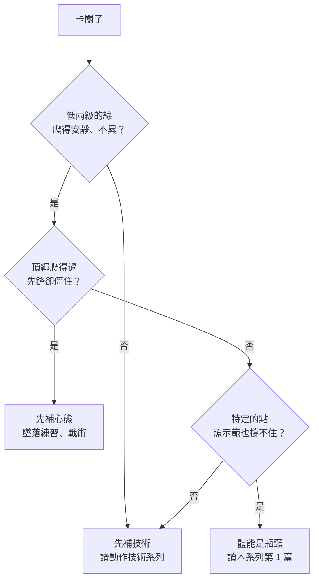

> 🌏 [English version](/posts/climbing/2026-10-18-climbing-training-diagnosis-en)

你爬了一年左右，一週去岩館兩三次，卡在 5.10 或 V3–V4 好幾個月。隔壁的人開始吊指力板、做負重引體向上，你也在想：是不是該開始「訓練」了？

這篇是「攀岩訓練」系列的入口。它不給課表，只回答三件事：各家怎麼看「先練技術還是先練體能」、怎麼分辨你卡在技術、心態還是體能、接下來該讀哪一篇。還沒在岩館爬過的話，先讀[攀岩入門](/posts/climbing/2026-10-08-climbing-beginner-guide)、[岩館上攀確保](/posts/climbing/2026-10-17-gym-top-rope-belay)和[岩館先鋒](/posts/climbing/2026-10-17-gym-lead-climbing)。

本系列每個訓練建議都會標證據等級：**研究**表示有實驗或量測支持；**教練共識**表示是教練的經驗做法，沒有對照研究。各家說法不一致的地方會並列，不替你選一個。

## 「攀爬就是最好的訓練」：各家怎麼說

英國攀岩者 Ron Fawcett 有句老話：「攀爬就是最好的攀岩訓練。」教練 Neil Gresham 在 [Climbing 雜誌的專欄](https://climbing.com/skills/training-value-effectiveness)引用這句話，接著說訓練有收穫也有代價：只練不爬，會丟掉在岩壁上的應變和膽量。他的建議是，如果你主要卡在技術或心態，就把時間花在那兩塊，不要拿去訓練。

其他教練的說法如下，差別在「什麼時候該加專項訓練」：

| 誰 | 對一年左右的人怎麼說 | 證據等級 |
|---|---|---|
| [Dave MacLeod](https://www.davemacleod.com/shop/9outof10climbers) | 多數人卡在動機、時間安排，以及看不出自己的技術和戰術錯誤 | 教練共識 |
| [Eva López](http://en-eva-lopez.blogspot.com/2018/05/fingerboard-training-guide-i-preliminary-evaluation.html) | 系統化攀爬或訓練 2 年以上才開始指力板懸吊；頭幾年的技術進步比較重要 | 教練共識，引用文獻說明肌腱和韌帶適應得比肌肉慢 |
| [Eric Hörst](https://trainingforclimbing.com/training-programs/) | 初學者課表（不到 1 年、上攀低於 5.11）以技巧、恐懼管理為主，但也包含專項肌力和拮抗肌 | 教練共識 |
| [Lattice Training](https://latticetraining.com/blog/lattice_data_finger_strength_grades) | 指力是最能預測等級的單一指標；建議手指要強，技術也要好 | 6,000 多人的測驗資料 |
| [Hooper's Beta](https://hoopersbeta.com/library/throw-your-hangboard-in-the-trash-if-you-dont-know-this-save-a-friend) | 技術已經不錯、進步停滯、而且確定手指是主要限制，指力板才值得練 | 物理治療師的臨床經驗 |

研究也沒有定論。[Stien 等人 2023 年的統合分析](https://pubmed.ncbi.nlm.nih.gov/36636194/)整理隨機對照試驗，發現「攀爬加專項阻力訓練」在攀岩專項測驗上的進步比只攀爬多，但能納入的研究很少。[Langer 等人 2024 年的隨機試驗](https://pubmed.ncbi.nlm.nih.gov/38976692/)找女性攀岩者練五週，牆下訓練有提升專項肌力的趨勢，牆上訓練有提升技術的趨勢，結論是照個人偏好選就好。

把這些放在一起看，多數來源對一年左右的人都偏向「先補技術」，但 Hörst 和 Lattice 不認為體能要等到很後面才練。這個系列不替你選邊，下面給的是怎麼判斷你屬於哪一種。

**今晚就能做的動作**：寫下你最近三次沒爬完的線，各自是在哪一步掉的、掉的時候身體的感覺是「手抓不住」「不知道怎麼做」還是「不敢做」。有兩次是同一種，就先往那個方向查。

## 研究看到什麼決定攀岩等級

### 可以練的比天生的重要

[Laffaye 等人 2016 年的研究](https://pubmed.ncbi.nlm.nih.gov/26453999/)量了新手、進階和菁英攀岩者的身材與肌力。可以訓練的因素能解釋攀岩等級將近一半的差異，身高、臂展、體脂這些身材特徵和肌肉組成加起來不到 4%。對多數人來說，「我手太短」不是卡關的主因。

### 指力還是肩膀，研究說法不一

- **指力**：[Berta 等人 2025 年的研究](https://pubmed.ncbi.nlm.nih.gov/39754511/)測了 307 名攀岩者，最大指力是預測等級最強的因素。
- **肩膀與上肢**：[MacKenzie 等人 2020 年的研究](https://pubmed.ncbi.nlm.nih.gov/31094249/)找到的主要因素是肩膀的爆發力和耐力。測法包括最多引體向上次數、手臂彎曲懸吊；指力排在次要。
- **台灣的資料**：[臺大 2025 年的碩士論文](https://tdr.lib.ntu.edu.tw/bitstream/123456789/98245/1/ntu-113-2.pdf)測了 25 名進階男性攀岩者，四個變項裡只有「最大負重引體向上」和體重的比值能顯著預測等級。
- **門檻型的能力**：[國際攀岩研究協會（IRCRA）2021 年的測驗組合](https://pubmed.ncbi.nlm.nih.gov/33652414/)發現，柔軟度和一般肌力要有一定水準，但超過之後再加，對等級的幫助就不明顯。

這些都是橫斷研究：同一時間量一群人，看強的人有什麼。它們看不出「先練哪一項會讓你變強」，臺大的論文也在結論寫明，因果要靠之後的訓練介入研究釐清。強的攀岩者手指強，有一部分可能是因為爬得多。

**今晚就能做的動作**：在筆記本記下你目前的最佳完攀等級，分成抱石和繩攀兩欄。[Draper 等人 2011 年的研究](https://pubmed.ncbi.nlm.nih.gov/21491325/)發現攀岩者自己回報的 onsight 等級和實測等級沒有顯著差異，所以這個數字可以當你之後追蹤進步的基準。

## 三步診斷：技術、心態、體能

照順序做。前一步有問題，先處理前一步，後面的測驗結果會比較準。

### 第一步：技術

[攀岩動作技術系列的總覽](/posts/climbing/2026-10-18-climbing-movement-overview)已經有完整的分辨方法：挑一條比你極限低兩級的線，用安靜腳的規則爬。簡單的線也爬得前臂很脹、腳常滑、要調好幾次才站穩，問題多半在動作。這時候練指力板，只是讓你能用比較強的手指繼續爬得沒效率。

**今晚就能做的動作**：請朋友錄一段你爬低兩級線的影片，對照[動作技術總覽的自我診斷表](/posts/climbing/2026-10-18-climbing-movement-overview)，找出最常出現的那一條。

### 第二步：心態

MacLeod 把「看不出自己的戰術錯誤」列為多數人卡關的原因，Hörst 的初學者課表也把恐懼管理放在前面。症狀通常很好認。同一條線頂繩爬得過，換成先鋒就在快扣下方僵住、手抓得特別緊；或者抱石題目的最後一步明明做得到，卻一直不敢出手。

Gresham 對這種情況的建議是多做墜落練習，多花時間在岩壁上，而不是去練身體。

**今晚就能做的動作**：挑一條你頂繩能完攀的線，改用先鋒爬一次，記下你在哪一支快扣前開始抓得特別緊。下次去岩館照[岩館先鋒的墜落練習](/posts/climbing/2026-10-17-gym-lead-climbing)，從那一支開始由小到大練墜落。

### 第三步：體能

前兩步都排除了，你在某個特定的點（很小的邊、很遠的距離、很陡的牆）照有經驗的人示範的動作做，還是撐不住，這時才是體能問題。Hooper's Beta 開始用指力板前的第一個問題就是：你確定手指是主要限制嗎？

可以先記錄三個數字，當作基準，不是考試：

- **López 的指力板入門測驗**：吊在 25 mm（約一個半指節深）的邊上，能吊滿 15 秒，López 認為可以開始用指力板練。吊不到，她建議繼續用攀爬練手指。
- **最多引體向上次數**：MacKenzie 研究用的肩膀測驗之一，不需要特別器材。
- **你的完攀等級**：上一節記下的那兩欄。

Lattice 的資料有一個提醒：女性和男性的指力基準差很多，拿總平均比會誤判，所以[本系列第 2 篇](/posts/climbing/2026-10-18-hangboard-training)會分開講。測驗時手指有任何不舒服就停，不要硬撐到極限。

**今晚就能做的動作**：在岩館找一個大約 25 mm 深的邊，雙手半封閉（half crimp）吊上去，腳先踩在地上或箱子上分擔體重。確認手指不痛之後，再把腳抬起來，看能吊幾秒。

## 吊不到 15 秒、卻想變強：保守的起點

López 給吊不到 15 秒的人兩個做法，都是用攀爬練手指：偶爾去比平常更陡的牆爬，以及在你爬的路線或題目裡，刻意選一些（她建議 10–20%）小手點和小腳點。

Hooper's Beta 提醒，如果真的要加訓練，就要從攀爬裡扣掉一些量。他們舉的例子是：原本一週高強度爬三次，開始練指力板時先降到兩次。Gresham 則建議每年安排一段不照課表、想爬什麼就爬什麼的時間。這三個建議都是教練共識。

**今晚就能做的動作**：下次去岩館，從你熟悉的牆換到更陡一級的牆，挑三條比平常低一級的線爬。

## 系列地圖：九篇各解決什麼問題

照這個順序讀：先確認自己需要訓練，再理解身體怎麼供應能量，接著才是指力、力量、耐力，最後把它們排進一年，並照顧好預防與恢復。

| 篇 | 主題 | 這篇回答的問題 |
|---|---|---|
| 0 | 診斷（本篇） | 卡關是技術、心態還是體能？ |
| 1 | [能量系統](/posts/climbing/2026-10-18-climbing-energy-systems) | 爬一條線用哪種能量？為什麼爬到爆不等於練耐力？ |
| 2 | [指力板](/posts/climbing/2026-10-18-hangboard-training) | 什麼時候可以開始？MaxHangs 和 repeaters 怎麼選？ |
| 3 | [力量、肩與 campus board](/posts/climbing/2026-10-18-climbing-strength-power) | 手指以外要練什麼？campus 什麼時候才輪得到？ |
| 4 | [耐力與力量耐力](/posts/climbing/2026-10-18-climbing-endurance-training) | 先鋒後段手就爆，練 ARC、4×4 還是間歇？ |
| 5 | [週期化](/posts/climbing/2026-10-18-climbing-periodization) | 每週練 3 次的一般人，一年怎麼排？ |
| 6 | [居家訓練](/posts/climbing/2026-10-18-climbing-home-training) | 一支單槓、一塊指力板在家能練什麼？ |
| 7 | [拮抗肌、核心與一般肌力](/posts/climbing/2026-10-18-climbing-antagonist-core) | 為什麼只練拉會受傷？每週一次的預防課表怎麼做？ |
| 8 | [營養、RED-S 與恢復](/posts/climbing/2026-10-18-climbing-nutrition-recovery) | 輕一點就強一點嗎？怎麼知道練過頭了？ |

受傷的處理與復健不在這個系列，會在傷害預防系列（撰寫中）講；第 7 篇是兩個系列的交界。

**今晚就能做的動作**：照你在三步診斷裡停下的那一步選讀：停在第一步，讀[動作技術總覽](/posts/climbing/2026-10-18-climbing-movement-overview)；停在第三步，從本系列第 1 篇開始。

## 練習題：四個情境

答案在每題下方，先自己想再看。

**1. 你爬了 10 個月，V3 的題目爬得很累，V1 的題目爬完前臂也很脹。朋友推薦你買指力板。**

答案

先不要。簡單的題目也爬得很累，代表動作效率有問題，屬於第一步的技術。先用安靜腳練習和[腳法](/posts/climbing/2026-10-18-climbing-footwork)處理，López 和 Hooper's Beta 也都把「技術已經不錯」當成開始練指力板的前提。

**2. 你頂繩可以完攀 5.10c，先鋒卻連 5.10a 都會在第四支快扣前下來，下來時手並不脹。**

答案

手不脹，就不是體能問題。這是第二步的心態，多半是怕墜落。照[岩館先鋒](/posts/climbing/2026-10-17-gym-lead-climbing)的方式由小到大練墜落，比做任何訓練都有效。

**3. 你爬了 3 年，簡單的線爬得很安靜，卡在 V5 的小點題目，照別人的 beta 做也撐不住。在 25 mm 的邊上可以吊 20 秒。**

答案

這比較像體能瓶頸，而且你通過了 López 的兩個門檻（2 年以上、25 mm 吊 15 秒）。可以讀第 1 篇能量系統，再讀第 2 篇指力板。開始練之前，記得照 Hooper's Beta 的提醒，先從攀爬裡扣掉一些量。

**4. 有人跟你說：「研究證明指力決定等級，所以每個人都要先練指力。」**

答案

這句話過頭了。Berta 和 Lattice 的資料確實顯示指力和等級關係最強，但 MacKenzie 的研究找到的主要因素是肩膀，而且這些都是橫斷研究，只能看出強的人有什麼，不能證明先練指力就會變強。

## 下一步

如果你的診斷停在第三步，下一個問題是：體能到底指什麼？很多人以為每次練到前臂爆掉就是在練耐力，其實這樣兩個能量系統都練不到。接著讀[能量系統](/posts/climbing/2026-10-18-climbing-energy-systems)。

## 參考資料

- [Should You Train or Just Go Climbing?（Neil Gresham，Climbing，2022）](https://climbing.com/skills/training-value-effectiveness)
- [9 out of 10 Climbers Make the Same Mistakes（Dave MacLeod 作者頁）](https://www.davemacleod.com/shop/9outof10climbers)
- [Fingerboard training guide (I). Preliminary evaluation（Eva López，2018）](http://en-eva-lopez.blogspot.com/2018/05/fingerboard-training-guide-i-preliminary-evaluation.html)
- [Free Training Programs for Climbers（Eric Hörst，Training for Climbing）](https://trainingforclimbing.com/training-programs/)
- [Finger Strength For Climbers Increases, In Relation To Grade（Lattice Training，2026）](https://latticetraining.com/blog/lattice_data_finger_strength_grades)
- [Throw Your Hangboard in the Trash If You Don't Know This（Hooper's Beta）](https://hoopersbeta.com/library/throw-your-hangboard-in-the-trash-if-you-dont-know-this-save-a-friend)
- [Stien N et al. Effects of climbing- and resistance-training on climbing-specific performance: a systematic review and meta-analysis. Biol Sport 2023](https://pubmed.ncbi.nlm.nih.gov/36636194/)
- [Langer K et al. The effects of five weeks of climbing training, on and off the wall… in female climbers. PLoS One 2024](https://pubmed.ncbi.nlm.nih.gov/38976692/)
- [Laffaye G et al. Determinant factors in climbing ability. Scand J Med Sci Sports 2016](https://pubmed.ncbi.nlm.nih.gov/26453999/)
- [Berta P et al. Validity and normative scores of finger flexor strength and endurance tests. J Sports Sci 2025](https://pubmed.ncbi.nlm.nih.gov/39754511/)
- [MacKenzie R et al. Physical and Physiological Determinants of Rock Climbing. Int J Sports Physiol Perform 2020](https://pubmed.ncbi.nlm.nih.gov/31094249/)
- [Draper N et al. Performance Assessment for Rock Climbers: The IRCRA Sport-Specific Test Battery. Int J Sports Physiol Perform 2021](https://pubmed.ncbi.nlm.nih.gov/33652414/)
- [Draper N et al. Self-reported ability assessment in rock climbing. J Sports Sci 2011](https://pubmed.ncbi.nlm.nih.gov/21491325/)
- [蕭妤瑄〈攀岩者上肢力量特徵與攀登等級之多元迴歸分析〉臺大碩士論文，2025](https://tdr.lib.ntu.edu.tw/bitstream/123456789/98245/1/ntu-113-2.pdf)
