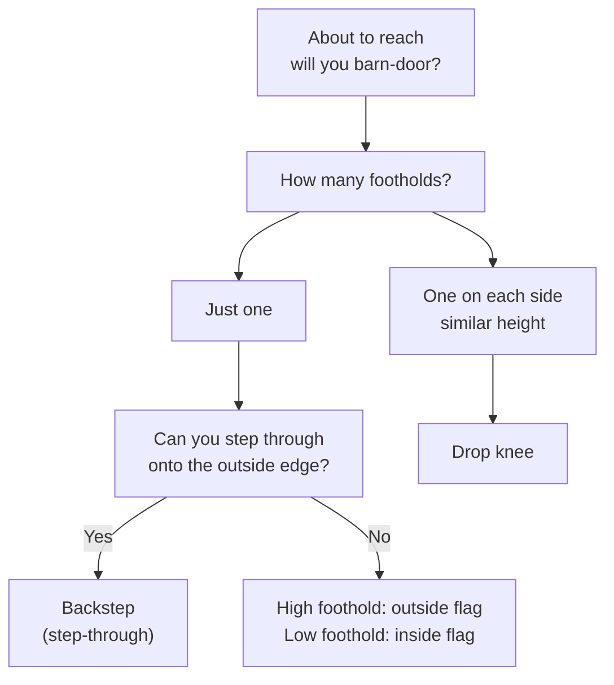

> 🌏 [中文版](/posts/climbing/2026-10-18-climbing-turning-twisting)

You are climbing vertical walls fine, but as soon as the wall goes past vertical it falls apart. Every reach is a hard pull and your body keeps swinging off. A coach glances over and says "turn sideways". You turn, but you don't know which way, or what your feet should do.

This post is about the details of "turn sideways". By the end you will know why barn-dooring happens, how to fix it with a flag, and when to use a backstep, a drop knee, or an inside or outside flag. It is part 3 of the [Climbing Movement series](/posts/climbing/2026-10-18-climbing-movement-overview-en), following [Center of Gravity and Balance](/posts/climbing/2026-10-18-climbing-balance-en). If shifting your weight is not solid yet, read that one first.

## Getting the names straight

Most gyms in Taiwan just use the English words. A [climbing glossary on Vocus](https://vocus.cc/article/623ac982fd897800012c7c40) (in Chinese) says so directly: nearly all climbing terms came from abroad, many have no proper Chinese name, and everyone uses the original. It also notes that barn door (開門) is one of the few terms that does have a Chinese name.

The word for "side-on" (側身) needs care in Chinese. Huang Kuo-wei's 2007 [climbing technique column](http://www.iclimb.com.tw/share/prose2_6.htm) (in Chinese) uses it for two different moves, the layback and the twist-lock. In this post:

- **Side-on**: hips turned toward the wall instead of parallel to it, as opposed to **square-on**.
- **Twist-lock**: Philly Rock Gym uses it as the name for a whole family of moves that turn the hips into the wall and lock the lower body: backsteps, drop knees and the reverse flag. Huang's definition is narrower: turning the upper body toward the locked-off hand, so the reach gains the length of your shoulder.
- Other moves keep their English names: backstep, drop knee, flag. Huang writes drop knee as 膝蓋朝下 and flag as 交叉平衡, and [HANCHOR's bouldering class](https://tw.hanchor.com/pages/climb10) (in Chinese) notes that some people call the drop knee 折膝.

## Square-on versus side-on

On slabs and vertical walls everyone climbs square-on by default: hips parallel to the wall, standing on the inside (big-toe) edges. British coach Neil Gresham points out in his [Climbing.com series on steep walls](https://www.climbing.com/skills/outside-edge-steep-climb-technique-how-to/) that this is how we climbed trees as children, so it is deeply ingrained.

Take the same style onto an overhang, Gresham says, and you get two problems:

1. Every reach depends on pulling and locking off with your arms.
2. As you reach you lose balance and your hips swing away from the wall. That is the barn door, and you end up lunging for the hold.

Why does turning side-on help? [REI's climbing technique guide](https://www.rei.com/learn/expert-advice/climbing-techniques.html) explains that hips squared to the wall push your weight away from it. With one hip against the wall, your weight returns to your feet and you can lean back on straight arms. A hip close to the wall also brings your shoulder closer, which changes the angle of pull on the handhold and makes it easier to grip.

The [BMC FUNdamentals coaching notes](https://services.thebmc.co.uk/media/files/Skills/FUNdamentals%20Docs/FUNdamentals%201,%202%20and%203%20-%20Guidance%20Notes.pdf) describe the same thing in terms of center of gravity: hip rotation brings it closer to the wall and more over your feet.

**Something you can do tonight**: do [Climb Strong's Hip Shapes drill](https://www.climbstrong.com/resource-posts/fundamental-skills-precision-execution-and-balance). Pick a boulder problem two or three grades below what you usually onsight (send first try). Climb it once with your hips square to the wall the whole way, then again using only backsteps (outer hip toward the wall). Compare which felt more off balance.

## Barn door: why you swing off

[Dave Rowland, co-owner of Philadelphia Rock Gyms and a coach for over 30 years](https://philarockgym.com/how-to-prevent-the-annoying-barn-door-in-climbing/), explains it most clearly. A barn door happens when only one side of your body is attached to the wall, for example pushing up on your right foot while holding only with your right hand. As you push, your weight lifts off your lower foot, your center of gravity shifts out, and your body swings open like a barn door in the wind. Huang also notes that it usually happens with hand and foot on the same side.

### Fix 1: diagonal support

Rowland's fix is cross-body tension, or diagonal support: whichever foot you push on, keep the hand on the **opposite** side on the wall. Pushing on your right foot, your left hand needs to be on the wall; then reach with your right hand. Your right foot and left hand form a diagonal, and your body stays in.

He adds that new climbers find this unnatural, because you have to "give up" your lower foot. All your weight goes onto one foot and your contact drops from three points to two. This is what the [previous post](/posts/climbing/2026-10-18-climbing-balance-en) meant: here the three-point rule has to go.

### Fix 2: counter-pressure, or a flag as counterweight

For barn-dooring on a sidepull, REI gives three options:

- Press your foot in the direction opposite to the pull to create counter-pressure.
- Pull the opposite way with your other hand or a hooked foot.
- Lean hard the other way and use your body weight as a counterbalance.

The concrete version of the third option is the flag, covered below.

**Something you can do tonight**: as Rowland suggests, barn-door on purpose. On a slab, hold on with your right hand and right foot only, take your left hand and foot off, and feel your body swing open. Then switch to right foot with left hand and do it again. Once you know what wrong feels like, it is easier to avoid.

## Backstep: outside edge, hip to the wall

REI describes the backstep as "the opposite of a normal step". Instead of standing on your big-toe edge with your hips square, you turn your hip sideways and stand on the outside (little-toe) edge of your shoe. Your hip comes close to the wall, your arm straightens more easily for a rest, and you gain a bit of reach. It is especially useful for saving energy on steep walls.

In his [twist-locking series](https://philarockgym.com/twist-locking-series-the-basics-of-back-stepping), Rowland gives a sequence for getting into a backstep:

1. Grab a good hold with your right hand, ideally a sidepull.
2. Put your left foot, on its outside edge, on a good foothold in line with your right hand or slightly to its right (that is the diagonal support).
3. Step off the ground and flag your right leg out straight.
4. Using your core, twist your lower body into the wall until your left hip almost touches it, and let your hips drift forward until they sit almost directly above your left heel.

When it is right, your hips feel locked in place and your upper body barely works.

Gresham calls the same move a step-through. On an overhang with a single foothold on the left, instinct puts your left foot on it, and that is where the trouble starts. Instead, step through and stand on it with the outside edge of your right foot. Two of his details:

- Use the toe part of the shoe's outside edge, not the middle, with your foot at about 45 degrees to the wall rather than parallel.
- The power for the reach comes mainly from the foot on the hold. Your shoulders rotate, and the reaching arm stays nearly straight.

### Spinning out of a backstep: feet behind the line

Another Rowland article covers a failure specific to backsteps, which [he calls a spin-out](https://philarockgym.com/twist-locking-series-prevent-back-stepping-spinouts). You are using diagonal support, yet your body still wants to rotate open. The cause is a foothold "behind the line": in a right-hand, left-foot backstep, the left foot is too far to the left of the right hand's vertical line. Your knee cannot pull your weight behind you, and your other leg is flagging with nothing to push on, so your arms have to hold the position. The fix is to pick footholds on or in front of the line. If the only footholds are behind it, use a drop knee instead.

**Something you can do tonight**: following Rowland's four steps, do five backsteps on each side on a steep wall with big holds. Pause two seconds each time and check that your hip is close to the wall and your arm is straight.

## Drop knee: when there is a foothold on each side

Gresham says drop knees come up when there is a foothold on either side of you at roughly the same height. The classic mistake is to attack it square-on: hips parallel, backside hanging out in space, arms pulling like crazy.

The more efficient way:

- **Pivot on one foot and twist your hips into the wall.** You make the reach by rotating your chest, so your arms don't need to pull. The sideways pressure between the two footholds works like a stem and takes more weight off your hands.
- **Drop the knee on the same side as the reaching hand.** Reaching with your left hand, drop your left knee. Gresham says this rule is never broken, even when crossing through.
- **Place the non-pivoting foot first.** His refinement is to stand on the front point of the toe and pivot as you pull up, rather than starting on the outside edge. Placing the other foot first lets you place the pivoting foot accurately from a stable position.

REI describes it a little differently: it works best with a foothold near hip level. Step on with the tip of your toe, then roll your knee in until the outside of the shoe rests on the hold and the knee points down. Both versions end with the outside edge loaded; they differ in how you start.

Rowland points out the [main difference](https://philarockgym.com/twist-locking-series-the-basics-of-drop-knees) between a drop knee and a backstep: in a drop knee both feet are on the wall. The other foot, pushed straight, drives your center of gravity back onto the pivot foot, which is exactly the push a backstep lacks and why it can spin out. So keep that foot on the wall throughout; if it slips, you spin out.

Which wall angles suit it? In Gresham's experience it works best on steep overhangs of roughly 30 to 75 degrees and not so well on slightly overhanging walls. You can't do it on an overhanging arête, or when a volume or a roof lip is in the way.

### The knee risk

Drop knees have direct injury data. [Lutter and colleagues (2020)](https://pubmed.ncbi.nlm.nih.gov/32004071/) analyzed acute knee injuries in climbers across several clinics, and drop knees were the mechanism in 16.9% of them. The most common structural damage overall was a medial meniscus tear, but the study abstract does not link meniscus tears to a particular mechanism, so it does not support saying that drop knees tear the meniscus.

Other numbers from Lutter 2020

- A 4-year retrospective multicenter case series: 71 patients with 77 acute knee injuries, 35% of them competitive athletes.
- Mechanisms: heel hook 40.3%, ground fall 22.1%, high step 20.8%, drop knee 16.9%.
- Medial meniscus tears made up 28.6%, significantly more often in non-competitive climbers.
- 46.8% of the injuries came from indoor bouldering.

Gresham is blunt: if your knees are injured, avoid drop knees. The farther apart the footholds, the more leg strength and hip flexibility it takes. If wide drop knees are beyond you, start with versions where the footholds are closer together.

**Something you can do tonight**: rehearse it on the floor first. Stand up, imagine a foothold on each side, reach up and right with your left hand while dropping your left knee and turning your hip. Once that feels natural, find a spot on a steep wall during your warm-up where the footholds on each side are level, and do a few. Stop if your knee feels anything off.

## Flag: your free leg as a counterweight

REI defines flagging as counterbalancing by using a limb to shift your weight, so you don't swing away from the rock. It helps whenever your holds are all on one side of your body: swing the other leg out to that side and you stay balanced.

In [his flagging article](https://www.climbing.com/skills/flagging/), Gresham says the flag is for when you can't step through: a roof lip or volume is in the way, the foothold is too far to the side, or the holds simply lead you into a square-on position (left foot on the left). You could swap feet instead, but that costs time and energy. There are two kinds, chosen by foothold height:

| | Outside flag | Inside flag |
|---|---|---|
| When | Foothold is high, around knee height or above, and out to the side | Foothold is low, below the knee |
| Free leg | Crosses outside the standing leg (the side away from the wall) | Passes between the standing leg and the wall |
| Hips | Roughly parallel to the wall; don't try to twist | Twist in as you stand up |
| Arms | You always have to pull and lock off | Saves more arm strength than the outside flag |

HANCHOR's bouldering class uses the same definitions: if the kicked-out leg is outside the standing foot, it is an outside flag; if it is inside, it is an inside flag.

Gresham's notes on the outside flag:

- **Find the balance point after you pull up, not before.** The most common mistake is setting the flag first and finding yourself out of balance at the top, where it matters.
- **Most people don't bring the flagging leg through far enough.** Watch two axes: how far through it goes, and how close to the wall.
- **The outside flag is naturally arm-heavy.** If one feels disproportionately strenuous, consider swapping feet and using a backstep, which lets you twist into the wall.

American coach Eric Hörst describes another common flag: [putting the free foot behind your supporting leg](https://trainingforclimbing.com/steep-wall-climbing-techniques/), which shifts your center of gravity sideways, closer to the supporting hand and foot. It is especially useful when your strongest handhold and foothold are on the same side.

**Something you can do tonight**: on a vertical wall, find a spot where your left hand and left foot are both on the left and your right hand needs to reach up and right. First try it without a flag and feel your body barn-door to the right. Then put your right foot behind your left and compare how stable the reach feels.

## How to choose: look at the footholds

- One foothold and you can step through: Gresham says this becomes the staple move on overhangs.
- One foothold and you can't step through, or it is too far to the side: flag, with the height deciding inside or outside.
- Two footholds and a steep enough wall: drop knee. If your knees are hurt, use something else.

## Practice: four scenarios

Answers are under each question. Think first, then check.

**1. Your right hand is on a sidepull and your right foot is below it. You need to reach up left with your left hand. As soon as your left hand lets go, your body swings open to the left.**

Answer

That is a barn door: only your right hand and right foot are attached. There are two fixes. One is to put your left foot on a foothold for diagonal support: push on the left foot, hold with the right hand. The other is to keep your left foot off the holds and put it behind your right foot as a flag, pulling your center of gravity back onto the right-side line of support.

**2. On an overhang, your left hand is on a hold and the only foothold is on the left at knee height. You stand on it with your left foot, and every right-hand reach is a hard pull.**

Answer

Square-on is expensive on an overhang. Try stepping through with your right foot and standing on that hold with its outside edge, as a backstep, so your right hip turns into the wall and your arm can straighten. If something blocks you from stepping through, keep your left foot there and outside-flag with your right leg, and accept that it is more arm-heavy.

**3. You are in a backstep with correct diagonal support, but your body keeps rotating open and you have to hold it with your arms.**

Answer

The foothold is probably "behind the line", too far from your hand's vertical line. Rowland calls this a spin-out: your knee can't pull your weight behind you, and your other leg has nothing to push on. Use a foothold on or in front of the line. If the only footholds are behind it, find a second foothold and switch to a drop knee.

**4. You are reaching with your left hand, there is a level foothold on each side, you drop your right knee, and the move gets harder.**

Answer

Wrong knee. Gresham's rule is to drop the knee on the same side as the reaching hand: reaching left, drop the left knee. Keep the other foot pushing straight and don't let it slip off.

## Next steps

Once you can turn, the next question is the holds themselves: how to grip sidepulls, underclings and gastons, and which grip is hardest on your fingers. That is the next post, [Hold Types and Grips](/posts/climbing/2026-10-18-climbing-holds-grips-en). How these turning moves rank on different wall angles is revisited in [Wall Angles](/posts/climbing/2026-10-18-climbing-wall-angles-en).

## References

- [Neil Gresham, Dial In Your Outside Edging And Crush Steep Climbs (Climbing.com)](https://www.climbing.com/skills/outside-edge-steep-climb-technique-how-to/)
- [Neil Gresham, How To Master Flagging (Climbing.com)](https://www.climbing.com/skills/flagging/)
- [Neil Gresham, The Trick To Pulling Harder Isn't Actually To Pull Harder (Climbing.com, drop knees)](https://www.climbing.com/skills/drop-knee-climbing-technique/)
- [Climbing Techniques and Moves (REI Expert Advice)](https://www.rei.com/learn/expert-advice/climbing-techniques.html)
- [Dave Rowland, How to Prevent the Annoying 'Barn Door' in Climbing (Philly Rock Gym)](https://philarockgym.com/how-to-prevent-the-annoying-barn-door-in-climbing/)
- [Dave Rowland, Twist-Locking Series: The Basics of Back-Stepping (Philly Rock Gym)](https://philarockgym.com/twist-locking-series-the-basics-of-back-stepping)
- [Dave Rowland, Twist-Locking Series: Prevent Back-Stepping Spinouts (Philly Rock Gym)](https://philarockgym.com/twist-locking-series-prevent-back-stepping-spinouts)
- [Dave Rowland, Twist-Locking Series: The Basics of Drop-Knees (Philly Rock Gym)](https://philarockgym.com/twist-locking-series-the-basics-of-drop-knees)
- [Eric Hörst, Steep Route Techniques to Climb Harder (Training for Climbing)](https://trainingforclimbing.com/steep-wall-climbing-techniques/)
- [FUNdamentals of Climbing 1, 2 and 3 Guidance Notes (British Mountaineering Council)](https://services.thebmc.co.uk/media/files/Skills/FUNdamentals%20Docs/FUNdamentals%201,%202%20and%203%20-%20Guidance%20Notes.pdf)
- [Fundamental Skills: Precision, Execution, and Balance (Climb Strong)](https://www.climbstrong.com/resource-posts/fundamental-skills-precision-execution-and-balance)
- [Lutter C, et al. Mechanisms of Acute Knee Injuries in Bouldering and Rock Climbing Athletes. Am J Sports Med 2020](https://pubmed.ncbi.nlm.nih.gov/32004071/)
- [Huang Kuo-wei, "Climbing Basics (3): Footwork and Body Language", *Shanye Diaoyou* 2007 no. 20 (reposted on iclimb) (in Chinese)](http://www.iclimb.com.tw/share/prose2_6.htm)
- [HANCHOR bouldering class: an overview of climbing body positions (in Chinese)](https://tw.hanchor.com/pages/climb10)
- [HHH, A glossary of climbing terms (Vocus) (in Chinese)](https://vocus.cc/article/623ac982fd897800012c7c40)
