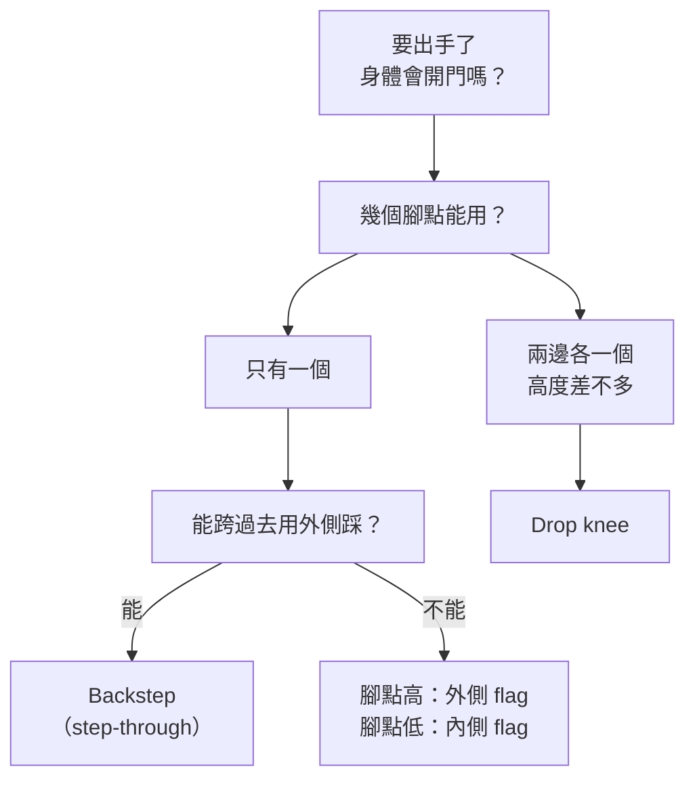

> 🌏 [English version](/posts/climbing/2026-10-18-climbing-turning-twisting-en)

垂直牆你已經爬得不錯，一到前傾牆就不行：每次出手都得用手臂硬拉，身體還會往外甩。教練看了一眼說「側過來」，你轉了，卻不知道該轉哪邊、腳該怎麼踩。

這篇講的就是「側過來」的細節。讀完你會知道開門為什麼會發生、怎麼用 flag 修正，以及 backstep、drop knee、內外側 flag 各在什麼情況下用。這是[攀岩動作技術系列](/posts/climbing/2026-10-18-climbing-movement-overview)的第 3 篇，接在[重心與平衡](/posts/climbing/2026-10-18-climbing-balance)後面；重心移轉還不熟的話，先讀那篇。

## 先把名詞講清楚

台灣岩館多半直接講英文。[方格子的攀岩術語整理](https://vocus.cc/article/623ac982fd897800012c7c40)說得很直接：攀岩術語幾乎都是從國外傳回來的，很多沒有正確的中文名稱，大家都講原文。它也說開門（barn door）是少數有中文的術語。

「側身」這個詞要特別小心。黃國維 2007 年的[攀岩技巧專欄](http://www.iclimb.com.tw/share/prose2_6.htm)同時用「側身」指 layback 和 twist-lock 兩種不同動作。所以本文這樣用：

- **側身**：髖部轉向牆、不再和牆平行的姿勢，相對於「正身」。
- **擰身（twist-lock）**：本文譯名，台灣沒有固定說法。Philly Rock Gym 把它當成一整類動作的總稱：把髖部轉向牆、讓下半身鎖住，包含 backstep、drop knee 和反向 flag。黃國維的定義比較窄：上半身轉向鎖臂那隻手，伸手時多出肩膀的長度，搆得比較遠。
- 其他動作直接用英文：backstep、drop knee、flag。黃國維把 drop knee 寫作「膝蓋朝下」、flag 寫作「交叉平衡」；[阿倫抱石教室](https://tw.hanchor.com/pages/climb10)提到 drop knee 中文也有人叫「折膝」。

## 正身和側身差在哪

在緩斜牆和垂直牆上，大家自然會用正身爬：髖部和牆平行，兩腳用內側（大拇趾那側）踩點。英國教練 Neil Gresham 在 [Climbing.com 的前傾牆系列](https://www.climbing.com/skills/outside-edge-steep-climb-technique-how-to/)說，這也是人小時候爬樹的方式，所以根深蒂固。

但同樣的姿勢搬到前傾牆，Gresham 說會出兩個問題：

1. 每次出手都要靠手臂拉、鎖臂。
2. 出手的瞬間身體失去平衡，髖部往外甩開，也就是開門，你只好撲過去抓點。

側身為什麼有用？[REI 的攀岩技巧教學](https://www.rei.com/learn/expert-advice/climbing-techniques.html)的解釋是：髖部正對牆，會把重量推離牆面。讓一側髖部靠牆，重量會回到腳上，你可以用直臂往後靠。髖部靠牆時肩膀也跟著靠近，拉手點的角度跟著改變，點就變得比較好抓。

[BMC 的 FUNdamentals 教練手冊](https://services.thebmc.co.uk/media/files/Skills/FUNdamentals%20Docs/FUNdamentals%201,%202%20and%203%20-%20Guidance%20Notes.pdf)用重心來講同一件事：轉髖讓重心更靠近牆、更落在腳上方。

**今晚就能做的動作**：做 [Climb Strong 的「髖部形狀」練習（Hip Shapes）](https://www.climbstrong.com/resource-posts/fundamental-skills-precision-execution-and-balance)。挑一條比你平常能 onsight（第一次嘗試就完攀）的程度低兩、三級的抱石題，先全程用正身爬，再全程只用 backstep（外側髖靠牆）爬。比較哪一次比較失去平衡。

## 開門：為什麼會被甩開

[Philly Rock Gym 共同經營者、教了 30 多年攀岩的 Dave Rowland](https://philarockgym.com/how-to-prevent-the-annoying-barn-door-in-climbing/) 對開門的說明最清楚。身體只有同一側接在牆上時就會開門，例如右腳往上推、同時只有右手抓著。你一推，重量離開下面那隻腳，重心往外偏，身體就像被風吹開的門一樣盪出去。黃國維也寫到，開門通常出現在同手同腳的姿勢。

### 修法一：對角支撐

Rowland 的修法叫 cross-body tension，也就是對角支撐：推哪隻腳，就讓**另一側**的手留在牆上。推右腳，左手要在牆上；然後才用右手出手。右腳和左手連成一條斜線，身體就不會甩開。

他也說新手覺得這樣很不自然，因為你得「放掉」下面那隻腳，所有重量放在一隻腳上，接觸點從三點變成兩點。這就是[上一篇](/posts/climbing/2026-10-18-climbing-balance)說的：三點規則在這裡要放掉。

### 修法二：用手腳反向出力，或用 flag 配重

REI 對付側拉點（sidepull）開門的方法有三種：

- 腳往側拉的反方向踩推，做出對抗的力。
- 用另一隻手或勾住的腳往反方向拉。
- 身體往反方向傾，用體重當配重。

第三種的具體做法就是 flag，下面會細講。

**今晚就能做的動作**：照 Rowland 的建議，故意開門一次。在緩斜牆上用右手右腳撐住，左手左腳離牆，感覺身體怎麼盪開。接著換成右腳配左手，再做一次。先知道錯的感覺，比較容易避開。

## Backstep：外側踩，髖部轉向牆

REI 對 backstep 的描述是「和一般踩法相反」：不用大拇趾那側、髖部正對牆，而是把髖部轉向側邊，用鞋子外側（小趾那側）踩點。好處是髖部靠牆、手臂比較容易伸直休息，也多出一點伸展距離，在前傾牆上特別省力。

Rowland 在 [twist-lock 系列](https://philarockgym.com/twist-locking-series-the-basics-of-back-stepping)給了一套進入 backstep 的步驟：

1. 右手抓好一個點，最好是側拉點。
2. 左腳用外側踩在一個好腳點上，位置和右手對齊或稍微偏右（這就是對角支撐）。
3. 離地，右腳伸直懸空當 flag。
4. 用核心把下半身轉向牆，讓左髖幾乎碰到牆，髖部往前移到左腳腳跟正上方。

做對的時候，髖部會像被鎖住一樣，上半身幾乎不用出力。

Gresham 把同一招叫 step-through：前傾牆上左邊只有一個腳點時，直覺會用左腳踩，問題就從這裡開始；正確是右腳跨過去，用外側踩那個點。他的兩個細節：

- 用鞋子前端的外側踩，不是中段；腳和牆大約成 45 度，不要完全平行。
- 出手時主要靠踩點那隻腳推，肩膀跟著轉，出手那隻手臂幾乎保持伸直。

### Backstep 轉出去：腳點在線後面

Rowland 另一篇講的是 backstep 的特有失敗，[他叫 spin-out](https://philarockgym.com/twist-locking-series-prevent-back-stepping-spinouts)：你已經做對角支撐，身體還是想轉開。原因是腳點在「線的後面」：以右手、左腳的 backstep 來說，就是左腳踩在右手那條垂直線左邊太遠的地方。膝蓋沒辦法把體重往身後拉，另一隻腳又懸空沒地方推，你只能用手臂撐住。修法是選在手點那條線上或線前面的腳點；如果只有線後面的腳點，就改用 drop knee。

**今晚就能做的動作**：照 Rowland 的四個步驟，在一段前傾的大點牆上，左右兩邊各做五次 backstep。每次停兩秒，確認髖部是不是貼近牆、手臂是不是伸直。

## Drop knee：兩邊都有腳點時

Gresham 說 drop knee 通常出現在身體兩側各有一個腳點、高度差不多的時候。常見錯誤是正身硬上：髖部平行、屁股懸在空中、手臂拚命拉。

更有效率的做法：

- **以一隻腳為軸，把髖部轉進牆。** 出手靠胸口旋轉，手臂不必拉。兩個腳點之間的橫向對撐，作用像撐開兩邊牆面，又分擔掉一部分手的負擔。
- **出哪隻手，就倒哪邊的膝蓋。** 左手出手，就倒左膝。Gresham 說這條規則沒有例外，交叉手也一樣。
- **先放不轉的那隻腳。** 他的細節是用腳尖前端踩、邊拉邊轉，而不是一開始就用外側踩；先放另一隻腳，轉的那隻腳才能在穩定的姿勢下精準放上去。

REI 的說法稍有不同：腳點大約在髖部高度時最好用，用腳尖踩上去，再把膝蓋往內轉，直到鞋子外側貼在點上、膝蓋朝下。兩種說法最後都是外側受力，差在起步。

Rowland 指出 drop knee 和 backstep 的[主要差別](https://philarockgym.com/twist-locking-series-the-basics-of-drop-knees)：drop knee 兩隻腳都踩在牆上。另一隻腳踩直、把重心推回轉軸腳上，這正是 backstep 缺少、因此會轉出去的那一推。所以那隻腳要全程留在牆上，滑掉的話就會轉出去。

什麼牆角度適合？Gresham 的經驗是：大約前傾 30 到 75 度的陡牆最好用，微前傾的牆反而不太好用。前傾的稜角，或被大型岩點、屋簷邊緣擋住時，做不出來。

### 膝蓋的風險

drop knee 有直接的受傷統計。[Lutter 等人 2020 年的研究](https://pubmed.ncbi.nlm.nih.gov/32004071/)整理多家醫院攀岩者的急性膝傷，drop knee 占受傷機轉的 16.9%。整體最常見的結構傷害是內側半月板撕裂，但研究摘要沒有把半月板撕裂和特定機轉對應起來，所以不能據此說 drop knee 會撕裂半月板。

Lutter 2020 的其他數字

- 4 年間的回溯性多中心病例系列：71 位病人、77 次急性膝傷，35% 是競技選手。
- 受傷機轉：heel hook 40.3%、地面墜落 22.1%、高跨步 20.8%、drop knee 16.9%。
- 內側半月板撕裂占 28.6%，非競技者明顯較多。
- 46.8% 的傷發生在室內抱石。

Gresham 也直接寫：膝蓋有傷的人，drop knee 要避開。腳點分得越開，對腿力和髖關節柔軟度的要求越高；做不到極端的大開，就從腳點較近的版本開始。

**今晚就能做的動作**：先在地上模擬。站著，假裝兩邊各有一個腳點，左手往右上方伸，同時倒左膝、轉髖。熟了再在熱身時，到前傾牆上找兩邊腳點等高的位置做幾次。膝蓋有任何不舒服就停。

## Flag：把空著的腳當配重

REI 對 flag 的定義是：用一隻手或腳去移動重量，達到平衡，不讓身體從牆上盪開。手點都在身體同一側時特別有用，把那隻腳甩到另一側就能平衡。

Gresham 在 [flag 那篇](https://www.climbing.com/skills/flagging/)說，flag 用在沒辦法 step-through 的時候。例如被屋簷邊緣或大型岩點擋住、腳點太偏，或腳點的位置本來就讓你用正身（左腳踩左邊）。這時換腳也行，但很花時間和力氣。flag 分兩種，看腳點高低選：

| | 外側 flag（outside flag） | 內側 flag（inside flag） |
|---|---|---|
| 什麼時候用 | 腳點偏高，大約在膝蓋或更高、偏向一側 | 腳點偏低，在膝蓋以下 |
| 空著的腳 | 從站立腳的外側（離牆那側）交叉過去 | 從站立腳和牆之間穿過去 |
| 髖部 | 大致和牆平行，不用轉 | 站起來時跟著轉進牆 |
| 手臂 | 一定要拉、要鎖臂 | 比外側 flag 更省手 |

阿倫抱石教室的定義一樣：踢出去的腳在踩點那隻腳的外側，就是外側 flag；在內側，就是內側 flag。

Gresham 對外側 flag 的提醒：

- **平衡點要在拉上去之後找到，不是之前。** 最常見的錯誤是一開始就擺好 flag，拉上去之後已經不平衡了。
- **flag 的腳通常擺得不夠遠。** 要同時注意兩個方向：擺多遠，以及離牆多近。
- **外側 flag 本來就比較費手。** 如果覺得特別費力，想想換腳改用 backstep 會不會比較好，因為那樣才能轉身靠牆。

美國教練 Eric Hörst 也提到另一種常見的 flag：[把空著的腳擺到支撐腳後面](https://trainingforclimbing.com/steep-wall-climbing-techniques/)，讓重心往側邊移、靠近支撐的手和腳。最強的手點和腳點在同一側時特別有用。

**今晚就能做的動作**：在垂直牆上找一個左手和左腳都在左邊的位置，右手要往右上方出手。先不 flag，感覺身體往右開門。再把右腳擺到左腳後方，比較兩次出手的穩定度。

## 怎麼選：看腳點配置

- 一個腳點、能跨過去：Gresham 說這會變成前傾牆上的基本動作。
- 一個腳點、跨不過去或腳點太偏：用 flag，高低決定內外側。
- 兩個腳點、牆夠陡：drop knee。膝蓋有傷就換別的方法。

## 練習題：四個情境

答案在每題下方，先自己想再看。

**1. 你右手抓一個側拉點，右腳踩在下方，左手要出手去抓左上方的點。一放開左手，身體就往左邊甩開。**

答案

這是開門：只有右手右腳接在牆上。修法有兩種。一是把左腳放到一個腳點上做對角支撐：推左腳、右手抓。二是左腳不踩點，擺到右腳後方當 flag，把重心拉回右側支撐線上。

**2. 前傾牆上，你左手抓點，左邊只有一個腳點在膝蓋高度。用左腳踩上去，每次出右手都要拚命拉。**

答案

正身在前傾牆上很費手。可以改用右腳跨過去，用外側踩那個點做 backstep，讓右髖轉向牆、手臂伸直。如果有東西擋住跨不過去，就保留左腳，右腳做外側 flag，接受它比較費手。

**3. 你在做 backstep，對角支撐也做對了，身體還是一直往外轉開，只能靠手撐住。**

答案

腳點可能在「線的後面」，離手點那條垂直線太遠。Rowland 叫這種情況 spin-out：膝蓋沒辦法把體重往身後拉，另一隻腳又懸空。換一個在線上或線前面的腳點；只有線後面的腳點時，找第二個腳點改做 drop knee。

**4. 你要用左手出手，兩邊各有一個等高的腳點，你倒了右膝，結果動作反而更難。**

答案

倒錯膝蓋了。Gresham 的規則是出哪隻手，就倒哪邊的膝蓋：左手出手，倒左膝。另一隻腳踩直撐住，不要讓它滑掉。

## 下一步

身體轉得過來之後，下一個問題是手點本身：側拉點、倒抓點、扳點各要怎麼握，哪種握法最傷手指。這是下一篇[手點種類與握法](/posts/climbing/2026-10-18-climbing-holds-grips)的主題。這些轉身動作在不同牆角度的優先順序，會在[牆角度](/posts/climbing/2026-10-18-climbing-wall-angles)那篇重新整理。

## 參考資料

- [Neil Gresham, Dial In Your Outside Edging And Crush Steep Climbs（Climbing.com）](https://www.climbing.com/skills/outside-edge-steep-climb-technique-how-to/)
- [Neil Gresham, How To Master Flagging（Climbing.com）](https://www.climbing.com/skills/flagging/)
- [Neil Gresham, The Trick To Pulling Harder Isn't Actually To Pull Harder（Climbing.com，drop knee）](https://www.climbing.com/skills/drop-knee-climbing-technique/)
- [Climbing Techniques and Moves（REI Expert Advice）](https://www.rei.com/learn/expert-advice/climbing-techniques.html)
- [Dave Rowland, How to Prevent the Annoying 'Barn Door' in Climbing（Philly Rock Gym）](https://philarockgym.com/how-to-prevent-the-annoying-barn-door-in-climbing/)
- [Dave Rowland, Twist-Locking Series: The Basics of Back-Stepping（Philly Rock Gym）](https://philarockgym.com/twist-locking-series-the-basics-of-back-stepping)
- [Dave Rowland, Twist-Locking Series: Prevent Back-Stepping Spinouts（Philly Rock Gym）](https://philarockgym.com/twist-locking-series-prevent-back-stepping-spinouts)
- [Dave Rowland, Twist-Locking Series: The Basics of Drop-Knees（Philly Rock Gym）](https://philarockgym.com/twist-locking-series-the-basics-of-drop-knees)
- [Eric Hörst, Steep Route Techniques to Climb Harder（Training for Climbing）](https://trainingforclimbing.com/steep-wall-climbing-techniques/)
- [FUNdamentals of Climbing 1, 2 and 3 Guidance Notes（British Mountaineering Council）](https://services.thebmc.co.uk/media/files/Skills/FUNdamentals%20Docs/FUNdamentals%201,%202%20and%203%20-%20Guidance%20Notes.pdf)
- [Fundamental Skills: Precision, Execution, and Balance（Climb Strong）](https://www.climbstrong.com/resource-posts/fundamental-skills-precision-execution-and-balance)
- [Lutter C, et al. Mechanisms of Acute Knee Injuries in Bouldering and Rock Climbing Athletes. Am J Sports Med 2020](https://pubmed.ncbi.nlm.nih.gov/32004071/)
- [黃國維〈攀岩基礎技巧（三）腳的魔法及身體語言〉，《山野釣遊》2007 第 20 期（iclimb 轉載）](http://www.iclimb.com.tw/share/prose2_6.htm)
- [阿倫抱石教室：攀岩姿勢概論（HANCHOR）](https://tw.hanchor.com/pages/climb10)
- [攀岩術語、名詞大補帖（HHH，方格子）](https://vocus.cc/article/623ac982fd897800012c7c40)
