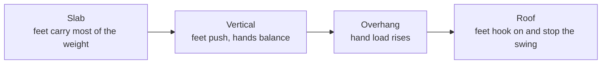

> 🌏 [中文版](/posts/climbing/2026-10-18-climbing-wall-angles)

A problem that flows on the vertical wall can feel impossible at the same grade on the overhang next door. It works the other way too: people who live on the steep wall often cannot stand up on a slab.

You did not suddenly get weaker. When the angle changes, what carries your weight changes, and the techniques you already know need a different order. This post teaches no new moves. It reorders [footwork](/posts/climbing/2026-10-18-climbing-footwork-en), [balance](/posts/climbing/2026-10-18-climbing-balance-en), [turning and twisting](/posts/climbing/2026-10-18-climbing-turning-twisting-en) and [grips](/posts/climbing/2026-10-18-climbing-holds-grips-en) by wall angle.

It is written for people who have been climbing in a gym for a few months. If you have not roped up yet, start with the [climbing beginner guide](/posts/climbing/2026-10-08-climbing-beginner-guide-en) and [Learning to Top-Rope Belay at the Gym](/posts/climbing/2026-10-17-gym-top-rope-belay-en).

First, names. The [vocus climbing glossary](https://vocus.cc/article/623ac982fd897800012c7c40) (in Chinese) notes that almost every climbing term came from abroad and people in Taiwan just use the English. The [climbingninjette technique guide](https://climbingninjette.com/2024/10/13/climbing-techniques/) (in Chinese) sorts walls into four types:

| Angle | Common Taiwanese term | What it looks like |
|---|---|---|
| Slab | 斜板 | Less than vertical, leans back, few small holds |
| Face | 直牆 | Close to 90°, where most beginner routes live |
| Overhang | 外傾牆 | Leans out over you |
| Roof | 天花板 | Close to horizontal, climbed hanging upside down |

## The steeper the wall, the more weight goes to your hands

Start with the research, because it drives every trade-off below.

- [Baláš et al. (2014)](https://pmc.ncbi.nlm.nih.gov/articles/PMC4327382/) had 11 female climbers climb at three angles, from just under vertical to slightly overhanging, with pressure insoles in their shoes. The steeper the wall, the less load went through the feet.
- In the same study, novices put less weight on footholds than intermediate climbers, yet used more oxygen and had higher heart rates.
- [Noé et al. (2001)](https://pubmed.ncbi.nlm.nih.gov/11240356/) compared vertical and overhanging stances: on the overhang, the arms had to work much harder to prevent a fall.
- [Bonelli et al.](https://pmc.ncbi.nlm.nih.gov/articles/PMC13236747/) measured 14 climbers on instrumented holds. Going from +5° to −5°, load moved from the feet to the hand.

So the old line "climb with your feet, not your hands" has research behind it on vertical and slightly overhanging walls. Once the wall gets steep, hand load rises however good your footwork is. On overhangs, remember a different line. British coach Neil Gresham writes in his [Climbing.com toe-hook guide](https://www.climbing.com/skills/rock-climbing-technique-foot-toe-hooks-tips/): "Page one of overhanging climbing is to keep your feet on."

## Slab: put your weight on your feet

There is little to pull on a slab. [Climbing.com's slab tips from Hazel Findlay](https://www.climbing.com/skills/friction-slabs-tips-from-hazel-findlay/) come down to one idea: trust your foot and put more weight on it, and invisible holds become usable.

In practice:

- **Stand directly over your feet.** More pressure on the foot means more friction and more security.
- **Heels down, smear with the ball of the foot.** Findlay says "Don't edge," because edging puts less rubber on the rock. [REI's technique guide](https://www.rei.com/learn/expert-advice/climbing-techniques.html) also names smearing as the slab technique.
- **Soft arms.** Elbows slightly bent, pressing with palms and fingers rather than gripping. REI notes that fingers-down palming is especially helpful on slabs.
- **Don't reach or step too high.** Big reaches, high steps and crimping tiny holds pull your body into the rock and take weight off your feet.
- **When your calves pump, sink your heels.** It stretches the calf and puts more rubber on the rock.

Slab is also the most confidence-driven angle. Findlay's advice is to keep moving, because the longer you stall in one position, the harder it is to get out of it.

**Something you can do tonight**: find the lowest-angle slab in your gym and pick a problem two grades below your usual. On every step, check that your heel is lower than your toe and your belly button is directly over that foot before you move a hand.

## Vertical: follow the fundamentals in order

Vertical walls are where the earlier posts live. Use the techniques in the order from the [series overview](/posts/climbing/2026-10-18-climbing-movement-overview-en): watch your feet, shift your weight, push with your legs, and add turning only as the wall steepens.

REI gives three reminders for vertical terrain:

- **Straight arms let your skeleton hold the weight.** Even a slight elbow bend means muscles are working.
- **Beginners keep their hips square to the wall.** It feels stable but pushes weight away from the wall.
- **Keep one hip close to the wall.** Your weight stays over your feet and you can lean back on straight arms.

The back step (outside edge of the shoe, hip turned in) and the drop knee start paying off on vertical walls; the details are in [turning and twisting](/posts/climbing/2026-10-18-climbing-turning-twisting-en).

**Something you can do tonight**: on a vertical top-rope route, pause after each move and check two things: are your arms straight, and which hip is closer to the wall?

## Overhang: keep your feet on

On an overhang your arms will work harder no matter what, so the goal becomes making them work less. [Climbing.com's steep climbing tips](https://www.climbing.com/skills/steep-climbing-tips-technique-mindset/) list a few rules:

- **Engage your core so your butt doesn't sag.** Sagging puts weight on your arms. Hips close to the wall give you more toeing-in power.
- **Press hard on every foothold, especially the bad ones.** Use the tip of the shoe with the hold under your big toe.
- **Centre your upper body under the hold.** Shift sideways by driving with your hips, not by pulling with your hands.
- **Keep your arms straight and still while your feet set up the position.** Moving your feet can turn a sidepull into an undercling.
- **Drop knees, heel hooks and toe hooks take weight off your arms.** Use them whenever you see them.
- **Climb from rest to rest.**

### "Hips to the wall" needs an update on overhangs

Hips in is right when you are standing still, not always when you are moving. [Hooper's Beta coach Dan](https://hoopersbeta.com/library/body-tension-coaching-with-dan) sees climbers pin themselves so tightly to the wall that the body swings out the moment a hand lets go, which blocks the next move. The feeling he teaches is getting as far as possible from your bottom hand and relaxing into the plumb line.

[Another episode in the same series](https://hoopersbeta.com/library/one-essential-tool-for-progressing-on-overhangs-coaching-w/-dan-pt-3) adds the other half: before a bigger move on an overhang, start straight-armed and sit back and down on your legs. That gives you room to move your feet and a longer runway to build speed. When you only need to balance and reach slowly, locking in close is fine.

The two ideas do not conflict; they belong to different phases:

| What you are doing | Hips |
|---|---|
| Standing still, resting, clipping | Close to the wall, weight on your feet |
| Setting up a bigger move | Straight arms, sit back and down, away from the bottom hand |

This is the same rule as in the [balance post](/posts/climbing/2026-10-18-climbing-balance-en): close to the wall when static, find the plumb line when moving.

### "Straight arms are resting" is only half right

Straight arms do rest the biceps and make shaking out easier. But Bonelli's study found higher finger-flexor activity in the straight-arm, sit-down position at all three wall angles. Your fingers are still working. The study only covered ±5° in a static three-point stance, so it does not transfer directly to steep caves, but it is enough to show that straight arms are not the same as resting fingers.

For real rests on steep ground, [Climbing.com's resting guide](https://www.climbing.com/skills/how-to-rest-climbing/) lists:

- **Heel hooks**, the most common rest on this terrain.
- **Knee bars**: the lower leg wedged between two surfaces, foot and knee in opposition. Using one for long on an overhang takes strong abs.
- **Stemming** in even a shallow corner, or a drop knee.

It also warns that core-heavy rests wear out your abs and legs within moments. When that happens, shake, chalk up and move on.

**Something you can do tonight**: pick an overhang problem you can send and climb it thinking about one thing only: before every hand move, are both feet still on? If a foot cuts loose, start again.

## Roof: your feet are a third and fourth hand

On a near-horizontal roof, feet do more than push; they hook on and stop you swinging off. Taiwanese usage calls the heel version **掛腳 (heel hook)** and the toe version **勾腳 (toe hook)**. The climbingninjette table lists the toe hook's use as "roofs, stopping the body from swinging out."

### Toe hooks

Gresham's main points:

- **Look down before you reach.** The most common mistake is missing toe-hook chances because they are outside your field of vision.
- **Commit fully.** Flex the foot and keep pulling with your shin muscle. Any hesitation and the foot creeps off.
- **Plan the release.** Build your feet in small steps so both don't cut at once. If you must cut, drop one foot first and tense your core to deaden the swing.
- **Clamping**: the other foot stands on top of the same hold and squeezes, which saves shin strength.
- **On big roofs, go out feet-first.** Hook the lip with a toe, then bring your body round.

### Heel hooks

[UKC's heel-hooking article](https://ukclimbing.com/articles/skills/technique_-_heel_hooking-11327) says a heel hook is usually the easiest way to turn the lip of a roof. Guest coach Louis Parkinson sees many people "plonk their heel into place and hope that it'll stay," which rarely works. The foot needs the right angle and the hamstring has to keep pulling the heel in.

Parkinson also offers a line that works as this post's summary: stop thinking of limbs as "arms, for pulling" and "legs, for pushing," and think of them as four interchangeable limbs. You are as likely to pull with your legs as to push with your arms.

Falling differs too. Climbing.com's steep tips point out that falls in caves go into air, with no ledges to hit. Slabs are the opposite: Findlay says that if you fall, you slide down the rock, so keep your body position with your feet on the rock and don't let your hands drag down it.

**Something you can do tonight**: on the bouldering-wall roof, try Gresham's drill. Use any holds, and count how many toe hooks you can find and how long you can hold each one.

## Three priorities for each angle

Here is everything above in one table. On a new route, check the angle first, then decide which three things to think about:

| Angle | Priorities | Most common mistake |
|---|---|---|
| Slab | Weight on feet, heels low and smear, soft hands that push | Reaching high and pulling yourself off your feet |
| Vertical | Precise feet, straight arms, one hip to the wall | Hips square to the wall, arms always bent |
| Overhang | Feet stay on, core engaged, drop knees and heel hooks to unload the arms | Butt sags, feet forgotten at the sight of a jug |
| Roof | Toe hooks, heel hooks, plan how to release the feet | A foot cuts loose and the whole body swings off |

## Practice: four scenarios

Answers are under each question; think first, then open.

**1. You're on a slab with blank rock under your feet. Your right hand can reach a small crimp above, and you want to squeeze it hard and pull yourself up.**

Answer

Don't. Crimping hard and reaching high pull your body into the rock, take weight off your feet and reduce shoe friction. Follow Findlay: heel down, paste the ball of the foot, stand directly over that foot, and use your hands only to push for balance.

**2. On an overhang, every time you reach for the next jug, both feet come off and you swing out.**

Answer

Lesson one on overhangs is keeping your feet on. Before reaching, engage your core so your butt doesn't sag; press hard through the toe on the foothold, or find a toe-hook or heel-hook spot to lock the feet in. You can also start straight-armed and sit down on your feet before you move, which gives you room to control the swing.

**3. A friend says: "On an overhang, straight arms are resting, so hang straight-armed as long as you can."**

Answer

Half right. Straight arms rest the biceps and let you shake out, but Bonelli's study found higher finger-flexor activity when sitting down on straight arms. The fingers are still working. A real rest puts weight back on your feet, such as a heel hook, a knee bar or a stem in a corner.

**4. You need to turn the lip of a roof, and there is a horizontal rail along the lip.**

Answer

That is a classic heel-hook spot. Get the heel onto the rail and keep pulling with your hamstring to move load from your arms to your leg. Once you have gained height, switch the heel to a toe. Don't just plonk the heel on and hope it stays.

## What's next

Once gym angles feel familiar, the next post is [crack climbing technique](/posts/climbing/2026-10-18-crack-climbing-technique-en). At crack crags like Long Dong, your hands and feet jam instead of grab. For an overview of the terrain at Taiwanese crags, read [Choosing a Crag in Taiwan](/posts/climbing/2026-10-17-taiwan-crags-rock-type-en).

The core, finger and shin strength that overhangs demand belongs to training, which will be covered in a separate series later.

## References

- [The Effect of Climbing Ability and Slope Inclination on Vertical Foot Loading (Baláš et al., 2014, Journal of Human Kinetics)](https://pmc.ncbi.nlm.nih.gov/articles/PMC4327382/)
- [Influence of steep gradient supporting walls in rock climbing: biomechanical analysis (Noé, Quaine & Martin, 2001, Gait & Posture)](https://pubmed.ncbi.nlm.nih.gov/11240356/)
- [Climber's muscle excitation and force distribution at different wall angles and body positions (Bonelli et al., European Journal of Applied Physiology)](https://pmc.ncbi.nlm.nih.gov/articles/PMC13236747/)
- [How to Get Better At Slab Climbing (Climbing.com, tips from Hazel Findlay)](https://www.climbing.com/skills/friction-slabs-tips-from-hazel-findlay/)
- [Climbing Techniques and Moves (REI Expert Advice)](https://www.rei.com/learn/expert-advice/climbing-techniques.html)
- [Steep Climbing Tips, From Technique to Mindset (Climbing.com)](https://www.climbing.com/skills/steep-climbing-tips-technique-mindset/)
- [9 Pro Climbing Technique Tips For Maximum Toe Hooking (Climbing.com, Neil Gresham)](https://www.climbing.com/skills/rock-climbing-technique-foot-toe-hooks-tips/)
- [SKILLS: Technique – Heel Hooking (UKClimbing, Neil Gresham with Louis Parkinson)](https://ukclimbing.com/articles/skills/technique_-_heel_hooking-11327)
- [How to Rest While Climbing (Climbing.com)](https://www.climbing.com/skills/how-to-rest-climbing/)
- [When 'Tight to the Wall' Actually Does the Opposite (Hooper's Beta)](https://hoopersbeta.com/library/body-tension-coaching-with-dan)
- [One Essential Tool for Progressing on Overhangs (Hooper's Beta)](https://hoopersbeta.com/library/one-essential-tool-for-progressing-on-overhangs-coaching-w/-dan-pt-3)
- [Climbing techniques (climbingninjette)](https://climbingninjette.com/2024/10/13/climbing-techniques/) (in Chinese)
- [Climbing glossary (vocus)](https://vocus.cc/article/623ac982fd897800012c7c40) (in Chinese)
- [Choosing a Crag in Taiwan: Rock Type Decides How You Climb, Rules Decide Whether You Can](/posts/climbing/2026-10-17-taiwan-crags-rock-type-en)
