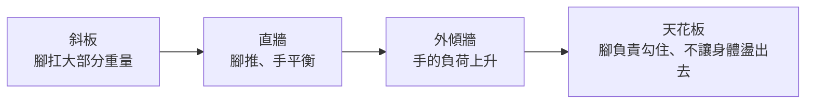

> 🌏 [English version](/posts/climbing/2026-10-18-climbing-wall-angles-en)

在垂直牆上爬得很順的題目，換到隔壁的外傾牆，同一個等級就上不去。反過來也一樣：外傾牆的常客，到了斜板上常常站不住。

這不是你突然變弱。牆的角度一變，身體的重量由誰來扛就跟著變，前面學過的技巧要換個順序用。這篇不教新動作，只把[腳法](/posts/climbing/2026-10-18-climbing-footwork)、[重心](/posts/climbing/2026-10-18-climbing-balance)、[側身與擰身](/posts/climbing/2026-10-18-climbing-turning-twisting)、[握法](/posts/climbing/2026-10-18-climbing-holds-grips)依牆的角度重新排一次。

這篇寫給在岩館爬了幾個月的人。還沒爬過繩攀的話，先讀[攀岩入門](/posts/climbing/2026-10-08-climbing-beginner-guide)和[岩館上攀確保](/posts/climbing/2026-10-17-gym-top-rope-belay)。

先講名稱。[方格子的攀岩術語表](https://vocus.cc/article/623ac982fd897800012c7c40)說，攀岩的術語幾乎都從國外傳回來，大家都講原文。[攀岩小妞的技巧整理](https://climbingninjette.com/2024/10/13/climbing-techniques/)把牆分成四種，本文沿用它的中文：

| 角度 | 台灣常見說法 | 長什麼樣子 |
|---|---|---|
| Slab | 斜板 | 比垂直緩，牆往後倒，點少而小 |
| Face | 直牆 | 接近 90 度垂直，新手路線大多在這 |
| Overhang | 外傾牆 | 牆往你這側傾出來 |
| Roof | 天花板 | 接近水平，要倒掛著爬 |

## 牆越陡，重量越往手上跑

先看研究怎麼說，因為它決定了後面所有的取捨。

- [Baláš 等人 2014 年的研究](https://pmc.ncbi.nlm.nih.gov/articles/PMC4327382/)讓 11 位女性攀岩者在三種角度的牆上爬，從略緩於垂直到微外傾，鞋墊裡放壓力感測器。牆越陡，腳承受的重量越少。
- 同一個研究裡，新手踩在腳點上的重量比中級者少，耗氧和心跳卻比較高。
- [Noé 等人 2001 年的研究](https://pubmed.ncbi.nlm.nih.gov/11240356/)比較垂直和外傾的姿勢：外傾時，手臂要明顯出更多力才不會掉。
- [Bonelli 等人的研究](https://pmc.ncbi.nlm.nih.gov/articles/PMC13236747/)用測力岩點量 14 位攀岩者：牆從 +5 度變成 −5 度，負荷就從腳轉移到手上。

所以常聽到的口訣「用腳爬，不要用手」，在垂直和微外傾的牆上有研究支持。牆一陡，手的負荷一定會上升，再會用腳也一樣。外傾牆該記的是另一句。英國教練 Neil Gresham 在 [Climbing.com 的勾腳教學](https://www.climbing.com/skills/rock-climbing-technique-foot-toe-hooks-tips/)裡說：「外傾攀登的第一頁，是腳不要離牆。」

## 斜板：把體重放到腳上

斜板上沒什麼可以拉的。[Climbing.com 整理的 Hazel Findlay 斜板技巧](https://www.climbing.com/skills/friction-slabs-tips-from-hazel-findlay/)，核心只有一句：相信你的腳，把更多體重壓上去，看不見的點就會變得可以用。

具體怎麼做：

- **身體站到腳的正上方。** 腳上的壓力越大，鞋底的摩擦力越大，也越穩。
- **腳跟放低，用前腳掌整片貼踩（smearing）。** Findlay 的原話是「不要用鞋尖內側踩（edging）」，因為接觸岩面的橡膠會變少。[REI 的動作教學](https://www.rei.com/learn/expert-advice/climbing-techniques.html)也說貼踩最適合斜板。
- **手放軟。** 手肘微彎，手掌或手指往牆上按，不是去抓。REI 提到在斜板上，手指朝下的推掌（palming）特別好用。
- **不要伸太高、跨太高。** 伸手勾遠點、腳跨得很高、用力捏小點，這些動作會把身體拉向牆，腳上的重量就變少了。
- **小腿痠了就把腳跟往下沉。** 這會伸展小腿，也讓更多鞋底貼住岩面。

斜板也是最考信心的角度。Findlay 說，卡在一個姿勢越久越難動，保持移動反而比較穩。

**今晚就能做的動作**：找館裡最緩的一面斜板，挑一條比你平常低兩級的題目。每踩一步，先確認腳跟比腳尖低、肚臍在那隻腳的正上方，再移手。

## 直牆：照基本功的順序走

垂直牆是前面幾篇的主場，技巧依[系列總覽](/posts/climbing/2026-10-18-climbing-movement-overview)的順序用就好：先看腳、再移重心、再推腳，牆陡一點才加入側身。

REI 對垂直牆的提醒有三條：

- **直臂讓骨架扛重量。** 手肘只要彎一點，肌肉就得出力撐住。
- **新手的髖部常正對牆面。** 這樣很穩，但會把重量推離牆面。
- **讓一側髖部貼近牆。** 重量會留在腳上，你也能靠著直臂往後倚。

Backstep（用鞋外側踩點、髖部側過去）和 drop knee（折膝）在垂直牆上就開始有用，細節在[側身與擰身](/posts/climbing/2026-10-18-climbing-turning-twisting)。

**今晚就能做的動作**：在一條垂直的上攀路線上，每做完一個動作就停一下，檢查兩件事：手臂是不是直的、哪一側髖部離牆比較近。

## 外傾牆：腳不要離牆

到了外傾牆，手一定會比較累，重點變成「讓手少累一點」。[Climbing.com 的外傾攀登技巧](https://www.climbing.com/skills/steep-climbing-tips-technique-mindset/)整理了幾條：

- **收緊核心，不要讓屁股往下垮。** 屁股一垂，重量就壓到手臂上。髖部靠近牆，腳尖才踩得進點。
- **每個腳點都用力踩，尤其是爛的那些。** 用鞋尖，讓點落在大拇趾下方。
- **身體對準手點的正下方。** 換方向時用髖部帶，不是用手拉。
- **手臂盡量伸直不動，讓腳去找位置。** 腳換個位置，側拉點也可能變成倒抓點。
- **折膝、掛腳、勾腳都是幫手臂減重的工具**，看到能用就用。
- **從休息點爬到下一個休息點。**

### 「屁股要貼牆」在外傾牆上要改一下

「髖部貼牆」在靜態站姿時是對的，但移動時不一定。[Hooper's Beta 的教練 Dan](https://hoopersbeta.com/library/body-tension-coaching-with-dan) 觀察到，把自己往牆上貼得太緊，一放手身體就會往外盪，反而卡住下一個動作。他教的感覺是：盡量遠離下方那隻手，放鬆找到重心的鉛垂線。

[同一系列的另一集](https://hoopersbeta.com/library/one-essential-tool-for-progressing-on-overhangs-coaching-w/-dan-pt-3)補上一個做法：在外傾牆上要做大動作前，先直臂、往下坐在腳上。這樣有空間移腳，也有一段距離可以加速。只是想慢慢平衡、伸手搆點時，貼緊牆就可以。

兩種說法並不衝突，看你在哪個階段：

| 你在做什麼 | 髖部 |
|---|---|
| 靜態站著、休息、掛快扣 | 貼近牆，重量留在腳上 |
| 準備做大動作、要出手 | 直臂往下坐，離下方那隻手遠一點 |

這和[重心篇](/posts/climbing/2026-10-18-climbing-balance)講的「靜態貼牆、移動找鉛垂線」是同一件事。

### 「直臂就是在休息」只對一半

直臂確實讓二頭肌休息，也方便甩手。但 Bonelli 的研究發現，直臂往下坐的姿勢，手指屈肌的活化在三種角度都比較高。手指還是在出力。這個研究只比較了 ±5 度，是靜態三點站姿，結論不能直接推到大外傾，但足以說明直臂不等於手指休息。

外傾牆上真正的休息，[Climbing.com 的休息技巧](https://www.climbing.com/skills/how-to-rest-climbing/)列了幾種：

- **掛腳**是這種地形最常見的休息方式。
- **膝頂（knee bar）**：把小腿卡在兩個面之間，腳掌和膝蓋對撐。台灣部落格多寫作膝頂。在外傾路線上要撐得久，需要很強的腹肌。
- **找淺淺的內角撐開（stemming）**，或用折膝。

文章也提醒，靠核心撐住的休息，過一下腹部和腿就先累了。這時甩一甩、補粉，就繼續往上。

**今晚就能做的動作**：在外傾牆上找一條你能完攀的題目，爬的時候只想一件事：每次出手前，兩隻腳都還在點上。腳滑掉一次，就從頭再爬。

## 天花板：腳是第三、第四隻手

天花板接近水平，腳不只負責推，還要負責勾住、不讓身體盪出去。台灣的寫法是：用腳跟叫**掛腳（heel hook）**，用腳背叫**勾腳（toe hook）**。攀岩小妞的技巧表把勾腳的用途寫成「天花板、防止身體盪出去」。

### 勾腳

Gresham 在勾腳教學裡講了幾個重點：

- **出手前先往下看。** 勾腳最常見的錯，是沒發現能勾的點，因為它在視線外。
- **勾了就勾死。** 腳背用力往回扳，用小腿前側的肌肉持續拉。猶豫一下腳就會滑開。
- **先想好怎麼收腳。** 用小步移腳，不要讓雙腳一次全離牆。真的要離牆，先放一隻腳，用核心把擺盪壓住。
- **Clamping**：另一隻腳踩在同一個點的上面，兩腳上下夾住，比較省小腿的力。
- **大屋簷可以腳先出去。** 先把腳勾到邊緣，身體再跟過去。

### 掛腳

[UKC 的掛腳教學](https://ukclimbing.com/articles/skills/technique_-_heel_hooking-11327)說，翻過天花板的邊緣，最簡單的方法通常是掛腳。客座教練 Louis Parkinson 說，他看到很多人只是把腳跟「放上去然後祈禱」，結果腳很少留得住。腳的角度要對，大腿後側要持續出力把腳跟往回拉。

Parkinson 還有一句話很適合當這篇的結論。不要把四肢想成「手是拉的、腳是推的」，要想成四隻可以互換的肢體：用腳拉，和用手推一樣常見。

另一個差別在墜落。Climbing.com 的外傾技巧提到，外傾牆和洞穴下方是空的，墜落時不會撞到岩階。斜板相反，Findlay 的文章說掉下去是貼著牆面往下滑，要保持姿勢、讓腳繼續貼著岩面，手不要跟著在牆上拖。

**今晚就能做的動作**：在抱石區的天花板，做 Gresham 推薦的練習。任何岩點都能用，數一數你能找到幾個可以勾腳的地方，每個能撐多久。

## 依角度排出三個優先技巧

把上面整理成一張表。拿到一條新路線，先看角度，再決定先想哪三件事：

| 角度 | 優先技巧 | 最常見的錯 |
|---|---|---|
| 斜板 | 體重壓在腳上、腳跟放低貼踩、手放軟去推 | 伸太高去勾點，把自己拉離腳 |
| 直牆 | 看腳精準踩、直臂、一側髖部貼牆 | 髖部正對牆面，手臂一直彎著 |
| 外傾牆 | 腳不離牆、收核心、用折膝或掛腳減輕手的負擔 | 屁股往下垮，看到大點就忘了腳 |
| 天花板 | 勾腳、掛腳、先想好怎麼收腳 | 腳一離點就整個人盪出去 |

## 練習題：四個情境

答案在每題下方，先自己想再看。

**1. 你在斜板上，腳下是一片沒有明顯腳點的牆面，右手搆得到上面一個小點。你很想用力捏住它把自己拉上去。**

答案

先不要。用力捏小點、伸高手，會把身體拉向牆，腳上的重量變少，鞋底的摩擦也跟著變小。照 Findlay 的做法：腳跟放低、前腳掌整片貼上去，身體站到那隻腳的正上方，手只用來推牆平衡。

**2. 外傾牆上，你每次伸手去拿下一個大點，雙腳就跟著離牆，整個人盪出去。**

答案

外傾攀登的第一課是腳不要離牆。出手前先收緊核心，讓屁股不要垮；用鞋尖用力踩住腳點，或找一個可以勾腳、掛腳的點把腳固定住。也可以先直臂往下坐在腳上，再發動，讓身體有空間控制擺盪。

**3. 朋友說：「在外傾牆上手臂伸直就是在休息，所以直臂吊著越久越好。」**

答案

只對一半。直臂讓二頭肌休息，也方便甩手；但 Bonelli 的研究發現，直臂往下坐時，手指屈肌的活化反而比較高。手指還在出力。真正的休息要找能讓重量回到腳上的位置，例如掛腳、膝頂或撐開的內角。

**4. 你要翻過一個天花板的邊緣，邊緣上有一條橫向的長條點。**

答案

這是掛腳的典型位置。先把腳跟掛上那條點，大腿後側持續出力往回拉，把手的負荷轉到腳上；站高之後，再把腳跟換成腳尖踩。不要只是把腳跟放上去就等它留住。

## 下一步

岩館的牆角度熟了，下一篇是[裂隙技術](/posts/climbing/2026-10-18-crack-climbing-technique)。到了龍洞這類有裂隙的岩場，手和腳要改用塞的。想知道台灣各岩場是什麼地形，可以讀[台灣岩場怎麼挑](/posts/climbing/2026-10-17-taiwan-crags-rock-type)。

外傾牆需要的核心、手指和小腿前側的肌力，屬於訓練的範圍，之後會在另一個系列另外寫。

## 參考資料

- [The Effect of Climbing Ability and Slope Inclination on Vertical Foot Loading（Baláš et al., 2014, Journal of Human Kinetics）](https://pmc.ncbi.nlm.nih.gov/articles/PMC4327382/)
- [Influence of steep gradient supporting walls in rock climbing: biomechanical analysis（Noé, Quaine & Martin, 2001, Gait & Posture）](https://pubmed.ncbi.nlm.nih.gov/11240356/)
- [Climber's muscle excitation and force distribution at different wall angles and body positions（Bonelli et al., European Journal of Applied Physiology）](https://pmc.ncbi.nlm.nih.gov/articles/PMC13236747/)
- [How to Get Better At Slab Climbing（Climbing.com，Hazel Findlay 的斜板技巧）](https://www.climbing.com/skills/friction-slabs-tips-from-hazel-findlay/)
- [Climbing Techniques and Moves（REI Expert Advice）](https://www.rei.com/learn/expert-advice/climbing-techniques.html)
- [Steep Climbing Tips, From Technique to Mindset（Climbing.com）](https://www.climbing.com/skills/steep-climbing-tips-technique-mindset/)
- [9 Pro Climbing Technique Tips For Maximum Toe Hooking（Climbing.com，Neil Gresham）](https://www.climbing.com/skills/rock-climbing-technique-foot-toe-hooks-tips/)
- [SKILLS: Technique – Heel Hooking（UKClimbing，Neil Gresham 與 Louis Parkinson）](https://ukclimbing.com/articles/skills/technique_-_heel_hooking-11327)
- [How to Rest While Climbing（Climbing.com）](https://www.climbing.com/skills/how-to-rest-climbing/)
- [When 'Tight to the Wall' Actually Does the Opposite（Hooper's Beta）](https://hoopersbeta.com/library/body-tension-coaching-with-dan)
- [One Essential Tool for Progressing on Overhangs（Hooper's Beta）](https://hoopersbeta.com/library/one-essential-tool-for-progressing-on-overhangs-coaching-w/-dan-pt-3)
- [攀岩技巧整理（攀岩小妞 climbingninjette）](https://climbingninjette.com/2024/10/13/climbing-techniques/)
- [攀岩術語表（方格子）](https://vocus.cc/article/623ac982fd897800012c7c40)
- [台灣岩場怎麼挑：岩質決定爬法，規定決定能不能去](/posts/climbing/2026-10-17-taiwan-crags-rock-type)
