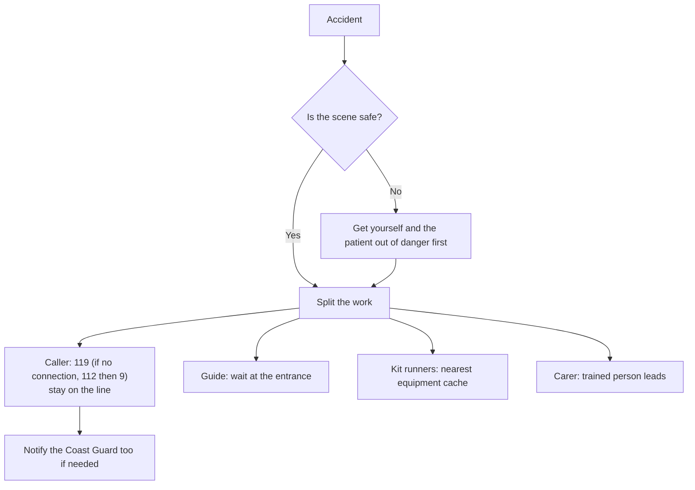

> 🌏 [中文版](/posts/climbing/2026-10-18-crag-first-aid)

In May 2026 there were two climbing falls at Long Dong within two weeks. In the first, firefighters arrived about 40 minutes after the call, but because they had to descend into the gully, [paramedics only reached the patient an hour after the call](https://www.cna.com.tw/news/asoc/202605020099.aspx) (in Chinese); she was hoisted out by a National Airborne Service Corps helicopter. In the second, firefighters [carried the injured climber out by stretcher relay across the rocks](https://www.mirrordaily.news/story/61392) (in Chinese) to Keelung Hospital.

After the second accident, the fire department said outdoor climbing accidents are on the rise and that rescuers often have to walk a long way to reach the scene. In other words, **for the first hour after an accident, it's just you and the climbers around you.**

This post covers four things: what to prepare before you go, how to call for help and split the work, what current guidelines say while you wait, and what to carry and where to train. It's the last post in the Climbing Injuries and First Aid series. For rope-based self-rescue (escaping the belay, hauling systems), see [Self-Rescue Basics](/posts/climbing/2026-10-17-self-rescue-basics-en); this post doesn't repeat it.

## Before you go: get your reporting details ready

### 119 or 112?

According to the [National Fire Agency](https://www.nfa.gov.tw/cht/index.php?code=list&flag=detail&ids=66&article_id=795) (in Chinese) and a [2026 explainer from the Taiwan FactCheck Center](https://tfc-taiwan.org.tw/mountain-safety-dont-rely-on-line-location-learn-essential-rescue-coordinates/) (in Chinese):

- **With signal, call 119 first.** A person answers directly, and the 119 dispatcher can send you a "location text"; once you agree to share, they get your GPS coordinates.
- **Only if 119 won't connect, call 112.** 112 routes you through a voice menu (press 9 for 119), so it's slower. 112 is voice-only and can't receive texts, so **you have to read your coordinates out yourself**.
- **After the 3G shutdown.** The [Forestry and Nature Conservation Agency](https://www.forest.gov.tw/0004548/0073591) (in Chinese) explains that since 3G was switched off on 30 June 2024, a phone must support 4G voice (VoLTE) and not be a CSFB model to dial 112 within any carrier's coverage. Phones or SIMs too old for VoLTE can't make the call anywhere, in the mountains or in town.

You'll hear "112 works even without signal". More precisely: it works when your own carrier has no signal but another carrier does. A [2020 Taiwan FactCheck Center report](https://tfc-taiwan.org.tw/fact-check-reports/migration-4648/) (in Chinese) notes that where there is no carrier base station at all, neither 112 nor 119 will connect.

### Numbers to save for Long Dong

| Service | Number | Use |
|---|---|---|
| 119 | 119 | First choice |
| 112 | 112, then press 9 | When 119 won't connect |
| New Taipei Fire Department, Gongliao station | 02-2494-1314 | Local fire station ([NTPC fire station list](https://www.fire.ntpc.gov.tw/PageDoc/Detail?fid=318&id=1956), in Chinese) |
| Coast Guard, Longdong Fishing Harbor station | 02-2490-9176 | Local unit for sea evacuation ([Coast Guard northern branch contact list](https://www.cga.gov.tw/GipOpen/wSite/public/Attachment/f111070102.pdf), in Chinese) |
| Coast Guard emergency line | 118 | Incidents at sea ([CGA 118 site](https://www.cga.gov.tw/GipOpen/wSite/lp?ctNode=1452&mp=118&nowPage=1&pagesize=15), in Chinese) |

Long Dong accidents are often evacuated by sea, and TOCC's 2020 accident report also recommends notifying the Coast Guard. The station numbers are ordinary office lines; in an emergency, 119 still comes first.

### How to describe where you are

- **Rescue point number.** TOCC (Taiwan Outdoor Climbers' Coalition)'s [Long Dong EMS Project](https://www.tocc-climbing.org/ems-project) surveyed 15 rescue points together with the Gongliao and Ruifang fire stations, with maps in the plan document. Saying "rescue point number X" tells responders whether to come by land, sea or air.
- **Coordinates.** The FactCheck Center quotes mountain writer 雪羊: your phone's built-in compass app shows coordinates; screenshot them or copy the latitude and longitude. It works without data.
- **Area name.** At minimum, be able to name the area, such as Music Hall (音樂廳) or School Gate (校門口).

**Something you can do tonight**: open your phone's compass app and check that it shows coordinates. Save the numbers above and the TOCC rescue plan on your phone, and check whether your phone supports VoLTE.

## When something happens: calling and splitting the work

### One person can't do everything

TOCC's [report on a 2020 accident at the Clocktower](https://www.tocc-climbing.org/post/2020/05/03-鐘塔橫渡牆女性遊客墜落意外) (in Chinese) includes a list of roles. In that incident a visitor fell about 6 m. Firefighters arrived about 40 minutes after 119 was reached, and a fire-service inflatable boat picked the patient up from a sea platform; by the time she reached hospital, nearly two and a half hours had passed since the call. The report recommends:

1. **One person calls and doesn't hang up**, keeping fire and Coast Guard updated.
2. **One person goes to the crag entrance** to guide rescuers in.
3. **Several people fetch the emergency kit** (locations under "Long Dong's equipment caches" below).
4. **One person records** times and images.
5. **Gather nearby climbers** to stand by and help carry.
6. **Whoever on site has medical training** leads the assessment.

### What to say

TOCC's reporting checklist: your name, the accident location or rescue point number, the patient's age, sex and injuries, how it happened, your phone and a backup phone number, and how many people on site can help carry.

TOCC also runs a "Long Dong accident reporting LINE group" whose members include climbers and some local fire and Coast Guard personnel; the join password is "TOCC". Posting your report there lets climbers nearby come straight away. The group supplements 119; it doesn't replace it.

**Something you can do tonight**: agree with your regular partners who calls and who goes to the entrance if something happens. Save a fill-in-the-blanks report template in your phone notes.

## While you wait: what current guidelines say

These are the two situations people ask about most. On the day, follow whoever on site is trained and the instructions from 119; this section explains the direction of international guidelines so you understand why a trained person might do something different from what you'd expect.

### Possible spinal injury

The [Wilderness Medical Society's 2024 spinal cord protection guideline summary](https://wms.org/magazine/1476/2024-Spine-Summary) says:

- The goal is to protect the spinal cord, not to immobilise the person completely. Rigid immobilisation with a collar or backboard is not an effective or safe means of doing that and can lead to worse outcomes in both blunt and penetrating trauma.
- When the patient has to be moved, the guideline prefers a "lift and slide" over a log roll, and a vacuum splint over a rigid collar.

The Long Dong equipment caches include collars and long boards, and they were used in the 2020 incident. These don't conflict: the kit is there, and whether and how to use it is for a trained person to decide. If you're not trained, don't move the patient yourself; wait for help and follow 119's instructions over the phone.

### Someone hanging on the rope and not moving

The [2023 ICAR Medical Commission review](https://pmc.ncbi.nlm.nih.gov/articles/PMC10710713/) on suspension syndrome says:

- It's rare, but someone hanging motionless on a rope may first become dizzy, pale, sweaty, with blurred vision and nausea, and then lose consciousness.
- Someone stuck on the rope must be **brought down quickly**, so "rope work should never be conducted alone": the team needs a plan to get a person down fast.
- While waiting, the person can push against the rock or stand in a clipped sling to activate the leg muscle pump.
- Once down, lay them **flat**. Older advice said not to lay the patient down abruptly; the review says there's no evidence for that.

For the rope techniques to get someone down, see [Self-Rescue Basics](/posts/climbing/2026-10-17-self-rescue-basics-en).

**Something you can do tonight**: tell your belay partner: "Someone stuck on the rope comes down fast, and once down, they lie flat." Then plan a session to practise lowering a passive climber close to the ground.

## First-aid kit and equipment

### Your own kit

The [BMC's first-aid kit advice](https://thebmc.co.uk/en/mountain-first-aid) favours light and simple:

- Tape you can cut to size, and a few antihistamine tablets.
- A couple of painkillers; the BMC's words are "if you are in doubt as to how to administer these: DON'T".
- Sanitary towels make cheap, light large dressings; duct tape holds dressings and improvised splints in place.
- Climbing carries a risk of grit in the eyes; small pods of sterile water or saline can wash out eyes and wounds.
- Six whistle blasts or six torch flashes are alternative ways to attract attention when phones don't work.

A [WMS Magazine article on first-aid kits](https://wms.org/magazine/magazine/1515/An-Evidence-Based-First-Aid-Kit/default.aspx) adds that a kit should be tailored to the trip and everyone in the group should know where it is and what's in it. The BMC also says the most useful thing you can carry is training.

### Long Dong's equipment caches

TOCC keeps six equipment caches at Long Dong: School Gate, Clocktower, Music Hall, First Cave, Golden Valley and Back Door. Each has a sealed blue barrel with supplies for bleeding control, bandaging, fracture splinting and collars, plus a dark green canvas bag holding a long board. Some advanced items are for trained professionals only. After using anything, fill in TOCC's accident report form so the team can recover the kit.

**Something you can do tonight**: open the TOCC rescue plan, find the nearest cache and rescue point number for the area you climb most, and write them down.

## Where to train

Wilderness first-aid courses in Taiwan (checked October 2026; all pages in Chinese):

| Course | Provider | Length | Cost | Certificate |
|---|---|---|---|---|
| [WFA](https://www.formosa-adventure.com/product_description.php?PNo=99) | Taiwan Wilderness Medical Association (TWMA), booked via Formosa Adventure | 2 days, 16 h | NT$7,800 | WMAI + TWMA, 3 years, no extension |
| [WAFA](https://miasan.com/event/wafa20261212/) | TWMA, booked via Miasan Outdoor Center | 4 days | NT$16,000 | Pass, then take the Bridge to upgrade to WFR |
| [Bridge](https://www.mountaineer.org.tw/event/2026-bridge/) | TWMA, co-hosted by Shujian Outdoor Learning Center | 4 days, 36 h | NT$16,000 | WAFA to WFR |
| [TWLS Taiwan Wilderness Life Support](https://www.sem.org.tw/Activity/Details/33268) | Taiwan Society of Emergency Medicine | 2 days | NT$5,000 | Taiwan Society of Emergency Medicine |
| [Long Dong rescue training](https://www.tocc-climbing.org/ld-ems-training) | TOCC | — | — | Patient assessment, c-spine protection, moving patients, evacuation plans |
| [16-hour first aider](http://taipeiredcross.org.tw/page.php?no=134) | Taipei Red Cross | 2 days, 16 h | NT$1,300 | Urban first aid, 3 years; this page covers group bookings |

A few notes:

- **Wilderness vs urban first aid** comes down to time to hospital. [Adventure Taiwan's explainer](https://www.adventuretaiwan.com/about-wilderness-first-aid/) puts it this way: if a patient can reach hospital within about an hour, urban first aid applies; if it takes one to two hours or more, you're in wilderness first-aid territory. Going by the incidents above, Long Dong is the latter.
- **Most 2026 sessions are full.** Miasan's late-2026 WFA and WAFA sessions show as full, with the next ones in March 2027; the Taiwan Society of Emergency Medicine cancelled its October 2026 TWLS session for low enrolment. Book early.
- **TWMA**'s website is [taiwanwma.org](https://taiwanwma.org/), where its 2026 (ROC year 115) courses are announced.

**Something you can do tonight**: pick a course from the table and put the next session date in your calendar. Agree with your regular climbing partners that at least one of you goes first.

## Practice: four scenarios

Answers are below each question. Think first, then check.

**1. You're at Long Dong and your partner falls and is hurt. Your phone shows one bar.**

Answer

Call 119, not 112. 119 is answered by a person and can send a location text to get your coordinates. Give the rescue point number or area name, the patient's condition, and your phone and backup numbers, then stay on the line.

**2. 119 won't connect, so you dial 112 and get through. The fire service asks where you are.**

Answer

112 can't receive texts, so read out your coordinates: open the compass app for latitude and longitude, and add the rescue point number or area name. If your phone is old and doesn't support VoLTE, it may not be able to dial 112 at all since the 3G shutdown; check before you go.

**3. Your partner fell about 8 m onto rock. They're alert but say their neck hurts. Someone suggests carrying them to flat ground.**

Answer

If the scene is safe and you're not trained, don't move them; call for help and wait for trained people and rescuers. The WMS 2024 guideline focuses on protecting the spinal cord, prefers lift-and-slide when moving, and advises against rigid immobilisation; doing this correctly takes training. Neck pain after a fall needs hospital assessment.

**4. Your partner falls on lead, hits their head, and hangs on the rope without responding.**

Answer

Call for help and get them down to the ground as quickly as possible. The ICAR review says a person stuck on the rope should be brought down fast and laid flat; the old "don't lay them down abruptly" advice has no evidence behind it. A head impact with reduced responsiveness means hospital. For lowering techniques, see [Self-Rescue Basics](/posts/climbing/2026-10-17-self-rescue-basics-en).

## Next steps

That's the end of the series. Go back to the [Climbing Injuries Overview](/posts/climbing/2026-10-18-climbing-injury-overview-en) for the full map of posts 0–13. If you're heading to an outdoor crag for the first time, read [Your First Outdoor Sport Lead](/posts/climbing/2026-10-17-first-outdoor-sport-lead-en) and [Choosing a Crag in Taiwan](/posts/climbing/2026-10-17-taiwan-crags-rock-type-en) next.

## References

- [119 and 112 (National Fire Agency, in Chinese)](https://www.nfa.gov.tw/cht/index.php?code=list&flag=detail&ids=66&article_id=795)
- [Don't rely on LINE location sharing in a mountain emergency: the coordinates lesson every hiker needs (Taiwan FactCheck Center, 2026-04-10, in Chinese)](https://tfc-taiwan.org.tw/mountain-safety-dont-rely-on-line-location-learn-essential-rescue-coordinates/)
- [False: "mobile emergency numbers are now unified as 112 and dialling 119 doesn't work" (Taiwan FactCheck Center, 2020-10-30, in Chinese)](https://tfc-taiwan.org.tw/fact-check-reports/migration-4648/)
- [Mobile signal points in mountain areas (Forestry and Nature Conservation Agency, in Chinese)](https://www.forest.gov.tw/0004548/0073591)
- [Fire station locations (New Taipei City Fire Department, in Chinese)](https://www.fire.ntpc.gov.tw/PageDoc/Detail?fid=318&id=1956)
- [Northern Branch contact list (Coast Guard Administration, in Chinese)](https://www.cga.gov.tw/GipOpen/wSite/public/Attachment/f111070102.pdf)
- [Coast Guard emergency line 118 (in Chinese)](https://www.cga.gov.tw/GipOpen/wSite/lp?ctNode=1452&mp=118&nowPage=1&pagesize=15)
- [Woman falls 10 m at Long Dong crag, helicopter evacuation (Central News Agency, 2026-05-02, in Chinese)](https://www.cna.com.tw/news/asoc/202605020099.aspx)
- [Singaporean man falls 10 m at Long Dong, carried out by firefighters (Mirror Daily, 2026-05-16, in Chinese)](https://www.mirrordaily.news/story/61392)
- [Man in his twenties falls 10 m at Long Dong, stretcher relay to hospital (United Daily News, 2026-05-16, in Chinese)](https://udn.com/news/story/7320/9506667)
- [Long Dong EMS Project (TOCC, Taiwan Outdoor Climbers' Coalition)](https://www.tocc-climbing.org/ems-project)
- [2020-05-03 fall at the Clocktower traverse wall (TOCC incident report, in Chinese)](https://www.tocc-climbing.org/post/2020/05/03-鐘塔橫渡牆女性遊客墜落意外)
- [EMS Training (TOCC)](https://www.tocc-climbing.org/ld-ems-training)
- [2024 Spine Summary (Wilderness Medical Society Magazine)](https://wms.org/magazine/1476/2024-Spine-Summary)
- [Rauch S et al. Suspension syndrome: a scoping review and recommendations from the International Commission for Mountain Emergency Medicine (ICAR MEDCOM). Scand J Trauma Resusc Emerg Med 2023](https://pmc.ncbi.nlm.nih.gov/articles/PMC10710713/)
- [First aid kit essentials for mountaineering (BMC)](https://thebmc.co.uk/en/mountain-first-aid)
- [An Evidence-Based First Aid Kit (Wilderness Medical Society Magazine)](https://wms.org/magazine/magazine/1515/An-Evidence-Based-First-Aid-Kit/default.aspx)
- [Taiwan Wilderness Medical Association (TWMA, in Chinese)](https://taiwanwma.org/)
- [WFA course (Formosa Adventure, in Chinese)](https://www.formosa-adventure.com/product_description.php?PNo=99)
- [WAFA, 12–15 December 2026 (Miasan Outdoor Center, in Chinese)](https://miasan.com/event/wafa20261212/)
- [2026 WMAI Bridge course (Shujian Outdoor Learning Center, in Chinese)](https://www.mountaineer.org.tw/event/2026-bridge/)
- [Taiwan Wilderness Life Support course (Taiwan Society of Emergency Medicine, in Chinese)](https://www.sem.org.tw/Activity/Details/33268)
- [16-hour first aider group course (Taipei Red Cross, in Chinese)](http://taipeiredcross.org.tw/page.php?no=134)
- [An introduction to wilderness first-aid training (Adventure Taiwan, in Chinese)](https://www.adventuretaiwan.com/about-wilderness-first-aid/)
