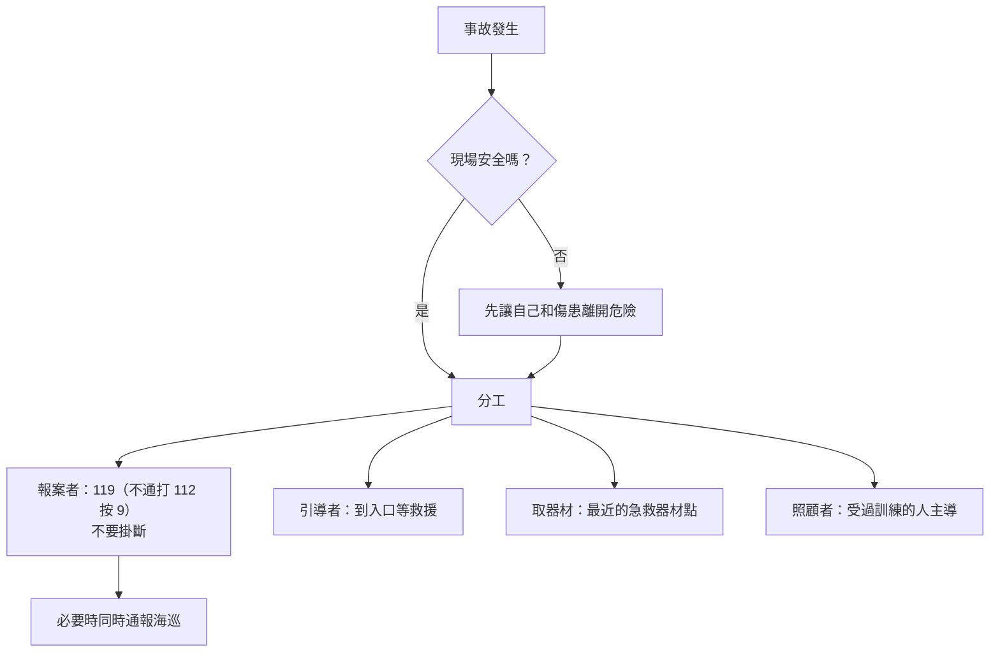

> 🌏 [English version](/posts/climbing/2026-10-18-crag-first-aid-en)

2026 年 5 月，龍洞兩週內發生兩起攀岩墜落。第一起，消防人員在報案後約 40 分鐘到場，但因為要下降到谷底，[報案一小時後才接觸到患者](https://www.cna.com.tw/news/asoc/202605020099.aspx)。最後由空勤總隊直升機吊掛送醫。第二起，傷者由[消防人員在岩石間人力接駁搬運](https://www.mirrordaily.news/story/61392)，送往衛福部基隆醫院。

新北市消防局在第二起之後表示，戶外攀岩事故有增加的趨勢，救援人員往往要長時間徒步才到得了現場。換句話說，**事故後的第一個小時，在場的只有你和岩友。**

這篇講四件事：出發前要準備什麼、出事時怎麼報案和分工、等救援時目前的指引怎麼說、該帶什麼和去哪裡學。這是〈攀岩傷害預防與急救〉系列的最後一篇。繩索技術的自我救援（確保脫離、拖拉系統）見〈[自我救援基礎](/posts/climbing/2026-10-17-self-rescue-basics)〉，本篇不重複。

## 出發前：把報案資訊準備好

### 119 和 112 怎麼選

依[內政部消防署](https://www.nfa.gov.tw/cht/index.php?code=list&flag=detail&ids=66&article_id=795)和[台灣事實查核中心 2026 年的整理](https://tfc-taiwan.org.tw/mountain-safety-dont-rely-on-line-location-learn-essential-rescue-coordinates/)：

- **有訊號，先打 119。** 有專人直接接聽，119 值勤台可以發「定位簡訊」給你，你同意上傳後，他們就拿得到 GPS 座標。
- **119 打不通，才打 112。** 112 會用語音引導轉接，按 9 轉 119，所以比較慢。112 只有語音、收不到簡訊，**座標要你自己唸出來**。
- **3G 關閉後的限制。** [林業及自然保育署](https://www.forest.gov.tw/0004548/0073591)說明，3G 在 2024 年 6 月 30 日關閉後，手機要支援 4G 語音（VoLTE）且不是 CSFB 機型，才能在任何一家業者的訊號範圍內撥 112。太舊的手機或 SIM 卡，山區平地都打不出去。

常聽到「沒訊號也能打 112」。比較準確的說法是：自家電信沒訊號、但有其他業者的訊號時可以打。[事實查核中心 2020 年的報告](https://tfc-taiwan.org.tw/fact-check-reports/migration-4648/)指出，當地沒有任何業者的基地台時，112 和 119 都打不通。

### 龍洞要存的號碼

| 單位 | 電話 | 用途 |
|---|---|---|
| 119 | 119 | 第一優先 |
| 112 | 112 → 按 9 | 119 打不通時 |
| 新北市消防局貢寮分隊 | 02-2494-1314 | 轄區消防分隊（[新北市消防局據點表](https://www.fire.ntpc.gov.tw/PageDoc/Detail?fid=318&id=1956)） |
| 海巡署龍洞漁港安檢所 | 02-2490-9176 | 海上接駁的在地單位（[海巡署北部分署聯絡表](https://www.cga.gov.tw/GipOpen/wSite/public/Attachment/f111070102.pdf)） |
| 海巡署報案專線 | 118 | 海上事故（[海巡署 118 網站](https://www.cga.gov.tw/GipOpen/wSite/lp?ctNode=1452&mp=118&nowPage=1&pagesize=15)） |

龍洞的事故常靠海路後送，2020 年 TOCC 事故報告也建議同時通報海巡。這兩支是單位的一般電話，緊急時仍以 119 為主。

### 位置怎麼講

- **救援點編號。** TOCC（臺灣戶外攀岩協會）的[龍洞岩場救援計畫](https://www.tocc-climbing.org/ems-project)和當年的貢寮、瑞芳分隊一起勘定了 15 個救援點，計畫書裡有地圖。報案時講「第幾救援點」，救援單位就知道走陸路、海路還是空中。
- **座標。** 事實查核中心引述登山作家雪羊的建議：手機內建的指南針 App 會顯示座標，截圖或抄下北緯東經數字就能用，沒有網路也可以。
- **區域名稱。** 至少講得出大禮堂、音樂廳、校門口這類區名。

**今晚就能做的動作**：打開手機的指南針 App，確認看得到座標。再把上面的號碼和 TOCC 救援計畫書存進手機，並查一下你的手機是不是支援 VoLTE。

## 出事時：報案和分工

### 一個人不要做所有事

TOCC 在 [2020 年鐘塔事故報告](https://www.tocc-climbing.org/post/2020/05/03-鐘塔橫渡牆女性遊客墜落意外)裡寫了一份分工建議。那次是遊客從約 6 公尺墜落。打通 119 後約 40 分鐘，消防人員到場，再用消防橡皮艇從海邊平台接駁；送達醫院時，已是報案後將近兩個半小時。報告建議的分工：

1. **一人報案，不要掛斷**，持續更新現場狀況給消防、海巡。
2. **一人到岩場入口**引導救援人員。
3. **數人去取急救器材**（位置見後面「龍洞岩場的急救器材點」）。
4. **一人記錄**時間和影像。
5. **召集附近岩友**待命，協助搬運。
6. **由現場有醫護背景的人**主導評估傷勢。

### 報案要講什麼

TOCC 的報案內容：你的姓名、事故地點或救援點編號、傷患的年齡性別和傷勢、怎麼受傷的、你的手機和備用手機號碼，以及現場有多少人可以協助搬運。

TOCC 也設了「龍洞岩場意外事故通報 LINE 群組」，成員包括岩友和部分在地消防、海巡人員，加入密碼是「TOCC」。把報案內容貼到群組，附近的岩友可以第一時間趕來。群組是補充，不是取代 119。

**今晚就能做的動作**：和常一起爬的夥伴約好：出事時誰報案、誰去入口。在手機備忘錄存一份報案範本，到時候只要填空。

## 等救援時：目前的指引怎麼說

下面兩項是現場最常被問的狀況。處理原則以現場受過訓練的人和 119 的指示為準；這裡只說明國際指引的方向，讓你知道為什麼受過訓練的人可能和你想的做法不同。

### 疑似脊椎受傷

[美國野外醫學會（WMS）2024 年的脊髓保護指引摘要](https://wms.org/magazine/1476/2024-Spine-Summary)說：

- 目標是保護脊髓，不是把人完全固定。用硬式頸圈或長背板固定，不是有效又安全的方法，在鈍傷和穿刺傷都可能讓結果更差。
- 需要移動傷患時，指引偏好「抬起滑移」（lift and slide），而不是側滾翻身（log roll）。真空夾板比硬式頸圈好。

龍洞的急救器材點裡有頸圈和長背板，2020 年的事故現場也用過。這兩件事不衝突：器材在那裡，用不用、怎麼用，交給受過訓練的人判斷。沒受過訓練，就別自己移動傷患，等人來，聽 119 的線上指導。

### 有人吊在繩上動不了

[國際山域救援委員會（ICAR）醫學委員會 2023 年的回顧](https://pmc.ncbi.nlm.nih.gov/articles/PMC10710713/)整理了懸吊症候群（suspension syndrome）：

- 很少見，但吊在繩上動不了的人，可能先出現頭暈、臉色蒼白、冒汗、視線模糊、噁心，進一步失去意識。
- 卡在繩上的人要**盡快放下來**，所以「繩索作業不應該一個人做」，同行的人要有快速把人弄下來的計畫。
- 等待時，讓吊著的人用腳踩岩壁或踩在掛好的扁帶環上，啟動腿部肌肉幫浦。
- 放下來之後**平躺**。舊建議說「不要立刻讓患者平躺」，回顧指出這個說法沒有證據。

把人放下來的繩索技術，見〈[自我救援基礎](/posts/climbing/2026-10-17-self-rescue-basics)〉。

**今晚就能做的動作**：把「卡在繩上的人要盡快放下來、放下來就平躺」講給你的確保夥伴聽。再約好一次，在地面附近練習下放一個不出力的人。

## 急救包和器材

### 自己帶的急救包

[英國登山協會（BMC）的急救包建議](https://thebmc.co.uk/en/mountain-first-aid)以輕便為主：

- 可剪成需要大小的膠布、少量抗組織胺錠。
- 少量止痛藥；BMC 的原話是「不確定怎麼用，就不要用」。
- 衛生棉可以當便宜的大敷料，大力膠帶可以固定敷料和臨時夾板。
- 攀岩時眼睛可能進沙，小包裝生理食鹽水可以沖眼睛和傷口。
- 沒有訊號時，吹哨或用手電筒閃 6 下求救。

[WMS 雜誌的急救包文章](https://wms.org/magazine/magazine/1515/An-Evidence-Based-First-Aid-Kit/default.aspx)補充：急救包要依行程調整，而且全隊都要知道它放在哪、裡面有什麼。BMC 也說，急救包裡最有用的東西是受過訓練。

### 龍洞岩場的急救器材點

TOCC 在龍洞設了 6 個急救器材點：校門口、鐘塔、音樂廳、第一洞、黃金谷、後門。每處有一個藍色密封桶，裝止血、包紮、骨折固定用品和頸圈；另一個墨綠色帆布袋裝長背板。部分進階器材限專業人員使用。用過之後，要填 TOCC 的意外事件回報表單，讓工作團隊回收器材。

**今晚就能做的動作**：打開 TOCC 救援計畫書，找出你最常爬的區域最近的器材點和救援點編號，記下來。

## 去哪裡學

台灣的野外急救課程（2026 年 10 月查詢）：

| 課程 | 開課單位 | 長度 | 費用 | 證照 |
|---|---|---|---|---|
| [WFA 初級野外急救](https://www.formosa-adventure.com/product_description.php?PNo=99) | 台灣野外地區緊急救護協會（TWMA），經小島探險報名 | 2 天 16 小時 | NT$7,800 | WMAI＋TWMA，3 年，不能展延 |
| [WAFA 野外進階急救](https://miasan.com/event/wafa20261212/) | TWMA，經米亞桑戶外中心報名 | 4 天 | NT$16,000 | 通過後可再上橋接課程換取 WFR |
| [Bridge 橋接課程](https://www.mountaineer.org.tw/event/2026-bridge/) | TWMA，書劍戶外學習中心合辦 | 4 天 36 小時 | NT$16,000 | WAFA 升 WFR |
| [TWLS 台灣野外救命術](https://www.sem.org.tw/Activity/Details/33268) | 台灣急診醫學會 | 2 天 | NT$5,000 | 台灣急診醫學會 |
| [龍洞岩場救援訓練](https://www.tocc-climbing.org/ld-ems-training) | TOCC | — | — | 傷患評估、頸椎保護、搬運與撤退計畫 |
| [16 小時急救員](http://taipeiredcross.org.tw/page.php?no=134) | 台北市紅十字會 | 2 天 16 小時 | NT$1,300 | 都市急救，3 年；這頁是團體開班辦法 |

幾點說明：

- **野外急救和都市急救的差別**在送醫時間。[艾格探險的說明](https://www.adventuretaiwan.com/about-wilderness-first-aid/)是：一小時內能送到醫院，適用都市急救；要一兩小時以上，就是野外急救的範圍。照前面的實例，龍洞屬於後者。
- **2026 年的梯次多已額滿。** 米亞桑 2026 年底的 WFA、WAFA 都顯示額滿，下一梯在 2027 年 3 月；台灣急診醫學會 2026 年 10 月那梯 TWLS 因人數不足取消。要上課，提早報名。
- **TWMA** 的官網是 [taiwanwma.org](https://taiwanwma.org/)，115 年度課程在上面公告。

**今晚就能做的動作**：從上表挑一門，把下一梯的日期記進行事曆。和固定的攀岩夥伴約好，至少一人先去上。

## 練習題：四個情境

答案在每題下方，先自己想再看。

**1. 你在龍洞，夥伴墜落受傷。你的手機顯示有一格訊號。**

答案

先打 119，不是 112。119 有專人接聽，還能發定位簡訊取得你的座標。報案時講救援點編號或區域名稱、傷患狀況、你和備用的手機號碼，然後不要掛斷。

**2. 119 撥不通，你改撥 112 接通了。消防問你在哪裡。**

答案

112 收不到簡訊，所以要自己唸座標：打開指南針 App 讀北緯東經，再加上救援點編號或區域名稱。如果手機是舊機、不支援 VoLTE，3G 關閉後可能連 112 都撥不出去，出發前就要確認。

**3. 夥伴從約 8 公尺墜落到岩盤上，意識清楚但說脖子痛。旁邊有人說要趕快把他抬到平坦的地方。**

答案

如果現場安全，沒受過訓練就不要移動他，報案、等受過訓練的人和救援人員。WMS 2024 指引強調保護脊髓，移動時偏好抬起滑移，不建議硬式固定；這些需要受訓才能做對。頸痛加上墜落，一定要送醫，由急診評估。

**4. 先鋒攀登的夥伴墜落後撞到頭，吊在繩上不回應。**

答案

立刻報案，同時盡快把他下放到地面。ICAR 的回顧說，卡在繩上的人要盡快放下來，放下來後平躺，舊的「不要立刻平躺」沒有證據。頭部撞擊加上意識不清，送醫是必要的。下放的技術見〈[自我救援基礎](/posts/climbing/2026-10-17-self-rescue-basics)〉。

## 下一步

系列到這裡結束。回到〈[攀岩傷害總覽](/posts/climbing/2026-10-18-climbing-injury-overview)〉，可以看到 0–13 篇的完整地圖。第一次去戶外岩場的人，可以接著讀〈[第一條戶外運攀先鋒](/posts/climbing/2026-10-17-first-outdoor-sport-lead)〉和〈[台灣岩場怎麼挑](/posts/climbing/2026-10-17-taiwan-crags-rock-type)〉。

## 參考資料

- [【錯誤】網傳「手機行動電話救命專線已統一為112…手機撥119是無效的」？（台灣事實查核中心，2020-10-30）](https://tfc-taiwan.org.tw/fact-check-reports/migration-4648/)
- [119、112（內政部消防署）](https://www.nfa.gov.tw/cht/index.php?code=list&flag=detail&ids=66&article_id=795)
- [發生山難不能只靠傳 LINE 定位！登山客必修的「救命座標課」（台灣事實查核中心，2026-04-10）](https://tfc-taiwan.org.tw/mountain-safety-dont-rely-on-line-location-learn-essential-rescue-coordinates/)
- [山區手機可通訊點標示資訊（林業及自然保育署）](https://www.forest.gov.tw/0004548/0073591)
- [消防據點（新北市政府消防局）](https://www.fire.ntpc.gov.tw/PageDoc/Detail?fid=318&id=1956)
- [北部分署及所屬單位聯絡資訊一覽表（海洋委員會海巡署）](https://www.cga.gov.tw/GipOpen/wSite/public/Attachment/f111070102.pdf)
- [海巡署緊急報案專線 118](https://www.cga.gov.tw/GipOpen/wSite/lp?ctNode=1452&mp=118&nowPage=1&pagesize=15)
- [新北貢寮龍洞攀岩女墜 10 公尺命危 空勤直升機急送醫（中央社，2026-05-02）](https://www.cna.com.tw/news/asoc/202605020099.aspx)
- [月初才 1 死！星國男龍洞攀岩墜 10 米 消防「人肉扛出」籲勿越級挑戰（鏡報，2026-05-16）](https://www.mirrordaily.news/story/61392)
- [貢寮區龍洞攀岩場 20 多歲男攀岩墜落 10 米 接力抬救送醫搶命（聯合報，2026-05-16）](https://udn.com/news/story/7320/9506667)
- [岩場救援計畫 EMS Project（TOCC 臺灣戶外攀岩協會）](https://www.tocc-climbing.org/ems-project)
- [2020/05/03 鐘塔橫渡牆女性遊客墜落意外（TOCC 意外事件報告）](https://www.tocc-climbing.org/post/2020/05/03-鐘塔橫渡牆女性遊客墜落意外)
- [救援訓練 EMS Training（TOCC）](https://www.tocc-climbing.org/ld-ems-training)
- [2024 Spine Summary（Wilderness Medical Society Magazine）](https://wms.org/magazine/1476/2024-Spine-Summary)
- [Rauch S et al. Suspension syndrome: a scoping review and recommendations from the International Commission for Mountain Emergency Medicine (ICAR MEDCOM). Scand J Trauma Resusc Emerg Med 2023](https://pmc.ncbi.nlm.nih.gov/articles/PMC10710713/)
- [First aid kit essentials for mountaineering（BMC）](https://thebmc.co.uk/en/mountain-first-aid)
- [An Evidence-Based First Aid Kit（Wilderness Medical Society Magazine）](https://wms.org/magazine/magazine/1515/An-Evidence-Based-First-Aid-Kit/default.aspx)
- [台灣野外地區緊急救護協會（TWMA）](https://taiwanwma.org/)
- [WFA 初級野外急救訓練（小島探險）](https://www.formosa-adventure.com/product_description.php?PNo=99)
- [2026/12/12–12/15 WAFA 野外進階急救訓練（米亞桑戶外中心）](https://miasan.com/event/wafa20261212/)
- [2026 WMAI Bridge 野外急救橋接課程（書劍戶外學習中心）](https://www.mountaineer.org.tw/event/2026-bridge/)
- [台灣野外救命術訓練課程（台灣急診醫學會）](https://www.sem.org.tw/Activity/Details/33268)
- [16H 急救員班申請開班辦法（台北市紅十字會）](http://taipeiredcross.org.tw/page.php?no=134)
- [淺談野外急救訓練（艾格探險）](https://www.adventuretaiwan.com/about-wilderness-first-aid/)
