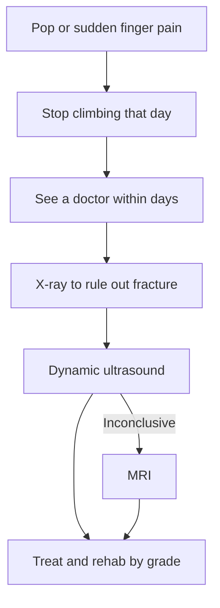

> 🌏 [中文版](/posts/climbing/2026-10-18-finger-pulley-injury)

You are on a tiny crimp at the gym, a foot slips, and there is a pop at the base of your finger. It may hurt right away, or you may finish the problem and only notice the swelling at home.

This post answers three questions: what a pulley is, the three things to do after the pop, and how much evidence sits behind the grading, timelines and taping advice you find online. The previous post, [Climbing Warm-Up](/posts/climbing/2026-10-18-climbing-warm-up-en), is about before an injury; this one is about the first months after. The series overview is [Climbing Injuries Overview](/posts/climbing/2026-10-18-climbing-injury-overview-en).

**This post is not a diagnosis.** The grades and timelines below come from studies or physiotherapists' summaries. Before any of them applies to your finger, a doctor has to examine it.

## What a pulley is, and why climbers injure them

Your fingers bend because of the flexor muscles in your forearm, whose tendons run all the way to the fingertips. Along the way, five annular ligaments hold the tendons against the bone. These are the pulleys, numbered A1 to A5 from the palm outward ([Larsson 2022](https://pmc.ncbi.nlm.nih.gov/articles/PMC9344739/)).

[Miro and colleagues' 2021 review](https://pubmed.ncbi.nlm.nih.gov/33966972/) is blunt: the crimp grip is the mechanism of pulley injury, and A2, A3 and A4 are at highest risk, especially under eccentric load. Eccentric load means the finger is pulling while being forced open, like the instant a foot slips. Why a full crimp loads A2 so heavily is worked through in [Hold Types and Grips](/posts/climbing/2026-10-18-climbing-holds-grips-en).

How common is it? It depends on the sample. At a sports medicine clinic in Bamberg, Germany, [Schöffl 2003](https://pubmed.ncbi.nlm.nih.gov/12825883/) saw 604 injured climbers, and pulley injuries were the most frequent at 20%. A decade later, in [911 injuries](https://pubmed.ncbi.nlm.nih.gov/25712297/) at the same clinic, pulleys were still the most common finger injury, and A4 injuries now outnumbered A2.

**Something you can do tonight**: Open your hands and find the middle of the segment closest to your palm on each finger. That is roughly where A2 sits; the middle of the next segment is A4. Next time a finger hurts, note which segment.

## Three things to do after the pop

### 1. Stop climbing that day

Physiotherapist Jason Hooper, in [Hooper's Beta's A2 recovery guide](https://hoopersbeta.com/library/ultimate-a2-pulley-injury-recovery-guide), recommends an immediate break from climbing for every grade, because climbing loads are unpredictable and a small injury can become a big one. A break from climbing is not a break from everything; other pain-free training can continue (evidence level: expert opinion).

### 2. See a doctor within a few days and ask for ultrasound

You usually do not need the emergency room. [Climbing.com's finger injury guide](https://www.climbing.com/skills/technique/complete-guide-healing-climbing-finger-injury/) says to get a medical evaluation within 3–10 days if the pain is very severe, swelling is significant, or you can see or feel bowstringing. [The Lattice physiotherapist's article on UKClimbing](https://ukclimbing.com/articles/skills/series/lattice_training_series_with_tom_randall/part_6_finger_injuries-11469) lists the same warning signs and adds obvious deformity or a significant loss of movement or function.

The order of tests is agreed on. [Schöffl's 2004 treatment study](https://pubmed.ncbi.nlm.nih.gov/15368149/) starts with X-rays to rule out a fracture, then dynamic ultrasound. Miro 2021 also recommends ultrasound as the first imaging test, with MRI added when ultrasound is inconclusive.

In Taiwan you can book orthopaedics (骨科) or hand surgery (手外科). The [Taiwan Society for Surgery of the Hand](https://handsurgery.com.tw/%E5%AD%B8%E6%9C%83%E7%B0%A1%E4%BB%8B/) (in Chinese) explains that hand surgeons qualify after specialist training in orthopaedics or plastic surgery, that their scope includes sports injuries of the hand, and that many hand injuries are treated with splints, tape, injections and hand therapy rather than surgery. Other options are in the [series overview](/posts/climbing/2026-10-18-climbing-injury-overview-en).

### 3. Rehab by grade, and agree the plan with your doctor or physio

Grades, timelines and splints only matter once you have a diagnosis. The next two sections cover them.

**Something you can do tonight**: Add one line to your phone notes: "Finger injury → stop climbing → see orthopaedics or hand surgery within 3–10 days → ask for dynamic ultrasound." When it happens, you will not be in the mood to search.

## Myth 1: "You can feel whether it's ruptured with a bowstring test"

A common gym routine is to have the injured climber flex the finger hard and see whether the tendon lifts.

[El-Sheikh and colleagues' 2006 systematic review](https://pmc.ncbi.nlm.nih.gov/articles/PMC2686056/) looked at 29 papers. Clinical bowstringing was indeed the most commonly cited diagnostic criterion, but the authors concluded that the prevailing notion that these injuries can be diagnosed by testing for bowstringing **is not supported by evidence**, and recommended dynamic ultrasound.

Hooper adds that even a complete A2 rupture usually shows no bowstringing to the naked eye, and a fully ruptured finger may have no obvious swelling or bruising. If you cannot see or feel anything, that does not mean nothing is wrong.

Ultrasound accuracy has cadaver support: [Isabelle Schöffl and colleagues in 2018](https://pubmed.ncbi.nlm.nih.gov/30537790/) created pulley ruptures in 18 cadaver fingers, and ultrasound detected A2 ruptures with 90% sensitivity (evidence level: cadaver study).

**Something you can do tonight**: Next time a friend is hurt and someone offers to "feel it", you can say: "Not feeling anything doesn't rule out a rupture. Get an ultrasound."

## Grading: the Schöffl system and its versions

The most-cited grading comes from Schöffl's group in 2003, based on injured climbers at one German sports medicine clinic. The table below is reproduced from [Larsson's 2022 systematic review](https://pmc.ncbi.nlm.nih.gov/articles/PMC9344739/), which notes it is "modified from Schöffl et al."

| Grade | Injury | Treatment in the original table |
|---|---|---|
| 1 | Pulley strain | Conservative, tape |
| 2 | Complete rupture of A4, or partial rupture of A2 or A3 | Conservative, tape |
| 3 | Complete rupture of A2 or A3 | Conservative, thermoplastic ring plus tape |
| 4 | Multiple ruptures; or a single rupture combined with lumbrical or collateral ligament trauma | Surgical reconstruction |

Three things to know when reading it:

- **Grade 4 has more than one definition.** The abstract of [Volker and Isabelle Schöffl's 2006 review](https://pubmed.ncbi.nlm.nih.gov/16632061/) defines grade IV only as "multiple ruptures". Hooper treats a two-pulley rupture (IVa) conservatively and refers a three-pulley rupture (IVb) for surgical consultation. [Scheibler and colleagues in 2021](https://pubmed.ncbi.nlm.nih.gov/33741540/) reported 12 triple A2–A3–A4 ruptures. The 6 seen within two weeks and treated conservatively with splints were all back at their previous level at 6 months; cases diagnosed more than two months late did worse. The authors suggest that early diagnosis and conservative care can avoid surgery even for triple ruptures (evidence level: case series).
- **Single ruptures are usually not operated on.** [Schöffl's 2006 follow-up of 21 climbers](https://pubmed.ncbi.nlm.nih.gov/16679977/) recommends non-surgical treatment for single ruptures, and found no strength difference between injured and healthy fingers. Hooper also says surgery is not recommended for an isolated A2 tear, even a complete one. "A ruptured pulley needs surgery" is a myth.
- **Splinting the whole finger: two camps.** Larsson summarises Schöffl's approach as immobilisation for up to 2 weeks for grades 2–3. Hooper says full-finger immobilisation is not recommended for any grade and uses only a pulley splint. Your doctor or physio decides.

**Something you can do tonight**: If you already have a diagnosis, ask your doctor: "Which grading system is this, and which grade?" Two "grade 4" injuries can be treated very differently depending on the version.

## Recovery timelines: check the endpoint first

Timelines online vary widely, mainly because they measure different endpoints. "First time back on the wall" and "back to your previous grade" can be months apart.

- **Back on the wall**: the [UIAA Medical Commission's sport climbing factsheet](https://theuiaa.org/documents/safety/UIAA_Medical_SportClimbing.pdf) says a single pulley injury can heal with functional taping or a softcast ring, with no climbing for 6–8 weeks depending on symptoms.
- **Back to previous grade**: [Schneeberger and Schweizer 2016](https://pubmed.ncbi.nlm.nih.gov/27067301/) followed 45 climbers with complete ruptures treated with a pulley-protection splint; regaining their previous level took a mean of 8.8 months.
- **Full strength**: Hooper estimates around 20 weeks for grade III, based on his clinical experience (evidence level: expert opinion).

The full numbers are below. Samples, grading versions and endpoints all differ, so **they cannot be compared with each other or used as your own timeline**.

Timelines by source (with sample and scope)

| Source | Sample / type | Endpoint | Timeline |
|---|---|---|---|
| Larsson 2022 summarising Schöffl 2003/2004 | Secondary summary; original table not public | Return to sport | Grades 1–2: 6–8 weeks; grade 3: 3 months. Protective taping 3 months (grades 1–2) or 6 months (grade 3) |
| UIAA MedCom factsheet | Expert advice | No climbing | Single pulley injury: 6–8 weeks, depending on symptoms |
| Schöffl 2006 MSSE | 21 climbers, grades 2–4, re-examined a mean 3.46 years later | Previous grade | Within a year |
| Schneeberger & Schweizer 2016 | 47 complete ruptures in 45 climbers, pulley-protection splint | Previous grade | 38 of 43 regained it, mean 8.8 months |
| Hooper's Beta | Physiotherapist's clinical experience | Time off climbing | I: 7–10 days; II: 2 weeks; III: 6 weeks; IVa: 8 weeks |
| Hooper's Beta | Same | Full strength | I: about 6–8 weeks; II: 10–12 weeks; III: at least 16 weeks, typically about 20; IVa: 24 weeks to a year |
| [The Climbing Doctor 2022](https://theclimbingdoctor.com/how-to-rehab-a-climbing-pulley-injury) | Physiotherapist's staged table | Hard climbing | Mild: weeks 5–6; moderate: weeks 9–12; severe: weeks 12–15 |

The Climbing Doctor also states that no clinical research supports one set-and-rep protocol over another, and that progression should be decided with a medical provider.

One more thing to watch for is a flap tear. [Isabelle Schöffl's 2011 study](https://pubmed.ncbi.nlm.nih.gov/21896956/) found that after a minor pulley rupture, the stump can fold under the tendon sheath and keep rubbing, causing long-lasting inflammation that sometimes needs surgical removal. Hooper's rule: if after 6–8 weeks of a decent rehab plan the finger is still swollen all over, catches when it bends, or has stalled, go back for imaging.

How to return to the gym in stages is covered in [Returning to Climbing After Injury](/posts/climbing/2026-10-18-return-to-climbing-en).

**Something you can do tonight**: If you are in rehab, write two goals: "week I'm back on easy routes" and "week I'm back at my previous grade", and ask your physio about each. With only one number, you will measure yourself against the wrong endpoint.

## H-taping: fine after injury, no evidence for prevention

H-taping was introduced by [Isabelle Schöffl and colleagues in 2007](https://pubmed.ncbi.nlm.nih.gov/17585178/). Using ultrasound on injured fingers, they found H-taping reduced the tendon-to-bone distance by 16% while the other methods did not. They therefore recommend it **after a pulley rupture** (evidence level: study of injured climbers, 8 people).

Many climbers tape uninjured fingers to prevent injury. The evidence there points the other way:

- [Warme and Brooks 2000](https://pubmed.ncbi.nlm.nih.gov/11032223/) tested cadaver fingers: circumferential tape did not raise the A2 failure load, and the authors do not support prophylactic taping (evidence level: cadaver study).
- [Schweizer 2000](https://pubmed.ncbi.nlm.nih.gov/10763736/) measured living fingers: circular tape is minimally effective at relieving A2 force and "probably ineffective in preventing pulley ruptures".
- [Salas and colleagues 2023](https://pubmed.ncbi.nlm.nih.gov/35870957/) tested H-taping on 14 pairs of cadaver hands and concluded it neither prevents A2 ruptures nor stabilises partially torn pulleys (evidence level: cadaver study).
- [Quarmby's 2023 systematic review](https://pubmed.ncbi.nlm.nih.gov/38162697/) found taping was not associated with overuse injury risk.

Larsson's 2022 systematic review puts it together: taping may reduce bowstringing by 15–22%, but evidence on pain, return to sport and preventing ruptures is low to very low. Hooper's view is that with intact pulleys, tape will not prevent an injury; it may make you feel protected, and quickly becomes a crutch.

**Something you can do tonight**: Look in your chalk bag. If you habitually tape uninjured fingers, spend that time on the next section instead.

## Prevention: what research and coaches can say

Quarmby 2023 identified factors associated with overuse injury: higher climbing intensity, bouldering, lower grip strength, frequent use of the crimp grip, and previous injury. It does not show which changes work, so the list below is coaching advice (evidence level: expert opinion).

Hooper closes his A2 guide with four points:

1. Avoid repeated attempts on moves that force your hand open under heavy load; this is believed to be one of the main mechanisms of pulley injury.
2. Do consistent, measurable grip training, starting low; see [Hangboarding](/posts/climbing/2026-10-18-hangboard-training-en).
3. Train the grips you actually use. Training only low-angle crimps off the wall and using high angles on it is a problem.
4. Warm up your fingers in the grips you are about to climb on, and keep a log. Falling strength plus new pain is an early warning sign.

And for climbers under 18, finger pain **should not be treated as a pulley injury**. Hooper says it must be treated as a possible growth-plate fracture until a specialist clears it. The Lattice physiotherapist adds that growth-plate injuries are the most likely finger injury at that age. See [Young Climbers and Finger Growth Plates](/posts/climbing/2026-10-18-youth-growth-plate-en).

**Something you can do tonight**: Open your training log and count how often last week you tried the same small hold more than five times in a row. If it happened, next time switch problems or move on to something else.

## Practice: four scenarios

Answers are under each question. Think first, then check.

**1. Your ring finger pops while bouldering. It doesn't hurt much and isn't swollen. A friend feels it, finds no bowstringing and says you're fine.**

Answer

"No swelling, no bowstringing" does not rule out a rupture. El-Sheikh's 2006 review found no evidence for clinical bowstring testing, and Hooper notes complete ruptures often show no visible bowstringing and may not swell. Stop climbing that day and see orthopaedics or a hand surgeon within a few days; ask about dynamic ultrasound.

**2. Your doctor says you have a complete A2 rupture. Someone online says "ruptured means surgery".**

Answer

Schöffl's 2006 study recommends non-surgical treatment for single ruptures, and Hooper says surgery is not recommended for an isolated A2 tear. Surgery is mainly considered for multiple ruptures or for flap tears that do not respond to conservative care. Follow your doctor's judgement based on your exam.

**3. It's week 7. You're back on easy routes but nowhere near your project, and you feel you're recovering too slowly.**

Answer

Check the endpoint. The UIAA's 6–8 weeks is the no-climbing period; regaining the previous level took a mean of 8.8 months in Schneeberger 2016. Being on easy routes at week 7 is consistent with both. If the whole finger is swollen, catches when it bends, or progress has stalled, go back to your doctor for imaging.

**4. A 15-year-old at your gym says the back of his middle finger joint has hurt for two weeks and wants to H-tape it and keep training.**

Answer

Finger pain under 18 is treated as a possible growth-plate injury first. He should stop training and see a doctor with a parent, and tell the doctor he trains for climbing. H-taping was designed for adult pulley ruptures and does not apply here.

## Next

Not every finger pain is a pulley. Swollen joints, inflamed tendon sheaths, deep palm pain and pain on the side of a finger each have different causes. See the next post, [Other Finger Injuries](/posts/climbing/2026-10-18-finger-injuries-other-en).

## References

- [Schöffl V et al. Pulley injuries in rock climbers. Wilderness Environ Med 2003](https://pubmed.ncbi.nlm.nih.gov/12825883/)
- [Schöffl V et al. Therapy of injuries of the pulley system in sport climbers (German, English abstract). Handchir Mikrochir Plast Chir 2004](https://pubmed.ncbi.nlm.nih.gov/15368149/)
- [Schöffl V et al. Injury trends in rock climbers: 911 injuries between 2009 and 2012. Wilderness Environ Med 2015](https://pubmed.ncbi.nlm.nih.gov/25712297/)
- [Schöffl VR, Schöffl I. Injuries to the finger flexor pulley system in rock climbers: current concepts. J Hand Surg Am 2006](https://pubmed.ncbi.nlm.nih.gov/16632061/)
- [Schöffl VR et al. Strength measurement and clinical outcome after pulley ruptures in climbers. Med Sci Sports Exerc 2006](https://pubmed.ncbi.nlm.nih.gov/16679977/)
- [Schneeberger M, Schweizer A. Pulley ruptures in rock climbers: outcome of conservative treatment with the pulley-protection splint. Wilderness Environ Med 2016](https://pubmed.ncbi.nlm.nih.gov/27067301/)
- [Miro PH et al. Finger flexor pulley injuries in rock climbers. Wilderness Environ Med 2021](https://pubmed.ncbi.nlm.nih.gov/33966972/)
- [El-Sheikh Y et al. Diagnosis of finger flexor pulley injury in rock climbers: a systematic review. Can J Plast Surg 2006](https://pmc.ncbi.nlm.nih.gov/articles/PMC2686056/)
- [Schöffl I et al. Diagnosis of A3 pulley injuries using ultrasound. Sportverletz Sportschaden 2018](https://pubmed.ncbi.nlm.nih.gov/30537790/)
- [Schöffl I et al. Flap irritation phenomenon (FLIP). J Appl Biomech 2011](https://pubmed.ncbi.nlm.nih.gov/21896956/)
- [Schöffl I et al. Impact of taping after finger flexor tendon pulley ruptures in rock climbers. J Appl Biomech 2007](https://pubmed.ncbi.nlm.nih.gov/17585178/)
- [Warme WJ, Brooks D. The effect of circumferential taping on flexor tendon pulley failure in rock climbers. Am J Sports Med 2000](https://pubmed.ncbi.nlm.nih.gov/11032223/)
- [Schweizer A. Biomechanical effectiveness of taping the A2 pulley in rock climbers. J Hand Surg Br 2000](https://pubmed.ncbi.nlm.nih.gov/10763736/)
- [Salas C et al. A biomechanical analysis of the H-taping method. J Hand Surg Am 2023](https://pubmed.ncbi.nlm.nih.gov/35870957/)
- [Larsson R et al. To tape or not to tape: annular ligament (pulley) injuries in rock climbers — a systematic review. BMC Sports Sci Med Rehabil 2022](https://pmc.ncbi.nlm.nih.gov/articles/PMC9344739/)
- [Scheibler AG et al. Primarily conservative treatment for triple (A2–A3–A4) finger flexor tendon pulley disruption. Hand Surg Rehabil 2021](https://pubmed.ncbi.nlm.nih.gov/33741540/)
- [Quarmby A et al. Risk factors and injury prevention strategies for overuse injuries in adult climbers: a systematic review. Front Sports Act Living 2023](https://pubmed.ncbi.nlm.nih.gov/38162697/)
- [UIAA Medical Commission. Factsheet on Sport Climbing (PDF)](https://theuiaa.org/documents/safety/UIAA_Medical_SportClimbing.pdf)
- [Ultimate A2 Pulley Injury Recovery Guide (Jason Hooper, Hooper's Beta)](https://hoopersbeta.com/library/ultimate-a2-pulley-injury-recovery-guide)
- [Climbers Deserve the Truth About Taping (Jason Hooper, Hooper's Beta)](https://hoopersbeta.com/library/climbers-deserve-the-truth-about-taping-the-actual-evidence)
- [How To Rehab a Climbing Finger Pulley Injury (Jared Vagy, The Climbing Doctor, 2022)](https://theclimbingdoctor.com/how-to-rehab-a-climbing-pulley-injury)
- [Lattice Training Series Part 6: Finger Injuries (Tom Randall, Sam Radcliffe, UKClimbing)](https://ukclimbing.com/articles/skills/series/lattice_training_series_with_tom_randall/part_6_finger_injuries-11469)
- [Your Complete Guide To Finger Injuries (And How To Recover!) (Climbing.com, 2025)](https://www.climbing.com/skills/technique/complete-guide-healing-climbing-finger-injury/)
- [Taiwan Society for Surgery of the Hand: About (in Chinese)](https://handsurgery.com.tw/%E5%AD%B8%E6%9C%83%E7%B0%A1%E4%BB%8B/)
