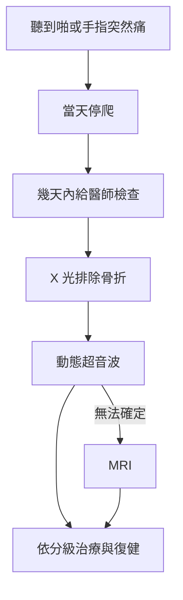

> 🌏 [English version](/posts/climbing/2026-10-18-finger-pulley-injury-en)

你在岩館抓一顆很小的 crimp，腳一滑，手指根部「啪」一聲。可能當下就痛，也可能還能爬完這條，回家才腫起來。

這篇回答三個問題：滑車韌帶是什麼、「啪」之後該做的三件事，以及網路上流傳的分級、時程和貼紮說法，各自有多少證據。上一篇〈[暖身](/posts/climbing/2026-10-18-climbing-warm-up)〉講受傷之前，這篇講受傷之後的頭幾個月。系列的總覽在〈[攀岩傷害總覽](/posts/climbing/2026-10-18-climbing-injury-overview)〉。

**這篇不能取代診斷。** 文中的分級和時程都來自研究或物理治療師的整理，要套到你的手指上，必須先由醫師檢查確認。

## 滑車韌帶是什麼，為什麼攀岩者特別容易傷到

手指彎曲靠的是前臂的屈指肌，肌腱一路延伸到指尖。沿途有五圈環狀韌帶把肌腱固定在骨頭旁邊，這就是滑車韌帶（pulley），由手掌往指尖編號 A1 到 A5（[Larsson 2022](https://pmc.ncbi.nlm.nih.gov/articles/PMC9344739/)）。

[Miro 等人 2021 年的回顧](https://pubmed.ncbi.nlm.nih.gov/33966972/)寫得很直接：攀岩的「crimp」握法就是滑車受傷的機轉，A2、A3、A4 風險最高，在離心負荷時特別危險。離心負荷就是手指正在出力、卻被往外扯開，例如腳突然滑掉的那一瞬間。全封閉握法（full crimp）為什麼讓 A2 受力特別大，〈[手點種類與握法](/posts/climbing/2026-10-18-climbing-holds-grips)〉有算給你看。

它有多常見？答案取決於樣本。在德國班貝格的運動醫學門診，[Schöffl 2003](https://pubmed.ncbi.nlm.nih.gov/12825883/) 收了 604 名受傷的攀岩者，滑車傷害占 20%，排第一。同一個門診十年後的 [911 件傷害](https://pubmed.ncbi.nlm.nih.gov/25712297/)裡，滑車仍是最常見的手指傷害，而且 A4 已經比 A2 多。

**今晚就能做的動作**：把雙手攤開，找到每根手指靠近手掌那一節（近節指骨）的中段，那就是 A2 大約的位置；中間那節的中段是 A4。以後手指痛，先記下痛點在哪一節。

## 「啪」之後的三件事

### 1. 當天停爬

物理治療師 Jason Hooper 在 [Hooper's Beta 的 A2 復原指南](https://hoopersbeta.com/library/ultimate-a2-pulley-injury-recovery-guide)建議，不論哪一級都先立刻停止攀爬。理由是攀爬的負荷很難預測，小傷可能變成大傷。停爬不等於什麼都不動，其他不痛的訓練可以繼續（證據等級：專家意見）。

### 2. 幾天內給醫師檢查，要求超音波

不是每次都要掛急診。[Climbing.com 的手指傷害指南](https://www.climbing.com/skills/technique/complete-guide-healing-climbing-finger-injury/)建議：疼痛很嚴重、明顯腫脹，或看得到、摸得到弓弦時，在 3–10 天內就醫。[Lattice 物理治療師在 UKClimbing 的專文](https://ukclimbing.com/articles/skills/series/lattice_training_series_with_tom_randall/part_6_finger_injuries-11469)列的警訊相同，另外加上手指明顯變形，或活動度、功能大幅喪失。

檢查順序有共識。[Schöffl 2004 年的治療研究](https://pubmed.ncbi.nlm.nih.gov/15368149/)的流程是先照 X 光排除骨折，再做動態超音波；Miro 2021 也建議超音波是第一線影像，無法確定時再加做 MRI。

在台灣，手指受傷可以掛骨科或手外科。[台灣手外科醫學會](https://handsurgery.com.tw/%E5%AD%B8%E6%9C%83%E7%B0%A1%E4%BB%8B/)說明，手外科醫師是在骨科或整形外科的專科訓練之後再甄審，處理範圍包含手部運動傷害。學會也說，很多手部傷害用夾板、膠帶、注射和手部治療就能處理，不必開刀。其他科別的選擇見〈[攀岩傷害總覽](/posts/climbing/2026-10-18-climbing-injury-overview)〉。

### 3. 依分級排復健，並和醫師或物理治療師約定進度

確診後才談分級、時程和護具，下面兩節會講。

**今晚就能做的動作**：在手機記事本寫一行「手指受傷→停爬→3–10 天內看骨科或手外科→問能不能做動態超音波」。真的發生時，你不會有心情上網查。

## 迷思一：「弓弦測試摸一摸就知道斷了沒」

岩館常見的做法，是請受傷的人彎手指出力，看肌腱有沒有浮起來。

[El-Sheikh 等人 2006 年的系統性回顧](https://pmc.ncbi.nlm.nih.gov/articles/PMC2686056/)整理了 29 篇文獻。臨床弓弦確實是最常被引用的診斷標準，但作者的結論是：「用臨床弓弦測試就能診斷」這個普遍看法**沒有證據支持**，應該用動態超音波。

Hooper 也提醒，即使 A2 完全斷裂，肉眼通常仍看不到弓弦；而且完全斷裂的手指可能沒有明顯腫脹或瘀青。看不到、摸不到，不代表沒事。

超音波的準確度有大體研究支持：[Isabelle Schöffl 等人 2018 年](https://pubmed.ncbi.nlm.nih.gov/30537790/)在 18 根大體手指上製造滑車斷裂。超音波判斷 A2 斷裂的敏感度是 90%（證據等級：大體研究）。

**今晚就能做的動作**：下次岩友受傷、有人要「幫他摸摸看」，你可以說：「摸不出來不代表沒斷，給醫師照超音波。」

## 分級：Schöffl 系統與它的不同版本

最常被引用的分級來自 Schöffl 團隊 2003 年的研究，樣本是德國一間運動醫學門診的受傷攀岩者。下表轉引自 [Larsson 2022 的系統性回顧](https://pmc.ncbi.nlm.nih.gov/articles/PMC9344739/)，原文註明「改編自 Schöffl 等人」。

| 級 | 傷害 | 原表建議的處置 |
|---|---|---|
| 1 | 滑車拉傷 | 保守治療，貼紮 |
| 2 | A4 完全斷裂，或 A2／A3 部分斷裂 | 保守治療，貼紮 |
| 3 | A2 或 A3 完全斷裂 | 保守治療，熱塑護環（thermoplastic ring，本文譯名）加貼紮 |
| 4 | 多條斷裂；或單條斷裂合併蚓狀肌、側副韌帶傷 | 手術重建 |

讀這張表要知道三件事：

- **第 4 級的定義有不同版本。** [Volker 與 Isabelle Schöffl 2006 年的綜述](https://pubmed.ncbi.nlm.nih.gov/16632061/)摘要只把第 IV 級寫成「多條斷裂」。Hooper 把兩條斷裂（IVa）列為保守治療，三條都斷（IVb）才需要手術諮詢。[Scheibler 等人 2021](https://pubmed.ncbi.nlm.nih.gov/33741540/) 報告了 12 例 A2、A3、A4 三條都斷的病例。兩週內就診、先用護具保守治療的 6 例，6 個月時都回到原本的難度；拖過兩個月才診斷的病例結果較差。作者認為，及早確診並保守治療，連三條都斷都有機會不開刀（證據等級：病例系列）。
- **單條斷裂通常不開刀。** [Schöffl 2006 年追蹤 21 名攀岩者的研究](https://pubmed.ncbi.nlm.nih.gov/16679977/)結論是單條斷裂建議非手術治療，受傷手指和健側手指的力量沒有差別。Hooper 也說，單獨的 A2 斷裂即使是完全斷裂，也不建議開刀。所以「滑車斷了就要開刀」是迷思。
- **斷裂後要不要固定，兩派不同。** Larsson 轉述 Schöffl 的做法是第 2、3 級固定最多 2 週；Hooper 則說任何一級都不建議整根手指固定，只用滑車護環保護。這交給你的醫師或物理治療師決定。

**今晚就能做的動作**：如果你已經拿到診斷，問醫師一句：「這是哪一個分級系統的第幾級？」同樣叫「第 4 級」，不同版本的處置可能差很多。

## 復原時程：先看終點是什麼

網路上的時程差很多，主要是因為終點不同：「第一次回到岩壁」和「回到原本難度」差好幾個月。

- **回到岩壁**：[UIAA 醫學委員會的運動攀登 factsheet](https://theuiaa.org/documents/safety/UIAA_Medical_SportClimbing.pdf) 說，單條滑車受傷可以靠功能性貼紮或軟式護環癒合，依症狀 6–8 週不攀爬。
- **回到原本難度**：[Schneeberger 與 Schweizer 2016](https://pubmed.ncbi.nlm.nih.gov/27067301/) 追蹤 45 名完全斷裂、用滑車護環治療的攀岩者，回到原本難度平均花 8.8 個月。
- **完整力量**：Hooper 估第 III 級通常要 20 週左右，這是他的臨床經驗（證據等級：專家意見）。

各來源完整的數字放在下面。它們的樣本、分級版本和終點都不同，**不能拿來互相比較，也不能直接當成你的時程**。

各來源的時程（含出處與適用範圍）

| 來源 | 樣本／性質 | 終點 | 時程 |
|---|---|---|---|
| Larsson 2022 轉述 Schöffl 2003／2004 | 二手整理，原始表未公開 | 回到運動 | 第 1–2 級 6–8 週，第 3 級 3 個月；持續貼紮第 1–2 級 3 個月、第 3 級 6 個月 |
| UIAA MedCom factsheet | 專家建議 | 不攀爬期 | 單條滑車受傷 6–8 週，視症狀而定 |
| Schöffl 2006 MSSE | 21 名第 2–4 級，平均 3.46 年後回診 | 回到原本難度 | 一年內 |
| Schneeberger & Schweizer 2016 | 45 人 47 處完全斷裂，滑車護環治療 | 回到原本難度 | 43 人中 38 人回到，平均 8.8 個月 |
| Hooper's Beta | 物理治療師臨床經驗 | 停爬 | I 7–10 天、II 2 週、III 6 週、IVa 8 週 |
| Hooper's Beta | 同上 | 完整力量 | I 約 6–8 週、II 10–12 週、III 至少 16 週（通常約 20 週）、IVa 24 週到一年 |
| [The Climbing Doctor 2022](https://theclimbingdoctor.com/how-to-rehab-a-climbing-pulley-injury) | 物理治療師的分階段表 | 困難攀爬 | 輕度第 5–6 週、中度第 9–12 週、重度第 12–15 週 |

The Climbing Doctor 也寫明：沒有臨床研究證明哪一套組數、次數比較好，進度要和醫療人員一起決定。

另一個要注意的狀況是「翻瓣」。[Isabelle Schöffl 2011 年的研究](https://pubmed.ncbi.nlm.nih.gov/21896956/)發現，輕微滑車斷裂後，殘端可能翻到腱鞘下面持續摩擦，造成長期發炎，有時需要手術移除。Hooper 的判準是：照合理的計畫復健 6–8 週，手指仍然整根腫、彎曲時卡卡的，或進度停滯，就該回去做影像檢查。

回到岩館的分階段做法，見〈[受傷後回岩館](/posts/climbing/2026-10-18-return-to-climbing)〉。

**今晚就能做的動作**：如果你正在復健，把目標寫成兩行：「第幾週回到簡單路線」「第幾週回到原本難度」，各自問物理治療師。只寫一個數字，就容易拿錯的終點跟自己比。

## H 貼紮：受傷後可以，預防沒有證據

H 貼紮是 [Isabelle Schöffl 等人 2007 年](https://pubmed.ncbi.nlm.nih.gov/17585178/)提出的方法。他們用超音波量受傷的手指：H 貼紮讓肌腱和骨頭的距離減少 16%，其他貼法沒有效果。作者因此建議**在滑車斷裂後**使用（證據等級：受傷者的研究，8 人）。

但很多人把它貼在沒受傷的手指上預防。這部分的證據都是反方向：

- [Warme 與 Brooks 2000](https://pubmed.ncbi.nlm.nih.gov/11032223/) 用大體手指測試，環狀貼紮沒有提高 A2 的斷裂強度，作者不支持預防性貼紮（證據等級：大體研究）。
- [Schweizer 2000](https://pubmed.ncbi.nlm.nih.gov/10763736/) 量活人手指，結論是環狀貼紮對減輕 A2 受力的效果很小，「可能無法預防斷裂」。
- [Salas 等人 2023](https://pubmed.ncbi.nlm.nih.gov/35870957/) 用 14 對大體手測 H 貼紮，結論是它不能預防 A2 斷裂，也不能穩定部分斷裂的滑車（證據等級：大體研究）。
- [Quarmby 2023 的系統性回顧](https://pubmed.ncbi.nlm.nih.gov/38162697/)發現貼紮和過度使用傷害的風險沒有關聯。

Larsson 2022 的系統性回顧把這些合起來：貼紮可能減少 15–22% 的弓弦，但對疼痛、回到運動和預防斷裂的證據都是低到非常低。Hooper 的說法是，滑車完好時，貼紮不會預防受傷；它可能讓人覺得被保護，但很快會變成依賴。

**今晚就能做的動作**：打開你的岩袋，看看是不是習慣在沒受傷的手指上貼一圈。想預防，把時間花在下一節的事情上。

## 預防：研究和教練能說到哪裡

Quarmby 2023 的回顧找出幾個和過度使用傷害有關的因子：攀爬強度較高、抱石、握力較低、常用 crimp 握法，以及曾經受傷。它沒有說明怎麼調整才有效，所以下面這些是教練的建議（證據等級：專家意見）。

Hooper 在 A2 指南最後列了四點：

1. 不要在手會被扯開的高負荷動作上反覆嘗試，這被認為是滑車受傷的主要機轉之一。
2. 做穩定、可量化的握力訓練，從低量開始，方法見〈[指力板訓練](/posts/climbing/2026-10-18-hangboard-training)〉。
3. 練你實際會用的握法。只在指力板上練低角度，牆上卻常用高角度，是個問題。
4. 用待會要爬的握法暖手指，並記訓練日誌，力量下滑又開始痛，就是早期警訊。

另外，18 歲以下的攀岩者手指痛，**不要當成滑車傷害**。Hooper 說，青少年手指痛要先當成生長板骨折處理，直到專科醫師排除為止。Lattice 的物理治療師也說，生長板傷害是這個年紀最可能的手指傷害。細節見〈[青少年生長板](/posts/climbing/2026-10-18-youth-growth-plate)〉。

**今晚就能做的動作**：打開訓練紀錄，數一數上週有幾次在同一顆小點上反覆嘗試超過五次。超過的話，下次換題或改練別的動作。

## 練習題：四個情境

答案在每題下方，先自己想再看。

**1. 你抱石時無名指「啪」一聲，當下不太痛，手指也沒腫。朋友幫你摸了摸，說沒有弓弦，應該沒事。**

答案

不能用「沒腫、摸不到弓弦」排除斷裂。El-Sheikh 2006 的回顧指出臨床弓弦測試沒有證據支持，Hooper 也說完全斷裂的手指常常看不到弓弦、也可能不腫。當天停爬，幾天內給骨科或手外科醫師檢查，問能不能做動態超音波。

**2. 醫師說你是 A2 完全斷裂。網路上有人說「斷了就要開刀」。**

答案

Schöffl 2006 的研究結論是單條斷裂建議非手術治療，Hooper 也說單獨的 A2 斷裂不建議開刀。手術主要考慮的是多條斷裂，或保守治療無效的翻瓣。實際怎麼處理，照你的醫師依檢查結果的判斷。

**3. 你受傷第 7 週，已經回到簡單路線，但原本的專案還差很遠，覺得自己恢復太慢。**

答案

先分清楚終點。UIAA 的 6–8 週是「不攀爬」的期間，回到原本難度在 Schneeberger 2016 的研究裡平均要 8.8 個月。第 7 週回到簡單路線，和這些數字並不矛盾。如果手指整根腫、彎曲卡住或進度停滯，就回去找醫師做影像檢查。

**4. 你 15 歲的學弟說他手指中間關節背面痛了兩週，想貼 H 貼紮繼續練。**

答案

18 歲以下的手指痛要先當成生長板骨折處理。請他停練，由家長帶去看醫師，並告訴醫師他有攀岩訓練。H 貼紮是為成人滑車斷裂設計的，不適用這種情況。

## 下一步

不是每一種手指痛都是滑車。關節腫、腱鞘發炎、手掌深處痛、手指側邊痛，各有不同的原因與處理，見下一篇〈[手指的其他傷害](/posts/climbing/2026-10-18-finger-injuries-other)〉。

## 參考資料

- [Schöffl V et al. Pulley injuries in rock climbers. Wilderness Environ Med 2003](https://pubmed.ncbi.nlm.nih.gov/12825883/)
- [Schöffl V et al. Therapy of injuries of the pulley system in sport climbers（德文，英文摘要）. Handchir Mikrochir Plast Chir 2004](https://pubmed.ncbi.nlm.nih.gov/15368149/)
- [Schöffl V et al. Injury trends in rock climbers: 911 injuries between 2009 and 2012. Wilderness Environ Med 2015](https://pubmed.ncbi.nlm.nih.gov/25712297/)
- [Schöffl VR, Schöffl I. Injuries to the finger flexor pulley system in rock climbers: current concepts. J Hand Surg Am 2006](https://pubmed.ncbi.nlm.nih.gov/16632061/)
- [Schöffl VR et al. Strength measurement and clinical outcome after pulley ruptures in climbers. Med Sci Sports Exerc 2006](https://pubmed.ncbi.nlm.nih.gov/16679977/)
- [Schneeberger M, Schweizer A. Pulley ruptures in rock climbers: outcome of conservative treatment with the pulley-protection splint. Wilderness Environ Med 2016](https://pubmed.ncbi.nlm.nih.gov/27067301/)
- [Miro PH et al. Finger flexor pulley injuries in rock climbers. Wilderness Environ Med 2021](https://pubmed.ncbi.nlm.nih.gov/33966972/)
- [El-Sheikh Y et al. Diagnosis of finger flexor pulley injury in rock climbers: a systematic review. Can J Plast Surg 2006](https://pmc.ncbi.nlm.nih.gov/articles/PMC2686056/)
- [Schöffl I et al. Diagnosis of A3 pulley injuries using ultrasound. Sportverletz Sportschaden 2018](https://pubmed.ncbi.nlm.nih.gov/30537790/)
- [Schöffl I et al. Flap irritation phenomenon (FLIP). J Appl Biomech 2011](https://pubmed.ncbi.nlm.nih.gov/21896956/)
- [Schöffl I et al. Impact of taping after finger flexor tendon pulley ruptures in rock climbers. J Appl Biomech 2007](https://pubmed.ncbi.nlm.nih.gov/17585178/)
- [Warme WJ, Brooks D. The effect of circumferential taping on flexor tendon pulley failure in rock climbers. Am J Sports Med 2000](https://pubmed.ncbi.nlm.nih.gov/11032223/)
- [Schweizer A. Biomechanical effectiveness of taping the A2 pulley in rock climbers. J Hand Surg Br 2000](https://pubmed.ncbi.nlm.nih.gov/10763736/)
- [Salas C et al. A biomechanical analysis of the H-taping method. J Hand Surg Am 2023](https://pubmed.ncbi.nlm.nih.gov/35870957/)
- [Larsson R et al. To tape or not to tape: annular ligament (pulley) injuries in rock climbers — a systematic review. BMC Sports Sci Med Rehabil 2022](https://pmc.ncbi.nlm.nih.gov/articles/PMC9344739/)
- [Scheibler AG et al. Primarily conservative treatment for triple (A2–A3–A4) finger flexor tendon pulley disruption. Hand Surg Rehabil 2021](https://pubmed.ncbi.nlm.nih.gov/33741540/)
- [Quarmby A et al. Risk factors and injury prevention strategies for overuse injuries in adult climbers: a systematic review. Front Sports Act Living 2023](https://pubmed.ncbi.nlm.nih.gov/38162697/)
- [UIAA Medical Commission. Factsheet on Sport Climbing（PDF）](https://theuiaa.org/documents/safety/UIAA_Medical_SportClimbing.pdf)
- [Ultimate A2 Pulley Injury Recovery Guide（Jason Hooper，Hooper's Beta）](https://hoopersbeta.com/library/ultimate-a2-pulley-injury-recovery-guide)
- [Climbers Deserve the Truth About Taping（Jason Hooper，Hooper's Beta）](https://hoopersbeta.com/library/climbers-deserve-the-truth-about-taping-the-actual-evidence)
- [How To Rehab a Climbing Finger Pulley Injury（Jared Vagy，The Climbing Doctor，2022）](https://theclimbingdoctor.com/how-to-rehab-a-climbing-pulley-injury)
- [Lattice Training Series Part 6: Finger Injuries（Tom Randall、Sam Radcliffe，UKClimbing）](https://ukclimbing.com/articles/skills/series/lattice_training_series_with_tom_randall/part_6_finger_injuries-11469)
- [Your Complete Guide To Finger Injuries (And How To Recover!)（Climbing.com，2025）](https://www.climbing.com/skills/technique/complete-guide-healing-climbing-finger-injury/)
- [台灣手外科醫學會：學會簡介](https://handsurgery.com.tw/%E5%AD%B8%E6%9C%83%E7%B0%A1%E4%BB%8B/)
