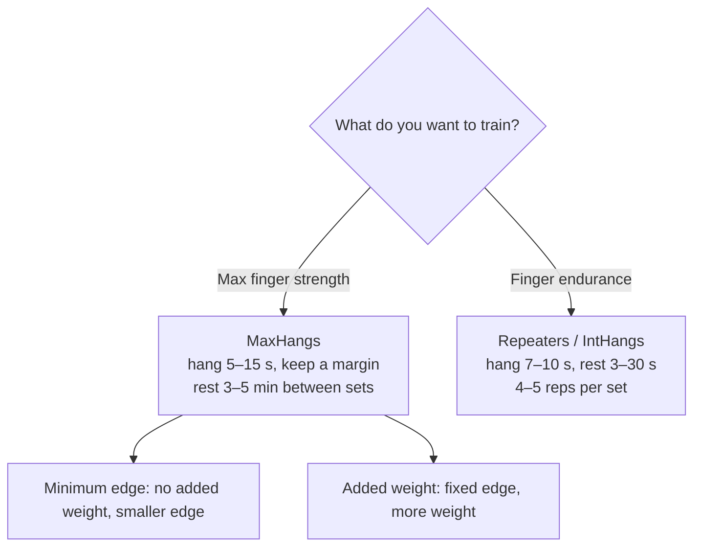

> 🌏 [中文版](/posts/climbing/2026-10-18-hangboard-training)

You have been climbing for a year and the gym's V3s and V4s have stopped going down. After the [diagnosis post](/posts/climbing/2026-10-18-climbing-training-diagnosis-en) you suspect your fingers: small holds just slide out of your hand. There is a wooden board full of slots in the corner of the gym, you have watched people hang from it, and you want to know whether you should start too.

This post answers three things: when you can start, what the common protocols each train, and how to lay out the first month. A hangboard trains maximal finger strength; why that is trained separately from endurance is covered in [energy systems](/posts/climbing/2026-10-18-climbing-energy-systems-en).

First, a word on how much weight each recommendation carries. Every one is labelled:

- **Research**: backed by controlled trials or systematic reviews.
- **Coaching consensus**: advice from coaches or physical therapists, with no controlled study behind it.

## When can you start? The schools side by side

The short answer: **no study has asked whether a one-year climber should hangboard.** The hangboard studies cited here all used intermediate-to-advanced climbers; Mundry 2021, for example, recruited climbers at UIAA VI–VIII. The thresholds below differ, and all of them are coaching consensus.

| Who | What they say |
|---|---|
| [Eva López](http://en-eva-lopez.blogspot.com/2018/05/fingerboard-training-guide-i-preliminary-evaluation.html) (PhD, climbing-training researcher) | More than 2 years of structured climbing or training; a 15-second hang on a 25 mm edge; 16 or older and past the growth spurt; injury-free |
| [Lattice Training](https://latticetraining.com/blog/the-beginners-guide) | Beginners should build finger strength by climbing; starting too soon adds volume, slows recovery and eats into skill learning |
| [Eric Hörst](https://trainingforclimbing.com/training-programs/) | His free program for climbers with under a year of experience, below 5.11 and V4, already lists "climbing-specific strength & endurance" as a goal |
| [Dave MacLeod (BMC Q&A)](https://thebmc.co.uk/en/how-to-fingerboard) | "Grade is irrelevant; it's the circumstances that count." For busy people who cannot climb several times a week, it can suit even relative novices |
| [Hooper's Beta](https://hoopersbeta.com/library/throw-your-hangboard-in-the-trash-if-you-dont-know-this-save-a-friend) (physical therapist Jason Hooper) | A decent grasp of technique, little or no progress, and fingers confirmed as a big limiting factor |

Underneath, they are all answering one question: **can your fingers still get stronger from climbing?** If you cannot hang 15 seconds on López's 25 mm test, she suggests training your fingers by climbing, for example by occasionally climbing on steeper walls or adding a few small holds to your problems. Lattice's reasoning is that tendons and ligaments may take five times longer to adapt than muscle, so a beginner's muscular strength runs ahead.

MacLeod's exception deserves a serious look. People who cannot get to a wall several times a week can still find half an hour to hang, and in that situation a hangboard can suit even relative novices. He also asks the real question: would that time be better spent bouldering?

**Something you can do tonight**: ask yourself Hooper's first three questions. Is my technique really good enough? (If unsure, read the [Climbing Movement](/posts/climbing/2026-10-18-climbing-movement-overview-en) series first.) Do I know how to control the load? Am I willing to drop one hard gym session a week to make room for hangs? If all three answers are yes, read on.

## Three protocols: MaxHangs, repeaters, minimum edge

Protocol names are a mess; the same thing goes by different labels. This post uses Eva López's scheme because she has also published research on it.

### MaxHangs: maximal finger strength

[López's guide, part II](https://en-eva-lopez.blogspot.com/2018/05/fingerboard-training-guide-II-Maxhangs-SubHangs-and-Inthangs-methodology.html) splits MaxHangs into two ways of setting the load:

- **Minimum edge depth (MED)**: no added weight. Find the smallest edge you can hold for 15 seconds, hang for 12, and keep a 3-second margin.
- **Maximum added weight (MAW)**: keep one edge (say 18 mm) and add weight to your body.

Both use 3–5 sets with 3–5 minutes' rest. She insists on the margin: stopping short of failure gives similar results, with less injury risk and faster recovery.

### Repeaters: on, off, on

Repeaters mean hanging a few seconds, resting a few seconds, and repeating several times as one set. López calls them IntHangs (intermittent hangs), for example 10 seconds on, 20 seconds off, four reps to a set, with the last rep of the last set reaching failure. [Hooper's Beta](https://hoopersbeta.com/library/max-hangs-vs-repeaters-what-should-you-do-when-youre-new-to-hang-boarding) uses shorter rests of only 3–5 seconds.

Early hangboard talks at Taiwanese gyms taught repeaters too. [kateberry wrote up a 2015 talk at the Hongshi (紅石) bouldering gym](http://kateberrysblog.blogspot.com/2020/05/beastmaker.html) (in Chinese): an active dead hang (arms and shoulders engaged), 7 seconds on and 3 off, seven reps in a row, with 48–72 hours between sessions.

### What the research says

- [López-Rivera 2019](https://pubmed.ncbi.nlm.nih.gov/30988852/) compared MaxHangs, IntHangs and a combination in sport climbers averaging 7c+/8a. Grip endurance improved earlier in the IntHangs group; the MaxHangs group needed the full cycle. The authors concluded that the two methods can be alternated. **Research**
- For maximal strength in the same participants, [López's blog report](https://en-eva-lopez.blogspot.com/2018/03/maximal-hangs-intermittent-hangs.html) found that only the group doing eight straight weeks of MaxHangs reached statistical significance. **Research**
- [Devise 2022](https://pubmed.ncbi.nlm.nih.gov/35498522/) trained three groups at high, moderate and low intensity. Each intensity mainly improved the capacity it targeted and spilled over into neighbouring ones: the moderate group's maximal strength also improved. **Research**
- [Mundry 2021, a randomized controlled trial](https://pubmed.ncbi.nlm.nih.gov/34188125/): the group adding 1.25 kg each week improved grip strength more than climbing alone; the group moving to smaller edges each week did not differ from controls. **Research**

Participants and numbers

- López-Rivera 2019: 26 climbers, 8 weeks. Grip endurance improved significantly by week 4 in the IntHangs group and by week 8 in the MaxHangs group. After 8 weeks, endurance gains were 34% (MaxHangs), 45% (IntHangs) and 7% (combination).
- López's blog: after 8 weeks, maximal strength rose 28% (MaxHangs), 13.9% (IntHangs) and 13.4% (combination).
- Devise 2022: 54 climbers, at 100%, 80% and 60% of maximal finger strength, for 4 weeks.
- Mundry 2021: 30 climbers, UIAA VI–VIII, 8 weeks.

Two things follow. First, both protocols work; neither is wrong. Second, every study population was stronger than you. A one-year climber copying an advanced climber's intensity is taking someone else's prescription.

**Something you can do tonight**: at the gym, note the depth of each edge on the hangboard (many boards mark it in mm). Just write them down; no hanging today.

## Grip and posture

**Grip**: Hooper says hangboard training is usually done in a half crimp (what the [holds and grips post](/posts/climbing/2026-10-18-climbing-holds-grips-en) calls a half crimp): middle joint around 90 degrees, thumb off. López notes that open-hand training needs edges with rounder lips; keep the sharper profiles for the half crimp.

**Posture**: the BMC fingerboard article says to hang with a slight bend in the arms, engaging them a little, rather than hanging purely on your elbow and shoulder joints. Hooper's rule is simpler: if you cannot keep your shoulders and fingers stable for the whole hang, reduce the weight or the duration. López lists the signs of excessive load: raising the shoulders, elbows, torso or legs, and too much tension anywhere in the body.

**Something you can do tonight**: stand on the floor and put both hands on the biggest hold on the board, feet still down. Set a half crimp, pull your shoulders down and keep a slight bend in the arms. Ask a friend for a side-on photo and check whether your shoulders have crept up to your ears.

## Your fingers get stronger; your climbing may not

The evidence that hangboarding increases finger strength is consistent: [Medernach 2015](https://pubmed.ncbi.nlm.nih.gov/26203738/), [Hermans 2022](https://pubmed.ncbi.nlm.nih.gov/35571743/), Mundry 2021 and [Levernier 2019](https://pubmed.ncbi.nlm.nih.gov/28945641/) all found it. **Research**

The trouble is the next step. [Stien 2023, a systematic review and meta-analysis](https://pubmed.ncbi.nlm.nih.gov/36636194/), found that resistance training plus climbing improved climbing-specific test scores more than climbing alone. The authors also note that studies training the finger flexors in isolation showed no strength or endurance gains in climbing-specific tests, and that intervention studies with climbers are few. [Stien 2024](https://www.frontiersin.org/journals/physiology/articles/10.3389/fphys.2024.1461820/full) gave 31 advanced-to-elite boulderers five weeks of dynamic finger strength training (curling a loaded hold, not hanging). Finger strength went up; bouldering performance did not. **Research**

So the common saying "stronger fingers make you climb harder" is only half supported so far. [Lattice's data on more than 6,000 climbers](https://latticetraining.com/blog/lattice_data_finger_strength_grades) shows finger strength is the single best predictor of grade. But that is correlation, not causation: good climbers have strong fingers, which does not mean strengthening your fingers will make you a good climber.

**Something you can do tonight**: before you start hangboarding, set a baseline on the wall. Pick three problems you are stuck on, where the sticking point is a small hold. Come back to the same three after four weeks. That is the comparison that matters, not just your seconds on the board.

## Be more careful with teenagers

López sets 16 and past the growth spurt as a threshold, and names the growth spurt itself as the most dangerous period: around 11–12 for girls and 13–14 for boys. MacLeod gives no blanket age, but he also says very repetitive finger training before growth tails off in the late teens has caused severe finger injuries. [Schöffl 2024](https://pubmed.ncbi.nlm.nih.gov/39311912/) reviews more than 200 documented growth-plate stress fractures in young climbers' fingers, mostly at age 13–15, and notes that frequent crimping raises the risk.

The consensus on campus boards for teenagers is even clearer; that is in [the next post](/posts/climbing/2026-10-18-climbing-strength-power-en).

**Something you can do tonight**: if someone under 16 in your family climbs, ask whether they hangboard and whose program they follow. If the answer is "something online", ask a gym coach to decide with them whether and how to train.

## Your first four weeks: a conservative plan

Who this is for: you pass López's 25 mm / 15-second test, you answered yes to Hooper's questions, and you have no old finger injury. If not, see the alternative below.

1. **Frequency**: twice a week, 48–72 hours apart. In [part III of her guide](https://en-eva-lopez.blogspot.com/2018/07/fingerboard-training-guide-iii-periodization-samples-of-maxhangs-training-programs-.html) López calls that gap compulsory. **Coaching consensus**
2. **Warm-up**: climb some easy problems first, then do 3–4 progressively harder hangs. **Coaching consensus**
3. **Content**: minimum-edge MaxHangs. Find an edge you can hold for 20 seconds, hang for 15 (a 5-second margin), and rest 3 minutes between sets. López places climbers used to a 3-second margin at intermediate level, so beginners keep a bigger one. **Coaching consensus**
4. **Sets**: 2 in week 1, 3 in week 2, 4 in week 3, 4 in week 4. No hangs at all in week 5. López says any new method starts with 2 sets. **Coaching consensus**
5. **Take something out**: Hooper suggests that if you climb hard three times a week, drop to two when you start hangboarding, or keep three but climb only easy technique problems on hangboard days. **Coaching consensus**
6. **Log it**: edge depth, seconds, how it felt, every session. **Coaching consensus**

López's stop signals: if you need an edge more than 2 mm deeper, or more than 25% less added weight, than last session, abort and delay a day or two. If you go backwards for more than two sessions in a row, or your fingers, wrists, elbows or neck hurt, lighten the load and rethink the plan. Finger pain that does not settle is for a doctor or physical therapist.

**Alternative if you cannot pass the 25 mm / 15-second test**: keep training your fingers by climbing. If you really want to use the board, BMC and Lattice suggest assisted hangs: a foot on a chair or on the floor, light hangs of about 20 seconds, building tendon tolerance rather than chasing maximal strength. **Coaching consensus**

**Something you can do tonight**: put the four weeks of sets in your phone calendar and mark week five "no hangs".

## Practice: four scenarios

Answers are under each question; think first, then open.

**1. You have climbed for eight months, you climb V3, you go to the gym three times a week, and you are still improving steadily. A friend says he started hangboarding at six months. Should you?**

Answer

Not yet. Your fingers are still getting stronger from climbing, which is exactly when Lattice and López say to keep climbing. A hangboard adds volume and eats into skill learning. Wait until progress stalls and you are sure your fingers are the limit.

**2. You are busy, can only climb once a week, have been climbing for a year and a half, and climb V3. Is a hangboard worth considering?**

Answer

Yes, this is the situation MacLeod describes: you cannot climb several times a week. Do López's 25 mm test first; if you cannot pass it, start with assisted hangs rather than MaxHangs.

**3. In week three's second session, you cannot even hold 15 seconds on last session's edge and have to move to one 3 mm deeper. What now?**

Answer

Stop for today and delay a day or two. López lists an edge difference of more than 2 mm as a sign of excessive fatigue. Check your sleep, food and the rest of the week's training.

**4. After eight weeks your minimum edge has dropped from 20 mm to 16 mm, but you still fall at the same move on those three gym problems. Was the hangboarding wasted?**

Answer

Not necessarily, but look at technique again. Stronger fingers do not automatically become better climbing; that is what Stien 2024 found too. Go back to that move and check your feet and body position (see [Climbing Movement](/posts/climbing/2026-10-18-climbing-movement-overview-en)). The move may not be about your fingers at all.

## Next

Beyond the fingers there is shoulder and back strength, and then there is that board in the corner with nothing but wooden rungs. When is it your turn? Read [strength, shoulders and the campus board](/posts/climbing/2026-10-18-climbing-strength-power-en) next. The finger endurance that repeaters train continues in [endurance and power endurance](/posts/climbing/2026-10-18-climbing-endurance-training-en). For what to do when a finger gets hurt, see [finger pulley injuries](/posts/climbing/2026-10-18-finger-pulley-injury-en).

## References

- [Fingerboard Training Guide (I): Preliminary Evaluation (Eva López, 2018)](http://en-eva-lopez.blogspot.com/2018/05/fingerboard-training-guide-i-preliminary-evaluation.html)
- [Fingerboard Training Guide (II): MaxHangs, SubHangs and IntHangs Methodology (Eva López, 2018)](https://en-eva-lopez.blogspot.com/2018/05/fingerboard-training-guide-II-Maxhangs-SubHangs-and-Inthangs-methodology.html)
- [Fingerboard Training Guide (III): Periodization, Samples of MaxHangs Programs (Eva López, 2018)](https://en-eva-lopez.blogspot.com/2018/07/fingerboard-training-guide-iii-periodization-samples-of-maxhangs-training-programs-.html)
- [Maximal Hangs, Intermittent Hangs or a Combination: Which 8-week Program Is More Effective? (Eva López, 2018)](https://en-eva-lopez.blogspot.com/2018/03/maximal-hangs-intermittent-hangs.html)
- [The Beginner Climber's Training Guide (Lattice Training)](https://latticetraining.com/blog/the-beginners-guide)
- [Finger Strength For Climbers Increases, In Relation To Grade (Lattice Training)](https://latticetraining.com/blog/lattice_data_finger_strength_grades)
- [Free Training Programs for Climbers (Eric Hörst, 2024)](https://trainingforclimbing.com/training-programs/)
- [How to fingerboard (Ned Feehally, Dave MacLeod, BMC)](https://thebmc.co.uk/en/how-to-fingerboard)
- [Throw Your Hangboard in the Trash If You Don't Know This (Hooper's Beta)](https://hoopersbeta.com/library/throw-your-hangboard-in-the-trash-if-you-dont-know-this-save-a-friend)
- [Max Hangs vs Repeaters: Which One if You're New to Hangboarding? (Hooper's Beta)](https://hoopersbeta.com/library/max-hangs-vs-repeaters-what-should-you-do-when-youre-new-to-hang-boarding)
- [My first Beastmaker session (kateberry, 2020, recounting a 2015 talk at the Hongshi gym) (in Chinese)](http://kateberrysblog.blogspot.com/2020/05/beastmaker.html)
- [López-Rivera E, González-Badillo JJ. Comparison of the Effects of Three Hangboard Strength and Endurance Training Programs on Grip Endurance in Sport Climbers. J Hum Kinet 2019](https://pubmed.ncbi.nlm.nih.gov/30988852/)
- [Devise M et al. Effects of Different Hangboard Training Intensities on Finger Grip Strength, Stamina, and Endurance. Front Sports Act Living 2022](https://pubmed.ncbi.nlm.nih.gov/35498522/)
- [Mundry S et al. Hangboard training in advanced climbers: A randomized controlled trial. Sci Rep 2021](https://pubmed.ncbi.nlm.nih.gov/34188125/)
- [Medernach JP et al. Fingerboard in Competitive Bouldering: Training Effects on Grip Strength and Endurance. J Strength Cond Res 2015](https://pubmed.ncbi.nlm.nih.gov/26203738/)
- [Hermans E et al. The Effects of 10 Weeks Hangboard Training on Climbing Specific Maximal Strength, Explosive Strength, and Finger Endurance. Front Sports Act Living 2022](https://pubmed.ncbi.nlm.nih.gov/35571743/)
- [Levernier G, Laffaye G. Four Weeks of Finger Grip Training Increases the Rate of Force Development and the Maximal Force in Elite and Top World-Ranking Climbers. J Strength Cond Res 2019](https://pubmed.ncbi.nlm.nih.gov/28945641/)
- [Stien N et al. Effects of climbing- and resistance-training on climbing-specific performance: a systematic review and meta-analysis. Biol Sport 2023](https://pubmed.ncbi.nlm.nih.gov/36636194/)
- [Stien N et al. Five weeks of dynamic finger flexor strength training on bouldering performance and climbing-specific strength tests. Front Physiol 2024](https://www.frontiersin.org/journals/physiology/articles/10.3389/fphys.2024.1461820/full)
- [Schöffl V et al. Stress fractures of the growth plates in the fingers of adolescent rock climbers. Unfallchirurgie 2024](https://pubmed.ncbi.nlm.nih.gov/39311912/)

## Update Log

- 2026-10-18: The Climbing Injuries and First Aid series is now published; replaced "in progress" mentions with links.
