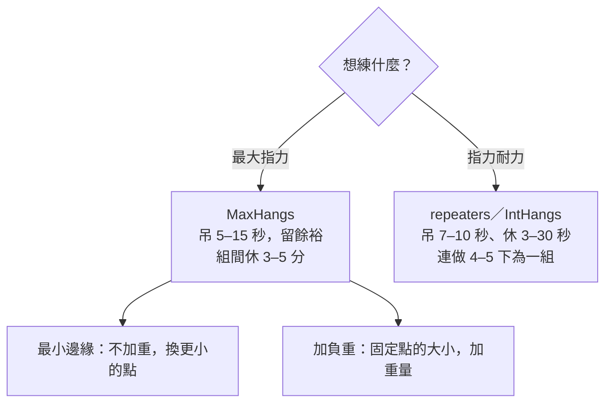

> 🌏 [English version](/posts/climbing/2026-10-18-hangboard-training-en)

你爬了一年，岩館裡的 V3、V4 開始卡關。[診斷篇](/posts/climbing/2026-10-18-climbing-training-diagnosis)讀完，你覺得是手指不夠力：小點一抓就滑掉。岩館牆角那塊有很多凹槽的木板，你看別人吊了好幾次，想知道自己能不能也開始。

這篇回答三件事：什麼時候可以開始、三種常見協定各練什麼、第一個月怎麼排。指力板練的是最大指力；為什麼它和耐力要分開練，[能量系統](/posts/climbing/2026-10-18-climbing-energy-systems)那篇講過。

先說證據的分量。這篇每個建議都會標出來源類型：

- **研究**：有對照試驗或系統性回顧。
- **教練共識**：教練或物理治療師的建議，沒有對照研究。

## 什麼時候可以開始：各家說法並列

先講結論：**沒有研究回答過「爬一年的人該不該上指力板」。** 這篇引用的指力板研究，受試者都是中高階攀岩者，例如 Mundry 2021 收的是 UIAA VI–VIII 的人。各家給的門檻不一樣，而且都是教練共識。

| 誰 | 怎麼說 |
|---|---|
| [Eva López](http://en-eva-lopez.blogspot.com/2018/05/fingerboard-training-guide-i-preliminary-evaluation.html)（博士，攀岩訓練研究者） | 系統化攀爬或訓練超過 2 年；能在 25 mm 的點上吊 15 秒；16 歲以上、過了生長高峰；沒有傷 |
| [Lattice Training](https://latticetraining.com/blog/the-beginners-guide) | 新手先靠攀爬長指力；太早上指力板會增加總量、拖慢恢復，壓縮學技術的時間 |
| [Eric Hörst](https://trainingforclimbing.com/training-programs/) | 給不到 1 年、上攀低於 5.11、抱石低於 V4 的人的免費課表，目標已經包含「專項力量與耐力」 |
| [Dave MacLeod（BMC 訪談）](https://thebmc.co.uk/en/how-to-fingerboard) | 「等級無關，情境才重要。」沒辦法常去岩館的忙碌上班族，相對新手也適合 |
| [Hooper's Beta](https://hoopersbeta.com/library/throw-your-hangboard-in-the-trash-if-you-dont-know-this-save-a-friend)（物理治療師 Jason Hooper） | 技術有一定基礎、進步停滯、而且確定手指是主要限制，才是好時機 |

這些說法其實在回答同一個問題：**你的手指還能不能靠攀爬變強？** López 的 25 mm 測驗吊不到 15 秒，她建議繼續用攀爬練手指。例如偶爾爬比平常更前傾的牆，或在題目裡多放一些小點。Lattice 的理由是，肌腱和韌帶的適應可能比肌肉慢 5 倍，新手的肌力會先跑在前面。

MacLeod 的例外也值得認真看。他說沒辦法一週去好幾次岩館的人，總找得到半小時吊一吊；在這種情境下，指力板甚至適合相對新手。他也反問：你吊指力板的時間，拿去多爬抱石會不會更好？

**今晚就能做的動作**：用 Hooper 的頭三個問題問自己。我的技術真的夠了嗎？（不確定就先讀[攀岩動作技術](/posts/climbing/2026-10-18-climbing-movement-overview)系列。）我知道怎麼控制負荷嗎？我願意為了指力板，少爬一次高強度的岩館嗎？三題都是「是」，再往下讀。

## 三種協定：MaxHangs、repeaters、最小邊緣

協定的名稱很亂，同一件事各家叫法不同。這裡用 Eva López 的分類，因為她同時發表了研究。

### MaxHangs：練最大指力

[López 的指南第二篇](https://en-eva-lopez.blogspot.com/2018/05/fingerboard-training-guide-II-Maxhangs-SubHangs-and-Inthangs-methodology.html)把 MaxHangs 分成兩種調強度的方法：

- **最小邊緣（MED，minimum edge depth）**：不加重量，找你最多能吊 15 秒的最小點，只吊 12 秒，留 3 秒餘裕。
- **加負重（MAW）**：固定一個點（例如 18 mm），在身上加重量。

兩種都做 3–5 組，組間休 3–5 分鐘。她強調留餘裕，因為不吊到力竭的效果差不多，受傷風險和恢復時間都比較少。

### repeaters：吊吊停停

repeaters 是吊幾秒、休幾秒、連續好幾下算一組。López 叫它 IntHangs（intermittent hangs），例如吊 10 秒、休 20 秒，做 4 下算一組，最後一組的最後一下剛好力竭。[Hooper's Beta](https://hoopersbeta.com/library/max-hangs-vs-repeaters-what-should-you-do-when-youre-new-to-hang-boarding) 的版本休得更短，只休 3–5 秒。

台灣岩館早期的指力板講座也教 repeaters。[kateberry 記下 2015 年紅石的講座內容](http://kateberrysblog.blogspot.com/2020/05/beastmaker.html)：用 active deadhang（手臂和肩膀出力的懸吊），吊 7 秒、休 3 秒，連做 7 下。兩次訓練之間要休息 48–72 小時。

### 研究怎麼說

- [López-Rivera 2019](https://pubmed.ncbi.nlm.nih.gov/30988852/) 比較 MaxHangs、IntHangs 和兩者組合，受試者是平均 7c+/8a 的運動攀登者。IntHangs 組的握力耐力比較早進步，MaxHangs 組要練滿整個週期才看得到。作者結論是兩種可以交替使用。**研究**
- 同一批受試者的最大指力，[López 的部落格報告](https://en-eva-lopez.blogspot.com/2018/03/maximal-hangs-intermittent-hangs.html)只有連做 8 週 MaxHangs 的那組達到統計顯著。**研究**
- [Devise 2022](https://pubmed.ncbi.nlm.nih.gov/35498522/) 用高、中、低三種強度各練一組人。每種強度主要改善它瞄準的能力，也會帶到相鄰的能力：中強度那組的最大指力也進步了。**研究**
- [Mundry 2021 隨機對照試驗](https://pubmed.ncbi.nlm.nih.gov/34188125/)：每週加 1.25 公斤的組，握力進步比只攀爬的組多；每週換更小點的組，和對照組沒有差異。**研究**

這些研究的受試者與數字

- López-Rivera 2019：26 人，8 週；IntHangs 組第 4 週握力耐力就顯著進步，MaxHangs 組到第 8 週。8 週後握力耐力進步 MaxHangs 組 34%、IntHangs 組 45%、組合組 7%。
- López 部落格：8 週後最大指力 MaxHangs 組 +28%，IntHangs 組 +13.9%，組合組 +13.4%。
- Devise 2022：54 人，強度分別是最大指力的 100%、80%、60%，練 4 週。
- Mundry 2021：30 人，UIAA VI–VIII，8 週。

這些研究告訴你兩件事。第一，兩種協定都有效，沒有一種是錯的。第二，研究對象都比你強，爬一年的人照抄高階者的強度，等於拿別人的處方吃藥。

**今晚就能做的動作**：在岩館的指力板上找出各點的深度（很多板子有標 mm）。只記下來，今天不吊。

## 握法和姿勢

**握法**：Hooper 說指力板訓練通常用 half crimp（本站〈[手點與握法](/posts/climbing/2026-10-18-climbing-holds-grips)〉叫它半封閉）：中間關節約 90 度、大拇指不壓。López 提醒，練 open hand（張手）要用邊緣比較圓的點，比較利的邊緣留給 half crimp。

**姿勢**：BMC 的指力板文說，手臂要微彎、出一點力，不要整個人掛在手肘和肩關節上。Hooper 的標準更簡單：整組吊完，肩膀和手指的位置都要穩定；撐不住就減重或縮短時間。López 列出「負荷過重」的訊號：肩膀、手肘、軀幹或腿往上抬，身體哪裡繃得太緊。

**今晚就能做的動作**：站在地上，雙手搭在指力板最大的點上，腳不離地。擺出 half crimp，再把肩膀往下拉、手臂微彎。請朋友拍一張側面照，看肩膀有沒有聳到耳朵旁邊。

## 指力會進步，攀岩不一定跟著進步

指力板讓指力進步，證據很一致：[Medernach 2015](https://pubmed.ncbi.nlm.nih.gov/26203738/)、[Hermans 2022](https://pubmed.ncbi.nlm.nih.gov/35571743/)、Mundry 2021、[Levernier 2019](https://pubmed.ncbi.nlm.nih.gov/28945641/) 都看到了。**研究**

問題在下一步。[Stien 2023 的系統性回顧與統合分析](https://pubmed.ncbi.nlm.nih.gov/36636194/)發現，阻力訓練加攀爬，在專項測驗上的進步比只攀爬多。作者也寫，單練屈指肌的研究，在攀岩專項測驗上沒看到力量或耐力的進步，而且有攀岩者參與的介入研究很少。[Stien 2024](https://www.frontiersin.org/journals/physiology/articles/10.3389/fphys.2024.1461820/full) 讓 31 位進階到菁英的抱石者做 5 週動態指力訓練（用器材做屈指，不是吊指力板）。指力進步了，抱石表現沒有。**研究**

所以「指力強了就會爬得更好」是一個常見說法，目前的研究只支持前半句。[Lattice 的 6,000 多人數據](https://latticetraining.com/blog/lattice_data_finger_strength_grades)顯示，指力是最能預測等級的單一指標。但這是相關，不是因果：爬得好的人手指都強，不代表把手指練強就會爬得好。

**今晚就能做的動作**：開始指力板之前，先記錄一個岩館裡的基準：選三題你目前卡住、而且卡在小點上的題目。4 週後回來爬同樣三題，比的是這個，不只是指力板上的秒數。

## 青少年要更保守

López 把 16 歲、過了生長高峰列為門檻，最危險的是女孩 11–12 歲、男孩 13–14 歲的生長高峰期。MacLeod 不給一刀切的年齡，但他也說，生長期結束前做大量重複的手指訓練，造成過嚴重的手指傷害。[Schöffl 2024 的回顧](https://pubmed.ncbi.nlm.nih.gov/39311912/)整理了 200 多例青少年攀岩者的手指生長板疲勞性骨折，多數 13–15 歲，常用 crimp 會增加風險。

campus board 對青少年的共識更明確，[下一篇](/posts/climbing/2026-10-18-climbing-strength-power)會講。

**今晚就能做的動作**：家裡有未滿 16 歲的人在爬，問他現在有沒有在吊指力板、照誰的課表。答案是「網路上找的」，就請岩館教練一起看要不要練、怎麼練。

## 第一個 4 週：保守版計畫

適用對象：López 的 25 mm／15 秒測驗做得到，Hooper 的問題也都答「是」，沒有手指舊傷。做不到的人看下面的替代版本。

1. **頻率**：每週 2 次，兩次之間隔 48–72 小時。López 在[指南第三篇](https://en-eva-lopez.blogspot.com/2018/07/fingerboard-training-guide-iii-periodization-samples-of-maxhangs-training-programs-.html)說這個間隔「必須」遵守。**教練共識**
2. **熱身**：先在牆上爬簡單的題目，再做 3–4 次逐漸加難的懸吊。**教練共識**
3. **內容**：MaxHangs 的最小邊緣版本。找你最多能吊 20 秒的點，只吊 15 秒（留 5 秒餘裕），組間休 3 分鐘。López 把習慣 3 秒餘裕的人算成中級，剛開始的人餘裕留大一點。**教練共識**
4. **組數**：第 1 週 2 組、第 2 週 3 組、第 3 週 4 組、第 4 週 4 組。第 5 週完全不吊。López 說新方法一律從 2 組開始。**教練共識**
5. **扣掉別的量**：Hooper 建議，原本每週 3 次高強度攀爬的人，開始吊指力板時降成 2 次，或在吊板那天只爬低強度的技術題。**教練共識**
6. **記錄**：每次記下點的深度、秒數、感覺。**教練共識**

López 的停止訊號：跟上次比，需要的點深了 2 mm 以上，或加重少了 25% 以上，今天就停，延一兩天再練。連續兩次以上退步，或手指、手腕、手肘、脖子痛，就降低強度重新檢查計畫。手指痛不會好，去看醫師或物理治療師。

**做不到 25 mm／15 秒的替代版本**：繼續用攀爬練手指。真的想碰指力板，BMC 和 Lattice 的建議是減重吊：腳踩椅子或留一隻腳在地上，吊 20 秒左右的輕負荷，練肌腱的承受度，不追最大力量。**教練共識**

**今晚就能做的動作**：把上面 4 週的組數寫進手機行事曆，第 5 週標成「不吊」。

## 練習題：四個情境

答案在每題下方，先自己想再看。

**1. 你爬了 8 個月，V3，每週去岩館 3 次，進步還很穩定。朋友說他 6 個月就開始吊指力板了，你要跟嗎？**

答案

先不用。你的手指還在靠攀爬變強，這正是 Lattice 和 López 說「繼續爬」的情況。指力板會增加總量、壓縮學技術的時間。等進步停下來、而且確定卡在手指時再說。

**2. 你工作很忙，一週只能去岩館一次，爬了一年半，V3。可以考慮指力板嗎？**

答案

可以考慮，這正是 MacLeod 說的情境：沒辦法一週去好幾次岩館。先做 López 的 25 mm 測驗；做不到就從減重懸吊開始，不要直接做 MaxHangs。

**3. 第三週的第二次訓練，你發現上次用的點今天連 15 秒都撐不到，得換深 3 mm 的點才行。怎麼辦？**

答案

今天停練，延一兩天。點的深度差超過 2 mm，López 把它列為疲勞過度的訊號。先檢查睡眠、飲食和這週其他訓練量。

**4. 你吊了 8 週，最小邊緣從 20 mm 進步到 16 mm，但岩館那三題還是卡在同一手。指力板白練了嗎？**

答案

不一定白練，但要回頭看技術。指力進步不會自動變成攀岩表現，Stien 2024 的受試者也是這樣。回到那一手，先檢查腳點和身體位置（見[攀岩動作技術](/posts/climbing/2026-10-18-climbing-movement-overview)）。也可能那一手卡的根本不是手指。

## 下一步

手指以外，上肢還有肩膀和背的力量；而岩館角落那面只有橫木條的板子，什麼時候才輪得到你？接著讀[力量、肩與 campus board](/posts/climbing/2026-10-18-climbing-strength-power)。repeaters 練的指力耐力，會在[耐力與力量耐力](/posts/climbing/2026-10-18-climbing-endurance-training)接著講。手指受傷怎麼辦，見傷害預防系列（撰寫中）。

## 參考資料

- [Fingerboard Training Guide (I): Preliminary Evaluation（Eva López，2018）](http://en-eva-lopez.blogspot.com/2018/05/fingerboard-training-guide-i-preliminary-evaluation.html)
- [Fingerboard Training Guide (II): MaxHangs, SubHangs and IntHangs Methodology（Eva López，2018）](https://en-eva-lopez.blogspot.com/2018/05/fingerboard-training-guide-II-Maxhangs-SubHangs-and-Inthangs-methodology.html)
- [Fingerboard Training Guide (III): Periodization, Samples of MaxHangs Programs（Eva López，2018）](https://en-eva-lopez.blogspot.com/2018/07/fingerboard-training-guide-iii-periodization-samples-of-maxhangs-training-programs-.html)
- [Maximal Hangs, Intermittent Hangs or a Combination: Which 8-week Program Is More Effective?（Eva López，2018）](https://en-eva-lopez.blogspot.com/2018/03/maximal-hangs-intermittent-hangs.html)
- [The Beginner Climber's Training Guide（Lattice Training）](https://latticetraining.com/blog/the-beginners-guide)
- [Finger Strength For Climbers Increases, In Relation To Grade（Lattice Training）](https://latticetraining.com/blog/lattice_data_finger_strength_grades)
- [Free Training Programs for Climbers（Eric Hörst，2024）](https://trainingforclimbing.com/training-programs/)
- [How to fingerboard（Ned Feehally、Dave MacLeod，BMC）](https://thebmc.co.uk/en/how-to-fingerboard)
- [Throw Your Hangboard in the Trash If You Don't Know This（Hooper's Beta）](https://hoopersbeta.com/library/throw-your-hangboard-in-the-trash-if-you-dont-know-this-save-a-friend)
- [Max Hangs vs Repeaters: Which One if You're New to Hangboarding?（Hooper's Beta）](https://hoopersbeta.com/library/max-hangs-vs-repeaters-what-should-you-do-when-youre-new-to-hang-boarding)
- [beastmaker 初體驗（kateberry，2020，轉述 2015 年紅石講座）](http://kateberrysblog.blogspot.com/2020/05/beastmaker.html)
- [López-Rivera E, González-Badillo JJ. Comparison of the Effects of Three Hangboard Strength and Endurance Training Programs on Grip Endurance in Sport Climbers. J Hum Kinet 2019](https://pubmed.ncbi.nlm.nih.gov/30988852/)
- [Devise M et al. Effects of Different Hangboard Training Intensities on Finger Grip Strength, Stamina, and Endurance. Front Sports Act Living 2022](https://pubmed.ncbi.nlm.nih.gov/35498522/)
- [Mundry S et al. Hangboard training in advanced climbers: A randomized controlled trial. Sci Rep 2021](https://pubmed.ncbi.nlm.nih.gov/34188125/)
- [Medernach JP et al. Fingerboard in Competitive Bouldering: Training Effects on Grip Strength and Endurance. J Strength Cond Res 2015](https://pubmed.ncbi.nlm.nih.gov/26203738/)
- [Hermans E et al. The Effects of 10 Weeks Hangboard Training on Climbing Specific Maximal Strength, Explosive Strength, and Finger Endurance. Front Sports Act Living 2022](https://pubmed.ncbi.nlm.nih.gov/35571743/)
- [Levernier G, Laffaye G. Four Weeks of Finger Grip Training Increases the Rate of Force Development and the Maximal Force in Elite and Top World-Ranking Climbers. J Strength Cond Res 2019](https://pubmed.ncbi.nlm.nih.gov/28945641/)
- [Stien N et al. Effects of climbing- and resistance-training on climbing-specific performance: a systematic review and meta-analysis. Biol Sport 2023](https://pubmed.ncbi.nlm.nih.gov/36636194/)
- [Stien N et al. Five weeks of dynamic finger flexor strength training on bouldering performance and climbing-specific strength tests. Front Physiol 2024](https://www.frontiersin.org/journals/physiology/articles/10.3389/fphys.2024.1461820/full)
- [Schöffl V et al. Stress fractures of the growth plates in the fingers of adolescent rock climbers. Unfallchirurgie 2024](https://pubmed.ncbi.nlm.nih.gov/39311912/)
