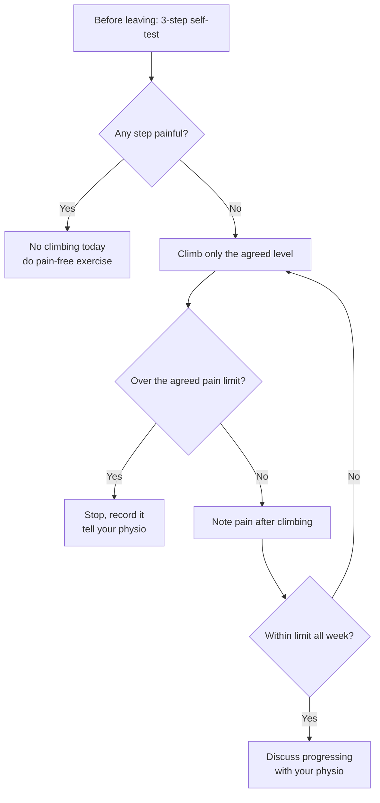

> 🌏 [中文版](/posts/climbing/2026-10-18-return-to-climbing)

Five weeks ago, crimping hard on a small edge, you felt a twinge at the base of your ring finger. The doctor said it was a mild pulley strain and you could ease back into climbing. Now the finger doesn't hurt, and you badly want to go back to the route you've been stuck on for a month.

This post is about what "ease back" actually means. By the end you'll be able to plan your first two weeks back at the gym together with a doctor or physiotherapist.

It covers principles shared across body parts. Diagnosis, grading and timelines for each area are in their own posts: [finger pulleys](/posts/climbing/2026-10-18-finger-pulley-injury-en), [other finger injuries](/posts/climbing/2026-10-18-finger-injuries-other-en), [elbow and wrist](/posts/climbing/2026-10-18-climbing-elbow-wrist-en), [shoulder](/posts/climbing/2026-10-18-climbing-shoulder-en). Teenage finger injuries follow different rules; see the [previous post on youth growth plates](/posts/climbing/2026-10-18-youth-growth-plate-en).

First, the state of the evidence. There's no international consensus yet on how to return to climbing after injury. The [protocol for an e-Delphi consensus study, published in 2025](https://pmc.ncbi.nlm.nih.gov/articles/PMC12090856/), opens by saying that treatment, rehabilitation and return-to-sport parameters after injury are "poorly documented". A [2026 scoping review protocol](https://pmc.ncbi.nlm.nih.gov/articles/PMC12927343/) likewise calls the literature sparse. Both are still protocols, with no results published. So most of what follows is physiotherapist **expert opinion**; research is labelled separately.

## Before you start: is the diagnosis right?

A return plan is only as good as the diagnosis behind it. Physiotherapist Jason Hooper's list of [ten rehab mistakes on Hooper's Beta](https://hoopersbeta.com/library/top-10-reasons-rehab-mistakes) includes two that matter here:

- **The wrong diagnosis**: his example is median nerve compression mistaken for climber's elbow. Treat the wrong injury and rehab won't progress.
- **The number one mistake**: asking the strong climbers at the gym, the community "experts", instead of a professional. Climbing hard doesn't make someone an injury expert.

In Taiwan, the usual order is doctor first, then physiotherapy. [Article 12 of Taiwan's Physical Therapists Act (in Chinese)](https://law.moj.gov.tw/LawClass/LawAll.aspx?pcode=L0020044) requires physiotherapists to work from a doctor's diagnosis, referral or order, except for services not aimed at treating disease. For which department to visit, see the [Climbing Injury Overview](/posts/climbing/2026-10-18-climbing-injury-overview-en).

How long a return takes varies widely. [Lum and Park 2019](https://pubmed.ncbi.nlm.nih.gov/31024194/) followed recreational climbers in the US: injuries that didn't need surgery took 3.9 months on average before a return to climbing. **Research**

**Something you can do tonight**: write an injury note on your phone: the date, the move you were doing, who diagnosed it, and the diagnosis. Bring it to every doctor and physio appointment.

## Principle 1: keep protection short, start loading early

The common plan is: rest completely until it stops hurting, then go straight back. Both halves are a problem.

[PEACE & LOVE](https://pubmed.ncbi.nlm.nih.gov/31377722/), a 2019 British Journal of Sports Medicine editorial by Dubois and Esculier, argues that:

- **Protection** only needs 1–3 days, to limit bleeding and avoid stretching the injured fibres further. Rest should be minimised, because prolonged rest compromises tissue strength and quality. Pain should guide when to stop protecting.
- After that, **add load** early and resume normal activities as symptoms allow, without making the pain worse.
- A few days after the injury, start **pain-free aerobic exercise** to increase blood flow to the injured area.

PEACE & LOVE is an editorial, not a clinical guideline, and draws mainly on ankle-sprain and general soft-tissue literature. **Expert opinion**

Research also supports not resting completely. [Silbernagel et al.'s 2007 randomised controlled trial](https://pubmed.ncbi.nlm.nih.gov/17307888/) split patients with Achilles tendinopathy into two groups: one kept running and jumping using pain monitoring, the other stopped for the first six weeks. Both improved at the same rate, and continuing activity caused no harm. **Research** (patients with Achilles tendinopathy, not climbers)

The second half, "pain-free means ready", is also a problem. In his advice on [the first 10 minutes to 10 weeks after an injury](https://hoopersbeta.com/library/injured-climbing-heres-what-to-do-in-the-first-10-minutes-10-hours-10-days-and-10-weeks), Hooper explains that no pain only means the tissue is out of the acute inflammatory phase, not that it has regained its strength.

**Something you can do tonight**: list three activities that don't involve the injured area and don't hurt, such as cycling or leg training. You are not in a "can't do anything" period.

## Principle 2: use pain as your gauge

### Start with a three-step self-test

Hooper suggests testing three things in order before returning, and resting if any step hurts:

1. **Mobility**: can the injured joint move through its full range without pain?
2. **Light resistance**: for a finger, for example, use your other hand to apply gentle resistance and see whether it hurts.
3. **Function**: get into the position you were injured in and load it lightly. Hurt it crimping? Test a crimp. Hurt your shoulder with the arm extended? Recreate that position in a controlled way.

### How much pain is too much: the numbers differ

| Source | When | Acceptable | Too much |
|---|---|---|---|
| Hooper's Beta | Acute inflammatory phase | No pain | Any pain |
| Hooper's Beta | After the acute phase (e.g. more than 3 weeks, no signs of inflammation) | 0/10 at rest, a 1–2 point rise during activity that disappears right after | A jump to 4/10 lasting more than 30 seconds |
| [The Climbing Doctor](https://theclimbingdoctor.com/how-to-rehab-a-climbing-pulley-injury) (pulley rehab) | "No pain" stage first, then "low pain" stage | Low pain = 3/10 lasting no more than 3 minutes | Beyond that |

Both are physiotherapists' clinical methods, and the numbers differ. The better approach is to agree on one number with your physiotherapist and stick to it. If you're not sure whether you're still in the acute phase, Hooper's advice is to see a professional.

The [UIAA Medical Commission factsheet on sport climbing](https://theuiaa.org/documents/safety/UIAA_Medical_SportClimbing.pdf) describes the typical way overuse injuries progress. First, pain some time after activity; then pain at the start and after; then during and after; finally, pain all the time. Its advice: don't wait until it hurts all the time to deal with it.

**Something you can do tonight**: run the three-step test above and note the pain score (0–10) for each step on your phone. That's your baseline before going back.

## Principle 3: return to the wall in stages

### What easy, moderate and hard mean

The Climbing Doctor's pulley rehab article splits the return to climbing into three levels:

| Level | Wall angle | Grips | Grade |
|---|---|---|---|
| Easy | Up to vertical | Big holds, no half or full crimps | Two full grades below your onsight (e.g. 5.12 → 5.10, V8 → V6) |
| Moderate | Slightly overhanging | Half crimps start | One grade below |
| Hard | Overhanging | Crimps | Up to onsight level |

It's designed for finger pulleys, but the three dials (angle, grip, grade) work for other areas too. The article also notes that judging a route's load on the fingers is not an exact science, and it's best decided with a medical provider.

The Climbing Doctor's pulley return timeline by severity (in weeks)

| Stage | Mild / Grade 1 | Moderate / Grade 2 | Severe / Grade 3 |
|---|---|---|---|
| No-pain hangs, stage 1 | 1–2 | 2–4 | 3–6 |
| Easy climbing | 2–3 | 4–6 | 6–9 |
| Moderate climbing | 3–4 | 6–9 | 9–12 |
| Hard climbing | 5–6 | 9–12 | 12–15 |

- Source: The Climbing Doctor's pulley rehab article, based on Lutter et al.'s ultrasound grading and Cooper et al.'s clinical criteria.
- Applies to: finger pulley strains and ruptures; not other areas or teenagers.
- The article itself says no clinical research supports one set-and-rep protocol over another. **Expert opinion**
- Another physiotherapist's reference point: Lattice's [Sam Radcliffe](https://ukclimbing.com/articles/skills/series/lattice_training_series_with_tom_randall/part_6_finger_injuries-11469) says minor finger injuries treated conservatively generally allow a return to climbing in about six weeks.

### Four common mistakes from Hooper's list

- **Going back to the route that hurt you**: Hooper says that even if you feel great after a week off, don't jump back onto your hardest crimp project.
- **Treating "healed" as "strong"**: feeling fine after three or four weeks off doesn't mean you're ready for a four-hour session. Other tissues have weakened a little from not climbing, too.
- **"Easy" climbing that still provokes the injury**: being a V7 climber doesn't make a V4 safe for an injured finger.
- **Doing too much rehab**: told to do it four times a week, some people do it four times a day and end up sore everywhere. Others quit an eight-week plan at week four because they don't feel progress.

Before each gym session, you can use this chart to decide how to climb that day:

The pain limit in the chart is the number you agreed with your physiotherapist.

**Something you can do tonight**: at your usual gym, pick three routes or boulder problems that meet the "easy" definition: up to vertical, big holds, two grades below your level. Take photos, and climb those three on your first day back.

## Plan your first two weeks

Put the principles into a table and take it to your doctor or physiotherapist. These are the items to ask about and write down, not a ready-made programme:

| Item | What to write down | Basis |
|---|---|---|
| Cleared to climb? | The date your doctor or physio agreed | Diagnosis first, then return |
| Pain limit | One number, and how long it may last | Hooper's or The Climbing Doctor's rule, agreed with your physio |
| What to avoid | Which grips, angles and moves (e.g. full crimp, dynamic moves, the position you were injured in) | Whatever hurt in the three-step test |
| Week 1 level | "Easy": up to vertical, big holds, two grades below | The Climbing Doctor's levels |
| Session length | Shorter than before the injury; let your physio set how short | Hooper: "healed" isn't "strong" |
| Sessions per week | Whatever frequency your physio sets; don't add more | Hooper: too much rehab is also a mistake |
| Conditions for week 2 | Only if every week-1 session stayed within the pain limit, discuss moving to "moderate" with your physio | Pain monitoring |

Even for a mild pulley strain, The Climbing Doctor's timeline only reaches "moderate" around week 3. So for the first two weeks, most people are still at "easy".

**Something you can do tonight**: copy this table onto your phone or paper, leaving the blanks. At your next appointment, ask your doctor or physiotherapist to help fill it in.

## Fingers and shoulders: the details differ

### Fingers: getting back on the fingerboard

The Climbing Doctor's 2026 article on [returning to the fingerboard](https://theclimbingdoctor.com/returning-to-the-fingerboard-after-a-finger-injury-2) suggests this progression:

1. Hang with **weight removed**, using pulleys and a counterweight.
2. Hang at **bodyweight**.
3. **Add weight**. The author considers added weight easier to control than switching to smaller edges: weight is a number you choose, while a smaller edge changes how load passes through the finger in less predictable ways.
4. **One-arm hangs** with assistance from the other hand.

If you can't hang yet, you can stand on a bathroom scale and pull down on the fingerboard to measure your pull force, then train at a percentage of that maximum. Compare against **your own pre-injury number and your other hand**, not other people's averages. The author stresses that research reference values are for context, not targets.

While hanging, film your fingers to see whether they drift to one side (the author calls these splits and shifts). If you can't correct them even on larger edges, the uneven load becomes a problem over time.

### Shoulders: even less evidence

There's little climbing-specific research on returning after a shoulder injury. Hooper's approach is to recreate the injury position in a controlled way. If you hurt your shoulder with the arm extended, for example, stand on a stool under a pull-up bar, or use a counterweight, and slowly load the shoulder in that position. For impingement, his advice in his [shoulder impingement episode](https://hoopersbeta.com/library/shoulder-impingement-syndrome-in-rock-climbers) is to see a professional, because it's hard to tell on your own whether the problem is mobility, stability or anatomy.

For outcomes after surgery, there's one study to refer to. [Simon et al. 2023](https://pubmed.ncbi.nlm.nih.gov/37301627/) followed 27 climbers who had arthroscopic repair after a first traumatic shoulder dislocation; after a little over four years on average, 93% had returned to climbing. **Research** (long-term outcome after surgery, not a return protocol)

For common shoulder problems and prevention, see [Shoulder](/posts/climbing/2026-10-18-climbing-shoulder-en).

**Something you can do tonight**: write down where your hand or arm was at the moment of injury, such as a full crimp, arm straight overhead, or a sidepull. When you return, test that position last.

## Practice: four scenarios

Answers are under each question; think first, then look.

**1. You had a mild pulley strain, rested for a week, and now it doesn't hurt at all. You plan to try your crimpy project this weekend.**

Answer

Not yet. Hooper says pain-free only means you're past the acute inflammatory phase; the tissue hasn't regained its strength, and you shouldn't go straight back to the move that hurt you. Do the three-step self-test, start on "easy" routes, and make sure your doctor or physiotherapist has cleared you.

**2. On your third session back, your finger goes from 0 to 2 out of 10 halfway up a route, and the pain disappears as soon as you're down.**

Answer

Under Hooper's post-acute rule, a 1–2 point rise that disappears right afterwards is acceptable. It also falls within The Climbing Doctor's low-pain threshold. Go by the number you agreed with your physiotherapist, and log it. If it jumps to 4/10 and lasts more than 30 seconds, Hooper considers that too much.

**3. A friend says: "Two months of complete rest is safest. Go back once it stops hurting."**

Answer

PEACE & LOVE recommends only 1–3 days of protection with minimal rest, then adding load early without making the pain worse. The Achilles tendon trial also found that continuing activity with pain monitoring did no worse than resting. This evidence isn't climbing-specific, so agree the details with your physiotherapist. Also, Hooper ranks "listening to community experts" as the number one rehab mistake.

**4. Three months after a shoulder injury, you're following a return programme you found online, but your shoulder hurts until the next day after every session.**

Answer

In the UIAA factsheet's progression, pain after activity is the first stage, and it warns not to wait until pain is constant before acting. If you haven't progressed in three months, go back to a doctor or physiotherapist for a reassessment, including whether the diagnosis is right. As Hooper points out, treating the wrong injury means rehab won't progress.

## Next steps

Once you're back on the wall, many people ask next: should I stretch more? Can flexibility prevent injury? The next post, [Flexibility and Mobility](/posts/climbing/2026-10-18-climbing-flexibility-mobility-en), covers what the research says and a 10-minute mobility routine.

## References

- [Ehiogu U et al. Developing consensus for upper limb rehabilitation, physical preparation and return to climbing in adults: protocol for an international e-Delphi study. BMJ Open Sport Exerc Med 2025](https://pmc.ncbi.nlm.nih.gov/articles/PMC12090856/)
- [Ehiogu U et al. Return to climbing after musculoskeletal injury: a scoping review protocol of rehabilitation content, outcome measures and return to sport criteria in climbers. BMJ Open Sport Exerc Med 2026](https://pmc.ncbi.nlm.nih.gov/articles/PMC12927343/)
- [Dubois B, Esculier JF. Soft-tissue injuries simply need PEACE and LOVE. Br J Sports Med 2020](https://pubmed.ncbi.nlm.nih.gov/31377722/)
- [Silbernagel KG et al. Continued sports activity, using a pain-monitoring model, during rehabilitation in patients with Achilles tendinopathy: a randomized controlled study. Am J Sports Med 2007](https://pubmed.ncbi.nlm.nih.gov/17307888/)
- [Lum ZC, Park L. Rock climbing injuries and time to return to sport in the recreational climber. J Orthop 2019](https://pubmed.ncbi.nlm.nih.gov/31024194/)
- [Simon M et al. Functional and Sport-Specific Outcome Following Traumatic First-Time Shoulder Dislocation and Arthroscopic Surgical Repair in Rock Climbers. Wilderness Environ Med 2023](https://pubmed.ncbi.nlm.nih.gov/37301627/)
- [Climbing Injuries: What to Do in The First 10 Minutes, 10 Hours, 10 Days, and 10 Weeks (Jason Hooper, Hooper's Beta, 2020)](https://hoopersbeta.com/library/injured-climbing-heres-what-to-do-in-the-first-10-minutes-10-hours-10-days-and-10-weeks)
- [10 Reasons Your Climbing Injury Won't Heal (Jason Hooper, Hooper's Beta)](https://hoopersbeta.com/library/top-10-reasons-rehab-mistakes)
- [Shoulder Impingement Syndrome in Rock Climbers (Jason Hooper, Hooper's Beta)](https://hoopersbeta.com/library/shoulder-impingement-syndrome-in-rock-climbers)
- [How To Rehab a Climbing Finger Pulley Injury (The Climbing Doctor)](https://theclimbingdoctor.com/how-to-rehab-a-climbing-pulley-injury)
- [Returning To The Fingerboard After A Finger Injury (Jared Vagy, The Climbing Doctor, 2026)](https://theclimbingdoctor.com/returning-to-the-fingerboard-after-a-finger-injury-2)
- [Part 6: Finger Injuries (Sam Radcliffe, Lattice Training × UKClimbing)](https://ukclimbing.com/articles/skills/series/lattice_training_series_with_tom_randall/part_6_finger_injuries-11469)
- [UIAA Medical Commission: Factsheet on Sport Climbing (PDF)](https://theuiaa.org/documents/safety/UIAA_Medical_SportClimbing.pdf)
- [Physical Therapists Act, Laws & Regulations Database of the Republic of China (Taiwan) (in Chinese)](https://law.moj.gov.tw/LawClass/LawAll.aspx?pcode=L0020044)
