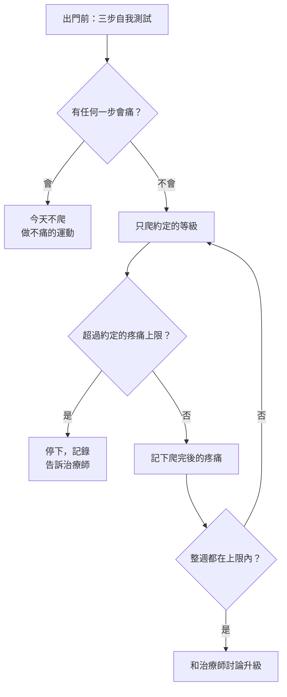

> 🌏 [English version](/posts/climbing/2026-10-18-return-to-climbing-en)

五週前，你在一個小點上用全封閉抓的時候，無名指根部痛了一下。醫師說是滑車輕微拉傷，可以慢慢回去爬。現在手指不痛了，你很想直接回去試那條卡了一個月的路線。

這篇講的就是「慢慢回去」到底怎麼慢。讀完你能跟醫師或物理治療師一起，排出回岩館的前兩週。

這篇講各部位共用的原則。每個部位的診斷、分級和時程，見各自那一篇：[手指滑車](/posts/climbing/2026-10-18-finger-pulley-injury)、[手指的其他傷害](/posts/climbing/2026-10-18-finger-injuries-other)、[肘與腕](/posts/climbing/2026-10-18-climbing-elbow-wrist)、[肩](/posts/climbing/2026-10-18-climbing-shoulder)。青少年的手指傷害有不同的規則，見[上一篇〈青少年生長板〉](/posts/climbing/2026-10-18-youth-growth-plate)。

先講清楚證據的狀況。攀岩受傷後怎麼回去爬，目前沒有國際共識。[2025 年發表的 e-Delphi 共識研究計畫書](https://pmc.ncbi.nlm.nih.gov/articles/PMC12090856/)開宗明義就說，受傷後的治療、復健與回到運動的參數「記錄得很少」。[2026 年的範圍回顧計畫書](https://pmc.ncbi.nlm.nih.gov/articles/PMC12927343/)也說相關文獻稀少。這兩篇都還只是計畫，結果還沒發表。所以下面多數做法是物理治療師的**專家意見**，研究會另外標明。

## 開始之前：診斷對了嗎

回岩館的計畫建立在正確的診斷上。物理治療師 Jason Hooper 在 [Hooper's Beta 列出的十個復健錯誤](https://hoopersbeta.com/library/top-10-reasons-rehab-mistakes)裡，有兩個跟這有關：

- **診斷錯了**：他舉的例子是正中神經壓迫被當成攀岩肘。治錯了傷，復健就不會有進展。
- **第一名的錯誤**：問岩館裡爬得很強的「社群專家」，而不是找專業人員。爬得強不代表懂傷害。

在台灣，順序通常是先看醫師，再做物理治療。[《物理治療師法》第 12 條](https://law.moj.gov.tw/LawClass/LawAll.aspx?pcode=L0020044)規定，物理治療師執行業務應依醫師開具的診斷、照會或醫囑，非以疾病治療為目的的才不在此限。受傷該掛哪一科，見〈[攀岩傷害總覽](/posts/climbing/2026-10-18-climbing-injury-overview)〉。

回去要多久，每個人差很多。[Lum 與 Park 2019 年](https://pubmed.ncbi.nlm.nih.gov/31024194/)追蹤美國休閒攀岩者，不需開刀的傷平均 3.9 個月回到攀岩。**研究**

**今晚就能做的動作**：在手機寫一筆受傷紀錄：哪一天、做什麼動作時受傷、誰診斷的、診斷名稱是什麼。回診和看物理治療時都拿出來。

## 原則一：保護期短一點，負荷早一點開始

很多人以為的做法是：完全休息到不痛，再直接回去爬。這兩半都有問題。

[PEACE & LOVE](https://pubmed.ncbi.nlm.nih.gov/31377722/) 是 Dubois 與 Esculier 2019 年在《英國運動醫學期刊》發表的社論，主張：

- **保護**只要 1–3 天，用來減少出血、避免傷處再被拉開。休息要盡量少，因為長期休息會讓組織的強度和品質變差。何時結束保護，由疼痛決定。
- 之後早一點**加上負荷**，症狀允許就恢復日常活動，前提是不讓疼痛惡化。
- 受傷幾天後，開始做**不會痛的有氧運動**，增加傷處血流。

PEACE & LOVE 是社論，不是臨床指引，內容主要從踝扭傷等一般軟組織文獻推來。**專家意見**

研究也支持「不必完全休息」。[Silbernagel 等人 2007 年的隨機對照試驗](https://pubmed.ncbi.nlm.nih.gov/17307888/)把阿基里斯腱病變的病人分兩組：一組用疼痛監測繼續跑跳，另一組前 6 週停止跑跳。兩組的進步沒有差別，繼續活動那組也沒有變差。**研究**（阿基里斯腱病變的病人，不是攀岩者）

後半句「不痛就直接回去」也有問題。Hooper 在[受傷後前 10 分鐘到 10 週的建議](https://hoopersbeta.com/library/injured-climbing-heres-what-to-do-in-the-first-10-minutes-10-hours-10-days-and-10-weeks)裡說：不痛只代表組織不在急性發炎期，不代表它已經恢復強度。

**今晚就能做的動作**：列出三項不會用到受傷部位、做了也不會痛的運動，例如騎腳踏車、腿部訓練。這段期間你不是「什麼都不能做」。

## 原則二：用疼痛當儀表

### 先做三步自我測試

Hooper 建議，回去之前依序測三件事，任何一步會痛就停下來休息：

1. **活動度**：受傷的關節能不能不痛地動完整個範圍。
2. **輕阻力**：例如手指受傷，用另一隻手輕輕給阻力，看會不會痛。
3. **功能**：擺出受傷時的姿勢，輕輕加一點力。在 crimp 受傷就擺 crimp；肩膀在手伸直時受傷，就在可以控制的情況下重現那個位置。

### 痛到多少要停：各家數字不同

| 來源 | 適用時機 | 可以接受 | 太多了 |
|---|---|---|---|
| Hooper's Beta | 急性發炎期 | 不痛 | 任何疼痛 |
| Hooper's Beta | 急性期過後（例如超過 3 週、沒有發炎徵象） | 休息時 0 分，活動時多 1–2 分，做完馬上消失 | 跳到 4 分，而且持續超過 30 秒 |
| [The Climbing Doctor](https://theclimbingdoctor.com/how-to-rehab-a-climbing-pulley-injury)（滑車復健） | 先「不痛」階段，再進「低痛」階段 | 低痛 = 3 分，持續不超過 3 分鐘 | 超過這個範圍 |

兩邊都是物理治療師的臨床做法，數字不同。比較好的做法是跟你的物理治療師約定一個數字，照那個數字執行。不確定自己是不是還在急性期，Hooper 的建議是找專業人員。

[UIAA 醫學委員會的運動攀登說明](https://theuiaa.org/documents/safety/UIAA_Medical_SportClimbing.pdf)描述了過度使用傷害典型的惡化順序。先是活動後一段時間才痛，接著開始和結束都痛，然後活動中和活動後都痛，最後一直痛。它的提醒是：不要等到一直痛才處理。

**今晚就能做的動作**：做一次上面的三步測試，把每一步的疼痛分數（0–10）記在手機裡。這就是你回岩館前的基準。

## 原則三：分階段回到牆上

### 容易、中等、困難怎麼分

The Climbing Doctor 的滑車復健文章，把回到攀爬分成三級：

| 等級 | 牆的角度 | 握法 | 難度 |
|---|---|---|---|
| 容易 | 垂直以內 | 大點，避開半封閉和全封閉 | 比你的 onsight 等級低兩級（例如 5.12 降到 5.10、V8 降到 V6） |
| 中等 | 稍微前傾 | 開始用半封閉 | 低一級 |
| 困難 | 前傾 | 用 crimp | 可以到 onsight 等級 |

這是為手指滑車設計的，但「角度、握法、難度」三個旋鈕，其他部位也用得上。文章也提醒，判斷一條路線對手指的負擔不是精確的科學，最好跟醫療人員一起決定。

The Climbing Doctor 的滑車回攀時程（依嚴重度，單位：週）

| 階段 | 輕度／第 1 級 | 中度／第 2 級 | 重度／第 3 級 |
|---|---|---|---|
| 不痛懸吊第 1 階段 | 1–2 | 2–4 | 3–6 |
| 容易攀爬 | 2–3 | 4–6 | 6–9 |
| 中等攀爬 | 3–4 | 6–9 | 9–12 |
| 困難攀爬 | 5–6 | 9–12 | 12–15 |

- 出處：The Climbing Doctor 網站的滑車復健文章，依 Lutter 等人的超音波分級與 Cooper 等人的臨床分級整理。
- 適用：手指滑車拉傷或斷裂，不適用於其他部位或青少年。
- 文章自己說，沒有臨床研究證明哪一種組數次數比較好。**專家意見**
- 另一位物理治療師的參考點：Lattice 的 [Sam Radcliffe](https://ukclimbing.com/articles/skills/series/lattice_training_series_with_tom_randall/part_6_finger_injuries-11469) 說，輕微的手指傷保守治療，一般 6 週左右可以回去爬。

### Hooper 列的四個常見錯誤

- **回去爬讓你受傷的那條路線**：Hooper 說，休息一週後感覺很好，也不要直接回去爬最難的 crimp 專案。
- **「好了」當成「強了」**：停爬三、四週後覺得沒事，不代表可以一次爬四小時。其他組織也因為停爬變弱了一點。
- **「容易」的路線其實還是會刺激傷處**：V7 的人去爬 V4，不代表那條 V4 對受傷的手指就安全。
- **復健做太多**：被交代一週做四次，自己改成一天四次，結果到處痛。也有人反過來，八週計畫做到第四週沒感覺就放棄。

每次去岩館前，可以照這張圖決定今天怎麼爬：

圖中的疼痛上限，就是你和物理治療師約定的那個數字。

**今晚就能做的動作**：在你常去的岩館，挑三條符合「容易」定義的路線或抱石題：垂直以內、大點、比你能力低兩級。拍照存起來，回去第一天就爬這三條。

## 排出你的前兩週

把上面的原則填進一張表，帶去給醫師或物理治療師看。下面是要問清楚、寫下來的項目，不是現成的課表：

| 項目 | 你要寫下的內容 | 依據 |
|---|---|---|
| 可以開始爬了嗎 | 醫師或物理治療師同意的日期 | 先有診斷，再談回攀 |
| 疼痛上限 | 一個數字，以及能持續多久 | Hooper 或 The Climbing Doctor 的規則，擇一約定 |
| 先避開什麼 | 哪些握法、角度、動作（例如全封閉、動態、受傷時的姿勢） | 三步測試中會痛的項目 |
| 第 1 週的等級 | 「容易」：垂直以內、大點、低兩級 | The Climbing Doctor 的分級 |
| 每次多長 | 比受傷前短，具體多長請治療師決定 | Hooper：「好了」不等於「強了」 |
| 每週幾次 | 照治療師給的頻率，不自己加 | Hooper：復健做太多也是錯 |
| 第 2 週升級的條件 | 第 1 週每次都在疼痛上限內，才和治療師討論升到「中等」 | 疼痛監測 |

即使是輕度的滑車拉傷，The Climbing Doctor 的時程表也要到第 3 週左右才進入「中等」。所以前兩週，多數人都還停在「容易」。

**今晚就能做的動作**：把這張表抄到手機或紙上，空格留著。下次回診時，請醫師或物理治療師幫你填完。

## 手指和肩：回歸的細節不一樣

### 手指：回到指力板

The Climbing Doctor 2026 年的[回到指力板](https://theclimbingdoctor.com/returning-to-the-fingerboard-after-a-finger-injury-2)文章，建議的進程是：

1. 用滑輪和配重**減輕體重**吊。
2. 吊**自身體重**。
3. **加負重**。作者認為加重量比換更小的點好控制，因為重量是你選的數字，換小點會改變手指受力的方式，比較難預測。
4. 用另一手輔助的**單手懸吊**。

不能吊的時候，可以站在體重計上往下拉指力板，算出拉力，再用最大拉力的某個百分比練習。比較的對象是**你自己受傷前的數字和另一隻手**，不是別人的平均值。作者提醒，研究的參考值只能當背景，不是目標。

吊的時候，可以錄影看手指有沒有往一邊歪（作者稱為 split 和 shift），在大點上也修不正的話，長期會讓受力不平均。

### 肩：證據更少

攀岩專屬的肩傷回攀研究很少。Hooper 的做法是在可控制的情況下重現受傷時的位置。例如肩膀在手伸直時受傷，就站在單槓下的椅子上，或用配重，慢慢讓肩膀在那個位置承重。肩夾擠的部分，他在[肩夾擠的影片說明](https://hoopersbeta.com/library/shoulder-impingement-syndrome-in-rock-climbers)裡的建議是：去找專業人員，因為很難自己分辨是活動度、穩定度還是結構的問題。

開刀之後的結果有一份研究可以參考。[Simon 等人 2023 年](https://pubmed.ncbi.nlm.nih.gov/37301627/)追蹤 27 位第一次創傷性肩脫臼、接受關節鏡修補的攀岩者，平均四年多後，93% 回到攀岩。**研究**（開刀後的長期結果，不是回攀流程）

肩的常見問題與預防，見〈[肩](/posts/climbing/2026-10-18-climbing-shoulder)〉。

**今晚就能做的動作**：寫下受傷那一刻你的手或手臂在什麼位置，例如全封閉、手伸直過頭、側拉（sidepull）。回去時，這個位置排在最後才測。

## 練習題：四個情境

答案在每題下方，先自己想再看。

**1. 你手指滑車輕微拉傷，休息了一週，現在完全不痛。你打算週末回去試那條卡住的 crimp 路線。**

答案

先不要。Hooper 說，不痛只代表過了急性發炎期，組織還沒恢復強度；也不要直接回到讓你受傷的動作。先做三步自我測試，從「容易」的路線開始，並確認醫師或物理治療師同意。

**2. 回岩館第三次，爬到一半手指從 0 分變成 2 分，下來之後馬上就不痛了。**

答案

依 Hooper 急性期過後的規則，活動時多 1–2 分而且馬上消失，是可以接受的範圍。在 The Climbing Doctor 的低痛標準裡，這也算可以接受。照你和物理治療師約定的數字判斷，並記錄下來。如果跳到 4 分、持續超過 30 秒，Hooper 認為就是太多了。

**3. 岩友說：「完全休息兩個月最保險，等到不痛再回去。」**

答案

PEACE & LOVE 建議保護期只要 1–3 天、休息盡量少，之後在不讓疼痛惡化的前提下早點加負荷。阿基里斯腱的隨機對照試驗也發現，用疼痛監測繼續活動，結果不比休息差。這些證據不是攀岩專屬，具體怎麼做請和物理治療師討論。另外，Hooper 把「聽社群專家的話」列為第一名的復健錯誤。

**4. 你肩膀受傷三個月，自己在網路上找了一套回攀課表，但每次爬完肩膀都痛到隔天。**

答案

UIAA 說明裡的惡化順序中，「活動後痛」是第一個階段，它提醒不要等到一直痛才處理。三個月還沒有進展，請回去找醫師或物理治療師重新評估，包括診斷本身對不對。Hooper 指出，治錯了傷，復健不會有進展。

## 下一步

回到牆上之後，很多人接著想問：要不要多拉筋？柔軟度能不能預防受傷？下一篇〈[柔軟度與活動度](/posts/climbing/2026-10-18-climbing-flexibility-mobility)〉講研究怎麼說，以及一組 10 分鐘的活動度練習。

## 參考資料

- [Ehiogu U et al. Developing consensus for upper limb rehabilitation, physical preparation and return to climbing in adults: protocol for an international e-Delphi study. BMJ Open Sport Exerc Med 2025](https://pmc.ncbi.nlm.nih.gov/articles/PMC12090856/)
- [Ehiogu U et al. Return to climbing after musculoskeletal injury: a scoping review protocol of rehabilitation content, outcome measures and return to sport criteria in climbers. BMJ Open Sport Exerc Med 2026](https://pmc.ncbi.nlm.nih.gov/articles/PMC12927343/)
- [Dubois B, Esculier JF. Soft-tissue injuries simply need PEACE and LOVE. Br J Sports Med 2020](https://pubmed.ncbi.nlm.nih.gov/31377722/)
- [Silbernagel KG et al. Continued sports activity, using a pain-monitoring model, during rehabilitation in patients with Achilles tendinopathy: a randomized controlled study. Am J Sports Med 2007](https://pubmed.ncbi.nlm.nih.gov/17307888/)
- [Lum ZC, Park L. Rock climbing injuries and time to return to sport in the recreational climber. J Orthop 2019](https://pubmed.ncbi.nlm.nih.gov/31024194/)
- [Simon M et al. Functional and Sport-Specific Outcome Following Traumatic First-Time Shoulder Dislocation and Arthroscopic Surgical Repair in Rock Climbers. Wilderness Environ Med 2023](https://pubmed.ncbi.nlm.nih.gov/37301627/)
- [Climbing Injuries: What to Do in The First 10 Minutes, 10 Hours, 10 Days, and 10 Weeks（Jason Hooper，Hooper's Beta，2020）](https://hoopersbeta.com/library/injured-climbing-heres-what-to-do-in-the-first-10-minutes-10-hours-10-days-and-10-weeks)
- [10 Reasons Your Climbing Injury Won't Heal（Jason Hooper，Hooper's Beta）](https://hoopersbeta.com/library/top-10-reasons-rehab-mistakes)
- [Shoulder Impingement Syndrome in Rock Climbers（Jason Hooper，Hooper's Beta）](https://hoopersbeta.com/library/shoulder-impingement-syndrome-in-rock-climbers)
- [How To Rehab a Climbing Finger Pulley Injury（The Climbing Doctor）](https://theclimbingdoctor.com/how-to-rehab-a-climbing-pulley-injury)
- [Returning To The Fingerboard After A Finger Injury（Jared Vagy，The Climbing Doctor，2026）](https://theclimbingdoctor.com/returning-to-the-fingerboard-after-a-finger-injury-2)
- [Part 6: Finger Injuries（Sam Radcliffe，Lattice Training × UKClimbing）](https://ukclimbing.com/articles/skills/series/lattice_training_series_with_tom_randall/part_6_finger_injuries-11469)
- [UIAA Medical Commission: Factsheet on Sport Climbing（PDF）](https://theuiaa.org/documents/safety/UIAA_Medical_SportClimbing.pdf)
- [物理治療師法（全國法規資料庫）](https://law.moj.gov.tw/LawClass/LawAll.aspx?pcode=L0020044)
