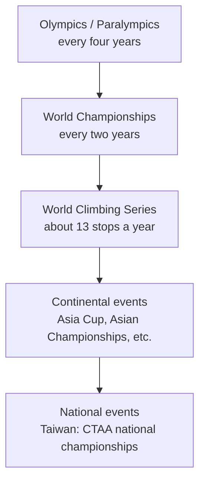

> 🌏 [中文版](/posts/climbing/2026-10-19-climbing-competitions-overview)

At the Paris 2024 Olympics, a lot of people watched a full climbing event on TV for the first time. Athletes fell off the wall again and again, yet the numbers on the scoreboard kept jumping. Afterwards the questions pile up: who runs this? What competitions are there besides the Olympics? When is the next one, and where can I watch it?

This is post 0 of the "Climbing Competitions and Pro Climbing" series. It draws the map: who runs competitions, what events happen each year, how they relate, and where to watch from Taiwan. Scoring details are in posts 1–3, and Olympic formats in post 4. After this post, when you see a competition headline you should be able to tell what level the event is and which post to read next.

## Three disciplines, three kinds of gym wall

Competitions have only three disciplines, and they map onto the three kinds of wall you have seen in a gym ([Climbing for Beginners](/posts/climbing/2026-10-08-climbing-beginner-guide-en) covers them in more detail):

| Discipline | What is being tested | Gym equivalent | Rules post |
|---|---|---|---|
| Boulder | Short walls of around four metres; solve the most problems in the time limit, in the fewest attempts | Bouldering area | [Post 1](/posts/climbing/2026-10-19-competition-bouldering-rules-en) |
| Lead | Long routes on a wall at least 15 metres high; one attempt, highest point wins | Lead wall (needs a belayer) | [Post 2](/posts/climbing/2026-10-19-competition-lead-rules-en) |
| Speed | One standard route used worldwide; first to hit the top wins | A few gyms have a standard speed wall | [Post 3](/posts/climbing/2026-10-19-competition-speed-climbing-en) |

Boulder and lead are about problem solving: the routes change every event, and athletes have to read them on the spot. Speed is the opposite. [World Climbing's speed wall specification](https://images.ifsc-climbing.org/ifsc/image/private/t_q_good/prd/urwl7n2hnnyvhiwiq0xg.pdf) fixes the wall at 15 metres and every hold in the same place, so the contest is running one route as fast as humanly possible. That is why speed specialists and boulder/lead athletes are often two different groups of people.

## Who runs competitions: World Climbing (formerly the IFSC)

The rules, calendar and world rankings for international climbing are all managed by one body: World Climbing. The "IFSC" (International Federation of Sport Climbing) in older news is its former name.

The name change happened in three steps. You only need them to match up old and new headlines:

1. **October 2023**: member federations voted to adopt the new name and wrote it into the statutes ([World Climbing brand launch announcement](https://worldclimbing.com/news/world-climbing-launches-new-global-identity)).
2. **10 December 2025**: the new name and visual identity launched, and the same announcement said the World Climbing Series would succeed the IFSC World Cup.
3. **23 July 2026**: an Extraordinary General Assembly approved the statute amendments that [completed the legal name change](https://worldclimbing.com/news/extraordinary-general-assembly-approves-legal-name-change-and-principles-based-approach-to-national-federation-membership-status).

Under World Climbing sit five continental bodies: Africa, Asia, Europe, Oceania and Pan America. Each country then has its own member federation. Taiwan's member is the Chinese Taipei Alpine Association (CTAA), which is how the federation field for Taiwanese athletes reads on the [official results site](https://ifsc.results.info/). Taiwanese athletes enter international events through the CTAA.

## What events run each year

Stack international events as a pyramid; the higher you go, the rarer the event and the harder it is to get in:

**The World Climbing Series** is what you will see most often on stream. The [2026 calendar](https://worldclimbing.com/news/china-events-confirmed-to-complete-2026-calendar) has 13 stops, from Keqiao (China) in May to Santiago (Chile) in October. Not every stop runs all three disciplines:

| Dates (2026) | Location | Disciplines |
|---|---|---|
| 1–3 May | Keqiao (China) | Boulder |
| 8–10 May | Wujiang (China) | Lead, Speed |
| 22–24 May | Bern (Switzerland) | Boulder |
| 28–31 May | Alcobendas (Spain) | Boulder, Speed |
| 3–7 June | Prague (Czechia) | Boulder, Lead |
| 17–21 June | Innsbruck (Austria) | Boulder, Lead |
| 3–5 July | Krakow (Poland) | Speed |
| 10–12 July | Chamonix (France) | Lead, Speed |
| 4–5 September | Koper (Slovenia) | Lead |
| 11–13 September | Guiyang (China) | Speed |
| 18–20 September | Chongqing (China) | Speed |
| 16–18 October | Salt Lake City (USA) | Boulder |
| 23–25 October | Santiago (Chile) | Lead, Speed |

As of October 2026, only the Santiago stop is still to come, and the season rankings will not be final until it is over.

Each country can send only so many athletes. Under the [2026 quota rules](https://worldclimbing.com/news/world-climbing-series-2026-quotas-confirmed-for-national-federations), every federation gets two athletes per medal event as a base, rising to a maximum of six depending on world ranking. Extra places go by the top 40 of the world ranking. For 2026, Japan and France filled all their extra places in both boulder and lead, which is why you see one country take several spots in a final. A federation with only the base allocation can send at most two per event.

**The World Championships** run every two years, and one event decides the world champion. The last edition was Seoul 2025 (the 19th); the next is [Brno, Czechia, 13–22 August 2027](https://worldclimbing.com/news/world-climbing-unveils-2027-international-competition-calendar), which also forms part of qualification for the Los Angeles Olympics.

**Continental events** are run by the five continental bodies. In Asia there is the Asia Cup (now the World Climbing Asia Series), the Asian Championships and the Asian Youth Championships. This is the level where Taiwanese athletes compete most often. Details are in [post 5](/posts/climbing/2026-10-19-climbing-competitions-asia-taiwan-en).

**The Olympics and Paralympics** sit at the top. Olympic climbing started at Tokyo 2020 and the format has changed every Games; LA 2028 will split the three disciplines and award separate medals for each. Para climbing is also confirmed for the LA 2028 Paralympics. The full story is in [post 4](/posts/climbing/2026-10-19-olympic-climbing-history-en).

## How youth and adult categories work

International events group athletes by birth year, not birthday. Under [World Climbing's 2026 Eligibility Code](https://images.ifsc-climbing.org/ifsc/image/private/t_q_good/prd/xk9zes4oinpxkfqgsovz.pdf):

- **Open (adult)**: in 2026 you must be born in 2009 or earlier, i.e. turn 17 during the year. This threshold started in 2025; up to 2024 it was 16.
- **Youth**: in 2026, U17 is born 2010–2011 and U19 is born 2008–2009. The code also lists U21 (born 2006–2007).

The Youth World Championships now run only U17 and U19, as at the [2026 Youth World Championship in Arco, Italy](https://worldclimbing.com/events/world-climbing-youth-championship-arco-2026/news/hayashi-nakata-deubler-and-jung-crowned-lead-youth-champions-in-arco). If your child trains for competitions, start by checking their birth year against the table to see which category they fall into this year.

## What each post in this series answers

| Post | Question it answers |
|---|---|
| 0 (this post) | Who runs competitions, what events exist, where to watch |
| [1 How bouldering is scored](/posts/climbing/2026-10-19-competition-bouldering-rules-en) | What 25 points, 10 points and minus 0.1 mean |
| [2 How lead is scored](/posts/climbing/2026-10-19-competition-lead-rules-en) | How athletes who don't top are ranked, and what "+" means |
| [3 Speed climbing](/posts/climbing/2026-10-19-competition-speed-climbing-en) | Why the route never changes, and the 0.1-second false start |
| [4 Olympic climbing](/posts/climbing/2026-10-19-olympic-climbing-history-en) | Why the format changed from Tokyo to Paris to Los Angeles |
| [5 Competitions in Asia and Taiwan](/posts/climbing/2026-10-19-climbing-competitions-asia-taiwan-en) | What a climber in Taiwan can enter, and the route to the national team |
| [6 Why Japan is so strong](/posts/climbing/2026-10-19-why-japan-climbing-strong-en) | Which parts are facts and which are only explanations |
| [7 Competitions outside World Climbing](/posts/climbing/2026-10-19-climbing-competitions-beyond-world-climbing-en) | Deep-water soloing, Rock Master, new pro leagues |
| [8 The other path for pro climbers](/posts/climbing/2026-10-19-professional-climbing-outdoor-en) | How professional climbers who don't compete prove themselves |

If you only want to follow broadcasts, read 0–4. If you want to enter competitions yourself, read 0, 1, 2 and 5. If you are curious how pro climbers make a living, jump to 7 and 8. Anyone planning to compete should also read the [Climbing Movement](/posts/climbing/2026-10-18-climbing-movement-overview-en) and [Climbing Training](/posts/climbing/2026-10-18-climbing-training-diagnosis-en) series.

## What to watch for on a broadcast

**Where to watch in Taiwan.** Take the 2026 Series [Alcobendas broadcast notice](https://worldclimbing.com/events/world-climbing-series-comunidad-de-madrid-2026/news/where-to-watch-the-world-climbing-series-comunidad-de-madrid-2026) as an example: boulder and lead semi-finals and finals stream live on [World Climbing's YouTube channel](https://www.youtube.com/@worldclimbing), but some territories are geo-blocked. Taiwan (listed as Chinese Taipei) is covered by ELTA TV, live or delayed. Each stop publishes its broadcast notice on its news page, so check it before the event starts.

**Check the event level in the title first.** On-screen graphics and headlines usually say "World Climbing Series + city", "World Championship" or "Asian Championship". A Series win and a World Championships win carry very different weight: there are a dozen or so Series stops a year, but the World Championships come once every two years.

**Then check the round.** Boulder and lead both have qualification, semi-final and final rounds, and broadcasts usually show only the last two. Finals have only 8 athletes, so when only 8 names are left on screen, the medals are on the line.

**Keep the official results site open alongside.** [ifsc.results.info](https://ifsc.results.info/) is World Climbing's official results site (the address hasn't followed the name change yet). Every attempt by every athlete updates live, including athletes the cameras don't show.

## Practice: four scenarios

Answers are under each question. Think first, then check.

**1. One headline says "IFSC World Cup Innsbruck", another says "World Climbing Series Innsbruck". Are they the same kind of event?**

Answer

Yes, the same system. IFSC is World Climbing's old name, and the World Climbing Series succeeded the IFSC World Cup from 2026. Headlines with the old name are usually about events before 2026, or from outlets that haven't switched yet.

**2. A friend says an athlete "has been world champion". You find out they won one 2026 Series stop. Is that accurate?**

Answer

Not quite. "World champion" normally means a gold medal at the World Championships, which only happen every two years (last in Seoul 2025, next in Brno 2027). The Series has a dozen or so stops a year, each with its own winner, plus an overall season winner. The three carry different weight.

**3. Your child was born in 2010 and wants to enter an international youth event in 2026. Which category? Can they enter Open?**

Answer

Under the 2026 Eligibility Code, 2010–2011 births are U17. Open in 2026 requires a 2009 or earlier birth year, so a child born in 2010 cannot enter Open this year. Next year (the year they turn 17) they can.

**4. You are in Taiwan and want to watch a World Climbing Series boulder final, but YouTube says the video isn't available in your region. What now?**

Answer

The Series is geo-blocked in some territories. The 2026 broadcast notice lists ELTA TV as the rights holder for Taiwan, so look there, and open ifsc.results.info for live results. The arrangements for each stop are set out in that stop's "where to watch" notice.

## Next

Once you know what competitions look like, the first thing to decode is the scoreboard. Where do the 24.9 and 9.8 on a boulder scoreboard come from? What changed in 2025? That is [post 1: how bouldering is scored](/posts/climbing/2026-10-19-competition-bouldering-rules-en).

## References

- [World Climbing launches new global identity (World Climbing, 2025-12-10)](https://worldclimbing.com/news/world-climbing-launches-new-global-identity)
- [Extraordinary General Assembly approves legal name change (World Climbing, 2026-07)](https://worldclimbing.com/news/extraordinary-general-assembly-approves-legal-name-change-and-principles-based-approach-to-national-federation-membership-status)
- [China events confirmed to complete 2026 calendar (World Climbing, 2026-01-09)](https://worldclimbing.com/news/china-events-confirmed-to-complete-2026-calendar)
- [World Climbing Series 2026 quotas confirmed for National Federations (World Climbing, 2025-12-16)](https://worldclimbing.com/news/world-climbing-series-2026-quotas-confirmed-for-national-federations)
- [World Climbing unveils 2027 international competition calendar (World Climbing)](https://worldclimbing.com/news/world-climbing-unveils-2027-international-competition-calendar)
- [World Climbing Eligibility Code v2 (2026-01, PDF)](https://images.ifsc-climbing.org/ifsc/image/private/t_q_good/prd/xk9zes4oinpxkfqgsovz.pdf)
- [IFSC Speed Licence Rules – Speed Walls (2022, PDF)](https://images.ifsc-climbing.org/ifsc/image/private/t_q_good/prd/urwl7n2hnnyvhiwiq0xg.pdf)
- [Hayashi, Nakata, Deubler and Jung crowned Lead Youth Champions in Arco (World Climbing, 2026)](https://worldclimbing.com/events/world-climbing-youth-championship-arco-2026/news/hayashi-nakata-deubler-and-jung-crowned-lead-youth-champions-in-arco)
- [Where to watch the World Climbing Series Comunidad de Madrid 2026 (World Climbing)](https://worldclimbing.com/events/world-climbing-series-comunidad-de-madrid-2026/news/where-to-watch-the-world-climbing-series-comunidad-de-madrid-2026)
- [World Climbing official results site](https://ifsc.results.info/)
