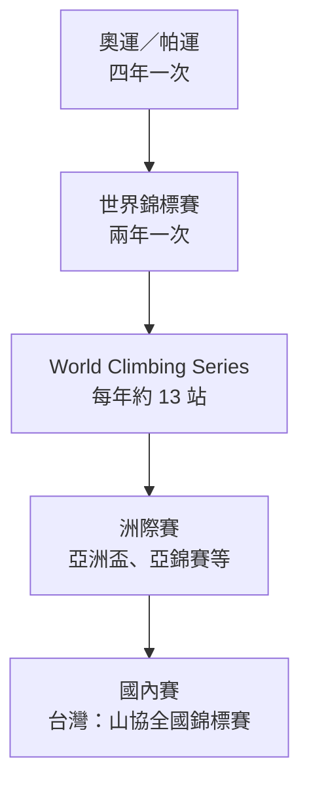

> 🌏 [English version](/posts/climbing/2026-10-19-climbing-competitions-overview-en)

2024 年巴黎奧運，很多人第一次在電視上看完一整場攀岩：選手在牆上一次次掉下來，比分板上的數字卻一直在跳。看完會冒出一串問題：這是誰辦的比賽？除了奧運還有什麼比賽？下一場什麼時候、去哪裡看？

這是「攀岩賽事與職業攀岩」系列的第 0 篇。這一篇先畫地圖：誰在辦比賽、一年有哪些比賽、它們之間是什麼關係、在台灣去哪看。計分細節留到第 1–3 篇，奧運賽制留到第 4 篇。讀完這篇，你看到一則賽事新聞時，可以判斷它在哪個等級，也知道下一步該讀哪一篇。

## 三個項目，對應岩館的三種牆

比賽只有三個項目，剛好對應你在岩館看過的三種牆（[〈攀岩入門〉](/posts/climbing/2026-10-08-climbing-beginner-guide)有更完整的介紹）：

| 項目 | 在比什麼 | 岩館裡的對應 | 詳細規則 |
|---|---|---|---|
| 抱石（boulder） | 四公尺左右的矮牆，限時內解開最多題、用最少次嘗試 | 抱石區 | [第 1 篇](/posts/climbing/2026-10-19-competition-bouldering-rules) |
| 先鋒（lead） | 至少 15 公尺高的長路線，一次機會，比誰爬得最高 | 先鋒區（要確保者） | [第 2 篇](/posts/climbing/2026-10-19-competition-lead-rules) |
| 速度（speed） | 全世界統一的標準路線，比誰先拍到頂 | 少數岩館有標準速度牆 | [第 3 篇](/posts/climbing/2026-10-19-competition-speed-climbing) |

抱石和先鋒比的是解題：路線每場都不一樣，選手要當場讀懂。速度相反，[World Climbing 的速度牆規範](https://images.ifsc-climbing.org/ifsc/image/private/t_q_good/prd/urwl7n2hnnyvhiwiq0xg.pdf)規定牆高 15 公尺、每個岩點的位置都固定，比的是把同一條路線跑到極致。所以速度選手和另外兩項的選手，常常是兩群不同的人。

## 誰在辦比賽：World Climbing（前 IFSC）

國際攀岩比賽的規則、賽程和世界排名，都由同一個組織管：World Climbing。你在舊新聞裡看到的「IFSC」（國際運動攀登總會）就是它的舊名。

換名分三步走，看新聞時對得上就好：

1. **2023 年 10 月**：各國協會投票通過改名，寫進章程（[World Climbing 品牌發表新聞](https://worldclimbing.com/news/world-climbing-launches-new-global-identity)）。
2. **2025 年 12 月 10 日**：新名稱和新識別正式啟用，同一則新聞宣布用「World Climbing Series」接替 IFSC 世界盃。
3. **2026 年 7 月 23 日**：臨時會員大會通過章程修正，[完成法定名稱變更](https://worldclimbing.com/news/extraordinary-general-assembly-approves-legal-name-change-and-principles-based-approach-to-national-federation-membership-status)。

World Climbing 底下有五個洲際總會：非洲、亞洲、歐洲、大洋洲、泛美。各國再有自己的會員協會。台灣在 World Climbing 登錄的會員是中華民國山岳協會（[官方成績網站](https://ifsc.results.info/)上台灣選手的協會欄位寫作 Chinese Taipei Alpine Association，CTAA）。台灣選手要出國比賽，報名都經過山協。

## 一年有哪些比賽

把國際比賽排成金字塔，越上面越少見、門檻越高：

**World Climbing Series（世界系列賽）**是轉播上最常看到的比賽。[2026 年賽程](https://worldclimbing.com/news/china-events-confirmed-to-complete-2026-calendar)共 13 站，從 5 月的柯橋（中國）一路比到 10 月的聖地牙哥（智利）。每站不一定三項都比：

| 日期（2026） | 地點 | 項目 |
|---|---|---|
| 5/1–3 | 柯橋（中國） | 抱石 |
| 5/8–10 | 吳江（中國） | 先鋒、速度 |
| 5/22–24 | 伯恩（瑞士） | 抱石 |
| 5/28–31 | Alcobendas（西班牙） | 抱石、速度 |
| 6/3–7 | 布拉格（捷克） | 抱石、先鋒 |
| 6/17–21 | 因斯布魯克（奧地利） | 抱石、先鋒 |
| 7/3–5 | 克拉科夫（波蘭） | 速度 |
| 7/10–12 | 夏慕尼（法國） | 先鋒、速度 |
| 9/4–5 | Koper（斯洛維尼亞） | 先鋒 |
| 9/11–13 | 貴陽（中國） | 速度 |
| 9/18–20 | 重慶（中國） | 速度 |
| 10/16–18 | 鹽湖城（美國） | 抱石 |
| 10/23–25 | 聖地牙哥（智利） | 先鋒、速度 |

截至 2026-10，只剩聖地牙哥站還沒比，年度總排名要等它比完才確定。

每個國家能派幾個人有上限。[2026 年的名額規則](https://worldclimbing.com/news/world-climbing-series-2026-quotas-confirmed-for-national-federations)是每個獎牌項目基本兩人，依世界排名等條件最多到六人。額外名額依世界排名前 40 名分配，2026 年日本和法國都拿滿了抱石和先鋒的額外名額，所以你會看到同一國在決賽一次站好幾個位置；只有基本名額的協會，每項最多派兩人。

**世界錦標賽**兩年一次，一場比賽決定世界冠軍。上一屆是 2025 年首爾（第 19 屆），下一屆是 [2027 年 8 月 13–22 日在捷克 Brno](https://worldclimbing.com/news/world-climbing-unveils-2027-international-competition-calendar)，同時也是洛杉磯奧運的資格賽之一。

**洲際賽**由五個洲際總會辦。亞洲有亞洲盃（現名 World Climbing Asia Series）、亞洲錦標賽、亞洲青年錦標賽，台灣選手最常出賽的就是這一層。細節在[第 5 篇](/posts/climbing/2026-10-19-climbing-competitions-asia-taiwan)。

**奧運與帕運**在金字塔頂端。奧運攀岩從 2020 東京開始，每屆賽制都改；2028 洛杉磯會把三個項目拆開，各自頒金牌。帕拉攀登（Para climbing）也確定進入 2028 洛杉磯帕運。這兩段的完整故事在[第 4 篇](/posts/climbing/2026-10-19-olympic-climbing-history)。

## 青年組和成人組怎麼分

國際比賽用出生年份分組，不看生日。依 [World Climbing 2026 年的參賽資格規章（Eligibility Code）](https://images.ifsc-climbing.org/ifsc/image/private/t_q_good/prd/xk9zes4oinpxkfqgsovz.pdf)：

- **成人組（Open）**：2026 年要 2009 年或更早出生，也就是當年滿 17 歲。這個門檻從 2025 年開始，2024 年以前是當年滿 16 歲。
- **青年組**：2026 年 U17 是 2010–2011 年生、U19 是 2008–2009 年生。規章另有 U21（2006–2007 年生）。

青年世錦賽現在只比 U17 和 U19 兩組，例如 [2026 年義大利阿爾科的青年世錦賽](https://worldclimbing.com/events/world-climbing-youth-championship-arco-2026/news/hayashi-nakata-deubler-and-jung-crowned-lead-youth-champions-in-arco)。如果你家小孩在練比賽，先用出生年對照表，看他今年落在哪一組。

## 這個系列每篇回答什麼

| 篇 | 回答的問題 |
|---|---|
| 0（本篇） | 誰辦比賽、一年有哪些、去哪看 |
| [1 抱石賽怎麼計分](/posts/climbing/2026-10-19-competition-bouldering-rules) | 25 分、10 分、扣 0.1 是什麼意思 |
| [2 先鋒賽怎麼計分](/posts/climbing/2026-10-19-competition-lead-rules) | 沒爬到頂的人怎麼排、「+」是什麼 |
| [3 速度賽](/posts/climbing/2026-10-19-competition-speed-climbing) | 為什麼路線永遠一樣、0.1 秒的起跑犯規 |
| [4 奧運攀岩](/posts/climbing/2026-10-19-olympic-climbing-history) | 東京、巴黎到洛杉磯的賽制為什麼每屆都改 |
| [5 亞洲與台灣的比賽](/posts/climbing/2026-10-19-climbing-competitions-asia-taiwan) | 台灣攀岩者能報什麼、怎麼走到國家隊 |
| [6 日本為什麼強](/posts/climbing/2026-10-19-why-japan-climbing-strong) | 哪些是事實、哪些只是解釋 |
| [7 World Climbing 以外的比賽](/posts/climbing/2026-10-19-climbing-competitions-beyond-world-climbing) | 深水抱石、Rock Master、新職業聯賽 |
| [8 職業攀岩者的另一條路](/posts/climbing/2026-10-19-professional-climbing-outdoor) | 不靠比賽的職業攀岩者怎麼證明自己 |

只想看懂轉播：讀 0–4。想自己報比賽：讀 0、1、2、5。對職業攀岩者怎麼生活好奇：直接跳到 7、8。想參賽的人，另外要讀[〈攀岩動作技術〉](/posts/climbing/2026-10-18-climbing-movement-overview)和[〈攀岩訓練〉](/posts/climbing/2026-10-18-climbing-training-diagnosis)兩個系列。

## 看轉播時盯什麼

**在台灣去哪看。** 以 2026 年系列賽的 [Alcobendas 站轉播公告](https://worldclimbing.com/events/world-climbing-series-comunidad-de-madrid-2026/news/where-to-watch-the-world-climbing-series-comunidad-de-madrid-2026)為例：抱石和先鋒的準決賽、決賽在 [World Climbing 的 YouTube 頻道](https://www.youtube.com/@worldclimbing)直播，但部分地區會被鎖區；台灣（公告寫 Chinese Taipei）的轉播權在愛爾達（ELTA TV），可能是直播或延遲播出。每站的轉播公告都會在該站的新聞頁發布，開賽前去看一眼。

**先看標題上的賽事等級。** 轉播畫面或新聞標題通常會寫「World Climbing Series ＋城市名」「World Championship」「Asian Championship」。同一個選手在系列賽拿冠軍和在世錦賽拿冠軍，份量差很多：系列賽一年十幾站，世錦賽兩年一次。

**再看輪次。** 抱石和先鋒都分資格賽、準決賽、決賽三輪，轉播通常只播後兩輪。決賽只有 8 個人，看到畫面上只剩 8 個名字，就是在爭獎牌了。

**開著官方成績網站一起看。** [ifsc.results.info](https://ifsc.results.info/) 是 World Climbing 的官方成績網站（網址還沒跟著改名），每個選手每次嘗試的結果都即時更新，轉播鏡頭沒帶到的人，也能在這裡看到。

## 練習題：四個情境

答案在每題下方，先自己想再看。

**1. 新聞標題寫「IFSC 世界盃因斯布魯克站」，另一則寫「World Climbing Series 因斯布魯克站」，是同一種比賽嗎？**

答案

是同一個體系。IFSC 是 World Climbing 的舊名，World Climbing Series 從 2026 年起接替 IFSC 世界盃。舊名的新聞通常是 2025 年以前的比賽，或媒體還沒改口。

**2. 朋友說某位選手「拿過世界冠軍」，你查到他拿的是 2026 年某一站系列賽的金牌。這樣說對嗎？**

答案

不精確。「世界冠軍」通常指世界錦標賽的金牌，兩年才一次（上一屆 2025 首爾、下一屆 2027 Brno）。系列賽一年十幾站，每站都有冠軍，也有整季累積的年度總冠軍，三者份量不同。

**3. 你的孩子 2010 年出生，2026 年想報國際青年賽，會在哪一組？可以報成人組嗎？**

答案

依 2026 年的 Eligibility Code，2010–2011 年生是 U17。成人組 2026 年要 2009 年或更早出生，所以 2010 年生的孩子今年還不能報成人組，明年（當年滿 17 歲）才可以。

**4. 你在台灣想看 World Climbing Series 的抱石決賽，打開 YouTube 卻顯示這個地區無法觀看。怎麼辦？**

答案

系列賽在部分地區會鎖區。2026 年的轉播公告寫台灣的轉播權在愛爾達（ELTA TV），去愛爾達找；同時打開 ifsc.results.info 看即時成績。每站的轉播安排以該站新聞頁的「where to watch」公告為準。

## 下一步

知道比賽長什麼樣子之後，第一個要看懂的是比分板。抱石賽上那些 24.9、9.8 是怎麼算出來的？2025 年的改制改了什麼？這是[第 1 篇：抱石賽怎麼計分](/posts/climbing/2026-10-19-competition-bouldering-rules)。

## 參考資料

- [World Climbing launches new global identity（World Climbing，2025-12-10）](https://worldclimbing.com/news/world-climbing-launches-new-global-identity)
- [Extraordinary General Assembly approves legal name change（World Climbing，2026-07）](https://worldclimbing.com/news/extraordinary-general-assembly-approves-legal-name-change-and-principles-based-approach-to-national-federation-membership-status)
- [China events confirmed to complete 2026 calendar（World Climbing，2026-01-09）](https://worldclimbing.com/news/china-events-confirmed-to-complete-2026-calendar)
- [World Climbing Series 2026 quotas confirmed for National Federations（World Climbing，2025-12-16）](https://worldclimbing.com/news/world-climbing-series-2026-quotas-confirmed-for-national-federations)
- [World Climbing unveils 2027 international competition calendar（World Climbing）](https://worldclimbing.com/news/world-climbing-unveils-2027-international-competition-calendar)
- [World Climbing Eligibility Code v2（2026-01，PDF）](https://images.ifsc-climbing.org/ifsc/image/private/t_q_good/prd/xk9zes4oinpxkfqgsovz.pdf)
- [IFSC Speed Licence Rules – Speed Walls（2022，PDF）](https://images.ifsc-climbing.org/ifsc/image/private/t_q_good/prd/urwl7n2hnnyvhiwiq0xg.pdf)
- [Hayashi, Nakata, Deubler and Jung crowned Lead Youth Champions in Arco（World Climbing，2026）](https://worldclimbing.com/events/world-climbing-youth-championship-arco-2026/news/hayashi-nakata-deubler-and-jung-crowned-lead-youth-champions-in-arco)
- [Where to watch the World Climbing Series Comunidad de Madrid 2026（World Climbing）](https://worldclimbing.com/events/world-climbing-series-comunidad-de-madrid-2026/news/where-to-watch-the-world-climbing-series-comunidad-de-madrid-2026)
- [World Climbing 官方成績網站](https://ifsc.results.info/)
