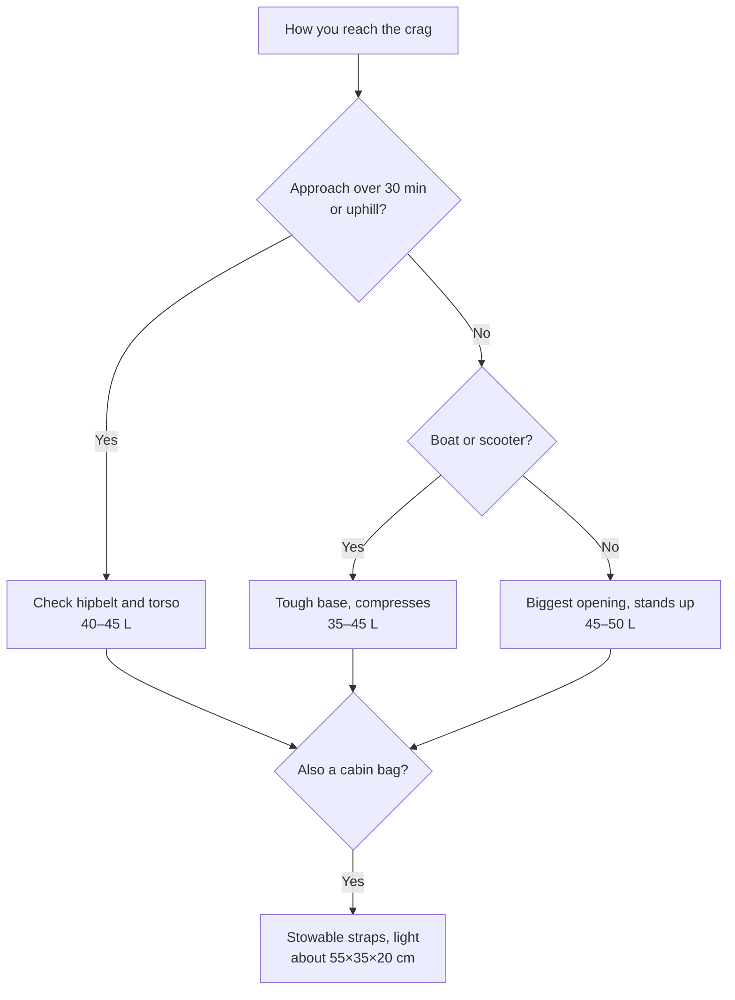

> 🌏 [中文版](/posts/climbing/2026-10-19-climbing-crag-packs)

On a climbing day at Railay in Thailand, the walk from your bungalow to the wall might take fifteen minutes. If you stay in Ao Nang instead, you start each day on a longtail boat. On Kalymnos, many people rent a scooter to reach the crags. The pack on your back works very differently on those days. On a boat or a scooter it has to sit on your lap or stay tight to your body. Once you reach the wall, it has to open wide for the rope, draws, and shoes.

The [previous article](/posts/climbing/2026-10-19-climbing-travel-luggage-en) chose the checked bag and the cabin bag. This one covers the pack you use after landing: the crag pack you carry from your room to the crag and live out of during a single-pitch sport climbing day. It is not a hiking pack. What matters is how easily you can get things in and out at the base of the wall, and it only needs to carry well for the approach. It is written for climbers taking one single rope abroad for sport climbing. By the end you should be able to pick a pack for your approach and load, or decide whether the one you own is good enough. Packs you climb with on multi-pitch routes are a separate question, covered in [Multi-Pitch Climbing Backpacks](/posts/climbing/2026-10-19-multipitch-climbing-backpacks-en).

## Start with how you get to the crag

The right pack depends on how you travel each day. Four common cases:

- **Walking**: The Railay peninsula has no roads, so once you land you walk everywhere. Railay West to Ton Sai is about 15–20 minutes on foot ([The Thailand Guides](https://thethailandguides.com/city/krabi/railay-beach)). If you sleep next to the crag, the harness system matters little. Focus on the opening and the capacity.
- **Longtail boat**: Railay is reachable only by longtail from Ao Nang or Krabi Town. Space on board is tight and spray is likely, so the pack should sit on your lap with a base that shrugs off water and abrasion. Straps and hipbelt that tuck away are less likely to snag when you lift it on and off.
- **Scooter**: On Kalymnos the scooter is the most popular way around, and some crags are a short walk from your room ([theCrag Kalymnos page](https://thecrag.com/en/climbing/greece/kalymnos)). On a scooter the pack stays on your back. A wide, tall pack pulls you backward, so 45 L or less with compression straps rides more steadily.
- **Rental car or songthaew**: The pack goes in the trunk or on the roof, so size matters less. If the approach runs over half an hour with climbing, check whether the hipbelt actually puts the weight on your hips.

In short: short approaches by car or boat favor a big opening and durability; long approaches on foot favor the carrying system.

## Seven criteria

### 1. Opening: full access matters most

Crag packs open in three common ways:

- **Full back-panel opening**: The zip runs around the back panel. Lay the pack straps-up on the ground and open it, and the straps stay out of the dirt. After using the Patagonia Cragsmith 45L, a Climbing reviewer wrote that the back-panel access meant he no longer had to spread his whole pack across the base of the cliff ([Climbing, 2024-02-02](https://www.climbing.com/gear/patagonias-cragsmith-45l/)).
- **Top loader plus a full-length side or front zip**: Black Diamond Creek, Crag 40, and Edelrid PIT. Stuff things in from the top, and unzip the side or front to reach the rope at the bottom.
- **Clamshell or suitcase-style**: The whole pack opens flat. The BD Pipe Dream 45 doubles as a lounge pad at the base of the wall, and the DMM Flight 45 and Tendon Gear Bag 45 have a zip that runs almost all the way around, so they open like a suitcase.

With a top-only pack (the Trango Crag Pack 2.0 or Patagonia Free Wall Pack 44L, for example), getting the rope from the bottom means pulling everything else out first. On a single-pitch day you move between several routes and repack each time, so look for a pack with a second opening.

### 2. Rope tarp: built in, removable, or separate

A rope tarp goes on the ground under the rope to keep sand and dirt off it. Tropical seaside crags often have sandy ground, so a tarp makes a real difference.

The Mammut Neon 45, Grivel Rocker 45, Wild Country Stamina, Climbing Technology Falesia, Petzl KLIFF, La Sportiva Granite 45 Crag, DMM Flight 45, Singing Rock Rocking 40, Tendon Gear Bag 45, and Moon Aerial Pack all come with a tarp. The Trango Crag Pack 2.0 has only a small organizing tarp that won't hold a whole rope. The BD and Patagonia packs and the Rab Rogue 48L don't have one, so bring one (see "Do you need a separate rope bag?" below).

### 3. A base that stands up

A pack that stands on its own is easier to open and fill at the crag. Mammut describes the Neon 45 as a "flat-based standing backpack," and UKClimbing's review lists "stands up on its own" as a plus ([UKClimbing, 2024-09-30](https://www.ukclimbing.com/gear/rucksacks/large/mammut_neon_45_climbing_pack-15909)). BD's Creek packs use haul-bag fabric that gives them a stiff, boxy shape that also stands up.

### 4. Durability

A crag pack gets dropped on limestone, dragged over scree, and shoved under boat seats. The Creek 50 uses waterproof ballistic-nylon haul-bag fabric. The Climbing Technology Falesia has a PVC panel on the side that touches the ground, and the Petzl KLIFF has a hook on the back so the back panel stays off the ground. Light packs like the 941 g Crag 40 are positioned by BD as everyday crag packs; if your pack will be hauled and thrown around, haul-bag fabric like the Creek's is the safer bet.

### 5. Capacity: 35–50 L

When two people share a rope, whoever carries it needs about 45 L. A Climbing reviewer fit a 70 m rope and 15 quickdraws into the Cragsmith 45L, plus a belay device, harness, several pairs of shoes, layers, a water bladder, and lunch, with room to spare ([Climbing, 2024-02-02](https://www.climbing.com/gear/patagonias-cragsmith-45l/)). The partner without the rope gets by with 35 L. If one person carries everything, look at 50 L.

### 6. Carry: hipbelt and torso length

Most crag packs come in a single torso length. UKClimbing's Neon 45 review notes that shorter climbers may find it less comfortable and that its hipbelt has less padding than a comparable Rab pack. The reviewer added that if his local crag meant an hour uphill every day, he might feel differently about it ([UKClimbing](https://www.ukclimbing.com/gear/rucksacks/large/mammut_neon_45_climbing_pack-15909)). For long approaches, choose a model with sizes: the BD Creek 50 comes in S/M and M/L, and the Patagonia Cragsmith 45L and 32L both come in S, M, and L. If you carry heavy loads a long way, the La Sportiva Granite 45 Crag has an aluminum stay, at the cost of 1,470 g empty.

### 7. Empty weight

Empty weights differ by almost 1.3 kg: the Petzl KLIFF is 750 g, the BD Creek 50 is 2 kg. At the crag that hardly matters. As a cabin bag, it comes straight out of a 7 kg allowance; see "Can a crag pack be your cabin bag?" below.

## 23 current models from 17 brands

Prices are list prices on each brand's own site on 2026-10-19, with no currency conversion. Where the brand doesn't list a price, one retailer price is given and marked. The review column only includes third-party reviews from 2020 or later.

| Model | Volume | Empty weight | Opening | Rope tarp | Official price | Review (2020+) | Who it suits / drawbacks |
|---|---|---|---|---|---|---|---|
| [Black Diamond Creek 50](https://blackdiamondequipment.com/products/creek-50-pack) | 50 L | 2 kg | Top + full-length side zip | No (rope strap) | USD 259.95, out of stock | [Switchback Travel 2025](https://www.switchbacktravel.com/best-climbing-backpacks): best cragging pack | Lots of gear, driving to the crag; heaviest here, and one community report has its straps torn up in checked baggage |
| [Black Diamond Crag 40](https://blackdiamondequipment.com/products/crag-40-backpack) | 40 L | 941 g | Top + full-length side zip | No (lid doubles as rope strap) | USD 159.95 | — | Want light and cabin-friendly; no tarp, 10 L less than the Creek 50 |
| [Black Diamond Pipe Dream 45](https://blackdiamondequipment.com/products/pipe-dream-45-backpack) | 45 L | Not listed | Clamshell, opens into a lounge pad | No | USD 199.95, out of stock | Added to Switchback Travel's 2025 list | Like to spread everything out; BD doesn't publish its weight |
| [Mammut Neon 45](https://www.mammut.com/us/en/products/2510-01944/neon-45) | 45 L | 1,500 g | Top + large back-panel zip | Yes, removable | USD 199.95 | [UKClimbing 2024-09-30](https://www.ukclimbing.com/gear/rucksacks/large/mammut_neon_45_climbing_pack-15909) | One pack with tarp and organization built in; single torso length, no side bottle pockets |
| [Patagonia Cragsmith 45L](https://www.patagonia.com/product/cragsmith-pack-45-liters/48066.html) | 45 L | 1,420 g | U-shaped lid + full back panel | No | USD 239 | [Climbing 2024-02-02](https://www.climbing.com/gear/patagonias-cragsmith-45l/) | Longer approaches, need a torso size; stiff shell doesn't compress when half full |
| [Patagonia Cragsmith Pack 32L](https://www.patagonia.com/product/cragsmith-pack-32-liters/48056.html) | 32 L | 1,200 g | Full back panel | No | USD 209 | — | One person, minimal kit, need a torso size (S/M/L); unlike the 45L, no top access and the hipbelt isn't removable |
| [Patagonia Free Wall Pack 44L](https://www.patagonia.com/product/free-wall-pack-44-liters/48745.html) | 44 L | 1,171 g | Top + lid | No | USD 229 | [Climbing's 2026 pack guide](https://www.climbing.com/gear/best-climbing-backpack/): best do-it-all pack | One pack for both single-pitch and multi-pitch days; built for hauling on big walls, top access only |
| [Petzl KLIFF](https://www.petzl.com/us/en/sport/products/rope-bags/kliff/KLIFF_SPO_a2mw0000002G5MVAA0.html) | 36 L | 750 g | Back zip | Yes, 140×140 cm | USD 89.95 | [OutdoorGearLab 2024-07-30](https://www.outdoorgearlab.com/topics/climbing/best-rope-bag): best gym-to-crag rope bag | Short approaches, minimal kit; it's a rope bag at heart, with shoulder and sternum straps only |
| [Edelrid PIT](https://edelrid.com/us-en/sport/backpacks-and-rope-bags-shop/pit) | 35 L | 860 g | Top + full-length front zip | No (external rope strap) | No price on Edelrid's site; Redpoint Climbing USD 99.95 | — | Tight budget, like the haul-bag look; tarp sold separately |
| [Edelrid CRAG JACK](https://edelrid.com/us-en/sport/backpacks-and-rope-bags-shop/crag-jack) | 37 L | 1,250 g | Top or fully open from the side | No | No price on Edelrid's site; BananaFingers USD 111.35 on sale | — | One person's kit, want lots of pockets; heavy for 37 L |
| [Grivel Rocker 45](https://us.grivel.com/products/rocker-45) | 45 L | 1,402 g | Full back panel | Yes | USD 202, new version on preorder | — | Want a tarp plus a hipbelt; retailers are still clearing the old 2,087 g version, so check which one you're buying |
| [Metolius Crag Station Classic](https://metoliusclimbing.com/products/crag-station-classic) | 41 L | 1.2 kg | Duffel-style opening | No | USD 149.95, sold out | — | Driving, need straps that tuck away for checking; 71 cm long, too big for the cabin |
| [Wild Country Stamina Gear Bag](https://wildcountry.com/en-us/stamina-gear-bag-40-0000010003) | 41 L | Not listed | Roll-top + full-length side zip | Yes, removable | USD 124.95 (93.71 on sale on Wild Country's site) | — | One pack for two people's hardware; weight not published |
| [Wild Country Movement Back Pack](https://wildcountry.com/en-us/movement-back-pack-40-0000010042) | 35 L | Not listed | Main zip opens right up | Yes, 135×100 cm | USD 99.95 | — | Shared between gym and crag; fits ropes up to 70 m only |
| [Climbing Technology Falesia](https://climbingtechnology.com/en/outdoor-en/bags-and-backpacks/backpacks/falesia) | 45 L | 1,000 g | Full-length back zip | Yes | Dealer-only, no official price; Oliunìd EUR 61.90 on sale | — | Want a crag pack that's also a cabin bag; webbing hipbelt, basic carry on long approaches |
| [Beal Combi Cliff II](https://beal-planet.com/en/products/combi-cliff-ii) | 35 L | 835 g | Back opening | Yes, 145×90 cm | EUR 80, sold out | — | Want a rope-bag backpack that fits an 80 m rope; sold out on Beal's site |
| [Trango Crag Pack 2.0](https://trango.com/products/crag-pack-2-0) | 45 L | Not listed; The Dihedral lists about 1.4 kg | Haul-bag-style top + lid | Small organizing tarp, not a full rope tarp | USD 119.95 (sold out) | [The Dihedral 2021-11-17](https://thedihedral.com/2021/11/17/trango-crag-pack-2-0) | Tight budget, want a tough haul-bag build; top access only, no side or back opening |
| [La Sportiva Granite 45 Crag](https://www.lasportiva.com/en/backpack-climbing-granite-45-crag-unisex-zecp005) | 45 L | 1,470 g | Drawcord top + back-panel zip | Yes, built in | EUR 160; USD 169 on the US site | — | Want an aluminum stay for heavy loads; heavy for 45 L |
| [Rab Rogue 48L Crag Pack](https://rab.equipment/uk/rab-rogue-48-crag-pack) | 48 L | 1.37 kg | Zip top + back zip | No (rope strap on top) | GBP 140; USD 170 on the US site, out of stock | [UKClimbing 2020-06-05](https://www.ukclimbing.com/gear/rucksacks/lowe_alpine_rogue_48-12783) (reviewed as the Lowe Alpine Rogue 48, before the rename) | Long approaches, some trad climbing; no tarp, out of stock in the US |
| [DMM Flight 45](https://us.dmmwales.com/products/flight-45l) | 45 L | 1,560 g | Suitcase-style, opens fully | Yes, removable | GBP 107; USD 207.49 on the US site | — | Sport climbing with ropes up to 80 m; on the heavy side, and much pricier in the US than in the UK |
| [Singing Rock Rocking 40](https://singingrock.com/rocking) | 40 L | 1,190 g | Top + back-panel zip | Yes, 120×140 cm | No price on Singing Rock's site; Singing Rock USA USD 179.99 | — | Shared between gym and crag; basic hipbelt that stows in a side pocket |
| [Tendon Gear Bag 45](https://mytendon.com/products/gear-bag) | 45 L | Not listed; Oliunìd lists 860 g | Zip runs almost all the way around, opens like a suitcase | Yes, 140×120 cm | Dealer-only; reference price on Tendon's page EUR 133.95 | — | Two people's gear, want a cheap pack with a tarp; 56×34×26 cm, removable seat pad in the back panel, weight not published by Tendon |
| [Moon Aerial Pack](https://moonclimbing.com/aerial-pack.html) | 38 L | 1.2 kg | Roll-top + vertical front center zip | Yes, removable | GBP 120; Jet Black colorway GBP 75 on sale | — | Want a simple pack with few dangly bits; tight for two people's gear at 38 L |

Some names still common in older recommendations are no longer current. Mystery Ranch's Tower 47 page has been taken down, Mammut marks the Neon Gear 45 as no longer available (the Neon 45 replaces it), and Metolius lists the Freerider as being discontinued. Used or clearance units are fine buys, but don't use them as the baseline for comparing new packs.

## Packing for two on a single-pitch day

Say two climbers spend a sport climbing day on Kalymnos or at Railay and share one 70 m single rope. Following [the destination gear list](/posts/climbing/2026-10-19-climbing-trip-gear-list-by-destination-en), they bring about 14 quickdraws.

**A's 45 L pack (shared hardware)**

- 70 m single rope: a Petzl Volta 9.2 weighs 55 g per meter, so about 3.85 kg for the whole rope ([Petzl](https://www.petzl.com/US/en/Sport/Ropes/VOLTA-9-2-mm))
- 14 quickdraws, plus carabiners and slings for top-rope anchors
- Own harness, shoes, belay device, chalk bag
- Rope tarp (skip it if the pack has one built in)

**B's 35 L pack (water, food, layers)**

- Water for both climbers for the whole day
- Lunch and snacks for two
- Two windproof jackets (belaying at the base gets cold)
- Own harness, shoes, belay device, first-aid kit, headlamp, sunscreen

Keeping the rope and draws in one pack means only one pack moves between routes. Water is the heaviest consumable, so B's pack gets lighter through the day and can take some hardware on the walk out. Helmets clip to the outside and don't use up volume.

If only one of you owns a crag pack, the other can carry water and layers in an everyday backpack. Only the hardware pack needs the big opening and the tarp.

## Do you need a separate rope bag?

If your pack has no tarp (BD, Patagonia, Rab Rogue 48L, Edelrid PIT and Crag Jack, Metolius), bring a light one. The Edelrid Dirt Bag weighs 110 g and costs EUR 25. The Metolius Dirt Bag II is USD 39.95 with a 132×147 cm tarp, and OutdoorGearLab named it the best value rope bag ([OutdoorGearLab, 2024-07-30](https://www.outdoorgearlab.com/topics/climbing/best-rope-bag)). If your pack already has a removable tarp, leave the extra one at home.

## Can a crag pack be your cabin bag?

Climbers often use a crag pack as their cabin bag. The three conditions (size, the 7 kg and 10 kg weight limits, and security opening the bag) are covered in [Checked Bags and Cabin Bags](/posts/climbing/2026-10-19-climbing-travel-luggage-en). Here is how the models compared above fit:

- **Designed to cabin size**: the Climbing Technology Falesia (55×35×20 cm, straps and hipbelt stow in pockets) and the Wild Country Stamina (55×32×21 cm). UKClimbing also notes the Neon 45 fits in overhead bins.
- **Light empty, leaving more allowance for gear**: KLIFF 750 g, Crag 40 941 g, Falesia 1,000 g. An empty Creek 50 already weighs 2 kg.
- **Won't compress**: Climbing's reviewer points out that the Cragsmith 45L's stiff shell won't cinch down when it isn't full; a roll-top with compression straps, like the Stamina, is easier to adjust.
- **A reason not to check it**: in a 2023 European sport trip, a friend's Creek 50 went in the hold and came back with its straps torn up (see [How Climbers Pack for Trips Abroad](/posts/climbing/2026-10-19-climbing-travel-packing-examples-en)).

## How to choose: three steps

1. **Write down your approach.** Open the crag information for your destination and check how long it takes to reach the area you'll climb most, and how you get there. If it's over 30 minutes uphill, put carry and torso fit first. If you'll go by boat, scooter, or car, put the opening and durability first.
2. **Lay both climbers' gear on the floor in two piles.** Hardware in one pile, water and layers in the other, then see whether the hardware pile needs 45 L or 50 L. If you already own a 35–40 L everyday pack, you only need to add one crag pack for the hardware.
3. **Decide whether it doubles as a cabin bag.** If so, choose from packs under 1 kg empty with stowable straps. If not, pick the most durable pack for your approach and pack it inside your checked bag to protect the straps.

For choosing shoes, harnesses, and helmets themselves, see [Climbing Shoes](/posts/climbing/2026-10-19-climbing-shoes-en) and [Harnesses](/posts/climbing/2026-10-24-climbing-harness-en), [Helmets](/posts/climbing/2026-10-24-climbing-helmet-en) in the Climbing Gear series. For multi-pitch routes, the next article covers [Multi-Pitch Climbing Backpacks](/posts/climbing/2026-10-19-multipitch-climbing-backpacks-en).

## Update Log

- 2026-10-19: Added 9 models to the current-models table (Patagonia Cragsmith 32L and Free Wall Pack 44L, Trango, La Sportiva, Rab, DMM, Singing Rock, Tendon, Moon), bringing it from 10 brands to 17, and worked the new packs into the opening, rope tarp, and carry sections. Checked specs against brand data and fixed 7 items.

## References

- [Black Diamond Creek 50](https://blackdiamondequipment.com/products/creek-50-pack)
- [Black Diamond Crag 40](https://blackdiamondequipment.com/products/crag-40-backpack)
- [Black Diamond Pipe Dream 45](https://blackdiamondequipment.com/products/pipe-dream-45-backpack)
- [Mammut Neon 45](https://www.mammut.com/us/en/products/2510-01944/neon-45)
- [Patagonia Cragsmith Pack 45L](https://www.patagonia.com/product/cragsmith-pack-45-liters/48066.html)
- [Petzl KLIFF](https://www.petzl.com/us/en/sport/products/rope-bags/kliff/KLIFF_SPO_a2mw0000002G5MVAA0.html)
- [Petzl Volta 9.2](https://www.petzl.com/US/en/Sport/Ropes/VOLTA-9-2-mm)
- [Edelrid PIT](https://edelrid.com/us-en/sport/backpacks-and-rope-bags-shop/pit)
- [Edelrid CRAG JACK](https://edelrid.com/us-en/sport/backpacks-and-rope-bags-shop/crag-jack)
- [Edelrid Dirt Bag](https://edelrid.com/eu-en/sport/backpacks-and-rope-bags-shop/dirt-bag)
- [Grivel Rocker 45](https://us.grivel.com/products/rocker-45)
- [Metolius Crag Station Classic](https://metoliusclimbing.com/products/crag-station-classic)
- [Metolius Dirt Bag II](https://metoliusclimbing.com/collections/rope-bags/products/dirt-bag-ii-rope-bag)
- [Wild Country Stamina Gear Bag](https://wildcountry.com/en-us/stamina-gear-bag-40-0000010003)
- [Wild Country Movement Back Pack](https://wildcountry.com/en-us/movement-back-pack-40-0000010042)
- [Climbing Technology Falesia](https://climbingtechnology.com/en/outdoor-en/bags-and-backpacks/backpacks/falesia)
- [Beal Combi Cliff II](https://beal-planet.com/en/products/combi-cliff-ii)
- [Patagonia Cragsmith Pack 32L](https://www.patagonia.com/product/cragsmith-pack-32-liters/48056.html)
- [Patagonia: Free Wall Pack 44L](https://www.patagonia.com/product/free-wall-pack-44-liters/48745.html)
- [Trango Crag Pack 2.0](https://trango.com/products/crag-pack-2-0)
- [La Sportiva Granite 45 Crag](https://www.lasportiva.com/en/backpack-climbing-granite-45-crag-unisex-zecp005)
- [Rab Rogue 48L Crag Pack](https://rab.equipment/uk/rab-rogue-48-crag-pack)
- [DMM Flight 45](https://us.dmmwales.com/products/flight-45l)
- [Singing Rock Rocking 40](https://singingrock.com/rocking)
- [Singing Rock USA: Rocking 40L Crag Bag](https://singingrock-usa.com/climbing/singing-rock-rocking-40l-crag-bag.html)
- [Tendon Gear Bag 45](https://mytendon.com/products/gear-bag)
- [Oliunìd: Tendon Gear Bag 45 L](https://www.oliunid.com/tendon-gear-bag-45-l-crag-climbing-backpack)
- [Moon Aerial Pack](https://moonclimbing.com/aerial-pack.html)
- [Switchback Travel: Best Climbing Backpacks](https://www.switchbacktravel.com/best-climbing-backpacks)
- [Climbing: The Best Climbing Backpacks (2026)](https://www.climbing.com/gear/best-climbing-backpack/)
- [The Dihedral: Trango Crag Pack 2.0 (2021-11-17)](https://thedihedral.com/2021/11/17/trango-crag-pack-2-0)
- [UKClimbing: Lowe Alpine Rogue 48 review (2020-06-05)](https://www.ukclimbing.com/gear/rucksacks/lowe_alpine_rogue_48-12783)
- [UKClimbing: Mammut Neon 45 review (2024-09-30)](https://www.ukclimbing.com/gear/rucksacks/large/mammut_neon_45_climbing_pack-15909)
- [Climbing: Patagonia Cragsmith 45L review (2024-02-02)](https://www.climbing.com/gear/patagonias-cragsmith-45l/)
- [OutdoorGearLab: The Best Rope Bags for Climbing (2024-07-30)](https://www.outdoorgearlab.com/topics/climbing/best-rope-bag)
- [The Thailand Guides: Railay Beach](https://thethailandguides.com/city/krabi/railay-beach)
- [theCrag: Kalymnos](https://thecrag.com/en/climbing/greece/kalymnos)
