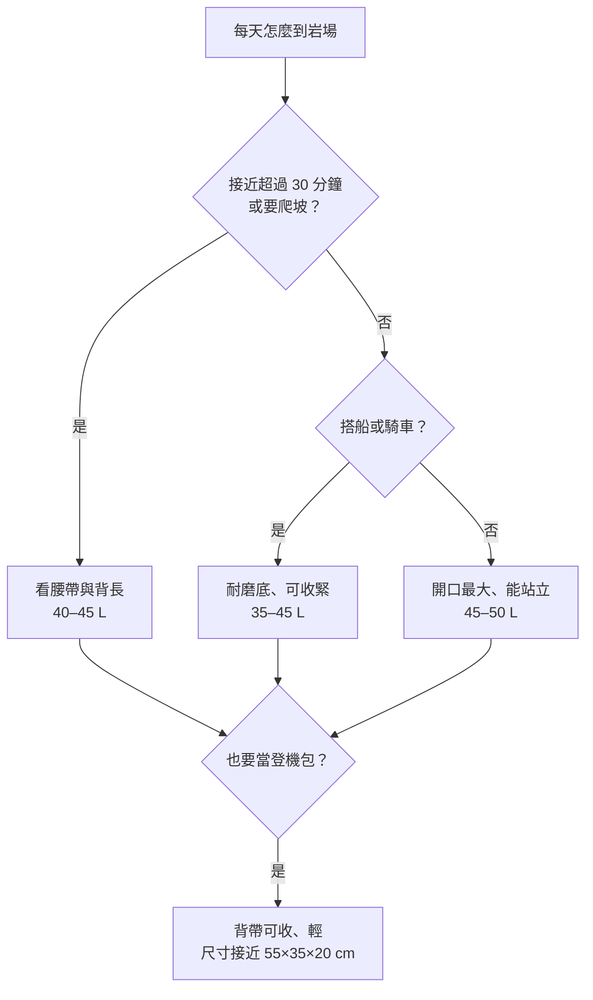

> 🌏 [English version](/posts/climbing/2026-10-19-climbing-crag-packs-en)

在泰國萊利（Railay）爬一天，住宿到岩壁可能只要走十幾分鐘；但如果住在奧南（Ao Nang），每天得先搭長尾船過去。在卡林諾斯，很多人租機車到岩場。這兩種日子，背在身上的包差很多：搭船和騎車時包要能抱在身上、不能太大；走到岩壁之後，它又要能攤開來放繩、快扣和鞋。

[上一篇](/posts/climbing/2026-10-19-climbing-travel-luggage)選好托運主袋和登機包，這篇接著處理落地之後那個包：每天從住宿背到岩場、單繩距運動攀登一整天用的岩場包（crag pack）。它跟登山背包不一樣，重點是在岩壁下好拿好放，背負只要撐過接近路段。這篇寫給準備帶一條單繩出國運攀的人；讀完，你應該能依自己的接近方式和裝載量選出一個包，或判斷手上那個包夠不夠用。背上岩壁的多繩距小包是另一個問題，見[多繩距攀登包](/posts/climbing/2026-10-19-multipitch-climbing-backpacks)。

## 先看住宿到岩場怎麼走

包型取決於你每天怎麼移動。以四個常見情況來說：

- **步行**：萊利半島沒有道路，上岸之後到哪裡都靠走路。從 Railay West 走到 Ton Sai 約 15–20 分鐘（[The Thailand Guides](https://thethailandguides.com/city/krabi/railay-beach)）。住在岩場旁邊時，背負系統不必講究，重點是開口和容量。
- **長尾船**：萊利只能從奧南或喀比鎮搭長尾船進出。船上空間小、可能濺濕，包要能抱在腿上，底部最好耐水、耐磨。背帶和腰帶能收好，搬上搬下比較不會勾到東西。
- **機車**：卡林諾斯最多人選的交通方式是機車，有些岩場從住宿走路就到（[theCrag 卡林諾斯頁](https://thecrag.com/en/climbing/greece/kalymnos)）。騎車時包背在身上，太寬太高會拉著你後仰，45 L 以下、能用壓縮帶收緊的包比較穩。
- **租車或雙條車**：包放後車廂或車頂，大小不太受限。接近路段如果超過半小時、還要爬坡，就要看腰帶能不能把重量放到髖部上。

一句話：接近短、靠車或船，挑大開口和耐磨；接近長、靠走路，挑背負系統。

## 七個判準

### 1. 開口：能整面打開比較重要

岩場包最常見的開口有三種：

- **背板全開**：拉鍊沿背板一圈，把包背面朝上放在地上打開，背帶不會沾土。Climbing 的評測者用了 Patagonia Cragsmith 45L 之後的感想是，背板開口讓他第一次不用把整包東西倒在岩壁下（[Climbing，2024-02-02](https://www.climbing.com/gear/patagonias-cragsmith-45l/)）。
- **頂開加側邊或前面全長拉鍊**：像 Black Diamond Creek、Crag 40 和 Edelrid PIT，頂部塞東西快，側邊或前面拉開可以拿底層的繩。
- **蛤殼式（clamshell）或行李箱式**：整個包能攤平，BD Pipe Dream 45 打開後可以當岩壁下的休息墊；DMM Flight 45 和 Tendon Gear Bag 45 的拉鍊繞將近一整圈，像行李箱一樣掀開。

只有頂開的包（例如 Trango Crag Pack 2.0、Patagonia Free Wall Pack 44L），要拿最底下的繩就得先把上面的東西全部拿出來。單繩距一天會在好幾條路線之間移動，每次都要重新整理，所以盡量挑有第二個開口的款式。

### 2. 繩布：內建、可拆，或另外帶

繩布（rope tarp）鋪在地上放繩，免得繩沾沙土。熱帶海邊的岩場地面常是沙，有塊布差很多。

附繩布的有 Mammut Neon 45、Grivel Rocker 45、Wild Country Stamina、Climbing Technology Falesia、Petzl KLIFF、La Sportiva Granite 45 Crag、DMM Flight 45、Singing Rock Rocking 40、Tendon Gear Bag 45 和 Moon Aerial Pack。Trango Crag Pack 2.0 附的是一塊小整理布，鋪不下整條繩。BD、Patagonia 和 Rab Rogue 48L 沒有，要另外帶（見後面「繩袋要不要另外帶」）。

### 3. 站立底部

能自己站好的包，在岩壁下打開、裝東西都方便。Mammut 寫明 Neon 45 是「平底、可站立」的款式，UKClimbing 的評測也把「能自己站著」列為優點（[UKClimbing，2024-09-30](https://www.ukclimbing.com/gear/rucksacks/large/mammut_neon_45_climbing_pack-15909)）。BD Creek 系列用拖包（haul bag）布料做出硬挺的箱型，也能站立。

### 4. 耐磨

岩場包會被丟在石灰岩上、拖過碎石、塞進船底。Creek 50 用的是防水的彈道尼龍（ballistic nylon）拖包布。Climbing Technology Falesia 在貼地那一面用 PVC 布，Petzl KLIFF 背面有一個鉤子讓背板不碰地。輕量款像 Crag 40 只有 941 g，BD 把它定位成日常用的岩場包，要拖要摔的話，Creek 這類拖包布料比較放心。

### 5. 容量：35–50 L

兩人共用一條繩時，裝繩的那個人需要 45 L 左右。Climbing 的評測者在 Cragsmith 45L 裡裝進一條 70 m 繩和 15 支快扣，再加上確保器、吊帶、幾雙鞋、外套、水袋和午餐，還有餘裕（[Climbing，2024-02-02](https://www.climbing.com/gear/patagonias-cragsmith-45l/)）。另一個人不揹繩，35 L 就夠。一個人包下全部時，看 50 L。

### 6. 背負：腰帶與背長

多數岩場包只有一種背長。UKClimbing 評 Neon 45 時提到，身材較矮的人可能背起來不太舒服，腰帶襯墊也不如 Rab 的同類款。評測者說，如果每天要上坡走一小時，他對這個包的看法可能就不同了（[UKClimbing](https://www.ukclimbing.com/gear/rucksacks/large/mammut_neon_45_climbing_pack-15909)）。接近長的行程，挑有尺寸可選的款式：BD Creek 50 分 S/M 和 M/L，Patagonia Cragsmith 45L 和 32L 都分 S、M、L 三個尺寸。裝得重又要走遠，La Sportiva Granite 45 Crag 有鋁條背架，代價是 1,470 g 的空重。

### 7. 空重

空包重量差了將近 1.3 kg：Petzl KLIFF 750 g，BD Creek 50 是 2 kg。只在岩場用時差別不大，但想把它當登機包，這個重量會直接吃掉 7 kg 的額度，後面「岩場包能不能當登機包」細講。

## 17 個品牌、23 款現行款

價格是 2026-10-19 在各品牌官網查到的標價，不換算台幣；原廠沒有標價的，列一家零售價並註明。評測欄只收 2020 年以後的第三方評測。

| 型號 | 容量 | 空重 | 開口 | 繩布 | 官方價格 | 2020 後評測 | 適合誰／缺點 |
|---|---|---|---|---|---|---|---|
| [Black Diamond Creek 50](https://blackdiamondequipment.com/products/creek-50-pack) | 50 L | 2 kg | 頂開＋側邊全長拉鍊 | 無（有繩帶） | USD 259.95，缺貨 | [Switchback Travel 2025](https://www.switchbacktravel.com/best-climbing-backpacks) 選為最佳岩場包 | 裝備多、開車到岩場的人；最重，社群有托運時背帶被扯壞的實例 |
| [Black Diamond Crag 40](https://blackdiamondequipment.com/products/crag-40-backpack) | 40 L | 941 g | 頂開＋側邊全長拉鍊 | 無（頂蓋兼繩帶） | USD 159.95 | — | 想要輕、能兼登機包的人；沒有繩布，容量比 Creek 50 少 10 L |
| [Black Diamond Pipe Dream 45](https://blackdiamondequipment.com/products/pipe-dream-45-backpack) | 45 L | 原廠未標 | 蛤殼式，可攤開當休息墊 | 無 | USD 199.95，缺貨 | Switchback Travel 2025 版新增 | 喜歡整包攤開的人；原廠沒公布空重 |
| [Mammut Neon 45](https://www.mammut.com/us/en/products/2510-01944/neon-45) | 45 L | 1,500 g | 頂開＋背板大拉鍊 | 有，可拆 | USD 199.95 | [UKClimbing 2024-09-30](https://www.ukclimbing.com/gear/rucksacks/large/mammut_neon_45_climbing_pack-15909) | 想要一個包解決繩布和整理的人；單一背長，沒有側邊水壺袋 |
| [Patagonia Cragsmith 45L](https://www.patagonia.com/product/cragsmith-pack-45-liters/48066.html) | 45 L | 1,420 g | U 型頂蓋＋背板全開 | 無 | USD 239 | [Climbing 2024-02-02](https://www.climbing.com/gear/patagonias-cragsmith-45l/) | 接近較長、需要選背長的人；外層硬，沒裝滿也壓不小 |
| [Patagonia Cragsmith Pack 32L](https://www.patagonia.com/product/cragsmith-pack-32-liters/48056.html) | 32 L | 1,200 g | 背板全開 | 無 | USD 209 | — | 一人份、裝備精簡、要選背長（S/M/L）的人；跟 45L 版不同，沒有頂開，腰帶也不能拆 |
| [Patagonia Free Wall Pack 44L](https://www.patagonia.com/product/free-wall-pack-44-liters/48745.html) | 44 L | 1,171 g | 頂開＋頂蓋 | 無 | USD 229 | [Climbing 2026 背包選購指南](https://www.climbing.com/gear/best-climbing-backpack/) 選為「一包到底」最佳 | 單繩距和多繩距都想用同一個包的人；為大岩壁拖吊設計，只能從上面掏 |
| [Petzl KLIFF](https://www.petzl.com/us/en/sport/products/rope-bags/kliff/KLIFF_SPO_a2mw0000002G5MVAA0.html) | 36 L | 750 g | 背面拉鍊 | 有，140×140 cm | USD 89.95 | [OutdoorGearLab 2024-07-30](https://www.outdoorgearlab.com/topics/climbing/best-rope-bag) 選為岩館到岩場最佳繩袋 | 接近短、裝備精簡的人；本質是繩袋，背負只有肩帶和胸帶 |
| [Edelrid PIT](https://edelrid.com/us-en/sport/backpacks-and-rope-bags-shop/pit) | 35 L | 860 g | 頂開＋前面全長拉鍊 | 無（外掛繩帶） | 官網未標價；Redpoint Climbing USD 99.95 | — | 預算有限、想要拖包外型的人；繩布要另帶 |
| [Edelrid CRAG JACK](https://edelrid.com/us-en/sport/backpacks-and-rope-bags-shop/crag-jack) | 37 L | 1,250 g | 頂開或側面全開 | 無 | 官網未標價；BananaFingers 特價 USD 111.35 | — | 一人份裝備、需要很多口袋的人；以 37 L 來說偏重 |
| [Grivel Rocker 45](https://us.grivel.com/products/rocker-45) | 45 L | 1,402 g | 背板全開 | 有 | USD 202，新版預購 | — | 想要繩布＋腰帶的人；零售店還在清的舊版重 2,087 g，買前看清楚版本 |
| [Metolius Crag Station Classic](https://metoliusclimbing.com/products/crag-station-classic) | 41 L | 1.2 kg | 旅行袋式開口 | 無 | USD 149.95，售完 | — | 開車、背帶要能收起來托運的人；長 71 cm，不適合當登機包 |
| [Wild Country Stamina Gear Bag](https://wildcountry.com/en-us/stamina-gear-bag-40-0000010003) | 41 L | 原廠未標 | 捲頂＋側邊全長拉鍊 | 有，可拆 | USD 124.95（官網特價 93.71） | — | 兩人份硬體都要一包背的人；空重沒公布 |
| [Wild Country Movement Back Pack](https://wildcountry.com/en-us/movement-back-pack-40-0000010042) | 35 L | 原廠未標 | 主拉鍊整面打開 | 有，135×100 cm | USD 99.95 | — | 岩館和岩場共用的人；只裝得下 70 m 以下的繩 |
| [Climbing Technology Falesia](https://climbingtechnology.com/en/outdoor-en/bags-and-backpacks/backpacks/falesia) | 45 L | 1,000 g | 背面全長拉鍊 | 有 | 經銷通路，原廠未標價；Oliunìd 特價 EUR 61.90 | — | 想兼登機包的人；腰帶是織帶款，接近長的行程背負較陽春 |
| [Beal Combi Cliff II](https://beal-planet.com/en/products/combi-cliff-ii) | 35 L | 835 g | 背面開口 | 有，145×90 cm | EUR 80，售完 | — | 想要繩袋式背包、繩長到 80 m 的人；官網售完 |
| [Trango Crag Pack 2.0](https://trango.com/products/crag-pack-2-0) | 45 L | 原廠未標；The Dihedral 標約 1.4 kg | 拖包式頂開＋頂蓋 | 小塊整理布，不是全尺寸繩布 | USD 119.95（缺貨） | [The Dihedral 2021-11-17](https://thedihedral.com/2021/11/17/trango-crag-pack-2-0) | 預算有限、想要耐磨拖包外型的人；只能從上面掏，沒有側開或背開 |
| [La Sportiva Granite 45 Crag](https://www.lasportiva.com/en/backpack-climbing-granite-45-crag-unisex-zecp005) | 45 L | 1,470 g | 抽繩頂開＋背板拉鍊 | 有，內建 | EUR 160；美國官網 USD 169 | — | 想要鋁條背架、背得重的人；以 45 L 來說偏重 |
| [Rab Rogue 48L Crag Pack](https://rab.equipment/uk/rab-rogue-48-crag-pack) | 48 L | 1.37 kg | 拉鍊頂開＋背面拉鍊 | 無（頂部繩帶） | GBP 140；美國官網 USD 170，缺貨 | [UKClimbing 2020-06-05](https://www.ukclimbing.com/gear/rucksacks/lowe_alpine_rogue_48-12783)（評的是改名前的 Lowe Alpine Rogue 48） | 接近長、兼爬傳統攀登的人；沒有繩布，美國缺貨 |
| [DMM Flight 45](https://us.dmmwales.com/products/flight-45l) | 45 L | 1,560 g | 行李箱式整面打開 | 有，可拆 | GBP 107；美國官網 USD 207.49 | — | 運動攀登、繩長到 80 m 的人；偏重，美國售價比英國高很多 |
| [Singing Rock Rocking 40](https://singingrock.com/rocking) | 40 L | 1,190 g | 頂開＋背板拉鍊 | 有，120×140 cm | 原廠未標價；美國代理 Singing Rock USA USD 179.99 | — | 岩館和岩場共用的人；腰帶是簡易款，可以收進側袋 |
| [Tendon Gear Bag 45](https://mytendon.com/products/gear-bag) | 45 L | 原廠未標；Oliunìd 標 860 g | 拉鍊繞將近一整圈，像行李箱打開 | 有，140×120 cm | 經銷通路；原廠頁經銷參考價 EUR 133.95 | — | 兩人份裝備、想要便宜又有繩布的人；尺寸 56×34×26 cm，背板附可拆坐墊，原廠不公布空重 |
| [Moon Aerial Pack](https://moonclimbing.com/aerial-pack.html) | 38 L | 1.2 kg | 捲頂＋正面中央直拉鍊 | 有，可拆 | GBP 120；Jet Black 配色特價 GBP 75 | — | 想要簡單、少掛件的人；38 L 裝兩人份會很擠 |

幾個名字在舊的推薦文裡很常見，現在已經不是現行款。Mystery Ranch Tower 47 原廠頁面已下架，Mammut Neon Gear 45 官網標示不再販售（Neon 45 是後繼款），Metolius Freerider 官網寫著停產中。二手或出清可以撿，但別當成新品比較的基準。

## 兩人單繩距一天怎麼裝

假設兩個人去卡林諾斯或萊利爬一天運動攀登，共用一條 70 m 單繩。快扣數照[依目的地列清單](/posts/climbing/2026-10-19-climbing-trip-gear-list-by-destination)的建議帶 14 支左右。

**A 的 45 L 包（揹公用硬體）**

- 70 m 單繩：以 Petzl Volta 9.2 為例，每公尺 55 g，整條約 3.85 kg（[Petzl](https://www.petzl.com/US/en/Sport/Ropes/VOLTA-9-2-mm)）
- 14 支快扣、架設頂繩用的鉤環與扁帶
- 自己的吊帶、鞋、確保器、粉袋
- 繩布（包有內建就省下這件）

**B 的 35 L 包（揹水、食物、衣服）**

- 兩人一整天的水
- 兩人的午餐和行動糧
- 兩件防風外套（岩壁下等確保時會冷）
- 自己的吊帶、鞋、確保器、急救包、頭燈、防曬

繩和快扣集中在一個包裡，換路線時只要搬一個包。水是最重的消耗品，喝掉之後 B 的包會越來越輕，回程可以分擔一部分硬體。頭盔掛在外面就好，不必占容量。

如果只有一個人有岩場包，另一個人用日常背包裝水和衣服也行；硬體集中的那個包，才需要大開口和繩布。

## 繩袋要不要另外帶

包裡沒有繩布（BD、Patagonia、Rab Rogue 48L、Edelrid PIT、Crag Jack、Metolius），就帶一塊輕的。Edelrid Dirt Bag 只有 110 g、EUR 25。Metolius Dirt Bag II 是 USD 39.95，附一塊 132×147 cm 的布，OutdoorGearLab 選它當 CP 值最高的繩袋（[OutdoorGearLab，2024-07-30](https://www.outdoorgearlab.com/topics/climbing/best-rope-bag)）。包已經有可拆繩布，就不用再帶。

## 岩場包能不能當登機包

把岩場包當登機包很常見，尺寸、7 kg 與 10 kg 的重量限制、安檢翻包這三個條件整理在[〈托運主袋與登機包〉](/posts/climbing/2026-10-19-climbing-travel-luggage)。這裡只看上面比較的款式各自適不適合：

- **照登機尺寸設計的**：Climbing Technology Falesia（55×35×20 cm，背帶和腰帶能收進口袋）、Wild Country Stamina（55×32×21 cm）。UKClimbing 也提到 Neon 45 放得進頭頂行李櫃。
- **空重輕、留給裝備的額度多**：KLIFF 750 g、Crag 40 941 g、Falesia 1,000 g。Creek 50 空包就 2 kg，當登機包會吃掉不少額度。
- **壓不小的**：Climbing 的評測者指出 Cragsmith 45L 外層硬，沒裝滿也縮不了；捲頂加壓縮帶的款式（例如 Stamina）比較好調整。
- **不想放托運的理由**：2023 年一個歐洲運攀實例中，朋友的 Creek 50 塞進托運，背帶被地勤扯壞（見[〈攀岩者怎麼打包出國〉](/posts/climbing/2026-10-19-climbing-travel-packing-examples)）。

## 怎麼挑：三個步驟

1. **寫下你的接近方式。** 打開目的地的岩場資訊，看住宿到最常去的岩區要走多久、搭什麼。超過 30 分鐘要爬坡，把背負和背長排第一；搭船、騎車或開車，把開口和耐磨排第一。
2. **把兩人的裝備攤在地上分成兩堆。** 硬體一堆、水和衣服一堆，看硬體那堆需要 45 L 還是 50 L。手上已經有 35–40 L 的日常背包，就只要再補一個裝硬體的岩場包。
3. **決定要不要兼登機包。** 要的話，從空重 1 kg 以下、背帶能收的款式裡挑；不要的話，就照接近方式選最耐用的那個，塞進托運主袋裡保護背帶。

鞋、吊帶、頭盔本身怎麼挑，交給「攀岩裝備」系列的[攀岩鞋](/posts/climbing/2026-10-19-climbing-shoes)與[吊帶和頭盔](/posts/climbing/2026-10-19-climbing-harness-helmet)。要上多繩距，下一篇講[多繩距攀登包](/posts/climbing/2026-10-19-multipitch-climbing-backpacks)。

## 更新紀錄

- 2026-10-19：現行款表格新增 9 款（Patagonia Cragsmith 32L、Free Wall Pack 44L、Trango、La Sportiva、Rab、DMM、Singing Rock、Tendon、Moon），品牌數從 10 個增為 17 個，並把新款併入開口、繩布、背負段落。依原廠資料核對規格，修正 7 處。

## 參考資料

- [Black Diamond Creek 50](https://blackdiamondequipment.com/products/creek-50-pack)
- [Black Diamond Crag 40](https://blackdiamondequipment.com/products/crag-40-backpack)
- [Black Diamond Pipe Dream 45](https://blackdiamondequipment.com/products/pipe-dream-45-backpack)
- [Mammut Neon 45](https://www.mammut.com/us/en/products/2510-01944/neon-45)
- [Patagonia Cragsmith Pack 45L](https://www.patagonia.com/product/cragsmith-pack-45-liters/48066.html)
- [Petzl KLIFF](https://www.petzl.com/us/en/sport/products/rope-bags/kliff/KLIFF_SPO_a2mw0000002G5MVAA0.html)
- [Petzl Volta 9.2](https://www.petzl.com/US/en/Sport/Ropes/VOLTA-9-2-mm)
- [Edelrid PIT](https://edelrid.com/us-en/sport/backpacks-and-rope-bags-shop/pit)
- [Edelrid CRAG JACK](https://edelrid.com/us-en/sport/backpacks-and-rope-bags-shop/crag-jack)
- [Edelrid Dirt Bag](https://edelrid.com/eu-en/sport/backpacks-and-rope-bags-shop/dirt-bag)
- [Grivel Rocker 45](https://us.grivel.com/products/rocker-45)
- [Metolius Crag Station Classic](https://metoliusclimbing.com/products/crag-station-classic)
- [Metolius Dirt Bag II](https://metoliusclimbing.com/collections/rope-bags/products/dirt-bag-ii-rope-bag)
- [Wild Country Stamina Gear Bag](https://wildcountry.com/en-us/stamina-gear-bag-40-0000010003)
- [Wild Country Movement Back Pack](https://wildcountry.com/en-us/movement-back-pack-40-0000010042)
- [Climbing Technology Falesia](https://climbingtechnology.com/en/outdoor-en/bags-and-backpacks/backpacks/falesia)
- [Beal Combi Cliff II](https://beal-planet.com/en/products/combi-cliff-ii)
- [Patagonia Cragsmith Pack 32L](https://www.patagonia.com/product/cragsmith-pack-32-liters/48056.html)
- [Patagonia：Free Wall Pack 44L](https://www.patagonia.com/product/free-wall-pack-44-liters/48745.html)
- [Trango Crag Pack 2.0](https://trango.com/products/crag-pack-2-0)
- [La Sportiva Granite 45 Crag](https://www.lasportiva.com/en/backpack-climbing-granite-45-crag-unisex-zecp005)
- [Rab Rogue 48L Crag Pack](https://rab.equipment/uk/rab-rogue-48-crag-pack)
- [DMM Flight 45](https://us.dmmwales.com/products/flight-45l)
- [Singing Rock Rocking 40](https://singingrock.com/rocking)
- [Singing Rock USA：Rocking 40L Crag Bag](https://singingrock-usa.com/climbing/singing-rock-rocking-40l-crag-bag.html)
- [Tendon Gear Bag 45](https://mytendon.com/products/gear-bag)
- [Oliunìd：Tendon Gear Bag 45 L](https://www.oliunid.com/tendon-gear-bag-45-l-crag-climbing-backpack)
- [Moon Aerial Pack](https://moonclimbing.com/aerial-pack.html)
- [Switchback Travel：Best Climbing Backpacks](https://www.switchbacktravel.com/best-climbing-backpacks)
- [Climbing：The Best Climbing Backpacks（2026）](https://www.climbing.com/gear/best-climbing-backpack/)
- [The Dihedral：Trango Crag Pack 2.0（2021-11-17）](https://thedihedral.com/2021/11/17/trango-crag-pack-2-0)
- [UKClimbing：Lowe Alpine Rogue 48 評測（2020-06-05）](https://www.ukclimbing.com/gear/rucksacks/lowe_alpine_rogue_48-12783)
- [UKClimbing：Mammut Neon 45 評測（2024-09-30）](https://www.ukclimbing.com/gear/rucksacks/large/mammut_neon_45_climbing_pack-15909)
- [Climbing：Patagonia Cragsmith 45L 評測（2024-02-02）](https://www.climbing.com/gear/patagonias-cragsmith-45l/)
- [OutdoorGearLab：The Best Rope Bags for Climbing（2024-07-30）](https://www.outdoorgearlab.com/topics/climbing/best-rope-bag)
- [The Thailand Guides：Railay Beach](https://thethailandguides.com/city/krabi/railay-beach)
- [theCrag：Kalymnos](https://thecrag.com/en/climbing/greece/kalymnos)
